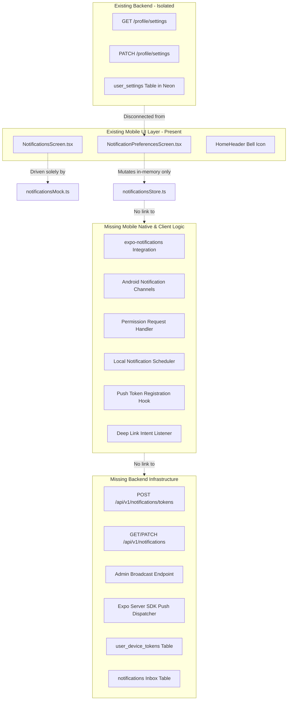
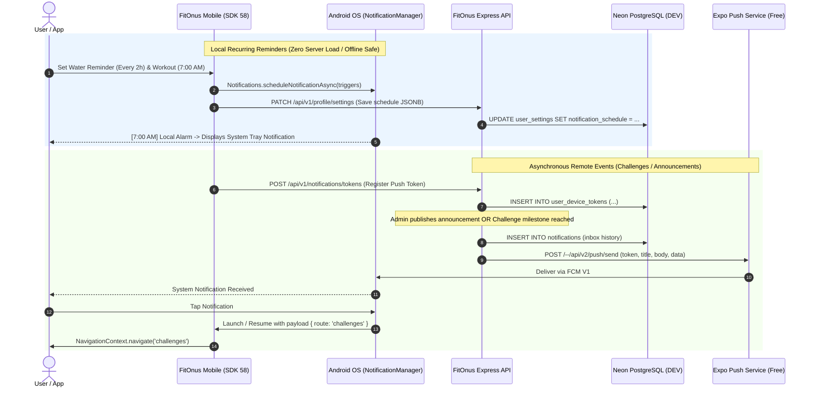

# FITONUS — COMPLETE NOTIFICATION SYSTEM AUDIT & ARCHITECTURE SPECIFICATION

**Author:** Senior Expo SDK 58 Engineer, Backend Architect & Notification Systems Specialist  
**Target Environment:** Expo SDK 58 (React Native 0.88.1, React 19.3.0) | Node.js 22 Express 5 Monolith | Neon PostgreSQL (DEV)  
**Project Root:** `/media/devshan/Study_Drive/Info/Projects/TuneOnus/FitOnus`  
**Date of Audit:** November 9, 2026  
**Audit Mode:** Read-Only Source & Schema Inspection (Zero Code/Database Modifications)  
**Output Document:** `FITONUS_NOTIFICATION_SYSTEM_AUDIT.md`

---

## 1. Executive Summary

FitOnus possesses an aesthetically refined, user-facing notification interface in the mobile application. However, a rigorous read-only inspection of the mobile client, backend monolith, database schema, and native Android configurations confirms that **zero functional notification delivery currently exists**.

The existing notification system operates entirely on hardcoded mock fixtures, in-memory Zustand state, and disconnected database settings. No native notification permissions are declared in the Android manifest, no notification channels are registered, no local notification alarms are scheduled, no push tokens are harvested, no backend push service is integrated, and no database tables exist to persist notification history or device push tokens.

### Key Audit Findings

1. **Mobile Application (UI Shell Only):**
   - The UI screens ([`NotificationsScreen.tsx`](file:///media/devshan/Study_Drive/Info/Projects/TuneOnus/FitOnus/mobile/src/features/notifications/screens/NotificationsScreen.tsx) and [`NotificationPreferencesScreen.tsx`](file:///media/devshan/Study_Drive/Info/Projects/TuneOnus/FitOnus/mobile/src/features/notifications/screens/NotificationPreferencesScreen.tsx)) are visually complete and adhere to the FitOnus design language.
   - The underlying store ([`notificationsStore.ts`](file:///media/devshan/Study_Drive/Info/Projects/TuneOnus/FitOnus/mobile/src/features/notifications/store/notificationsStore.ts)) is backed entirely by static mock data ([`notificationsMock.ts`](file:///media/devshan/Study_Drive/Info/Projects/TuneOnus/FitOnus/mobile/src/features/notifications/data/notificationsMock.ts)). All read states, dismissals, and preference toggles are lost upon application reload.
   - `expo-notifications` (`~58.1.7`), `expo-device` (`~58.0.5`), and `expo-constants` (`~58.0.14`) are present in [`mobile/package.json`](file:///media/devshan/Study_Drive/Info/Projects/TuneOnus/FitOnus/mobile/package.json), but **are not imported or utilized anywhere** in `mobile/src`.
   - The notification preferences UI is completely decoupled from the persistent settings store ([`settingsStore.ts`](file:///media/devshan/Study_Drive/Info/Projects/TuneOnus/FitOnus/mobile/src/shared/stores/settingsStore.ts)) and its corresponding backend sync API.

2. **Native Android & Build Configuration Blocker:**
   - The bare Android manifest ([`AndroidManifest.xml`](file:///media/devshan/Study_Drive/Info/Projects/TuneOnus/FitOnus/mobile/android/app/src/main/AndroidManifest.xml)) and [`mobile/app.json`](file:///media/devshan/Study_Drive/Info/Projects/TuneOnus/FitOnus/mobile/app.json) **lack the required `android.permission.POST_NOTIFICATIONS` permission**.
   - Because FitOnus targets Android 15 (API level 36), the Android operating system enforces strict runtime permission gating (introduced in Android 13 / API 33). Without `POST_NOTIFICATIONS` in the manifest, notification permission requests fail immediately and silently without prompting the user.
   - `expo-notifications` is absent from the `plugins` array in [`mobile/app.json`](file:///media/devshan/Study_Drive/Info/Projects/TuneOnus/FitOnus/mobile/app.json).
   - No Google Services configuration (`google-services.json`) or Firebase Cloud Messaging (FCM V1) credentials exist in the project.
   - **A new Android Development / Preview APK is strictly required** before any notifications can be received or displayed on physical Android devices.

3. **Backend Architecture (Zero Push Infrastructure):**
   - The backend Express monolith has **no notification module**, no push dispatch queue, and no worker scheduler.
   - `backend/package.json` contains no push notification client (such as `expo-server-sdk` or `firebase-admin`).
   - Domain actions—such as publishing challenges, completing workouts, achieving streaks, or AI coach interactions—have no event dispatchers or notification triggers attached.

4. **Database Findings (Neon DEV PostgreSQL):**
   - The existing database schema contains 38 tables.
   - The only notification-related data structures are two fields in `user_settings` ([`0004_create_user_profiles.sql`](file:///media/devshan/Study_Drive/Info/Projects/TuneOnus/FitOnus/backend/migrations/0004_create_user_profiles.sql#L74) and [`0012_extend_user_settings_and_preferences.sql`](file:///media/devshan/Study_Drive/Info/Projects/TuneOnus/FitOnus/backend/migrations/0012_extend_user_settings_and_preferences.sql#L20)):
     - `notifications_enabled boolean NOT NULL DEFAULT true`
     - `notification_schedule jsonb NOT NULL DEFAULT '{}'`
   - There are **no tables** for device push tokens, notification inbox/history, delivery status, or admin announcements.

---

## 2. Existing Mobile Implementation

### 2.1 Dependencies and Packages

Inspection of [`mobile/package.json`](file:///media/devshan/Study_Drive/Info/Projects/TuneOnus/FitOnus/mobile/package.json#L24-L35):

```json
{
  "dependencies": {
    "expo": "^58.0.0",
    "expo-constants": "~58.0.14",
    "expo-device": "~58.0.5",
    "expo-notifications": "~58.1.7",
    "react-native": "0.88.1"
  }
}
```

- `expo-notifications` (`~58.1.7`), `expo-device` (`~58.0.5`), and `expo-constants` (`~58.0.14`) are installed in `node_modules` and declared in `dependencies`.
- **Finding:** A full AST and regex scan across all files in `mobile/src` reveals **zero import statements** referencing `expo-notifications`. The package is completely dormant.

### 2.2 App Configuration & Native Android Manifest

Inspection of [`mobile/app.json`](file:///media/devshan/Study_Drive/Info/Projects/TuneOnus/FitOnus/mobile/app.json#L15-L42):

```json
"android": {
  "permissions": [
    "android.permission.CAMERA",
    "android.permission.RECORD_AUDIO",
    "android.permission.MODIFY_AUDIO_SETTINGS",
    "android.permission.FOREGROUND_SERVICE",
    "android.permission.FOREGROUND_SERVICE_MEDIA_PLAYBACK"
  ],
  "package": "com.devshan369.FitOnus"
},
"plugins": [
  "expo-router",
  ["expo-splash-screen", { ... }],
  "expo-status-bar",
  "expo-secure-store",
  "expo-image",
  "expo-camera",
  "expo-audio"
]
```

Inspection of [`mobile/android/app/src/main/AndroidManifest.xml`](file:///media/devshan/Study_Drive/Info/Projects/TuneOnus/FitOnus/mobile/android/app/src/main/AndroidManifest.xml#L2-L12):

```xml
<manifest xmlns:android="http://schemas.android.com/apk/res/android" xmlns:tools="http://schemas.android.com/tools">
  <uses-permission android:name="android.permission.ACCESS_COARSE_LOCATION"/>
  <uses-permission android:name="android.permission.ACCESS_FINE_LOCATION"/>
  <uses-permission android:name="android.permission.CAMERA"/>
  <uses-permission android:name="android.permission.INTERNET"/>
  <uses-permission android:name="android.permission.READ_EXTERNAL_STORAGE" android:maxSdkVersion="32" tools:replace="android:maxSdkVersion"/>
  <uses-permission android:name="android.permission.RECORD_AUDIO"/>
  <uses-permission android:name="android.permission.SYSTEM_ALERT_WINDOW"/>
  <uses-permission android:name="android.permission.VIBRATE"/>
  <uses-permission android:name="android.permission.WRITE_EXTERNAL_STORAGE" android:maxSdkVersion="32" tools:replace="android:maxSdkVersion"/>
```

#### Deficiencies Identified:
1. `android.permission.POST_NOTIFICATIONS` is completely missing from both `app.json` and `AndroidManifest.xml`.
2. `android.permission.RECEIVE_BOOT_COMPLETED` (necessary to reschedule local alarms after device reboots) is missing.
3. `android.permission.SCHEDULE_EXACT_ALARM` or `android.permission.USE_EXACT_ALARM` (required for exact minute scheduling on modern Android) is missing.
4. `expo-notifications` is missing from the `plugins` array in `app.json`. Consequently, the Expo prebuild configuration plugin does not inject notification icons, notification accent colors, or background notification receivers into the native Android build.

### 2.3 Store & State Management Architecture

FitOnus contains two conflicting state mechanisms:

#### 1. In-Memory Mock Store: [`notificationsStore.ts`](file:///media/devshan/Study_Drive/Info/Projects/TuneOnus/FitOnus/mobile/src/features/notifications/store/notificationsStore.ts)
- Created via `zustand`.
- Initialized with `initialNotifications` (8 mock records) and `notificationPreferenceDefaults` (8 default preferences) from [`notificationsMock.ts`](file:///media/devshan/Study_Drive/Info/Projects/TuneOnus/FitOnus/mobile/src/features/notifications/data/notificationsMock.ts).
- Provides actions: `markRead(id)`, `markAllRead()`, `remove(id)`, `togglePreference(key)`, `setPreferenceTime(key, time)`, and `resetStore()`.
- Provides an unused selector: `useUnreadCount()`.
- **Limitation:** Has zero persistence. Closing the app resets all notifications and user preferences back to the hardcoded mock state.

#### 2. Persistent Settings Store: [`settingsStore.ts`](file:///media/devshan/Study_Drive/Info/Projects/TuneOnus/FitOnus/mobile/src/shared/stores/settingsStore.ts#L25-L35)
- Manages user preferences with `AsyncStorage` persistence and synchronizes with the backend via `GET /api/v1/profile/settings` and `PATCH /api/v1/profile/settings`.
- Defines:
  ```typescript
  notificationsEnabled: boolean; // default: true
  notificationSchedule: Record<string, unknown>; // default: {}
  setNotificationsEnabled: (enabled: boolean) => void;
  setNotificationSchedule: (schedule: Record<string, unknown>) => void;
  ```
- **Disconnection:** The UI screen [`NotificationPreferencesScreen.tsx`](file:///media/devshan/Study_Drive/Info/Projects/TuneOnus/FitOnus/mobile/src/features/notifications/screens/NotificationPreferencesScreen.tsx) interacts **only with `notificationsStore`**, completely ignoring `settingsStore`. Any changes made in the settings screen never persist to local storage or sync to the Neon DEV database.

### 2.4 User Interface & Screen Implementation

#### 1. Notification Inbox: [`NotificationsScreen.tsx`](file:///media/devshan/Study_Drive/Info/Projects/TuneOnus/FitOnus/mobile/src/features/notifications/screens/NotificationsScreen.tsx)
- Route: `notifications` (registered in [`screenRegistry.tsx`](file:///media/devshan/Study_Drive/Info/Projects/TuneOnus/FitOnus/mobile/src/app/routes/screenRegistry.tsx#L139)).
- Navigated from: Home header bell icon in [`HomeHeader.tsx`](file:///media/devshan/Study_Drive/Info/Projects/TuneOnus/FitOnus/mobile/src/features/home/components/HomeHeader.tsx#L44).
- Features implemented:
  - Groups items by `'Today'`, `'Yesterday'`, and `'Earlier'`.
  - Displays unread indicator dots and Lucide icons according to notification kind.
  - "Mark all as read" button in header.
  - Bottom sheet preview displaying title, timestamp, body, and action buttons.
  - Deletion action (`remove(id)`).
  - Deep action button: Invokes `navigate(open.actionRoute)` if present.
- **Deficiencies:**
  - The Home header bell icon does not display an unread badge, even though `useUnreadCount` is implemented.
  - No pull-to-refresh or pagination.
  - Deletions and read status are volatile.

#### 2. Notification Preferences: [`NotificationPreferencesScreen.tsx`](file:///media/devshan/Study_Drive/Info/Projects/TuneOnus/FitOnus/mobile/src/features/notifications/screens/NotificationPreferencesScreen.tsx)
- Route: `notificationPreferences` (registered in [`screenRegistry.tsx`](file:///media/devshan/Study_Drive/Info/Projects/TuneOnus/FitOnus/mobile/src/app/routes/screenRegistry.tsx#L140)).
- Navigated from:
  - Settings screen notifications row in [`SettingsScreen.tsx`](file:///media/devshan/Study_Drive/Info/Projects/TuneOnus/FitOnus/mobile/src/features/settings/screens/SettingsScreen.tsx#L68).
  - Header icon button in `NotificationsScreen.tsx`.
- Features implemented:
  - Toggles for 8 notification kinds: `workout`, `walking`, `water`, `protein`, `sleep`, `achievement`, `streak`, `report`.
  - Reminder time picker sheet with chip selectors (`'6:30 AM'`, `'7:00 AM'`, `'8:00 AM'`, `'6:00 PM'`, `'8:00 PM'`, `'9:30 PM'`, `'10:30 PM'`).
  - "Quiet hours" toggle card (`11:00 PM – 6:00 AM`).
- **Deficiencies:**
  - Quiet hours state is stored in a local React hook (`const [quiet, setQuiet] = useState(true);`) and is permanently lost on screen unmount.
  - No system notification permission request is triggered when toggles are enabled.
  - Changing times or toggles does not schedule or cancel any native alarms.

### 2.5 Navigation and Deep Linking Lifecycle

The mobile app operates on a custom navigation architecture:
- Screen rendering is orchestrated by [`NavigationContext.tsx`](file:///media/devshan/Study_Drive/Info/Projects/TuneOnus/FitOnus/mobile/src/app/navigation/NavigationContext.tsx) inside [`AppShell.tsx`](file:///media/devshan/Study_Drive/Info/Projects/TuneOnus/FitOnus/mobile/src/app/AppShell.tsx).
- Expo Router is used only as an outer container wrapper (`mobile/src/app/_layout.tsx` renders `<Slot />`, and `mobile/src/app/index.tsx` mounts `<NavigationProvider initialRoute="splash"><AppShell /></NavigationProvider>`).
- Scheme: `fitonus://` is configured in `app.json`.
- **Finding:** There is **zero listener integration** for native notification responses:
  - No `Notifications.addNotificationResponseReceivedListener` exists to handle background/killed notification taps.
  - No `Notifications.addNotificationReceivedListener` exists to handle foreground heads-up presentation.
  - No `Notifications.getLastNotificationResponseAsync` is invoked during app launch to resume deep link targets from cold start.

---

## 3. Existing Backend Implementation

### 3.1 Architecture Overview

The FitOnus backend is an Express 5 TypeScript modular monolith organized under Clean Architecture principles with explicit composition root dependency injection in [`backend/src/container.ts`](file:///media/devshan/Study_Drive/Info/Projects/TuneOnus/FitOnus/backend/src/container.ts).

```
backend/src/
├── app.ts                  # Express application setup
├── server.ts               # HTTP server lifecycle, shutdown, port binding
├── container.ts            # Composition root (wires all modules and DB pool)
├── modules/
│   ├── admin/             # RBAC user management, audit logs, system stats
│   ├── analytics/         # Progress reports, volume, caloric analytics
│   ├── app-settings/      # Feature flags, maintenance mode, AI runtime config
│   ├── auth/              # Sessions, argon2 password hashing, JWTs
│   ├── challenges/        # Challenges, gamification, badges, leaderboards
│   ├── coach/             # Gemini AI Coach streaming, sessions, memories
│   ├── dashboard/         # Aggregated home overview data
│   ├── goals/             # Goals, checkpoints, habits
│   ├── health/            # Liveness and readiness endpoints
│   ├── nutrition/         # Food logging, water tracking, meal photo AI
│   ├── profile/           # User profile & user_settings (notification schedule)
│   ├── progress/          # Weight logs, body measurements
│   ├── users/             # Account management
│   └── workouts/          # Workout plans, templates, exercises, sessions
```

### 3.2 Notification-Related Backend Endpoints

The only notification-related logic in the entire backend resides in the `profile` module:

1. **`GET /api/v1/profile/settings`**
   - Controller: [`profile.controller.ts`](file:///media/devshan/Study_Drive/Info/Projects/TuneOnus/FitOnus/backend/src/modules/profile/interface/profile.controller.ts)
   - Repository: [`pg-settings-repository.ts`](file:///media/devshan/Study_Drive/Info/Projects/TuneOnus/FitOnus/backend/src/modules/profile/infrastructure/pg-settings-repository.ts)
   - Returns:
     ```json
     {
       "themeMode": "system",
       "unitSystem": "metric",
       "notificationsEnabled": true,
       "notificationSchedule": {}
     }
     ```

2. **`PATCH /api/v1/profile/settings`**
   - Schema validation: [`profile.schemas.ts`](file:///media/devshan/Study_Drive/Info/Projects/TuneOnus/FitOnus/backend/src/modules/profile/interface/profile.schemas.ts#L120-L130)
   - Accepts:
     ```typescript
     notificationsEnabled?: boolean;
     notificationSchedule?: Record<string, unknown>;
     ```
   - Persists into `user_settings.notifications_enabled` and `user_settings.notification_schedule`.

### 3.3 What Does Not Exist in Backend

- **No Push Notification Service:** Neither `@expo/server-sdk` nor `firebase-admin` is installed in `backend/package.json`.
- **No Device Token Endpoints:** There is no `POST /api/v1/notifications/tokens` or `DELETE /api/v1/notifications/tokens/:token` endpoint.
- **No Notification Inbox Endpoints:** There are no endpoints for fetching, reading, or dismissing notifications (`GET /api/v1/notifications`, `PATCH /api/v1/notifications/:id/read`, `DELETE /api/v1/notifications/:id`).
- **No Background Scheduler / Queue:** The backend does not run BullMQ, PgBoss, Agenda, node-cron, or any background worker process. The server only handles incoming HTTP requests.
- **No Event Triggers:**
  - Challenges published via [`admin-challenges.controller.ts`](file:///media/devshan/Study_Drive/Info/Projects/TuneOnus/FitOnus/backend/src/modules/challenges/interface/admin-challenges.controller.ts#L88) trigger no notifications.
  - Workout logging in [`log-workout-session.ts`](file:///media/devshan/Study_Drive/Info/Projects/TuneOnus/FitOnus/backend/src/modules/workouts/application/use-cases/log-workout-session.ts) generates no streak or PR notifications.
  - Admin announcements have no authoring or dispatch endpoints.

---

## 4. Database Findings

### 4.1 Schema Inspection (PostgreSQL / Neon DEV)

Inspection of all 15 migration files in [`backend/migrations/`](file:///media/devshan/Study_Drive/Info/Projects/TuneOnus/FitOnus/backend/migrations/) confirms 38 tables in total:

| Migration File | Primary Tables Created | Notification Relevance |
| :--- | :--- | :--- |
| `0001_create_users.sql` | `users` | Foreign key target (`users.id`) |
| `0002_create_auth_sessions.sql` | `auth_sessions` | Session management |
| `0003_create_idempotency_keys.sql` | `idempotency_keys` | Safe payment/mutation retries |
| `0004_create_user_profiles.sql` | `user_profiles`, **`user_settings`** | **`notifications_enabled boolean DEFAULT true`** |
| `0005_create_admin_audit_logs.sql` | `admin_audit_logs` | Admin action auditing |
| `0006_create_workouts_and_exercises.sql` | `exercises`, `workouts`, `workout_exercises`, `workout_sessions`, `personal_records` | Workout domain data |
| `0007_fix_seed_uuid_compliance.sql` | (Data fix) | None |
| `0008_create_nutrition_system.sql` | `foods`, `meals`, `meal_items`, `water_intake`, `food_favorites` | Nutrition & water data |
| `0009_create_progress_and_measurements.sql` | `weight_logs`, `body_measurements` | Body progress logs |
| `0010_create_goals_and_habits.sql` | `goals`, `goal_checkpoints`, `habits`, `habit_completions` | Habit tracking |
| `0011_create_challenges_and_gamification.sql` | `badges`, `challenges`, `challenge_occurrences`, `challenge_enrollments`, `user_badges`, `gamification_profiles`, `gamification_points_ledger` | Gamification & badges |
| `0012_extend_user_settings_and_preferences.sql` | **`user_settings`** | **`notification_schedule jsonb DEFAULT '{}'`** |
| `0013_create_coach_conversations_and_memories.sql` | `coach_conversations`, `coach_messages`, `coach_memories` | AI Coach chat & memory |
| `0014_create_app_settings.sql` | `app_settings` | Maintenance flag & banner text |
| `0015_create_gemini_management.sql` | `gemini_config`, `gemini_pricing`, `gemini_usage_events`, `user_ai_usage` | AI quota & token billing |

### 4.2 Detailed Column Analysis in `user_settings`

From [`0004_create_user_profiles.sql`](file:///media/devshan/Study_Drive/Info/Projects/TuneOnus/FitOnus/backend/migrations/0004_create_user_profiles.sql#L70-L80) and [`0012_extend_user_settings_and_preferences.sql`](file:///media/devshan/Study_Drive/Info/Projects/TuneOnus/FitOnus/backend/migrations/0012_extend_user_settings_and_preferences.sql#L15-L25):

```sql
CREATE TABLE user_settings (
  user_id                uuid        PRIMARY KEY REFERENCES users (id) ON DELETE CASCADE,
  theme_mode             text        NOT NULL DEFAULT 'system',
  unit_system            text        NOT NULL DEFAULT 'metric',
  health_connect_enabled boolean     NOT NULL DEFAULT false,
  smartwatch_connected   boolean     NOT NULL DEFAULT false,
  notifications_enabled  boolean     NOT NULL DEFAULT true,       -- Master switch
  language               text        NOT NULL DEFAULT 'en',
  privacy_analytics      boolean     NOT NULL DEFAULT true,
  privacy_photo_retention boolean    NOT NULL DEFAULT true,
  privacy_coach_sharing  boolean     NOT NULL DEFAULT false,
  notification_schedule  jsonb       NOT NULL DEFAULT '{}',       -- Granular reminder schedule
  created_at             timestamptz NOT NULL DEFAULT now(),
  updated_at             timestamptz NOT NULL DEFAULT now()
);
```

### 4.3 Missing Tables in Database

The following tables are completely absent:

1. **Device Tokens Table (`user_device_tokens`):**
   - Required to store push tokens, platform (`android`/`ios`), device metadata, and active state.
2. **Notification Inbox Table (`notifications`):**
   - Required to store notification history, read/unread states, entity routing payloads, and timestamps.
3. **Notification Delivery Log Table (`notification_deliveries`):**
   - Required to record outbound push attempts, Expo ticket IDs, receipt receipts, and failure reasons.
4. **Admin Announcements Table (`admin_announcements`):**
   - Required to record broadcast announcements, target audiences, and dispatch metrics.

---

## 5. Native Package Audit

| Package | Version in `package.json` | Installed in `node_modules` | Used in App Code | Native Autolinking Status | Android Manifest Declaration |
| :--- | :--- | :--- | :--- | :--- | :--- |
| `expo-notifications` | `~58.1.7` | `58.1.7` | ❌ No | ✅ Linked by Expo Autolinking | ❌ Missing `POST_NOTIFICATIONS` |
| `expo-device` | `~58.0.5` | `58.0.5` | ❌ No | ✅ Linked by Expo Autolinking | N/A |
| `expo-constants` | `~58.0.14` | `58.0.14` | ❌ No | ✅ Linked by Expo Autolinking | N/A |

### Android 13+ (API 33+) Native Gaps:
- Target SDK is **Android 15 (compileSdk 36, targetSdk 36)** in Gradle configuration.
- Google Play guidelines mandate that any app targeting API 33+ must declare `<uses-permission android:name="android.permission.POST_NOTIFICATIONS"/>`.
- Calling `Notifications.requestPermissionsAsync()` in runtime without this manifest declaration causes the Android runtime to reject the permission instantly without displaying any system permission dialog to the user.

### Notification Channels Requirement:
- On Android 8.0 (API 26) and above, **every notification must be assigned to a valid Notification Channel**.
- If a notification is posted without a registered channel, the Android OS drops the notification silently. FitOnus currently registers zero channels.

---

## 6. Feature Completeness Matrix

Each of the 12 key notification features has been rigorously audited against the codebase and classified:

| # | Feature | Status | Mobile Source Reference | Backend Source Reference | Audit Notes & Root Cause |
| :-: | :--- | :--- | :--- | :--- | :--- |
| **1** | **Water Reminders** | **UI ONLY** | [`notificationsMock.ts:16,102`](file:///media/devshan/Study_Drive/Info/Projects/TuneOnus/FitOnus/mobile/src/features/notifications/data/notificationsMock.ts#L16)<br>[`NotificationPreferencesScreen.tsx:25`](file:///media/devshan/Study_Drive/Info/Projects/TuneOnus/FitOnus/mobile/src/features/notifications/screens/NotificationPreferencesScreen.tsx#L25) | None | Mock item `n2` exists in mock list. Preference toggle updates volatile Zustand state only. No local interval notification is scheduled with OS. |
| **2** | **Workout Reminders** | **UI ONLY** | [`notificationsMock.ts:4,92`](file:///media/devshan/Study_Drive/Info/Projects/TuneOnus/FitOnus/mobile/src/features/notifications/data/notificationsMock.ts#L4)<br>[`NotificationPreferencesScreen.tsx:41`](file:///media/devshan/Study_Drive/Info/Projects/TuneOnus/FitOnus/mobile/src/features/notifications/screens/NotificationPreferencesScreen.tsx#L41) | None | Default 7:00 AM reminder and time-picker sheet exist in UI. Selecting a time only mutates in-memory store; no OS alarm is registered. |
| **3** | **Breakfast / Lunch / Dinner Reminders** | **MISSING** | None | None | No meal-time reminder toggles exist in UI or mock data (only an evening protein check-in mock item `n4` is defined). No backend support. |
| **4** | **Challenge Notifications** | **MISSING** | None | [`admin-challenges.controller.ts:88`](file:///media/devshan/Study_Drive/Info/Projects/TuneOnus/FitOnus/backend/src/modules/challenges/interface/admin-challenges.controller.ts#L88) | Neither challenge publishing, user enrollment, nor milestone completion generates any notification record or push dispatch. |
| **5** | **AI Coach Reminders** | **UI ONLY** | [`notificationsMock.ts:60,140`](file:///media/devshan/Study_Drive/Info/Projects/TuneOnus/FitOnus/mobile/src/features/notifications/data/notificationsMock.ts#L60) | None | Mock item `n7` ("Your weekly report is ready") exists with `kind: 'report'`. Preference toggle exists in UI. No AI scheduling or generation exists. |
| **6** | **Admin Announcements** | **MISSING** | None | [`app-settings.schemas.ts:24`](file:///media/devshan/Study_Drive/Info/Projects/TuneOnus/FitOnus/backend/src/modules/app-settings/interface/app-settings.schemas.ts#L24) | No announcement authoring, inbox record, or push broadcast exists. (Only a static `maintenance_announcement` text field exists in app settings for modal display). |
| **7** | **Notification History** | **UI ONLY** | [`NotificationsScreen.tsx:64`](file:///media/devshan/Study_Drive/Info/Projects/TuneOnus/FitOnus/mobile/src/features/notifications/screens/NotificationsScreen.tsx#L64)<br>[`notificationsStore.ts:19`](file:///media/devshan/Study_Drive/Info/Projects/TuneOnus/FitOnus/mobile/src/features/notifications/store/notificationsStore.ts#L19) | None | Grouped UI list ('Today', 'Yesterday', 'Earlier') renders 8 hardcoded mock items. No database inbox table or API endpoint exists. |
| **8** | **Read / Unread State** | **UI ONLY** | [`NotificationsScreen.tsx:75`](file:///media/devshan/Study_Drive/Info/Projects/TuneOnus/FitOnus/mobile/src/features/notifications/screens/NotificationsScreen.tsx#L75)<br>[`notificationsStore.ts:27`](file:///media/devshan/Study_Drive/Info/Projects/TuneOnus/FitOnus/mobile/src/features/notifications/store/notificationsStore.ts#L27) | None | State updates only in volatile Zustand store. Resets upon app reboot or logout. Unread counter is not bound to Home header bell badge. |
| **9** | **Notification Deep Linking** | **PARTIALLY IMPLEMENTED** | [`NotificationsScreen.tsx:165`](file:///media/devshan/Study_Drive/Info/Projects/TuneOnus/FitOnus/mobile/src/features/notifications/screens/NotificationsScreen.tsx#L165)<br>[`routes.ts:63`](file:///media/devshan/Study_Drive/Info/Projects/TuneOnus/FitOnus/mobile/src/app/navigation/routes.ts#L63) | None | In-app bottom sheet successfully calls `navigate(actionRoute)`. However, OS-level push notification tap routing and deep link intent handling are 100% missing. |
| **10** | **Quiet Hours** | **UI ONLY** | [`NotificationPreferencesScreen.tsx:57`](file:///media/devshan/Study_Drive/Info/Projects/TuneOnus/FitOnus/mobile/src/features/notifications/screens/NotificationPreferencesScreen.tsx#L57) | None | UI toggle card exists ("11:00 PM – 6:00 AM"). State is isolated in local `useState(true)`. Lost on unmount. No scheduler enforces quiet hours. |
| **11** | **Push Token Lifecycle** | **MISSING** | None | None | No Expo push token generation, device token registration, refresh listener, or unregistration on logout exists. |
| **12** | **Android Permission Handling** | **MISSING** | None | None | `POST_NOTIFICATIONS` is missing from `AndroidManifest.xml` and `app.json`. `requestPermissionsAsync()` is never invoked. |

---

## 7. Missing Functionality & Architectural Gaps



### Detailed Functional Breakdown:

1. **Android Permission Handshake:**
   - Android 13+ requires requesting runtime permission. The app must check `getPermissionsAsync()`, prompt with `requestPermissionsAsync()`, and handle user denial gracefully with an explanation modal.
2. **Channel Setup:**
   - Android requires channels such as `workout-reminders` (High importance, vibration, sound), `water-reminders` (Default importance), and `announcements` (Max importance).
3. **Local Alarm Scheduling Engine:**
   - A client-side scheduling service that translates user preferences into OS-level recurring triggers (`trigger: { hour: 7, minute: 0, repeats: true }` or interval triggers) using `Notifications.scheduleNotificationAsync`.
4. **Push Token Lifecycle Engine:**
   - Upon authentication, harvest `getExpoPushTokenAsync({ projectId })`.
   - Submit token to backend with device platform, model, and app version.
   - On user logout, invalidate token via API and clear local notification schedules.
5. **Backend Push Dispatcher:**
   - Service to batch and deliver push notifications via Expo Push Service HTTP API (`https://exp.host/--/api/v2/push/send`).
   - Handles Expo ticket receipts and handles invalid tokens (`DeviceNotRegistered`).
6. **In-App Notification Inbox:**
   - Database-persisted notifications table with unread counters, pagination, and mark-as-read mutations.

---

## 8. Recommended Architecture

To achieve production-grade reliability without unnecessary complexity or recurring paid third-party infrastructure (such as OneSignal, Firebase Paid tiers, or external cron SaaS), FitOnus should adopt a **Hybrid Edge/Local + Backend Push Architecture**.

### 8.1 Architecture Blueprint



### 8.2 Architectural Principles

1. **Local Scheduling for Personal Routines:**
   - Water reminders (interval), workout reminders (daily morning), meal-logging nudges, and sleep wind-down reminders **must be scheduled locally on-device**.
   - **Why?**
     - Zero backend cron workers required.
     - 100% offline and airplane mode functionality.
     - Zero push notification latency or delivery rate-limiting.
     - Zero ongoing server or API service costs.
2. **Backend Push for Shared & Platform Events:**
   - Challenge start/completion, leaderboard updates, admin announcements, and AI weekly summaries are published via backend push.
   - Sent through the **Expo Push Service** (HTTP POST to `https://exp.host/--/api/v2/push/send`). This service is free, handles FCM V1 routing natively, and requires no direct Firebase server SDK maintenance.
3. **Neon DEV PostgreSQL as Source of Truth:**
   - User notification preferences remain in `user_settings.notification_schedule` (already created in migration 0012).
   - In-app notification inbox history and device push tokens are stored in dedicated Neon tables with explicit `user_id` foreign keys and cascading deletion on account deletion.
4. **Existing Security & RBAC Reuse:**
   - All token registration and inbox endpoints enforce `requireActor(req)` using existing JWT bearer sessions.
   - Admin announcement broadcast endpoints enforce `assertPermission(actor, 'admin:announcements:write')`.

---

## 9. Implementation Roadmap

### Phase A: Native Setup & Local Reminders

**Goal:** Enable native Android notification permissions, configure notification channels, and activate local reminders for workouts and water.

- **Files to Modify:**
  - [`mobile/app.json`](file:///media/devshan/Study_Drive/Info/Projects/TuneOnus/FitOnus/mobile/app.json): Add `expo-notifications` plugin configuration and `POST_NOTIFICATIONS` permission.
  - [`mobile/android/app/src/main/AndroidManifest.xml`](file:///media/devshan/Study_Drive/Info/Projects/TuneOnus/FitOnus/mobile/android/app/src/main/AndroidManifest.xml): Add `POST_NOTIFICATIONS`, `RECEIVE_BOOT_COMPLETED`, and `SCHEDULE_EXACT_ALARM`.
  - Create `mobile/src/services/notification-service.ts`: Channel setup, permission request handler, and local notification scheduling.
  - [`mobile/src/features/notifications/screens/NotificationPreferencesScreen.tsx`](file:///media/devshan/Study_Drive/Info/Projects/TuneOnus/FitOnus/mobile/src/features/notifications/screens/NotificationPreferencesScreen.tsx): Wire toggles and time chips to `notification-service.ts` and sync with `settingsStore.ts`.
  - [`mobile/src/app/AppShell.tsx`](file:///media/devshan/Study_Drive/Info/Projects/TuneOnus/FitOnus/mobile/src/app/AppShell.tsx): Initialize notification channels and response listener on mount.
- **Packages Required:** None (already installed: `expo-notifications`, `expo-device`, `expo-constants`).
- **Database Changes:** None (reuses `user_settings.notification_schedule` in Neon DEV).
- **API Changes:** None (uses existing `PATCH /api/v1/profile/settings`).
- **Dependencies:** EAS Build generation for Android.
- **Risks:** Android 13+ devices require explicit user permission acceptance before any notification can appear.
- **Test Requirements:** Unit test for notification scheduler logic; device test verifying system permission prompt appearance and scheduled local alert triggers.

---

### Phase B: Backend Push Infrastructure & Device Tokens

**Goal:** Establish database schema for device tokens, create push registration endpoints, and integrate the push dispatch service.

- **Files to Create / Modify:**
  - Create Migration `0016_create_notification_system.sql` in `backend/migrations/`:
    - `user_device_tokens` table.
    - `notifications` inbox table.
  - Create `backend/src/modules/notifications/domain/device-token.ts`.
  - Create `backend/src/modules/notifications/infrastructure/pg-device-token-repository.ts`.
  - Create `backend/src/modules/notifications/application/use-cases/register-device-token.ts`.
  - Create `backend/src/modules/notifications/application/use-cases/unregister-device-token.ts`.
  - Create `backend/src/modules/notifications/infrastructure/expo-push-service.ts`: Lightweight HTTPS client calling Expo Push API.
  - Wire into composition root in [`backend/src/container.ts`](file:///media/devshan/Study_Drive/Info/Projects/TuneOnus/FitOnus/backend/src/container.ts).
  - Create `mobile/src/features/notifications/hooks/use-push-token.ts`: Automatically registers token upon user login and unregisters on logout.
  - [`mobile/src/features/auth/services/auth-service.ts`](file:///media/devshan/Study_Drive/Info/Projects/TuneOnus/FitOnus/mobile/src/features/auth/services/auth-service.ts): Call push token unregistration during `logout()`.
- **Packages Required:**
  - Backend: None (native `fetch` or existing HTTP library for Expo Push API; or optional `expo-server-sdk`).
- **Database Changes:**
  - New table: `user_device_tokens` (`id`, `user_id`, `device_token`, `platform`, `device_name`, `is_active`, `last_seen_at`, `created_at`, `updated_at`).
- **API Changes:**
  - `POST /api/v1/notifications/tokens`
  - `DELETE /api/v1/notifications/tokens/:token`
- **Dependencies:** Phase A completed.
- **Risks:** Handling stale/revoked push tokens gracefully without spamming the database.
- **Test Requirements:** Integration tests for token registration/unregistration; duplicate token upsert test.

---

### Phase C: Notification Preferences Sync & In-App Inbox

**Goal:** Replace volatile in-memory notification store with real database-backed inbox and server-synced preferences.

- **Files to Create / Modify:**
  - Create `backend/src/modules/notifications/infrastructure/pg-notifications-repository.ts`.
  - Create `backend/src/modules/notifications/interface/notifications.controller.ts` & `routes.ts`:
    - `GET /api/v1/notifications` (paginated inbox with unread count).
    - `PATCH /api/v1/notifications/:id/read` (mark single notification read).
    - `POST /api/v1/notifications/read-all` (mark all read).
    - `DELETE /api/v1/notifications/:id` (delete notification).
  - Create `mobile/src/features/notifications/api/notifications-api.ts`.
  - Refactor [`notificationsStore.ts`](file:///media/devshan/Study_Drive/Info/Projects/TuneOnus/FitOnus/mobile/src/features/notifications/store/notificationsStore.ts) to query backend inbox via TanStack Query.
  - Update [`HomeHeader.tsx`](file:///media/devshan/Study_Drive/Info/Projects/TuneOnus/FitOnus/mobile/src/features/home/components/HomeHeader.tsx): Display unread count badge over the bell icon when unread > 0.
  - Wire deep linking handler in [`AppShell.tsx`](file:///media/devshan/Study_Drive/Info/Projects/TuneOnus/FitOnus/mobile/src/app/AppShell.tsx):
    - Call `Notifications.getLastNotificationResponseAsync()` on launch.
    - Attach `Notifications.addNotificationResponseReceivedListener`.
    - Route user to target screen via `useNavigation().navigate(route, params)`.
- **Packages Required:** None.
- **Database Changes:**
  - New table: `notifications` (`id`, `user_id`, `kind`, `title`, `body`, `data`, `read`, `read_at`, `created_at`).
- **API Changes:**
  - `GET /api/v1/notifications`
  - `PATCH /api/v1/notifications/:id/read`
  - `POST /api/v1/notifications/read-all`
  - `DELETE /api/v1/notifications/:id`
- **Dependencies:** Phase B completed.
- **Risks:** High unread count badge flickering if store is not pre-hydrated.
- **Test Requirements:** Unit tests for unread count badge; integration tests for pagination and read mutations.

---

### Phase D: Admin Announcements & Event Triggers

**Goal:** Enable administrators to publish announcements and trigger automatic push notifications for challenges and workout achievements.

- **Files to Create / Modify:**
  - Create Migration `0017_create_admin_announcements.sql` in `backend/migrations/`:
    - `admin_announcements` table.
  - Create `backend/src/modules/admin/application/use-cases/create-announcement.ts`.
  - Create `backend/src/modules/admin/interface/admin-announcements.routes.ts`:
    - `POST /api/v1/admin/announcements` (creates announcement, writes to `notifications` inbox for targeted users, dispatches push).
  - Challenge event hook in [`admin-challenges.controller.ts`](file:///media/devshan/Study_Drive/Info/Projects/TuneOnus/FitOnus/backend/src/modules/challenges/interface/admin-challenges.controller.ts): Trigger push when challenge is published.
  - Achievement event hook in [`log-workout-session.ts`](file:///media/devshan/Study_Drive/Info/Projects/TuneOnus/FitOnus/backend/src/modules/workouts/application/use-cases/log-workout-session.ts): Push alert on new Personal Record.
  - Admin Web UI: Add Announcement Composer in `admin/app/announcements/page.tsx`.
- **Packages Required:** None.
- **Database Changes:**
  - New table: `admin_announcements` (`id`, `admin_id`, `title`, `body`, `target_audience`, `status`, `total_sent`, `created_at`).
- **API Changes:**
  - `POST /api/v1/admin/announcements`
  - `GET /api/v1/admin/announcements`
- **Dependencies:** Phase C completed.
- **Risks:** Dispatching mass push broadcasts synchronously on the main HTTP thread can cause request timeouts. Must process in batches of 100 via chunked promise workers.
- **Test Requirements:** Batch push test; RBAC authorization tests ensuring non-admins cannot invoke announcement endpoints.

---

### Phase E: Physical Android Device Testing & Release Gate

**Goal:** Execute exhaustive end-to-end device testing on physical Android hardware across diverse OS versions.

- **Activities:**
  - Build standalone Preview APK via EAS (`eas build --profile preview --platform android`).
  - Install APK on physical Android 13+ test devices.
  - Verify runtime notification permission prompt.
  - Verify foreground heads-up banner presentation.
  - Verify background push delivery and lock-screen display.
  - Verify notification tap handling: Cold start launch vs Background resume.
  - Verify device reboot persistence for scheduled local reminders.
  - Verify quiet hours silence compliance.

---

## 10. Android Build Requirements

### 10.1 Why a New APK Build is Mandatory

The currently compiled Preview APK (Build ID: `8fafd0e2-0ba0-4446-a8c8-d5e59e8461b2`) cannot deliver or display notifications on physical devices due to the following hard native constraints:

1. **Manifest Permission Rejection:**
   Because FitOnus targets Android 15 (API 36), the Android OS strictly prohibits displaying notifications unless `android.permission.POST_NOTIFICATIONS` is compiled into the APK's `AndroidManifest.xml`. The existing APK lacks this permission.
2. **Missing Notification Plugin Configuration:**
   Without `expo-notifications` in `mobile/app.json` plugins, native notification intent receivers, status bar icon drawables, and notification service metadata are omitted during compilation.
3. **FCM V1 / Google Services Integration:**
   For push notifications, EAS build credentials must link the Firebase Cloud Messaging (FCM V1) service account JSON, or `google-services.json` must be present in the project.

### 10.2 Required Configuration Changes Before Build

#### 1. Update `mobile/app.json`

```json
{
  "expo": {
    "plugins": [
      "expo-router",
      [
        "expo-notifications",
        {
          "icon": "./assets/images/icon.png",
          "color": "#208AEF",
          "sounds": []
        }
      ]
    ],
    "android": {
      "permissions": [
        "android.permission.CAMERA",
        "android.permission.RECORD_AUDIO",
        "android.permission.MODIFY_AUDIO_SETTINGS",
        "android.permission.FOREGROUND_SERVICE",
        "android.permission.FOREGROUND_SERVICE_MEDIA_PLAYBACK",
        "android.permission.POST_NOTIFICATIONS",
        "android.permission.RECEIVE_BOOT_COMPLETED",
        "android.permission.SCHEDULE_EXACT_ALARM"
      ]
    }
  }
}
```

#### 2. Update `mobile/android/app/src/main/AndroidManifest.xml`

```xml
<manifest xmlns:android="http://schemas.android.com/apk/res/android">
  <uses-permission android:name="android.permission.POST_NOTIFICATIONS"/>
  <uses-permission android:name="android.permission.RECEIVE_BOOT_COMPLETED"/>
  <uses-permission android:name="android.permission.SCHEDULE_EXACT_ALARM"/>
  ...
```

#### 3. EAS Build Command (When Implementation Turn Commences)

```bash
cd mobile
eas build --profile preview --platform android
```

---

## 11. Security Considerations

1. **Multi-Tenant Isolation:**
   - Push tokens in `user_device_tokens` and notifications in `notifications` must strictly reference `user_id uuid REFERENCES users (id) ON DELETE CASCADE`.
   - Every read and mutation query must enforce `WHERE user_id = $1` matching the authenticated caller's `req.actor.userId`. Cross-user data leakage is strictly prohibited.
2. **Push Token Hijacking & Reassignment:**
   - When a user logs in on a shared device, the device token must be updated to the new `user_id`, immediately disassociating it from the previous user.
   - On logout, `is_active` must be set to `false` or deleted to prevent sending private workout/nutrition notifications to subsequent users.
3. **Sensitive Data in Push Payloads:**
   - Push notification payloads sent over public networks (FCM/APNs) must not contain sensitive Protected Health Information (PHI) or personal auth credentials.
   - Payloads should display high-level alert text (e.g. "Workout ready" or "Challenge update") with entity IDs in the `data` dictionary, leaving confidential details to be fetched through authenticated TLS REST endpoints after the app unlocks.
4. **Admin Announcement Rate Limiting:**
   - The announcement endpoint (`POST /api/v1/admin/announcements`) must be protected by strict RBAC (`admin:announcements:write`) and rate-limited (e.g. maximum 5 broadcast requests per hour) to prevent inadvertent push spamming.
5. **Database Resource Protection:**
   - Indexes must be created on `notifications (user_id, created_at DESC)` and `user_device_tokens (user_id, is_active)` to prevent full-table scans during high-concurrency push fan-outs.

---

## 12. Testing Strategy

### 12.1 Automated Test Suites

1. **Backend Unit & Integration Tests (Vitest):**
   - `tests/unit/notifications/register-token.test.ts`: Test token upsert, duplicate handling, and device metadata storage.
   - `tests/unit/notifications/expo-push-service.test.ts`: Mock Expo Push API HTTP responses; verify retry handling on 429 and cleanup on `DeviceNotRegistered`.
   - `tests/integration/http/notifications-routes.test.ts`: Verify `GET /api/v1/notifications`, `PATCH /api/v1/notifications/:id/read`, and RBAC enforcement.
2. **Mobile Client Tests (TSX / Node Test Runner):**
   - `mobile/tests/notification-scheduler.test.ts`: Verify that given a 7:00 AM workout preference, the calculated `DailyTriggerInput` matches target hours and minutes.
   - `mobile/tests/notifications-store.test.ts`: Test optimistic unread count decrementing and cache invalidation.

### 12.2 Physical Android Device Manual QA Checklist

| Test Case ID | Test Scenario | Steps | Expected Result |
| :--- | :--- | :--- | :--- |
| **QA-NOTIF-01** | Runtime Permission Prompt (Android 13+) | Launch fresh app install; navigate to Settings -> Notifications; toggle any reminder. | System dialog displays: "Allow FitOnus to send you notifications?". |
| **QA-NOTIF-02** | Permission Denial Fallback | Tap "Don't allow" on system dialog. | Toggle reverts to disabled; friendly toast/modal explains notifications are disabled in Android Settings. |
| **QA-NOTIF-03** | Local Workout Reminder Trigger | Set workout reminder for 2 minutes in future; put app in background. | System tray notification displays at scheduled minute with dumbbell icon and configured sound. |
| **QA-NOTIF-04** | Local Water Interval Trigger | Enable water reminders (interval 2 hours); advance system clock or simulate trigger. | System tray notification displays hydration prompt. |
| **QA-NOTIF-05** | Foreground Presentation | Trigger notification while app is active on HomeScreen. | Heads-up banner displays on top of screen without interrupting current view. |
| **QA-NOTIF-06** | Notification Tap Deep Linking | Tap notification from system tray with payload `{ route: 'workoutPlan' }`. | App opens or resumes, and automatically navigates directly to `workoutPlan` screen. |
| **QA-NOTIF-07** | Cold Start Tap Deep Linking | Force-kill app; tap system tray notification. | App boots through splash, authenticates, and transitions straight to the target screen. |
| **QA-NOTIF-08** | Quiet Hours Silence | Set Quiet Hours 11:00 PM – 6:00 AM; simulate notification at 11:30 PM. | Notification is silenced or deferred; no intrusive ring or heads-up vibration. |
| **QA-NOTIF-09** | Push Token Logout Unregistration | Register device; log out from Profile tab. | Backend marks token inactive; subsequent push test to that user does not buzz device. |
| **QA-NOTIF-10** | Device Reboot Alarm Recovery | Schedule daily reminder; restart phone; do not launch FitOnus. | AlarmManager receives `BOOT_COMPLETED` and fires notification at the scheduled time. |

---

## 13. Audit Conclusion & Next Actions

The FitOnus notification subsystem is currently a **prototype UI veneer without functional native or backend plumbing**. However, the groundwork is exceptionally favorable:
- The UI screens and design tokens are already complete and visually integrated.
- The necessary Expo SDK 58 libraries are already present in `node_modules`.
- The database already reserves `notification_schedule jsonb` for storing granular user schedules.

**Next Immediate Step:** Once the user reviews and approves this audit report, proceed with **Phase A** (Native Setup & Local Reminders) by declaring permissions in `app.json` and `AndroidManifest.xml`, registering Android notification channels, and activating the local notification scheduling service.

