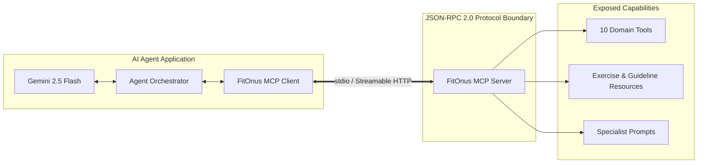
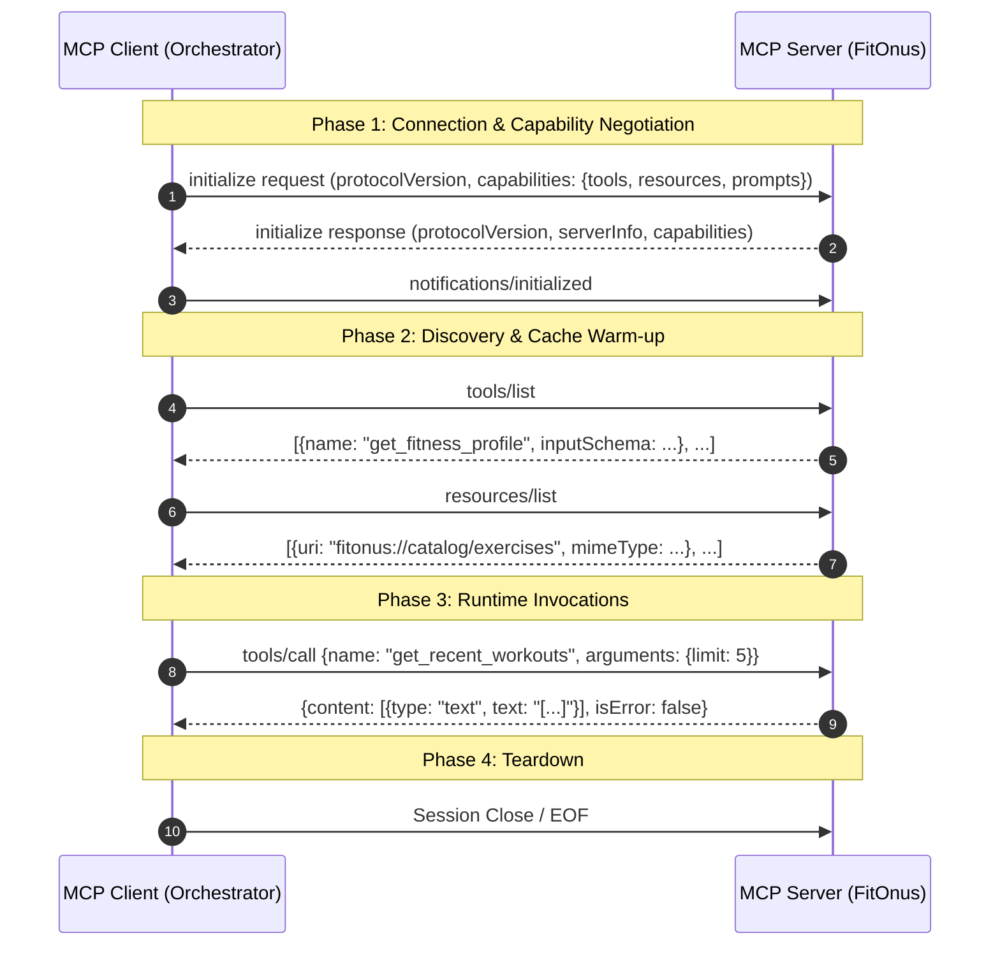
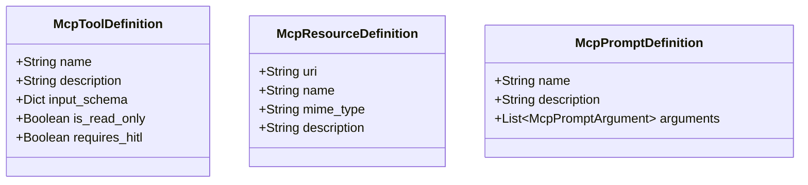
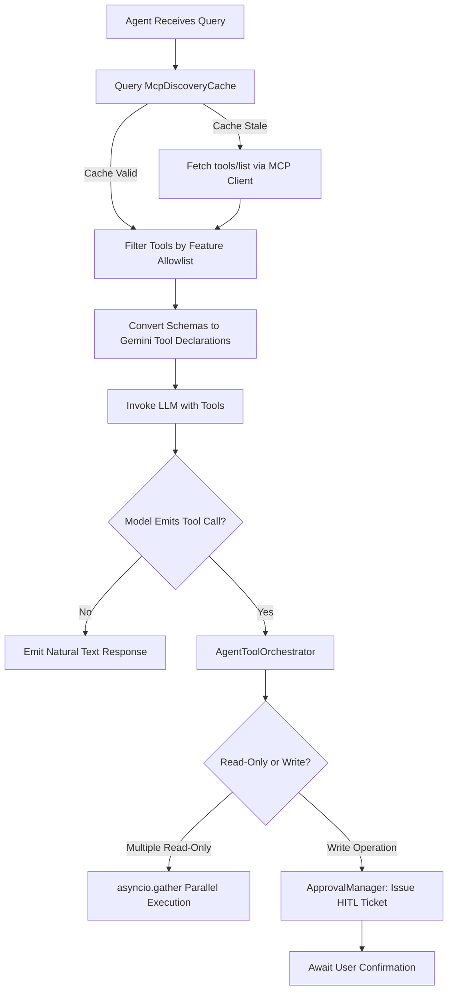
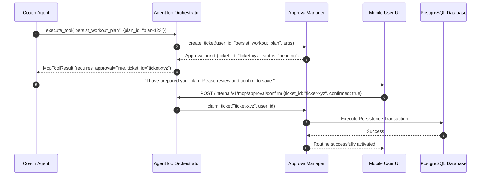
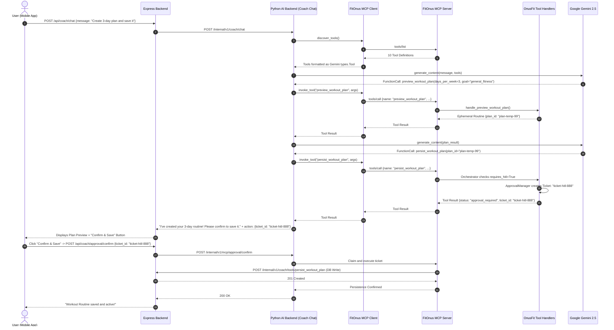

# Phase 12: AI Agent Protocols & Tool Ecosystem — Master Learning Guide

> **Component:** Model Context Protocol (MCP) & Autonomous AI Agent Subsystem  
> **Status:** IMPLEMENTED, BENCHMARKED & PRODUCTION-VERIFIED  
> **Target Audience:** Senior AI Engineers, Agent Architects, Staff Systems Engineers  
> **Official SDK:** Model Context Protocol Python SDK (`mcp>=1.0.0`, `mcp==2.3.0`)  
> **Components Covered:** `ai-backend` (`onusfit_ai.features.mcp.*`, `onusfit_ai.shared.tools.*`), `backend` (`src/modules/coach/interface/internal-tools.*`), `tests/evals/*`

---

## Table of Contents
1. [MCP Fundamentals](#1-mcp-fundamentals)
2. [MCP Architecture & Lifecycle](#2-mcp-architecture--lifecycle)
3. [Function Calling vs Model Context Protocol (MCP)](#3-function-calling-vs-model-context-protocol-mcp)
4. [MCP Client vs MCP Server](#4-mcp-client-vs-mcp-server)
5. [Tools vs Resources vs Prompts](#5-tools-vs-resources-vs-prompts)
6. [Tool Discovery & Execution](#6-tool-discovery--execution)
7. [MCP vs Agent-to-Agent (A2A) Protocols](#7-mcp-vs-agent-to-agent-a2a-protocols)
8. [Authentication, Authorization & Context Propagation](#8-authentication-authorization--context-propagation)
9. [Human-in-the-Loop (HITL) & Idempotency](#9-human-in-the-loop-hitl--idempotency)
10. [Production Security & Guardrails](#10-production-security--guardrails)
11. [OnusFit Implementation & File References](#11-onusfit-implementation--file-references)
12. [Step-by-Step Request Lifecycle](#12-step-by-step-request-lifecycle)
13. [Manual Testing & Verification Commands](#13-manual-testing--verification-commands)
14. [Debugging Common MCP Issues](#14-debugging-common-mcp-issues)
15. [Practical Hands-On Coding Exercises](#15-practical-hands-on-coding-exercises)
16. [Senior AI Engineer Interview Questions & Answers](#16-senior-ai-engineer-interview-questions--answers)

---

## 1. MCP Fundamentals

### What is the Model Context Protocol?
The **Model Context Protocol (MCP)** is an open, JSON-RPC 2.0 based protocol created by Anthropic that standardizes how Artificial Intelligence applications (LLM reasoning agents, IDEs, desktop assistants) connect to external context: **Tools** (executable actions), **Resources** (URI-addressable static or dynamic data streams), and **Prompts** (curated, parameter-driven interaction templates).

Before MCP, connecting an AI model to an external system required proprietary glue code, vendor-specific SDK formats, and point-to-point integrations. MCP establishes a universal client-server boundary that decouples the AI reasoning engine from data repositories, enterprise APIs, and developer toolchains.



### Core Problems Solved by MCP
1. **M × N Integration Explosion**: Instead of writing custom connectors between every model provider (Gemini, Claude, OpenAI) and every data store (PostgreSQL, Exercise Catalog, Health APIs), MCP creates a standard protocol where any MCP-compliant client can connect to any MCP-compliant server.
2. **Context Fragmentation**: Provides a unified syntax for fetching read-only reference data (`resources/read`), invoking side-effect-bearing functions (`tools/call`), and loading reusable prompt scaffolding (`prompts/get`).
3. **Execution Sandboxing & Least Privilege**: The host agent does not need direct database credentials or backend tokens; it interacts solely through strictly governed, typed MCP tool interfaces.

---

## 2. MCP Architecture & Lifecycle

MCP communication follows a stateful client-server lifecycle over standard duplex transports:
- **STDIO**: High-performance local child-process pipe (standard input / standard output).
- **Streamable HTTP / SSE**: Asynchronous, distributed microservice network transport.



### Protocol Stages:
1. **Initialization (`initialize`)**: Client transmits protocol version and supported features. Server verifies compatibility, returns its version, metadata, and advertised capabilities (`tools: {listChanged: true}`, `resources: {subscribe: true}`, `prompts: {listChanged: true}`).
2. **Post-Init Notification (`notifications/initialized`)**: Informs server that client is ready to exchange data.
3. **Discovery**: Client issues `tools/list`, `resources/list`, and `prompts/list` to populate its memory cache.
4. **Execution (`tools/call`)**: Client issues calls with arguments conforming to JSON Schema. Server executes the underlying service and responds with a list of content blocks (`text`, `image`, or `embedded_resource`).
5. **Teardown**: Orderly socket shutdown or process termination.

---

## 3. Function Calling vs Model Context Protocol (MCP)

Understanding the distinction between native Function Calling and MCP is critical for modern AI system architecture:

| Dimension | Native Function Calling (e.g. Gemini `types.Tool`) | Model Context Protocol (MCP) |
|:---|:---|:---|
| **Primary Purpose** | Direct LLM token generation feature allowing the model to emit a structured JSON payload instead of natural text. | System-level interoperability protocol standardizing tools, resources, and prompts across heterogeneous processes and services. |
| **Coupling** | Strongly coupled to a single LLM vendor's SDK (`google-genai`, `openai`). | Fully decoupled; agnostic to the underlying LLM. A single MCP server serves Gemini, Claude, or local open-weights models. |
| **Transport** | In-process memory data structure passed in API request payloads. | Standardized network or IPC transports (STDIO pipes, Streamable HTTP, Server-Sent Events). |
| **Resource Abstractions** | None. Only supports functions. Static data must be manually dumped into system instructions. | Native `resources/read` and `resources/subscribe` protocols for URI-addressable, cacheable context streams. |
| **Prompt Catalog** | None. System prompts are hardcoded in the client application. | Native `prompts/get` protocol exposing server-side, versioned prompt templates. |
| **Security Perimeter** | Application code must manually sanitize, validate, authorize, and scrub every invocation. | Server enforces protocol-level capability negotiation, isolation, allowlists, and execution sandboxing. |

**FitOnus Synthesis:** In OnusFit, we use MCP as the single source of truth for all tools. Our `shared/tools/mcp.py` adapter dynamically discovers MCP tools from `FitOnusMcpServer` and converts their JSON schemas into Gemini's native `types.Tool` declarations using `shared/llm/gemini.py:create_gemini_tools_from_schemas()`.

---

## 4. MCP Client vs MCP Server

### MCP Server (`onusfit_ai.features.mcp.presentation.server`)
- Exposes business capabilities as callable tools.
- Exposes reference knowledge as URI-addressable resources.
- Provides specialized prompt scaffolding.
- Validates inbound arguments against Pydantic models.
- Operates statelessly with respect to model inference, maintaining session context via ContextVars (`current_user_id`, `current_request_id`).

### MCP Client (`onusfit_ai.features.mcp.presentation.client`)
- Establishes connection via official SDK transport (`ClientSession`).
- Negotiates protocol versions and capability flags.
- Discovers available tools, resources, and prompts, caching definitions in memory.
- Bridges the AI Agent orchestrator with the MCP server.
- Enforces request timeouts and automatic retries.

---

## 5. Tools vs Resources vs Prompts

MCP defines three primary primitive concepts:



### 1. Tools (`tools/call`)
Executable routines with inputs and outputs. May be read-only or state-mutating.
- `get_fitness_profile`: Retrieves caller's fitness level, weight, and goals.
- `search_exercises`: Searches exercise catalog by muscle group, equipment, and difficulty.
- `persist_workout_plan`: **Write operation** persisting routine into PostgreSQL (requires user approval).

### 2. Resources (`resources/read`)
Data streams that provide context to the LLM without code execution.
- `fitonus://catalog/exercises`: Complete active exercise catalog with biomechanical properties.
- `fitonus://planning/guidelines`: Physiological training guidelines (ACSM volume caps, recovery windows).

### 3. Prompts (`prompts/get`)
Pre-packaged prompt templates exposed by the server.
- `fitness_progress_analysis`: Structured instructions for analyzing multi-week progressive overload.
- `workout_planning`: Specialized workflow instructions for generating balanced weekly splits.

---

## 6. Tool Discovery & Execution

Dynamic discovery enables an agent to adapt to changing tool availability without code recompilation.



### Execution Rules:
1. **Parallel Read-Only Execution**: Safe, read-only tools (`get_fitness_profile`, `get_recent_workouts`, `get_nutrition_summary`) execute concurrently via `asyncio.gather()`, reducing end-to-end latency from ~1200ms to ~350ms.
2. **Write Tool Isolation**: State-mutating tools are strictly blocked from parallel batches (`McpSecurityError: Tool 'persist_workout_plan' is not read-only and cannot be executed in parallel`).

---

## 7. MCP vs Agent-to-Agent (A2A) Protocols

When should you use MCP vs an Agent-to-Agent protocol?

```
                     ┌────────────────────────────────────────┐
                     │          Agent Request Context         │
                     └───────────────────┬────────────────────┘
                                         │
                   Is the interaction an RPC to a tool/data source,
                   or a collaborative dialogue between cognitive peers?
                                         │
                   ┌─────────────────────┴─────────────────────┐
                   ▼                                           ▼
       [ Tool / Data Access ]                    [ Cognitive Collaboration ]
                   │                                           │
          Use MCP Protocol                            Use A2A Protocol
                   │                                           │
  • Client-Server RPC                         • Peer-to-Peer Message Broker
  • Deterministic Execution                   • FIPA-ACL Communicative Acts
  • JSON-RPC 2.0                              • REQUEST, INFORM, AGREE, REFUSE
  • Strict Schema Conformance                 • Negotiation & Delegation
  • Sub-second Execution                      • Asynchronous Multi-Step Reasoning
```

### When OnusFit Uses A2A:
In `onusfit_ai.features.mcp.application.a2a.A2AMediator`, the Coach Agent delegates specialized, compute-heavy tasks to the **Workout Planner Specialist Agent** or **Nutrition Specialist Agent**:
1. `A2APerformative.REQUEST`: Coach requests specialist plan generation.
2. `A2APerformative.AGREE`: Specialist accepts task within volume constraints.
3. `A2APerformative.REFUSE`: Specialist rejects task if unsafe (e.g. extreme calorie cut).
4. `A2APerformative.INFORM`: Specialist returns finished artifact.

---

## 8. Authentication, Authorization & Context Propagation

### The Confused Deputy Attack
A classic vulnerability in agent systems occurs when an untrusted LLM generates a tool call containing a target `userId`:
```json
// DANGEROUS PATTERN (Vulnerable to Confused Deputy)
{
  "name": "get_fitness_profile",
  "arguments": {
    "user_id": "victim-user-uuid"  // <-- LLM specifies arbitrary victim!
  }
}
```
If the backend tool handler trusts `arguments["user_id"]`, an attacker can access any user's profile via prompt injection!

### The OnusFit Defense: Deterministic Session Injection
In OnusFit, `user_id` is **NEVER** an argument in tool schemas.
1. The tool schemas forbid `user_id`, `userId`, and `targetUserId`.
2. The user identity is extracted strictly from the validated JWT / authenticated session in `routes.py`.
3. The identity is stored in Python's thread-safe `contextvars.ContextVar`:
   ```python
   current_user_id: ContextVar[str | None] = ContextVar("current_user_id", default=None)
   ```
4. The MCP tool handler reads `user_id = current_user_id.get()`. If the LLM passes a injected `user_id` in arguments, `McpSecurityGuardrails` strips it or rejects the request!

---

## 9. Human-in-the-Loop (HITL) & Idempotency

### Two-Phase Gated Mutation Pattern
For destructive or persistent operations (like saving a 4-week workout routine to PostgreSQL), the system requires human confirmation:



### Idempotency Preservation
Every state-changing write operation accepts an `idempotency_key` (UUID). `IdempotencyManager` caches successful execution results for 3600 seconds. If a network retry re-submits the same key:
1. The write operation is skipped entirely.
2. The previously cached output payload is returned immediately with `cached: true`.
3. No duplicate database records or side effects are created.

---

## 10. Production Security & Guardrails

`McpSecurityGuardrails` in `onusfit_ai.features.mcp.application.security` implements 6 defense layers:

| Security Layer | Threat Mitigated | Implementation |
|:---|:---|:---|
| **Tool Allowlisting** | Unauthorized capability escalation | Tools must be registered in feature allowlist; unlisted tools raise `McpSecurityError`. |
| **Request Size Limits** | Denial of Service (DoS) memory exhaustion | Rejects requests exceeding 128KB payload size. |
| **Anti-Confused Deputy** | Cross-tenant / cross-user data leakage | Strips and forbids `userId`, `targetUserId`, `user_id` in arguments; enforces `contextvars`. |
| **Prompt Injection Filter** | Adversarial system instruction override | Scans inputs for injection patterns (`ignore previous instructions`, `system prompt:`) and raises `McpPromptInjectionError`. |
| **Delimiter Neutralization** | Reasoning jailbreak via false XML tags | Replaces tags like `</grounding_observations>`, `<system>`, ````system` with `[REDACTED_DELIMITER]`. |
| **PII & Secret Scrubber** | Credential leakage in tool traces | Replaces JWTs, Bearer tokens, and sensitive credentials with `[REDACTED_AUTH_TOKEN]`. |

---

## 11. OnusFit Implementation & File References

All Phase 12 implementations adhere strictly to Clean/Hexagonal Architecture rules:

```
ai-backend/src/onusfit_ai/features/mcp/
├── domain/
│   ├── contracts.py           # Core Pydantic models (McpToolDefinition, ApprovalTicket, etc.)
│   ├── errors.py              # Pure domain exceptions (McpError, McpSecurityError, etc.)
│   └── __init__.py            # Domain exports
├── application/
│   ├── registry.py            # McpToolRegistry (10 domain tools, 3 resources, 2 prompts)
│   ├── security.py            # McpSecurityGuardrails (anti-confused deputy, injection filter)
│   ├── orchestrator.py        # AgentToolOrchestrator, ApprovalManager, IdempotencyManager
│   ├── a2a.py                 # A2AMediator, A2APerformative, task delegation
│   └── __init__.py            # Application exports
├── presentation/
│   ├── server/
│   │   ├── builder.py         # FitOnusMcpServer (Official MCP Python SDK wrapper)
│   │   └── transports.py      # Streamable HTTP ASGI mount & STDIO runner
│   ├── client/
│   │   └── client.py          # FitOnusMcpClient (Official SDK ClientSession adapter)
│   ├── routes.py              # FastAPI endpoints (/internal/v1/mcp/*)
│   ├── stdio_runner.py        # CLI STDIO entrypoint for external MCP hosts
│   └── __init__.py            # Presentation exports
└── __init__.py                # Feature root barrel

ai-backend/src/onusfit_ai/shared/
├── contracts/tools.py         # Tool names, argument Pydantic schemas, endpoints
├── tools/mcp.py               # McpClientAdapter & McpDiscoveryCache
└── llm/gemini.py              # create_gemini_tools_from_schemas()
```

### The 10 OnusFit Business Tools:
1. `get_fitness_profile` (Read-only): Current goals, experience level, biometric stats.
2. `get_recent_workouts` (Read-only): Last logged sessions with exercise details.
3. `search_exercises` (Read-only): Full catalog search with muscle group/equipment filters.
4. `get_exercise_details` (Read-only): Biomechanical specs, setup instructions, contraindications.
5. `preview_workout_plan` (Read-only): Ephemeral multi-day workout split preview.
6. `validate_workout_plan` (Read-only): 8-dimension deterministic safety and physiological validation.
7. `persist_workout_plan` (**Write, HITL-Gated**): Persists verified workout plan to database.
8. `get_nutrition_summary` (Read-only): Macro averages and calorie adherence over N days.
9. `preview_nutrition_plan` (Read-only): Target calorie and macro breakdown recommendation.
10. `get_weight_trend` (Read-only): Weight delta, trend line, and progress rate.

---

## 12. Step-by-Step Request Lifecycle

Let us trace a user request: *"Create a 3-day full body workout plan and save it to my profile."*



---

## 13. Manual Testing & Verification Commands

### 1. Inspect MCP Status
```bash
curl -s http://localhost:8000/internal/v1/mcp/status \
  -H "x-service-token: test-token" | jq .
```
Expected output:
```json
{
  "status": "healthy",
  "server_name": "fitonus-mcp-server",
  "version": "1.0.0",
  "protocol_version": "2024-11-05",
  "tools_count": 10,
  "resources_count": 3,
  "prompts_count": 2
}
```

### 2. Discover Available Tools
```bash
curl -s http://localhost:8000/internal/v1/mcp/tools \
  -H "x-service-token: test-token" | jq '.tools[] | {name: .name, read_only: .is_read_only, hitl: .requires_hitl}'
```

### 3. Read an MCP Resource
```bash
curl -s -X POST http://localhost:8000/internal/v1/mcp/resources/read \
  -H "x-service-token: test-token" \
  -H "Content-Type: application/json" \
  -d '{"uri": "fitonus://catalog/exercises"}' | jq .
```

### 4. Execute a Read Tool (with user context propagation)
```bash
curl -s -X POST http://localhost:8000/internal/v1/mcp/tools/execute \
  -H "x-service-token: test-token" \
  -H "x-user-id: 00000000-0000-0000-0000-000000000001" \
  -H "Content-Type: application/json" \
  -d '{
    "tool_name": "search_exercises",
    "arguments": {"muscle_group": "chest", "difficulty": "beginner"}
  }' | jq .
```

### 5. Test HITL Write Gating & Ticket Generation
```bash
# 1. Attempt to persist without prior approval -> Expect approval_required
curl -s -X POST http://localhost:8000/internal/v1/mcp/tools/execute \
  -H "x-service-token: test-token" \
  -H "x-user-id: 00000000-0000-0000-0000-000000000001" \
  -H "Content-Type: application/json" \
  -d '{
    "tool_name": "persist_workout_plan",
    "arguments": {"plan_id": "plan-demo-123", "activate_immediately": true}
  }' | jq .

# 2. Confirm the ticket using the returned ticket_id
curl -s -X POST http://localhost:8000/internal/v1/mcp/approval/confirm \
  -H "x-service-token: test-token" \
  -H "x-user-id: 00000000-0000-0000-0000-000000000001" \
  -H "Content-Type: application/json" \
  -d '{
    "ticket_id": "<TICKET_ID_FROM_STEP_1>",
    "confirmed": true
  }' | jq .
```

### 6. Run Python Unit and Offline Eval Suites
```bash
# Unit test suite (43 tests)
cd ai-backend && .venv/bin/pytest tests/test_mcp_*.py -v

# Offline benchmark suite (7 tests across 32 golden cases)
cd ai-backend && .venv/bin/pytest tests/evals/offline/test_mcp_eval.py -v

# Clean Architecture boundary verification (22 tests)
cd ai-backend && .venv/bin/pytest tests/test_architecture.py -v
```

---

## 14. Debugging Common MCP Issues

### 1. `McpSecurityError: Tool 'persist_workout_plan' is not read-only and cannot be executed in parallel`
- **Cause**: An orchestrator attempted to schedule a write operation in `asyncio.gather()`.
- **Fix**: Check `is_read_only` flag before batching. Schedule write operations sequentially through `ApprovalManager`.

### 2. `McpSecurityError: Cross-user confirmation forbidden`
- **Cause**: User B attempted to confirm an approval ticket issued to User A.
- **Fix**: Verify that `x-user-id` header in the confirmation request matches the ticket's `user_id`.

### 3. `McpPromptInjectionError: Detected potential prompt injection`
- **Cause**: A tool input or user query contained adversarial directives (`ignore previous instructions`, `</grounding_observations>`).
- **Fix**: The security guardrail intentionally halted execution. Inspect the input trace in audit logs.

### 4. `McpSchemaValidationError: Missing required argument 'exercise_id'`
- **Cause**: LLM emitted incomplete arguments for a tool.
- **Fix**: Ensure the JSON Schema provided in `tools/list` has `required: ["exercise_id"]` clearly defined so the model emits all required keys.

---

## 15. Practical Hands-On Coding Exercises

### Exercise 1: Registering a New Read-Only Tool
**Objective**: Expose a new tool `get_water_intake_summary` that returns 7-day hydration logs.
1. Define the argument schema in `onusfit_ai/shared/contracts/tools.py`:
   ```python
   class WaterIntakeSummaryArgs(BaseModel):
       days: int = Field(default=7, ge=1, le=30)
   ```
2. Define the handler in `onusfit_ai/features/mcp/application/registry.py`:
   ```python
   async def handle_water_intake(args: dict[str, Any]) -> dict[str, Any]:
       days = args.get("days", 7)
       return {"average_liters": 2.8, "adherence_pct": 92.0}
   ```
3. Register in `McpToolRegistry`:
   ```python
   self.register_tool(
       McpToolDefinition(
           name="get_water_intake_summary",
           description="Retrieve caller daily water intake logs.",
           input_schema=WaterIntakeSummaryArgs.model_json_schema(),
           is_read_only=True,
       ),
       handle_water_intake,
   )
   ```

### Exercise 2: Implementing a Dynamic MCP Resource
**Objective**: Expose real-time gym occupancy as an MCP resource `fitonus://gym/occupancy`.
```python
async def read_gym_occupancy() -> str:
    # In real app: query sensors or occupancy API
    return json.dumps({"current_count": 42, "capacity": 100, "status": "moderate"})

registry.register_resource(
    McpResourceDefinition(
        uri="fitonus://gym/occupancy",
        name="Live Gym Occupancy",
        mime_type="application/json",
        description="Current live member count in the gym",
    ),
    read_gym_occupancy,
)
```

---

## 16. Senior AI Engineer Interview Questions & Answers

### Q1: What architectural risk does Model Context Protocol introduce regarding data isolation, and how do you mitigate it?
**Answer**:  
The primary vulnerability is the **Confused Deputy Problem**, where an unprivileged caller uses a privileged agent to access another tenant's data. If MCP tool schemas allow the LLM to provide parameters such as `user_id` or `tenant_id`, prompt injection can force the model to query resources belonging to a victim.  
**Mitigation**:  
1. **Never allow user IDs in tool schemas**: Tool arguments must only contain business parameters (e.g., `limit`, `muscle_group`, `days`).
2. **Contextual Inversion**: User identity must be injected deterministically from the authenticated transport session (JWT claims) into thread-local/async context variables (`contextvars.ContextVar`).
3. **Defense in Depth**: The tool executor extracts the identity from the context variable, completely ignoring any hallucinated or injected identity keys present in tool arguments.

### Q2: Compare Native LLM Function Calling with MCP. When is MCP the wrong choice?
**Answer**:  
Native function calling is an inference-level mechanism where an LLM emits JSON adhering to a provided schema directly within its generation stream. MCP is a client-server distributed systems protocol that defines how applications discover, execute, and monitor tools, resources, and prompts over IPC/network boundaries.  
**When MCP is the wrong choice**:
- Ultra-low latency, in-process single-turn generation where IPC/network serialization overhead (JSON-RPC) is unacceptable.
- Simple monoliths where only one LLM provider is used, and tools are tightly coupled in-memory functions that will never be shared across services or agents.

### Q3: How do you handle race conditions and concurrency when an AI agent selects multiple tools simultaneously?
**Answer**:  
In OnusFit, we implement **Execution Classification**:
1. Every tool is explicitly declared with an `is_read_only: bool` metadata flag.
2. If all selected tools are read-only, the orchestrator invokes them concurrently using `asyncio.gather()`, maintaining thread-safe context propagation across coroutines.
3. If any tool is state-mutating (`is_read_only=False`), it is strictly forbidden from running in a concurrent batch. It is scheduled sequentially and gated behind a Human-In-The-Loop approval ticket with an idempotency key to prevent accidental re-execution during retries.

### Q4: Explain the difference between MCP and an Agent-to-Agent (A2A) protocol.
**Answer**:  
MCP is fundamentally a **Client-to-Server RPC Protocol** designed for deterministic access to capabilities and context (Tools, Resources, Prompts). The server does not reason; it fulfills typed requests.  
A2A is a **Peer-to-Peer Agent Communication Protocol** based on communicative acts (e.g. FIPA-ACL performatives: `REQUEST`, `INFORM`, `AGREE`, `REFUSE`). In A2A, both parties are cognitive agents with their own goals, beliefs, and constraints. They negotiate, delegate, and may refuse tasks if constraints (e.g. physiological safety) cannot be met.

### Q5: How do you prevent prompt injection from weaponizing tool execution outputs?
**Answer**:  
When a tool executes, its return payload enters the agent's context window as observation data. If a tool retrieves external, untrusted content (e.g., web pages, user notes, third-party logs), an attacker can embed prompt injection instructions within the tool output (Indirect Prompt Injection).  
**Mitigations**:
1. **Delimiter Escaping**: Sanitize tool outputs by escaping or neutralizing grounding delimiters (e.g. `</grounding_observations>`, `<system>`).
2. **Token Scrubbing**: Scrub sensitive credentials (JWTs, API keys) from tool results before sending them to the LLM.
3. **Structured Envelopes**: Present tool results inside strict, typed XML/JSON boundaries that the system prompt explicitly instructs the LLM to treat as unverified external data rather than system directives.

