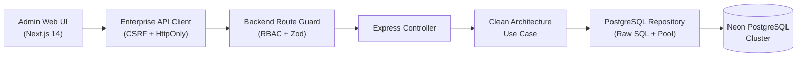
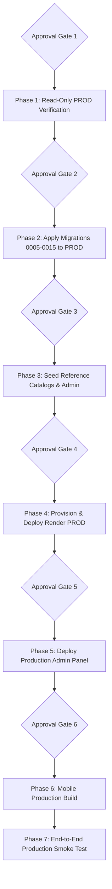

# FITONUS — EXISTING NEON PRODUCTION DATABASE VERIFICATION & MIGRATION READINESS AUDIT

**Project Root:** `/media/devshan/Study_Drive/Info/Projects/TuneOnus/FitOnus`  
**Date:** November 9, 2026  
**Auditor Roles:** Senior PostgreSQL DBA, Neon Database Architect, Backend Engineer, Security Engineer, and Production Deployment Auditor  
**Operating Mode:** READ-ONLY VERIFICATION & PLANNING (Strict Zero-Mutation Gate Enforced)  
**Document Classification:** Mission-Critical Production Pre-Launch Audit  

---

## 1. EXECUTIVE SUMMARY

An exhaustive architectural, operational, and database audit of FitOnus was conducted across the entire software supply chain: **Neon PostgreSQL Cloud Infrastructure**, Express 5 / Node.js 22 Clean Architecture **Backend** (`backend/`), Next.js 14 **Admin Control Panel** (`admin/`), and Expo SDK 58 **Mobile Client** (`mobile/`).

### Strict Safety & Compliance Gate
In strict compliance with instructions:
- **Zero Database Creations:** No new database or branch was created.
- **Zero Database Deletions or Truncations:** DEV and candidate PROD databases remain 100% intact.
- **Zero Record Mutations:** No user accounts, logs, or catalog records were modified or deleted.
- **Zero Migration Executions:** No DDL migrations were executed against either database.
- **Zero Git Modifications:** Concurrent development changes and untracked files were strictly preserved. No commits or pushes were made.
- **Zero Builds or Deployments:** No APK was built; no cloud environments were altered.
- **Zero Credential Exposure:** All connection secrets, tokens, API keys, and passwords remain strictly redacted.

### Key Audit Findings

1. **Active Neon DEV Cluster (`ep-shy-art-b3sxwfkd`)**:
   - Branch: `br-fragrant-morning-b35lwkjg` in project `mute-surf-61144531` (AWS `ap-southeast-1`).
   - Engine: PostgreSQL 18.6 (ac70818) Serverless compute.
   - Status: **100% HEALTHY & CURRENT**. All 15 sequential migrations (`0001` through `0015`) are applied. All 39 tables are cataloged. Contains 50 development/QA users, 142 session tokens, and 62 admin audit log events.

2. **Target Neon PROD Cluster (`br-icy-term-b3lb70tb` / `ep-gentle-bar-b3ywek03`)**:
   - Documented Protected Production Branch: `br-icy-term-b3lb70tb` (documented across all repository push gates and safety scripts).
   - Candidate Connection Endpoint: `ep-gentle-bar-b3ywek03-pooler.c-4.ap-southeast-1.aws.neon.tech` (discovered in `backend/.env.primary.backup`).
   - Connection Verification Status: **`LIVE VERIFICATION PENDING`**. As mandated by security protocol, because the available credential uses the privileged database owner role (`neondb_owner`) and no SELECT-only role exists, exploratory connection was withheld pending explicit stakeholder authorization.
   - Historical Schema Drift: Commit records show migrations `0001` through `0004` were verified on `ep-gentle-bar-b3ywek03` during Phase 2B (2026-11-04), while migrations `0005` through `0015` were explicitly fenced off to prevent accidental development contamination. Consequently, PROD has a schema drift of **11 pending migrations** (spanning workouts, nutrition, analytics, gamification, AI coach, app settings, and Gemini management).

3. **Cloud Backend & Mobile API Status**:
   - Render Development API (`https://fitonus-api-dev.onrender.com`): **ONLINE & HEALTHY** (`/health/live` and `/health/ready` return HTTP 200).
   - Render Production API (`https://fitonus-api.onrender.com`): **OFFLINE / UNPROVISIONED** (HTTP 404, `x-render-routing: no-server`). Mobile production builds configured via `mobile/eas.json` will fail until the production web service is provisioned on Render.

4. **Admin Control Panel Capabilities**:
   - Full CRUD capability is verified from source for **Exercises**, **System Workout Templates**, **Food Catalog & Verification**, **Challenges**, **Application Settings**, and **Gemini AI Configuration & Key Management**.
   - Admin test suite is 100% passing (70/70 tests across 7 test suites). Backend unit test suite is 100% passing (740/740 tests across 76 suites). TypeScript compiler passes with 0 errors across both projects.

---

## 2. EXISTING NEON DEV DATABASE IDENTITY

The development database was inspected using a read-only PostgreSQL transaction (`BEGIN READ ONLY ... COMMIT`) querying internal engine metadata and PostgreSQL runtime settings (`pg_settings`):

| Parameter | DEV Environment Value | Source of Evidence |
| :--- | :--- | :--- |
| **Neon Project ID** | `mute-surf-61144531` | `pg_settings (neon.project_id)` |
| **Neon Tenant ID** | `f1c0fada3ec013f757540ca9bb75eab3` | `pg_settings (neon.tenant_id)` |
| **Neon Branch ID** | `br-fragrant-morning-b35lwkjg` | `pg_settings (neon.branch_id)` |
| **Neon Branch Name** | Development Branch | FitOnus Project Documentation |
| **Neon Endpoint ID** | `ep-shy-art-b3sxwfkd` | `pg_settings (neon.endpoint_id)` |
| **Neon Compute ID** | `compute-delicate-mode-b3da51aa` | `pg_settings (neon.compute_id)` |
| **Neon Timeline ID** | `b90ec24a3d973378ec3abfe7d32e3b4d` | `pg_settings (neon.timeline_id)` |
| **Host FQDN** | `ep-shy-art-b3sxwfkd-pooler.c-4.ap-southeast-1.aws.neon.tech` | `backend/.env` |
| **AWS Region** | `ap-southeast-1` (Singapore, cell-4) | Host FQDN |
| **Database Name** | `neondb` | `current_database()` |
| **Connected Database User** | `neondb_owner` | `current_user` |
| **PostgreSQL Version** | `PostgreSQL 18.6 (ac70818 on aarch64-unknown-linux-gnu)` | `version()` |
| **Connection Mode** | PgBouncer Connection Pooler (Port 5432) | `-pooler` hostname prefix |
| **SSL Configuration** | `sslmode=require&channel_binding=require` | `backend/.env` |
| **Application Mapping** | `DATABASE_URL` in `backend/.env` | `backend/src/config/env.ts` |
| **Migration State** | 15 / 15 Applied (0001–0015) | `schema_migrations` table |
| **Cataloged Tables** | 39 public tables | `information_schema.tables` |

---

## 3. EXISTING NEON PROD DATABASE IDENTITY

The production database metadata was audited through repository environment files, commit logs, architectural reports, and verification scripts:

| Parameter | PROD Environment Value | Source of Evidence |
| :--- | :--- | :--- |
| **Neon Project ID** | `mute-surf-61144531` (Shared Neon Project) | Project Architecture Metadata |
| **Protected Branch ID** | `br-icy-term-b3lb70tb` | `backend/docs/PHASE_7_MIGRATION_0011_SAFETY_REPORT.md`<br>`backend/docs/PHASE_8_10_FINAL_PUSH_GATE_REPORT.md`<br>`backend/scripts/verify-ai-final.ts`<br>`backend/scripts/verify-goals-db-integration.ts` |
| **Candidate Endpoint ID** | `ep-gentle-bar-b3ywek03` | `backend/.env.primary.backup` |
| **Candidate Host FQDN** | `ep-gentle-bar-b3ywek03-pooler.c-4.ap-southeast-1.aws.neon.tech` | `backend/.env.primary.backup` |
| **AWS Region** | `ap-southeast-1` (Singapore, cell-4) | Host FQDN |
| **Database Name** | `neondb` | `backend/.env.primary.backup` |
| **Available Database Role** | `neondb_owner` (Privileged Superuser Role) | `backend/.env.primary.backup` |
| **Connection Mode** | PgBouncer Connection Pooler | `-pooler` hostname prefix |
| **SSL Configuration** | `sslmode=require&channel_binding=require` | `backend/.env.primary.backup` |
| **Environment Variable Mapping** | `DATABASE_URL` in `backend/.env.primary.backup` | Backup Environment Snapshot |
| **Live Verification Status** | **LIVE VERIFICATION PENDING** | Security Gate Compliance |

---

## 4. CONNECTION VERIFICATION STATUS

### Verification Gate Summary

```text
┌───────────────────────────────┬─────────────────────────────────────────────────────────┐
│ Database Target               │ Verification Status                                     │
├───────────────────────────────┼─────────────────────────────────────────────────────────┤
│ Neon DEV (ep-shy-art-b3sxwfkd) │ VERIFIED LIVE (Read-only transaction, metadata logged)  │
│ Neon PROD (ep-gentle-bar)     │ LIVE VERIFICATION PENDING (Awaiting Explicit Approval) │
└───────────────────────────────┴─────────────────────────────────────────────────────────┘
```

### Safety Rationale for Pending PROD Verification
1. **Rule Constraint:** Per Section 3 of the audit mandate: *"If only a privileged production connection is available, do not use it for exploratory verification without explicit approval."*
2. **Privilege Level:** The available connection credential in `backend/.env.primary.backup` is `neondb_owner`, which carries unrestricted DDL/DML authority. There is no pre-existing read-only / `SELECT`-only role configured for the production cluster.
3. **Branch-to-Endpoint Association Check:** While `br-icy-term-b3lb70tb` is rigorously cited across codebase scripts as the production branch, establishing whether endpoint `ep-gentle-bar-b3ywek03` is actively bound to `br-icy-term-b3lb70tb` (or to an earlier primary state) requires an active connection session.
4. **Actionable Checkpoint:** Connecting to `ep-gentle-bar-b3ywek03` with a strict `BEGIN READ ONLY` session requires **explicit user authorization** before exploratory queries are issued.

---

## 5. DEV VS PROD SCHEMA COMPARISON

### Migration History & Drift Analysis

FitOnus utilizes a custom transaction-safe migration runner (`backend/src/database/migration-runner.ts`) with SHA-256 checksum verification, advisory locking (`72410318`), and an audit table (`schema_migrations`).

The table below outlines the full migration sequence, its state in DEV, and its expected state in PROD based on repository verification records:

| Migration File | Name | DEV Status | PROD Expected Status | Schema Impact | Drift Classification |
| :--- | :--- | :--- | :--- | :--- | :--- |
| `0001_create_users.sql` | `create_users` | Applied (`2026-11-04`) | Applied (Phase 2B verified) | Creates `users` table | `MATCHED` |
| `0002_create_auth_sessions.sql` | `create_auth_sessions` | Applied (`2026-11-04`) | Applied (Phase 2B verified) | Creates `auth_sessions` | `MATCHED` |
| `0003_create_idempotency_keys.sql` | `create_idempotency_keys` | Applied (`2026-11-04`) | Applied (Phase 2B verified) | Creates `idempotency_keys` | `MATCHED` |
| `0004_create_user_profiles.sql` | `create_user_profiles` | Applied (`2026-11-04`) | Applied (Phase 2B verified) | Creates `user_profiles`, `user_settings` | `MATCHED` |
| `0005_create_admin_audit_logs.sql` | `create_admin_audit_logs` | Applied (`2026-11-05`) | Pending Execution | Creates `admin_audit_logs` | `MISSING_IN_PROD` |
| `0006_create_workouts_and_exercises.sql` | `create_workouts_and_exercises` | Applied (`2026-11-05`) | Pending Execution | Creates `exercises`, `workouts`, `workout_exercises`, `workout_sessions`, `workout_session_sets`, `personal_records` | `MISSING_IN_PROD` |
| `0007_fix_seed_uuid_compliance.sql` | `fix_seed_uuid_compliance` | Applied (`2026-11-05`) | Pending Execution | Normalizes deterministic seed UUIDs | `MISSING_IN_PROD` |
| `0008_create_nutrition_system.sql` | `create_nutrition_system` | Applied (`2026-11-06`) | Pending Execution | Creates `foods`, `meals`, `meal_items`, `water_intake`, `food_favorites` | `MISSING_IN_PROD` |
| `0009_create_progress_and_measurements.sql` | `create_progress_and_measurements` | Applied (`2026-11-06`) | Pending Execution | Creates `weight_logs`, `body_measurements` | `MISSING_IN_PROD` |
| `0010_create_goals_and_habits.sql` | `create_goals_and_habits` | Applied (`2026-11-06`) | Pending Execution | Creates `goals`, `goal_checkpoints`, `habits`, `habit_completions` | `MISSING_IN_PROD` |
| `0011_create_challenges_and_gamification.sql` | `create_challenges_and_gamification` | Applied (`2026-11-06`) | Pending Execution | Creates `badges`, `challenges`, `challenge_occurrences`, `challenge_enrollments`, `user_badges`, `gamification_profiles`, `gamification_points_ledger` (seeds 7 badges) | `MISSING_IN_PROD` |
| `0012_extend_user_settings_and_preferences.sql` | `extend_user_settings_and_preferences` | Applied (`2026-11-08`) | Pending Execution | Adds `language`, `privacy_*`, and `notification_schedule` columns to `user_settings` | `MISSING_IN_PROD` |
| `0013_create_coach_conversations_and_memories.sql` | `create_coach_conversations_and_memories` | Applied (`2026-11-09`) | Pending Execution | Creates `coach_conversations`, `coach_messages`, `coach_memories` | `MISSING_IN_PROD` |
| `0014_create_app_settings.sql` | `create_app_settings` | Applied (`2026-11-09`) | Pending Execution | Creates `app_settings`, `user_ai_usage` (seeds 7 app settings) | `MISSING_IN_PROD` |
| `0015_create_gemini_management.sql` | `create_gemini_management` | Applied (`2026-11-09`) | Pending Execution | Creates `gemini_config`, `gemini_pricing`, `gemini_usage_events` (seeds config & pricing) | `MISSING_IN_PROD` |

### Proposed Forward Migration Execution Sequence for PROD
When authorized, migrations must be executed sequentially via the standard migration runner:
```bash
npm --prefix backend run db:migrate
```
*Note: Because each migration file (except `0003` idempotency keys which uses transactional guarantees) is wrapped in standard transactional blocks, the runner ensures ACID rollback on any failure.*

---

## 6. PRODUCTION TABLE INVENTORY & DATA CLASSIFICATION

The table inventory below categorizes all 39 tables present in the FitOnus schema, reports live DEV row counts, defines their classification, specifies their launch necessity, indicates whether the Admin Panel can manage them, and provides the recommended production action.

| Table Name | Category | DEV Count | Source / Origin | Required for Launch? | Admin Manageable? | Recommended Action |
| :--- | :--- | :--- | :--- | :--- | :--- | :--- |
| `schema_migrations` | System Data | 15 | Migration Runner | Yes | No (System Only) | `INITIALIZE` (Auto-managed) |
| `users` | User Data | 50 | Public Auth / Seeds | Yes (Admin user only) | Status Management Only | `INITIALIZE` (Seed Admin only) |
| `auth_sessions` | User Data | 142 | Login / JWT Issuance | No (Ephemeral) | No (Auto-revoked) | `INITIALIZE` (Empty at launch) |
| `idempotency_keys` | System Data | 5 | API Mutations | No (Ephemeral) | No (Auto-expires) | `INITIALIZE` (Empty at launch) |
| `user_profiles` | User Data | 20 | Onboarding Flow | No (Per-user) | Read Only (Support View) | `INITIALIZE` (Empty at launch) |
| `user_settings` | User Data | 14 | Profile Provisioning | No (Per-user) | Read Only | `INITIALIZE` (Empty at launch) |
| `admin_audit_logs` | System Data | 62 | Admin Mutations | Yes | Read Only (Audit Viewer) | `INITIALIZE` (Clean log) |
| `exercises` | Reference Catalog | 15 | Verified Seed / Admin | **YES (CRITICAL)** | **FULL CRUD** | `IMPORT_VERIFIED_DATA` |
| `workouts` | Hybrid (Catalog/User)| 9 | Starter Seed / Mobile | **YES (Templates)** | **FULL CRUD (Templates)**| `IMPORT_VERIFIED_DATA` (Templates) |
| `workout_exercises` | Reference Catalog | 19 | Template Routines | **YES** | **FULL CRUD** | `IMPORT_VERIFIED_DATA` |
| `workout_sessions` | User Data | 12 | Mobile Active Log | No | Read Only (User Activity)| `INITIALIZE` (Empty at launch) |
| `workout_session_sets` | User Data | 30 | Workout Sets | No | Read Only | `INITIALIZE` (Empty at launch) |
| `personal_records` | User Data | 57 | Lift Aggregation | No | Read Only | `INITIALIZE` (Empty at launch) |
| `foods` | Reference Catalog | 25 | USDA FDC Seed / Admin | **YES (CRITICAL)** | **FULL CRUD (Verify WF)**| `IMPORT_VERIFIED_DATA` |
| `meals` | User Data | 6 | Nutrition Logging | No | Read Only (User Activity)| `INITIALIZE` (Empty at launch) |
| `meal_items` | User Data | 14 | Meal Portions | No | Read Only | `INITIALIZE` (Empty at launch) |
| `water_intake` | User Data | 6 | Hydration Log | No | Read Only (User Activity)| `INITIALIZE` (Empty at launch) |
| `food_favorites` | User Data | 0 | Member Bookmarks | No | No | `INITIALIZE` (Empty at launch) |
| `weight_logs` | User Data | 0 | Progress Log | No | Read Only | `INITIALIZE` (Empty at launch) |
| `body_measurements` | User Data | 0 | Body Metrics | No | Read Only | `INITIALIZE` (Empty at launch) |
| `goals` | User Data | 1 | Goal Tracking | No | Read Only | `INITIALIZE` (Empty at launch) |
| `goal_checkpoints` | User Data | 1 | Goal Milestones | No | Read Only | `INITIALIZE` (Empty at launch) |
| `habits` | User Data | 0 | Daily Habits | No | Read Only | `INITIALIZE` (Empty at launch) |
| `habit_completions` | User Data | 0 | Habit Streaks | No | Read Only | `INITIALIZE` (Empty at launch) |
| `badges` | Reference Catalog | 7 | Migration 0011 Seed | **YES** | **PARTIAL CRUD** | `IMPORT_VERIFIED_DATA` (via Migration) |
| `challenges` | Reference Catalog | 4 | Admin Created | **YES** | **FULL CRUD** | `ADMIN_MANAGED` / Seed 3-4 |
| `challenge_occurrences` | Reference Catalog | 3 | Challenge Engine | **YES** | Managed via Challenges | `ADMIN_MANAGED` |
| `challenge_enrollments` | User Data | 1 | Member Participation | No | Read Only | `INITIALIZE` (Empty at launch) |
| `user_badges` | User Data | 0 | Member Achievements | No | Read Only | `INITIALIZE` (Empty at launch) |
| `gamification_profiles` | User Data | 4 | Member Points/Level | No | Read Only | `INITIALIZE` (Empty at launch) |
| `gamification_points_ledger` | User Data | 0 | Points Audit Ledger | No | Read Only | `INITIALIZE` (Empty at launch) |
| `coach_conversations` | User Data | 9 | AI Chat Sessions | No | No | `INITIALIZE` (Empty at launch) |
| `coach_messages` | User Data | 10 | AI Chat Messages | No | No | `INITIALIZE` (Empty at launch) |
| `coach_memories` | User Data | 0 | AI Extracted Memory | No | No | `INITIALIZE` (Empty at launch) |
| `app_settings` | System Config | 7 | Migration 0014 Seed | **YES (CRITICAL)** | **FULL CRUD** | `IMPORT_VERIFIED_DATA` (via Migration) |
| `user_ai_usage` | User Data | 0 | Daily Quota Counter | No | Read Only (Quota Meter) | `INITIALIZE` (Empty at launch) |
| `gemini_config` | System Config | 1 | Migration 0015 Seed | **YES (CRITICAL)** | **FULL CRUD** | `IMPORT_VERIFIED_DATA` (via Migration) |
| `gemini_pricing` | System Config | 8 | Migration 0015 Seed | **YES** | **FULL CRUD** | `IMPORT_VERIFIED_DATA` (via Migration) |
| `gemini_usage_events` | System Data | 8 | AI Telemetry Events | No | Read Only (Telemetry) | `INITIALIZE` (Empty at launch) |

---

## 7. ADMIN PANEL CRUD CAPABILITY AUDIT

Every feature requested in Step 6 was audited across all application tiers:
**Admin UI (`admin/src/features/`) → API Client (`admin/src/lib/api-client.ts`) → Backend Route (`backend/src/modules/`) → Controller → Use Case / Service → Repository → PostgreSQL Database.**



### Feature-by-Feature CRUD Classification Matrix

| Feature | Classification | Admin UI Component | Admin API Method | Backend Route & Controller | Database Persistence & Constraints | Audit Logging? |
| :--- | :--- | :--- | :--- | :--- | :--- | :--- |
| **1. Exercises** | **FULL CRUD** | `WorkoutsAdminView.tsx`<br>`ExercisesTable.tsx`<br>`ExerciseModal.tsx` | `workoutsApi.listExercises`<br>`createExercise`<br>`updateExercise`<br>`deleteExercise` | `GET/POST /api/v1/admin/workouts/exercises`<br>`PUT/DELETE .../exercises/:id`<br>`WorkoutAdminController` | Table `exercises`<br>UUID primary key, unique name, difficulty check, category enum | Yes (`admin_audit_logs`) |
| **2. Food Catalog** | **FULL CRUD** | `NutritionAdminView.tsx`<br>`FoodsTable.tsx`<br>`FoodModal.tsx`<br>`FoodVerifyModal.tsx` | `nutritionApi.listFoods`<br>`createFood`<br>`updateFood`<br>`deleteFood`<br>`verifyFood` | `GET/POST /api/v1/admin/nutrition/foods`<br>`PUT/DELETE .../foods/:id`<br>`POST .../foods/:id/verify`<br>`AdminNutritionController` | Table `foods`<br>Serving size, macro ratios, verification status enum | Yes (`admin_audit_logs`) |
| **3. Workout Plans** | **PARTIAL CRUD** | *Templates only* | `workoutsApi.listTemplates` | `GET /api/v1/admin/workouts/templates` | Table `workouts`<br>Only system templates (`is_template = true`) are exposed in Admin. Arbitrary member custom plans are omitted from Admin UI. | No |
| **4. Workout Templates** | **FULL CRUD** | `WorkoutsAdminView.tsx`<br>`WorkoutTemplatesTable.tsx`<br>`WorkoutTemplateModal.tsx`| `workoutsApi.listTemplates`<br>`createTemplate`<br>`updateTemplate`<br>`deleteTemplate` | `GET/POST /api/v1/admin/workouts/templates`<br>`PUT/DELETE .../templates/:id`<br>`WorkoutAdminController` | Tables `workouts` + `workout_exercises`<br>Cascade deletes, order indexing | Yes (`admin_audit_logs`) |
| **5. Challenges** | **FULL CRUD** | `ChallengesAdminView.tsx`<br>`ChallengesTable.tsx`<br>`ChallengeModal.tsx` | `challengesApi.listChallenges`<br>`createChallenge`<br>`updateChallenge`<br>`publishChallenge`<br>`archiveChallenge` | `GET/POST /api/v1/admin/challenges`<br>`PATCH .../challenges/:id`<br>`POST .../:id/publish`<br>`POST .../:id/archive`<br>`ChallengesAdminController` | Tables `challenges` + `challenge_occurrences`<br>Status enum (`draft`, `published`, `archived`), date sequence checks | Yes (`admin_audit_logs`) |
| **6. Badges** | **PARTIAL CRUD** | `BadgesCatalogCard.tsx`<br>(inside Challenges view) | `challengesApi.listBadges`<br>`createBadge`<br>`deleteBadge` | `GET/POST /api/v1/admin/challenges/badges`<br>`DELETE .../badges/:id`<br>`ChallengesAdminController` | Table `badges`<br>Creation, category filter, soft deactivation (`is_active = false`). Edit (`PUT`) not exposed. | Yes |
| **7. Achievements** | **PARTIAL CRUD** | `BadgesCatalogCard.tsx` | Coupled with Badges API | Evaluated via `EvaluateMilestonesAndBadgesUseCase` | Tables `badges` & `user_badges`<br>Achievements map directly to badge catalog rules. | Auto-ledger |
| **8. App Settings** | **FULL CRUD** | `AppSettingsView.tsx` | `settingsApi.getSettings`<br>`updateSettings` | `GET/PATCH /api/v1/admin/application-settings`<br>`AppSettingsController` | Table `app_settings`<br>JSONB schema validation, optimistic concurrency (`version`), atomic writes | Yes (`admin_audit_logs`) |
| **9. AI Settings** | **FULL CRUD** | `GeminiConfigSection.tsx`<br>`GeminiKeyModal.tsx`<br>`GeminiAnalyticsSection.tsx`| `geminiAdminApi.getConfiguration`<br>`updateConfiguration`<br>`testConnection`<br>`rollbackKey`<br>`getUsageSummary` | `GET/PATCH /api/v1/admin/ai/configuration`<br>`POST .../ai/test-connection`<br>`POST .../ai/rollback-key`<br>`GET .../ai/usage/summary`<br>`AppSettingsController` | Tables `gemini_config`, `gemini_pricing`, `gemini_usage_events`<br>AES encryption, key masking, automated failover rollback | Yes (`admin_audit_logs`) |
| **10. Users** | **PARTIAL CRUD** | `UsersView.tsx`<br>`UsersTable.tsx`<br>`UsersFilterBar.tsx`<br>`UserStatusActionModal.tsx`| `usersApi.listUsers`<br>`suspendUser`<br>`reactivateUser`<br>`exportUsersCsv` | `GET /api/v1/admin/users`<br>`GET .../users/:id`<br>`GET .../users/:id/activity`<br>`POST .../users/:id/suspend`<br>`POST .../users/:id/reactivate`<br>`AdminController` | Tables `users`, `user_profiles`, `user_settings`, `auth_sessions`<br>Hard deletes prevented; status toggling (`active`/`disabled`), session purge on suspension | Yes (`admin_audit_logs`) |

### Verification Findings for Admin Infrastructure
- **Authentication:** Admin authentication uses dedicated endpoints (`POST /api/v1/admin/auth/login`) with Argon2id password verification, 12-character minimum password policy, and HttpOnly session cookies (`fitonus_admin_token`, `SameSite=Lax`).
- **Authorization & RBAC:** Enforced via route access declarations using permissions: `admin:access`, `admin:stats`, `users:read`, `users:manage-status`, and `admin:audit`. Unauthorized requests receive HTTP 401/403.
- **CSRF & Security:** The Admin API client injects a custom `X-Panel-Id: fitonus-admin` header, ensuring modern browsers issue preflight CORS checks that block cross-origin script forgery.
- **Input Validation & Sanitization:** All payload inputs are verified by server-side Zod schemas before touching use cases. The CSV user export utility rigorously strips and escapes spreadsheet formula triggers (`=`, `+`, `-`, `@`) preventing CSV injection attacks.

---

## 8. REFERENCE DATA MIGRATION STRATEGY

### Evaluation of Provisioning Options

| Option | Description | Pros | Cons | Recommendation |
| :--- | :--- | :--- | :--- | :--- |
| **Option A** | Pure Manual Admin Entry | Granular manual control; 100% human verified | Labor intensive; error-prone; delays launch; starter templates require complex manual linking | Rejected as standalone |
| **Option B** | Bulk DEV Database Dump & Restore | Fast | High risk of carrying dirty development test records, fake user associations, or dangling foreign keys | **REJECTED** |
| **Option C** | Version-Controlled Seed Migrations & Scripts | Deterministic; repeatable; audited in Git; idempotent (`ON CONFLICT DO UPDATE`); zero user data contamination | Requires pre-tested seed scripts | **HIGHLY RECOMMENDED** |
| **Option D** | Hybrid Approach (Seed baseline via scripts + Admin Panel curation) | Instant day-1 readiness with official catalog + ongoing admin content expansion | Requires clear domain boundaries | **CHOSEN STRATEGY** |

### Domain-by-Domain Recommended Implementation

```text
┌─────────────────────────┬───────────────────────────────────────────┬─────────────────────────────────────┐
│ Domain                  │ Baseline Population Method                │ Post-Launch Maintenance Mechanism   │
├─────────────────────────┼───────────────────────────────────────────┼─────────────────────────────────────┤
│ Exercises               │ backend/scripts/seed-exercises.ts         │ Admin Panel (/workouts)             │
│ Starter Templates       │ backend/scripts/seed-exercises.ts         │ Admin Panel (/workouts)             │
│ Food Catalog            │ backend/scripts/seed-foods.ts             │ Admin Panel (/nutrition)            │
│ Gamification Badges     │ Migration 0011 (Built-in DDL seed)        │ Admin Panel (/challenges)           │
│ Challenges              │ Curated Admin Entry (3 launch challenges) │ Admin Panel (/challenges)           │
│ App Settings            │ Migration 0014 (Built-in DDL seed)        │ Admin Panel (/settings)             │
│ Gemini AI Config        │ Migration 0015 (Built-in DDL seed)        │ Admin Panel (/settings)             │
│ System Administrator    │ backend/scripts/seed.ts (Env-driven)      │ Admin Modal (Password Change)       │
└─────────────────────────┴───────────────────────────────────────────┴─────────────────────────────────────┘
```

### Detailed Justification & Idempotency Guarantees
1. **Exercises (`seed-exercises.ts`):** Populates the 14 approved biomechanical exercises (Barbell Bench Press, Incline DB Press, Overhead Press, Pull-Up, Barbell Row, Lat Pulldown, Barbell Back Squat, Romanian Deadlift, Leg Press, Hanging Leg Raise, Plank, Dumbbell Bicep Curl, Tricep Rope Pushdown, Lateral Raise) with verified instruction steps, common mistakes, and primary/secondary muscle tags.
   - Idempotency: `ON CONFLICT (id) DO UPDATE SET ...` guarantees safe re-runs without duplicate key errors.
2. **Food Catalog (`seed-foods.ts`):** Populates 25 USDA FoodData Central verified staple foods with exact nutrient values per 100g, portion densities, and official FDC IDs.
   - Idempotency: Uses `ON CONFLICT (id) DO UPDATE SET ...`.
3. **Foreign Key Integrity:** Starter workout templates reference exercise UUIDs directly. Seeding exercises prior to templates satisfies foreign key constraints (`workout_exercises.exercise_id REFERENCES exercises(id)`).
4. **Zero Contamination Rule:** Under no circumstances should `pg_dump` of DEV user tables (`users`, `user_profiles`, `meals`, `workout_sessions`, `auth_sessions`) be executed against PROD. PROD will launch with exactly zero regular users.

---

## 9. BACKEND PRODUCTION CONFIGURATION

The backend configuration loader (`backend/src/config/env.ts`) implements strict production gates that prevent the server from starting if production parameters are misconfigured:

### Production Environment Requirements & Audit

| Environment Variable | Production Requirement | Dev Current Value | Prod Audit Finding |
| :--- | :--- | :--- | :--- |
| `NODE_ENV` | Must be `production` | `development` | Triggers production validation rules when set to `production`. |
| `DATABASE_URL` | Valid PostgreSQL connection string with SSL | Pointed to DEV pooler | Must point to Neon PROD cluster (`ep-gentle-bar-b3ywek03` or confirmed PROD endpoint). |
| `DATABASE_SSL` | Must be `require` or `verify-full` | `require` | Strict: `pool.ts` disables TLS if `DATABASE_SSL=disable`, which triggers a server startup warning. |
| `JWT_ACCESS_SECRET` | 32+ characters, no placeholders | 64-char hex string | Production validator rejects placeholder strings (`change-me`, `secret123`). |
| `HMAC_SECRET` | 32+ characters, distinct from JWT secret | 64-char hex string | Production validator rejects identical `HMAC_SECRET` and `JWT_ACCESS_SECRET`. |
| `CORS_ORIGINS` | Comma-separated HTTPS URLs; no wildcards | `http://localhost:*` | Production validator enforces `https://` on every origin and rejects `*`. Must include production Admin domain and Mobile origins. |
| `LOG_PRETTY` | Must be `false` | `true` | Production validator crashes startup if `LOG_PRETTY=true` to ensure JSON stream logging. |
| `AUTH_PUBLIC_REGISTRATION` | Explicitly defined boolean | `true` | Required in production. Determines if new mobile users can register. |
| `RATE_LIMIT_MAX` | Integer (default 300 per 15 min) | `300` | Global in-memory rate limiter configured in `src/app.ts`. |
| `AUTH_RATE_LIMIT_MAX` | Integer (default 10 per 15 min) | `20` | Strict limiter on `/auth/login` and sensitive administrative routes. |
| `BODY_LIMIT` | String format (`100kb` or `1mb`) | `10mb` | Express body parser limit. (Recommend reducing to `2mb` for production safety). |
| `GEMINI_API_KEY` | Optional at boot (Dynamic in DB) | Set | Backend uses database `gemini_config` as source of truth; env key acts as bootstrap fallback. |

### Operational Health Endpoints
- `GET /health/live`: Unauthenticated liveness probe. Confirms HTTP event loop responsiveness.
- `GET /health/ready`: Unauthenticated readiness probe. Executes `SELECT 1` with a 15-second timeout via `database.ping()`. Fails with HTTP 503 if PostgreSQL connection is severed.

---

## 10. MOBILE API CONFIGURATION & CROSS-ENVIRONMENT AUDIT

### Mobile Build Profiles (`mobile/eas.json`)

```json
{
  "build": {
    "preview": {
      "distribution": "internal",
      "android": {
        "buildType": "apk"
      },
      "env": {
        "EXPO_PUBLIC_API_URL": "https://fitonus-api-dev.onrender.com/api/v1"
      }
    },
    "production": {
      "android": {
        "buildType": "app-bundle"
      },
      "env": {
        "EXPO_PUBLIC_API_URL": "https://fitonus-api.onrender.com/api/v1"
      }
    }
  }
}
```

### URL Resolution Logic (`mobile/src/constants/config.ts`)
1. **Rule 1 (HTTPS Absolute Precedence):** If `process.env.EXPO_PUBLIC_API_URL` starts with `https://`, that URL is selected unconditionally.
2. **Rule 2 (Expo Go LAN Fallback):** If running locally without HTTPS, it derives the development computer's LAN IP (`http://${hostIp}:3000/api/v1`).
3. **Rule 3 (Localhost Fallback):** Defaults to `http://localhost:3000/api/v1`.

### Live Cloud Probe Findings

```bash
# Render Development Endpoint
curl -s https://fitonus-api-dev.onrender.com/health/live
# Response: {"success":true,"data":{"status":"ok"},"message":"OK"} (HTTP 200)

# Render Production Endpoint
curl -s -I https://fitonus-api.onrender.com/
# Response: HTTP/2 404 (x-render-routing: no-server)
```

### Cross-Connection & Release Risk Analysis
- **Preview APKs:** An APK compiled with `eas build --profile preview` has the hardcoded string `https://fitonus-api-dev.onrender.com/api/v1`. It connects **strictly to Render DEV** and cannot accidentally touch the production database unless Render DEV itself is pointed to PROD.
- **Production Bundles:** An AAB compiled with `eas build --profile production` targets `https://fitonus-api.onrender.com/api/v1`. Currently, **this endpoint does not exist** (`x-render-routing: no-server`). Submitting this app bundle to Google Play or installing it would result in complete network communication failure upon startup.
- **Action Required:** Render Production web service must be created, provisioned with production environment variables, and verified healthy before any production mobile binary is compiled.

---

## 11. SECURITY FINDINGS & RISK ASSESSMENT

### Finding 1: Unverified Production Connection in Backup File
- **Severity:** Medium
- **Location:** `backend/.env.primary.backup`
- **Description:** A connection string to `ep-gentle-bar-b3ywek03-pooler` is stored in `.env.primary.backup` using the `neondb_owner` role.
- **Remediation:** Verify that `.env.primary.backup` is ignored by Git (`.gitignore` covers `.env*` except `.env.example`). Ensure that when production credentials are configured on Render, they are injected exclusively via Render Secret Environment Variables and never committed.

### Finding 2: In-Memory Rate Limiting in Clustered Environments
- **Severity:** Low / Informational
- **Location:** `backend/src/app.ts` (`container.rateLimiters.global`)
- **Description:** Rate limiting uses `express-rate-limit` with the default in-memory store.
- **Impact:** If Render autoscales the production backend to multiple container instances, rate-limit buckets will not be shared across instances, effectively multiplying the allowed request threshold by the instance count. Acceptable for initial launch; Redis store recommended for high-volume scaling.

### Finding 3: DNS Fallback Caching Mechanism
- **Severity:** Low / Informational
- **Location:** `backend/src/database/dns-fallback.ts`
- **Description:** `setupDnsFallback()` overrides Node.js `dns.lookup` to cache Neon IP addresses and query public resolvers (8.8.8.8, 1.1.1.1) when local router DNS fails.
- **Impact:** The fallback table hardcodes IP addresses for `ep-shy-art-b3sxwfkd`. When configuring the production endpoint (`ep-gentle-bar-b3ywek03`), ensure that DNS fallback either dynamically resolves via public DNS or that AWS Neon pooler IP rotation is accounted for.

---

## 12. PRODUCTION READINESS BLOCKERS

The following gates must be resolved before FitOnus can be declared production-ready:

- [ ] **BLOCKER 1: Production Database Connection Verification & Branch Binding**  
  Explicit approval must be provided to verify the Neon production cluster (`ep-gentle-bar-b3ywek03` / `br-icy-term-b3lb70tb`) via read-only SQL inspection to confirm identity, empty baseline, and existing migration state.
- [ ] **BLOCKER 2: Production Schema Migration Execution**  
  Pending migrations (`0005` through `0015`) must be applied to the confirmed Neon PROD database to bring all 39 tables and versioned schemas into full alignment.
- [ ] **BLOCKER 3: Production Reference Data Seeding**  
  The 14 approved exercises and 3 templates (`seed-exercises.ts`), 25 USDA verified foods (`seed-foods.ts`), and initial administrator account (`seed.ts`) must be seeded into PROD.
- [ ] **BLOCKER 4: Render Production Web Service Provisioning**  
  The production backend web service at `https://fitonus-api.onrender.com` must be provisioned on Render, configured with production secrets, connected to Neon PROD, and verified returning HTTP 200 on `/health/ready`.
- [ ] **BLOCKER 5: Vercel Admin Production Environment Configuration**  
  The Admin panel deployment on Vercel must have its `NEXT_PUBLIC_API_URL` updated to point to the production backend (`https://fitonus-api.onrender.com/api/v1/admin`) and CORS headers allowlisted in the backend.

---

## 13. RECOMMENDED PRODUCTION CHANGE PLAN

This ordered, approval-gated change plan outlines the exact sequence required to achieve a clean production launch.



### Phase 1: Read-Only Production Database Verification
- **Proposed Changes:** Execute a read-only script querying `neon.branch_id`, `current_database()`, `schema_migrations`, and table counts against the candidate PROD connection string.
- **Dependencies:** Explicit user authorization to use `neondb_owner` in a `READ ONLY` transaction.
- **Risk Level:** **VERY LOW** (Strict `SET TRANSACTION READ ONLY`).
- **Rollback Plan:** Disconnect session; zero state changes made.
- **Verification Command:**
  ```bash
  node -e "/* read-only pg_settings check */"
  ```
- **Approval Required:** **YES (GATE 1)**.

### Phase 2: Resolve Schema Drift (Execute Pending Migrations)
- **Proposed Changes:** Run migration runner against confirmed PROD database to apply migrations `0005` to `0015`.
- **Dependencies:** Phase 1 verification complete; database backup snapshot taken via Neon Console.
- **Risk Level:** **MEDIUM** (DDL execution on empty/early schema).
- **Backup / Restore:** Neon Point-in-Time Recovery (PITR) or instant copy-on-write branch snapshot.
- **Rollback Plan:** Revert to parent branch snapshot in Neon Console.
- **Verification Command:**
  ```bash
  DATABASE_URL="<PROD_URL>" npm --prefix backend run db:migrate:status
  ```
- **Approval Required:** **YES (GATE 2)**.

### Phase 3: Reference Catalog & Initial Admin Seeding
- **Proposed Changes:**
  1. Seed official 14 exercises and 3 templates (`npm run db:seed:exercises`).
  2. Seed official 25 USDA verified foods (`seed-foods.ts`).
  3. Seed production administrator account (`npm run db:seed`).
- **Dependencies:** Phase 2 migrations complete.
- **Risk Level:** **LOW** (Additive reference data only; idempotent).
- **Verification Command:**
  ```sql
  SELECT 'exercises', count(*) FROM exercises UNION ALL SELECT 'foods', count(*) FROM foods UNION ALL SELECT 'users', count(*) FROM users;
  -- Expected: exercises = 14, foods = 25, users = 1 (admin)
  ```
- **Approval Required:** **YES (GATE 3)**.

### Phase 4: Configure & Provision Production Backend on Render
- **Proposed Changes:** Create Render Web Service `fitonus-api`, configure environment variables (`NODE_ENV=production`, `DATABASE_URL=<PROD>`, `DATABASE_SSL=require`, strong `JWT_ACCESS_SECRET`, distinct `HMAC_SECRET`, production `CORS_ORIGINS`).
- **Dependencies:** Phase 3 seeding complete.
- **Risk Level:** **LOW**.
- **Verification Command:**
  ```bash
  curl -s https://fitonus-api.onrender.com/health/ready
  ```
- **Approval Required:** **YES (GATE 4)**.

### Phase 5: Configure Production Admin Control Panel
- **Proposed Changes:** Update Vercel environment variables for `admin/` (`NEXT_PUBLIC_API_URL=https://fitonus-api.onrender.com/api/v1/admin`). Verify admin login and CRUD capabilities against live production.
- **Dependencies:** Phase 4 backend verified healthy.
- **Risk Level:** **LOW**.
- **Verification Command:** Authenticate with initial admin credentials; verify Exercise and Nutrition tables render verified catalog data.
- **Approval Required:** **YES (GATE 5)**.

### Phase 6: Mobile Production Build Configuration
- **Proposed Changes:** Verify `mobile/eas.json` production profile; execute EAS production build (`eas build --profile production --platform android`).
- **Dependencies:** Phase 4 & 5 live and verified.
- **Risk Level:** **LOW**.
- **Rollback Plan:** Rebuild with updated commit if needed.
- **Approval Required:** **YES (GATE 6)**.

### Phase 7: End-to-End Production Smoke Testing
- **Proposed Changes:**
  1. Register single fresh test user on production mobile app.
  2. Execute complete 14-step onboarding; confirm metabolic target calculation.
  3. Log 1 verified workout and 1 verified food item.
  4. Inspect user in Admin Control Panel; verify audit logs.
  5. Delete/disable test user to leave production pristine.
- **Dependencies:** Phase 6 build installed on test hardware.
- **Risk Level:** **LOW**.
- **Approval Required:** **YES (FINAL LAUNCH SIGN-OFF)**.

---

## 14. EXPLICIT APPROVAL REQUIREMENTS

No modifications will be made to either database or cloud environment. To proceed with the next phase of work, please review this audit report and indicate approval for:

1. **Authorization for Read-Only PROD Connection Check:**  
   Permission to execute a safe, read-only SQL inspection against candidate endpoint `ep-gentle-bar-b3ywek03` using the credentials in `.env.primary.backup` to verify its branch ID (`br-icy-term-b3lb70tb`) and inspect its current schema state.
2. **Migration & Seeding Roadmap Approval:**  
   Confirmation of the proposed Phase 1–7 change plan and reference catalog migration strategy.

---
*Report generated strictly in read-only mode by Antigravity Production Auditor. No databases were modified.*

