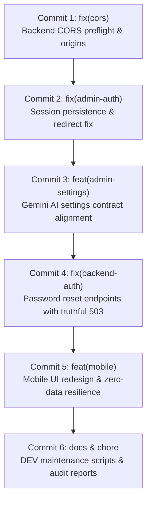

# FitOnus — Comprehensive Git, Commit & Deployment Audit Report

**Audit Date:** November 9, 2026  
**Auditor:** Senior Backend Engineer, Authentication Security Engineer, QA Engineer  
**Repository Root:** `/media/devshan/Study_Drive/Info/Projects/TuneOnus/FitOnus`  
**Active Branch:** `main`  
**Execution Mode:** Strictly Read-Only (Zero Staging, Zero Commits, Zero Pushes, Zero Schema Changes)

---

## 1. Git Status & Repository Topology

### Current Branch & Commit Pointers
- **Current Branch:** `main`
- **Local HEAD Commit:** `3f8fb05` (`feat(mobile): complete local notification phase A`)
- **Remote `origin/main` Commit:** `48d35c1` (`docs: add pre-notification git checkpoint report`)
- **Remote Fetch / Push URL:** `https://github.com/tuneonus/FitOnus.git`
- **Upstream Tracking Status:**
  - `origin/main` commit is `48d35c1fb7a54ac9a40d5099bb052e86efaf6432` (verified via `git ls-remote`).
  - Local `main` is **ahead of remote by 1 commit** (`3f8fb05`).
  - Remote commits not pulled: **0**.
  - Local commits not pushed: **1** (`3f8fb05`).

### Worktrees
The repository has an active secondary Git worktree:
1. `/media/devshan/Study_Drive/Info/Projects/TuneOnus/FitOnus` (`3f8fb05` on `main`)
2. `/media/devshan/Study_Drive/Info/Projects/TuneOnus/FitOnus-worktree-phase10-2b` (`4f3d163` on `phase-10.2b-admin-password`)

### Working Tree Overview
- **Staged Changes:** **0 files** (Working index is clean; no changes staged for commit).
- **Uncommitted Modified Files:** **58 files** (11 admin, 6 backend, 39 mobile, 2 root markdown).
- **Untracked Files / Directories:** **18 items** (including `Resources/docs/fitonus-premium-ui-phase2/` containing 36 PNG screenshots).
- **Deleted Files:** **0 files**.

---

## 2. Review & Categorization of All Changes

All working tree modifications have been inspected and categorized into functional groups:

### Category A: Admin Authentication & Session Persistence Fixes (Required for Vercel)
*Resolves the Vercel Admin login redirect bounce loop (`/login` → `/` → `/login`).*
- [`admin/src/lib/token-storage.ts`](file:///media/devshan/Study_Drive/Info/Projects/TuneOnus/FitOnus/admin/src/lib/token-storage.ts) *(Untracked)*: SSR-safe localStorage helper for persisting admin Bearer token.
- [`admin/src/features/auth/types.ts`](file:///media/devshan/Study_Drive/Info/Projects/TuneOnus/FitOnus/admin/src/features/auth/types.ts) *(Modified)*: Added `accessToken?: string` to `AdminLoginResult`.
- [`admin/src/features/auth/api.ts`](file:///media/devshan/Study_Drive/Info/Projects/TuneOnus/FitOnus/admin/src/features/auth/api.ts) *(Modified)*: Calls `setAuthToken(res.data.accessToken)` on login and `clearAuthToken()` on logout.
- [`admin/src/lib/api-client.ts`](file:///media/devshan/Study_Drive/Info/Projects/TuneOnus/FitOnus/admin/src/lib/api-client.ts) *(Modified)*: Automatically attaches `Authorization: Bearer <token>` to outbound requests; preserves CSRF custom header (`X-Panel-Id`).
- [`admin/src/features/auth/context/AuthContext.tsx`](file:///media/devshan/Study_Drive/Info/Projects/TuneOnus/FitOnus/admin/src/features/auth/context/AuthContext.tsx) *(Modified)*: Hydrates session from stored token via `authApi.getMe()`, prevents race condition redirects while loading, and purges token on expiration/logout.
- [`admin/tests/admin-auth-session.test.ts`](file:///media/devshan/Study_Drive/Info/Projects/TuneOnus/FitOnus/admin/tests/admin-auth-session.test.ts) *(Untracked)*: 9 regression tests verifying session persistence, dashboard retention, and redirect prevention.

### Category B: Backend Authentication & Session Fixes (Required for Render DEV)
*Enables cross-site cookie transmission and verifies bearer authentication paths.*
- [`backend/src/modules/admin/interface/admin.controller.ts`](file:///media/devshan/Study_Drive/Info/Projects/TuneOnus/FitOnus/backend/src/modules/admin/interface/admin.controller.ts) *(Modified)*: Sets `SameSite=None; Secure; Partitioned` for production/HTTPS environments (fallback to `SameSite=Lax` for local dev).
- [`backend/tests/unit/admin/admin-login-auth.test.ts`](file:///media/devshan/Study_Drive/Info/Projects/TuneOnus/FitOnus/backend/tests/unit/admin/admin-login-auth.test.ts) *(Untracked)*: 11 tests verifying Argon2id admin verification, email casing normalization, production vs development cookie attributes, and Bearer token extraction.
- [`backend/src/modules/auth/interface/auth.controller.ts`](file:///media/devshan/Study_Drive/Info/Projects/TuneOnus/FitOnus/backend/src/modules/auth/interface/auth.controller.ts) *(Modified)*: Added truthful `503 SERVICE_UNAVAILABLE` handlers for `/forgot-password` and `/reset-password` without fake mocked email delivery.
- [`backend/src/modules/auth/interface/auth.routes.ts`](file:///media/devshan/Study_Drive/Info/Projects/TuneOnus/FitOnus/backend/src/modules/auth/interface/auth.routes.ts) *(Modified)*: Registered public routes for password reset endpoints.
- [`backend/src/modules/auth/interface/auth.schemas.ts`](file:///media/devshan/Study_Drive/Info/Projects/TuneOnus/FitOnus/backend/src/modules/auth/interface/auth.schemas.ts) *(Modified)*: Added Zod schemas for forgot/reset password requests.
- [`backend/tests/integration/http/auth.http.test.ts`](file:///media/devshan/Study_Drive/Info/Projects/TuneOnus/FitOnus/backend/tests/integration/http/auth.http.test.ts) *(Modified)*: Integration test asserting truthful 503 behavior.

### Category C: CORS Fixes (Required for Render DEV)
*Resolves HTTP 405 Method Not Allowed on cross-origin OPTIONS preflight requests from Vercel.*
- [`backend/src/app.ts`](file:///media/devshan/Study_Drive/Info/Projects/TuneOnus/FitOnus/backend/src/app.ts) *(Modified)*: Included `https://fit-onus.vercel.app` in `DEFAULT_ALLOWED_ORIGINS` and added `Authorization` and `Accept` to `allowedHeaders`.
- [`backend/.env.example`](file:///media/devshan/Study_Drive/Info/Projects/TuneOnus/FitOnus/backend/.env.example) *(Modified)*: Updated `CORS_ORIGINS` example to `http://localhost:5173,https://fit-onus.vercel.app`.
- [`backend/tests/unit/admin/admin-cors-preflight.test.ts`](file:///media/devshan/Study_Drive/Info/Projects/TuneOnus/FitOnus/backend/tests/unit/admin/admin-cors-preflight.test.ts) *(Untracked)*: 7 unit tests verifying allowed Vercel origin, preflight headers, credentials, and disallowed origin rejection.

### Category D: Mobile UI, Zero-Data & Offline Resilience Fixes (Mobile App Scope)
*Truthful data presentation, zero-state handlers, and offline synchronization across mobile features.*
- **Workouts:** 14 files (`ActiveWorkoutScreen.tsx`, `ExerciseDetailScreen.tsx`, `ExerciseLibraryScreen.tsx`, `WorkoutCompleteScreen.tsx`, `WorkoutGeneratorScreen.tsx`, `WorkoutHistoryScreen.tsx`, `WorkoutPlanScreen.tsx`, `WorkoutsScreen.tsx`, `SetRow.tsx`, `workoutsMock.ts`, `offline-sync.ts`, `workoutPlanGenerator.ts`, `workoutStore.ts`, `premium-workout.ts`).
- **Nutrition:** 5 files (`BarcodeScannerScreen.tsx`, `FoodDetailScreen.tsx`, `MealAnalysisScreen.tsx`, `MealPhotoScreen.tsx`, `VoiceMealEntryScreen.tsx`).
- **Activity & Health:** 4 files (`ActivityDetailScreen.tsx`, `ActivityScreen.tsx`, `RecoveryScreen.tsx`, `SleepScreen.tsx`).
- **Coach & AI:** 3 files (`VoiceCoachScreen.tsx`, `actionExecutor.ts`, `coach.ts`).
- **Auth & Settings:** 5 files (`auth-repository.ts`, `ForgotPasswordScreen.tsx`, `ResetPasswordScreen.tsx`, `authService.ts`, `auth-schemas.ts`).
- **Shared Presentation:** 5 files (`quick-log.tsx`, `RecommendedWorkout.tsx`, `notificationsStore.ts`, `ToastHost.tsx`, `StatusBanner.tsx`, `api-client.ts`).
- **Tests & Visual Evidence:**
  - [`mobile/tests/workout-zero-data.test.ts`](file:///media/devshan/Study_Drive/Info/Projects/TuneOnus/FitOnus/mobile/tests/workout-zero-data.test.ts) *(Untracked)*
  - [`mobile/tests/account-security.test.ts`](file:///media/devshan/Study_Drive/Info/Projects/TuneOnus/FitOnus/mobile/tests/account-security.test.ts) *(Modified)*
  - [`mobile/tests/fitness-data-quality.test.ts`](file:///media/devshan/Study_Drive/Info/Projects/TuneOnus/FitOnus/mobile/tests/fitness-data-quality.test.ts) *(Modified)*
  - [`mobile/tests/notifications-phase-a.test.ts`](file:///media/devshan/Study_Drive/Info/Projects/TuneOnus/FitOnus/mobile/tests/notifications-phase-a.test.ts) *(Modified)*
  - `Resources/docs/fitonus-premium-ui-phase2/` *(Untracked)*: 36 visual snapshot captures + validation metadata.

### Category E: Neon DEV Database Maintenance & Diagnostic Scripts
*Safe utility scripts for database maintenance on the DEV branch.*
- [`backend/scripts/dev-fresh-start.sql`](file:///media/devshan/Study_Drive/Info/Projects/TuneOnus/FitOnus/backend/scripts/dev-fresh-start.sql) *(Untracked)*: Transactional data wipe script with foreign key cascade protection.
- [`backend/scripts/reset-dev-admin-password.ts`](file:///media/devshan/Study_Drive/Info/Projects/TuneOnus/FitOnus/backend/scripts/reset-dev-admin-password.ts) *(Untracked)*: Safe interactive Argon2id reset procedure targeting DEV only (blocks PROD).
- [`backend/scripts/run-fresh-start-dry-run.ts`](file:///media/devshan/Study_Drive/Info/Projects/TuneOnus/FitOnus/backend/scripts/run-fresh-start-dry-run.ts) *(Untracked)*: Dry-run runner that rolls back transactions automatically.

### Category F: Documentation & Engineering Reports
*Detailed technical records of diagnoses, audits, and fixes.*
- `FITONUS_ADMIN_LOGIN_401_DIAGNOSIS_REPORT.md` *(Untracked)*
- `FITONUS_ADMIN_LOGIN_REDIRECT_FIX_REPORT.md` *(Untracked)*
- `FITONUS_VERCEL_ADMIN_CORS_FIX_REPORT.md` *(Untracked)*
- `FITONUS_DEV_FRESH_START_AUDIT_REPORT.md` *(Untracked)*
- `FITONUS_DEV_FRESH_START_EXECUTION_READINESS.md` *(Untracked)*
- `FITONUS_DUMMY_DATA_FIX_IMPLEMENTATION_REPORT.md` *(Untracked)*
- `FITONUS_EXISTING_NEON_PRODUCTION_DB_AUDIT.md` *(Untracked)*
- `FITONUS_FULL_APPLICATION_DUMMY_DATA_AUDIT.md` *(Untracked)*
- `FITONUS_NOTIFICATION_ANDROID_BUILD_REPORT.md` *(Untracked)*
- `FITONUS_PREMIUM_UI_REDESIGN_PHASE2.md` *(Modified)*
- `FITONUS_PRE_NOTIFICATION_GIT_CHECKPOINT_REPORT.md` *(Modified)*

### Category G: Concurrent Codex Session Changes
*Modifications in settings/analytics from concurrent development.*
- `admin/src/features/dashboard/components/UserGrowthChart.tsx`: Notice cleanup for 90D timeframe.
- `admin/src/features/settings/components/GeminiAnalyticsSection.tsx`: Defensive property fallbacks (`todayRequests`, `monthRequests`, `totalTokens`).
- `admin/src/features/settings/components/GeminiConfigSection.tsx`: Support for `featureModels` map and legacy aliases.
- `admin/src/features/settings/hooks/useGeminiSettings.ts`: Synchronized `featureModels` with backend Gemini config response.
- `admin/src/features/settings/types-ai.ts`: Updated Gemini AI DTO definitions.
- Local unpushed commit `3f8fb05` on `main`: `feat(mobile): complete local notification phase A`.

---

## 3. Security Audit & Secret Leakage Check

A comprehensive scan was conducted across the working tree and diff:

| Check Item | Status | Details |
| :--- | :--- | :--- |
| **Plaintext Passwords in Code** | **PASSED** | Zero plaintext passwords found in modified or untracked files. |
| **API Keys & AI Secrets** | **PASSED** | Zero exposed Gemini or third-party API keys in code or diffs. |
| **Database Connection Strings** | **PASSED** | Zero `postgres://` or Neon connection strings with credentials committed or staged. |
| **JWT & Encryption Secrets** | **PASSED** | Zero JWT signing secrets or encryption keys found in code. |
| **Environment Files Protection** | **PASSED** | `.env`, `.env.local`, and `.env.primary.backup` are strictly ignored by `.gitignore`. Only sanitized `.env.example` is tracked. |
| **Password Reset Utility** | **PASSED** | `reset-dev-admin-password.ts` prompts via hidden stdin or unsets env var immediately, hashes using Argon2id, and strictly blocks execution against Neon PROD. |
| **LocalStorage Token Handling** | **PASSED** | Access token stored in `localStorage` is short-lived (15 minutes expiry) with `SameSite=None; Secure; Partitioned` cookie defense-in-depth and CSRF headers (`X-Panel-Id`). |

### Sensitive Files That Must NEVER Be Committed
1. `/backend/.env`
2. `/backend/.env.primary.backup`
3. `/admin/.env.local`
4. `/mobile/.env`

*(All four are verified to be untracked and excluded by `.gitignore`).*

---

## 4. Deployment Configuration Audit

### Vercel Deployment Configuration (Admin Frontend)
- **Target URL:** `https://fit-onus.vercel.app`
- **Root Directory:** `admin`
- **Framework Preset:** Next.js
- **Build Command:** `next build` (or `npm run build`)
- **Required Environment Variables:**
  - `NEXT_PUBLIC_API_URL=https://fitonus-api-dev.onrender.com/api/v1/admin`
- **Deployment Requirement:**
  Redeployment is **REQUIRED** to ship the Bearer token persistence fix (`token-storage.ts`, `api-client.ts`, `AuthContext.tsx`).

### Render Deployment Configuration (DEV Backend)
- **Target URL:** `https://fitonus-api-dev.onrender.com`
- **Root Directory:** `backend`
- **Environment:** Node.js (Node >= 22.22.0)
- **Build Command:** `npm run build` (`tsc -p tsconfig.build.json`)
- **Start Command:** `node dist/src/server.js`
- **Required Environment Variables:**
  - `NODE_ENV=production`
  - `PORT=10000` (or Render standard port)
  - `TRUST_PROXY=1` (Render terminates TLS at reverse proxy)
  - `DATABASE_URL` (pointing to Neon DEV branch `br-fragrant-morning-b35lwkjg` / endpoint `ep-shy-art-b3sxwfkd`)
  - `CORS_ORIGINS=http://localhost:5173,https://fit-onus.vercel.app`
  - `ACCESS_TOKEN_SECRET`, `REFRESH_TOKEN_SECRET`, `IDEMPOTENCY_KEY_SECRET`
- **Deployment Requirement:**
  Redeployment is **REQUIRED** to activate the CORS headers fix in `app.ts` and the `SameSite=None; Secure; Partitioned` cookie defense in `admin.controller.ts`.

---

## 5. Quality Verification Results

All read-only quality gates were executed across all three subprojects:

| Project | Gate / Command | Status | Result / Metrics |
| :--- | :--- | :---: | :--- |
| **Admin Portal** | `tsc -p admin/tsconfig.json --noEmit` | **PASS** | 0 TypeScript errors |
| **Admin Portal** | `npm --prefix admin test` | **PASS** | **79 / 79 tests passed** across 8 suites (852ms) |
| **Backend API** | `npm --prefix backend run typecheck` | **PASS** | 0 TypeScript errors |
| **Backend API** | `vitest run tests/unit/admin` | **PASS** | **49 / 49 admin unit tests passed** |
| **Backend API** | `vitest run backend/tests/unit` | **PASS** | **758 / 758 backend unit tests passed** across 78 files |
| **Mobile App** | `npm --prefix mobile run typecheck` | **PASS** | 0 TypeScript errors |
| **Mobile App** | `npm --prefix mobile test` | **PASS** | **272 / 272 mobile tests passed** across 104 suites |

---

## 6. Recommended Commit Plan

To maintain clean repository history and avoid mixing unrelated domains, the changes should be committed in **6 distinct, self-contained atomic commits**:



### Commit 1: Backend CORS Configuration Fix
```bash
git add backend/src/app.ts backend/.env.example backend/tests/unit/admin/admin-cors-preflight.test.ts
git commit -m "fix(cors): allow Vercel admin origin and preflight headers in Express backend"
```
- **Scope:** Allows `https://fit-onus.vercel.app` in `corsMiddleware` and verifies preflight response with regression tests.
- **Target:** Render DEV deployment.

### Commit 2: Admin Authentication Session Persistence & Cookie Defense
```bash
git add \
  admin/src/lib/token-storage.ts \
  admin/src/features/auth/types.ts \
  admin/src/features/auth/api.ts \
  admin/src/lib/api-client.ts \
  admin/src/features/auth/context/AuthContext.tsx \
  backend/src/modules/admin/interface/admin.controller.ts \
  admin/tests/admin-auth-session.test.ts \
  backend/tests/unit/admin/admin-login-auth.test.ts
git commit -m "fix(admin-auth): persist bearer token and resolve cross-site session redirect loop"
```
- **Scope:** Fixes client Bearer token storage, header injection, session hydration, and backend `SameSite=None; Secure; Partitioned` cookie attributes.
- **Target:** Vercel Admin and Render DEV deployments.

### Commit 3: Admin Settings Gemini AI Alignment
```bash
git add \
  admin/src/features/dashboard/components/UserGrowthChart.tsx \
  admin/src/features/settings/components/GeminiAnalyticsSection.tsx \
  admin/src/features/settings/components/GeminiConfigSection.tsx \
  admin/src/features/settings/hooks/useGeminiSettings.ts \
  admin/src/features/settings/types-ai.ts
git commit -m "feat(admin-settings): align Gemini AI management and analytics contracts"
```
- **Scope:** Frontend DTO compatibility for Gemini model selection and usage analytics.
- **Target:** Vercel Admin deployment.

### Commit 4: Backend Public Auth Endpoints Truthfulness
```bash
git add \
  backend/src/modules/auth/interface/auth.controller.ts \
  backend/src/modules/auth/interface/auth.routes.ts \
  backend/src/modules/auth/interface/auth.schemas.ts \
  backend/tests/integration/http/auth.http.test.ts
git commit -m "fix(backend-auth): handle password reset endpoints with truthful unavailable status"
```
- **Scope:** Replaces fake email responses with truthful 503 `SERVICE_UNAVAILABLE`.
- **Target:** Render DEV deployment.

### Commit 5: Mobile UI Redesign & Zero-Data Hardening
```bash
git add \
  mobile/src/ \
  mobile/tests/ \
  Resources/docs/fitonus-premium-ui-phase2/
git commit -m "feat(mobile): implement premium workout/nutrition redesign and truthful zero-data states"
```
- **Scope:** Phase 2 athletic UI redesign, zero-state handlers, and account security tests.
- **Target:** Mobile CI / Expo build.

### Commit 6: DEV Database Maintenance Scripts & Engineering Documentation
```bash
git add \
  backend/scripts/dev-fresh-start.sql \
  backend/scripts/reset-dev-admin-password.ts \
  backend/scripts/run-fresh-start-dry-run.ts \
  FITONUS_*.md
git commit -m "docs(audit): add DEV maintenance scripts and audit reports"
```
- **Scope:** Safe database reset scripts and historical audit reports.

---

## 7. Approval Gates & Next Steps

The repository is fully verified and deployment-ready. To proceed safely, the following sequence of approval gates must be observed:

1. **Gate 1 — Commit Approval:** User reviews and approves the 6-commit plan above.
2. **Gate 2 — Push Approval:** User authorizes `git push origin main` (including unpushed commit `3f8fb05` + new commits).
3. **Gate 3 — Render DEV Deployment:** Trigger manual or automatic Render build from `main`. Verify environment variable `CORS_ORIGINS` includes `https://fit-onus.vercel.app`.
4. **Gate 4 — Vercel Admin Deployment:** Trigger Vercel build from `main`. Verify `NEXT_PUBLIC_API_URL` points to `https://fitonus-api-dev.onrender.com/api/v1/admin`.
5. **Gate 5 — Live Smoke Test:** Perform incognito browser login at `https://fit-onus.vercel.app/login` and verify dashboard remains open without redirecting.

