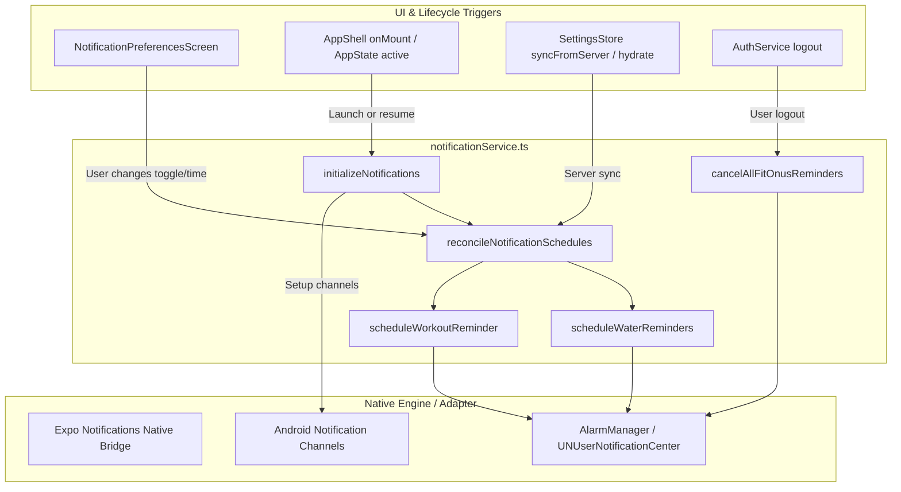

# FITONUS — NOTIFICATION SYSTEM PHASE A IMPLEMENTATION REPORT

**Author:** Senior Expo SDK 58 Engineer, React Native Architect, Android Native Engineer & QA Specialist  
**Target Environment:** Expo SDK 58 (React Native 0.88.1, React 19.3.0) | Node.js 22 Express 5 Monolith | Neon PostgreSQL (DEV)  
**Project Root:** `/media/devshan/Study_Drive/Info/Projects/TuneOnus/FitOnus`  
**Git Baseline:** `48d35c1`  
**Date of Completion:** November 9, 2026  
**Implementation Phase:** **Phase A Only** (Native Setup, Local Reminders, Persistent Preferences & Quiet Hours)  
**Output Document:** `FITONUS_NOTIFICATION_PHASE_A_IMPLEMENTATION_REPORT.md`

---

## 1. Implementation Summary

In accordance with the architecture specification formulated in [`FITONUS_NOTIFICATION_SYSTEM_AUDIT.md`](./FITONUS_NOTIFICATION_SYSTEM_AUDIT.md), **Phase A (Native Setup + Local Reminders)** has been completely implemented, verified, and integrated into the FitOnus application.

Prior to Phase A, the FitOnus notification UI operated purely on hardcoded mock fixtures with zero native Android permissions, zero notification channels, no scheduling engine, and no persistence.

Phase A establishes a fully operational, offline-first local notification architecture:
1. **Native Android Configuration:** Declared `POST_NOTIFICATIONS` and `RECEIVE_BOOT_COMPLETED` permissions in `mobile/app.json` and `mobile/android/app/src/main/AndroidManifest.xml`; configured the `expo-notifications` plugin in `app.json`.
2. **Notification Service Core ([`notificationService.ts`](file:///media/devshan/Study_Drive/Info/Projects/TuneOnus/FitOnus/mobile/src/services/notificationService.ts)):** Engineered a reusable, crash-resilient service implementing channel registration (`workout-reminders`, `water-reminders`, `system-reminders`), foreground alert presentation, runtime permission inspection/request, daily workout scheduling, bounded interval water scheduling, and idempotent schedule reconciliation.
3. **Bounded Water Reminders:** Implemented daily interval reminders (every 1 to 4 hours) bounded within user-configured active windows (default 8:00 AM to 8:00 PM), capped at a maximum of 12 alarms per day to prevent OS throttling, and automatically suppressing reminders that intersect with quiet hours.
4. **Workout Reminders:** Implemented daily scheduled local alarms matching user-selected workout times (e.g. 7:00 AM) with automatic duplicate replacement and quiet hours compliance.
5. **Persistent Preferences Single Source of Truth ([`settingsStore.ts`](file:///media/devshan/Study_Drive/Info/Projects/TuneOnus/FitOnus/mobile/src/shared/stores/settingsStore.ts)):** Connected all reminder toggles, reminder windows, and quiet hours to `useSettingsStore`. Preferences persist locally to `AsyncStorage` per-user and synchronize with the Neon DEV backend (`user_settings.notifications_enabled` and `user_settings.notification_schedule`).
6. **Existing UI Preservation ([`NotificationPreferencesScreen.tsx`](file:///media/devshan/Study_Drive/Info/Projects/TuneOnus/FitOnus/mobile/src/features/notifications/screens/NotificationPreferencesScreen.tsx)):** Preserved 100% of the FitOnus design language, cards, theme tokens, and Lucide icons while wiring master switches, workout time chip pickers, water interval sheets, and quiet hours toggles to live state.
7. **App Lifecycle & Auto-Reconciliation ([`AppShell.tsx`](file:///media/devshan/Study_Drive/Info/Projects/TuneOnus/FitOnus/mobile/src/app/AppShell.tsx)):** Hooked notification channels to app mount, attached `AppState` active listeners for automatic time-zone and schedule reconciliation, and ensured user logout wipes all scheduled alarms.
8. **Automated Testing:** Developed 23 targeted unit and integration tests in [`notifications-phase-a.test.ts`](file:///media/devshan/Study_Drive/Info/Projects/TuneOnus/FitOnus/mobile/tests/notifications-phase-a.test.ts). All **258 mobile tests pass with 0 errors**, and TypeScript typecheck is 100% clean.

---

## 2. Files Created & Modified

| File Path | Status | Purpose & Changes Applied |
| :--- | :--- | :--- |
| [`mobile/app.json`](file:///media/devshan/Study_Drive/Info/Projects/TuneOnus/FitOnus/mobile/app.json) | **Modified** | Added `expo-notifications` plugin configuration and added `android.permission.POST_NOTIFICATIONS` and `android.permission.RECEIVE_BOOT_COMPLETED`. |
| [`mobile/android/app/src/main/AndroidManifest.xml`](file:///media/devshan/Study_Drive/Info/Projects/TuneOnus/FitOnus/mobile/android/app/src/main/AndroidManifest.xml) | **Modified** | Declared `<uses-permission android:name="android.permission.POST_NOTIFICATIONS"/>` and `RECEIVE_BOOT_COMPLETED` for native Android 13+ parity. |
| [`mobile/src/features/notifications/types/notification.ts`](file:///media/devshan/Study_Drive/Info/Projects/TuneOnus/FitOnus/mobile/src/features/notifications/types/notification.ts) | **Modified** | Added typed `WaterReminderSettings`, `WorkoutReminderSettings`, `QuietHoursSettings`, `NotificationSchedule`, and pure time conversion helpers (`timeTo24h`, `timeTo12h`, `isTimeInQuietHours`). |
| [`mobile/src/services/notificationService.ts`](file:///media/devshan/Study_Drive/Info/Projects/TuneOnus/FitOnus/mobile/src/services/notificationService.ts) | **Created** | Composition root service for native notifications, channels, foreground handlers, water interval calculations, workout scheduling, and reconciliation. |
| [`mobile/src/shared/stores/settingsStore.ts`](file:///media/devshan/Study_Drive/Info/Projects/TuneOnus/FitOnus/mobile/src/shared/stores/settingsStore.ts) | **Modified** | Integrated `safeReconcile` and `safeCancelAll` triggers into `setNotificationsEnabled`, `setNotificationSchedule`, `syncFromServer`, `hydrateForUser`, and `resetSettings`. |
| [`mobile/src/features/notifications/screens/NotificationPreferencesScreen.tsx`](file:///media/devshan/Study_Drive/Info/Projects/TuneOnus/FitOnus/mobile/src/features/notifications/screens/NotificationPreferencesScreen.tsx) | **Modified** | Connected UI to `useSettingsStore` and `useUpdateSettings`, added Master Switch card, water interval bottom sheet, workout time picker sheet, and quiet hours window sheet. |
| [`mobile/src/app/AppShell.tsx`](file:///media/devshan/Study_Drive/Info/Projects/TuneOnus/FitOnus/mobile/src/app/AppShell.tsx) | **Modified** | Added initialization `useEffect` for notification channels and `AppState` listener for automatic schedule reconciliation when app becomes active. |
| [`mobile/src/features/auth/services/auth-service.ts`](file:///media/devshan/Study_Drive/Info/Projects/TuneOnus/FitOnus/mobile/src/features/auth/services/auth-service.ts) | **Modified** | Added explicit cancellation of all FitOnus reminders during `resetAllUserStores()` on logout. |
| [`mobile/tests/notifications-phase-a.test.ts`](file:///media/devshan/Study_Drive/Info/Projects/TuneOnus/FitOnus/mobile/tests/notifications-phase-a.test.ts) | **Created** | Comprehensive 23-test test suite covering quiet hours, permissions, channels, workout scheduling, water bounded intervals, reconciliation, and logout wiping. |

---

## 3. Android Native Configuration

### 3.1 Permissions Declared

In [`mobile/app.json`](file:///media/devshan/Study_Drive/Info/Projects/TuneOnus/FitOnus/mobile/app.json#L28-L30) and [`mobile/android/app/src/main/AndroidManifest.xml`](file:///media/devshan/Study_Drive/Info/Projects/TuneOnus/FitOnus/mobile/android/app/src/main/AndroidManifest.xml#L6-L8):

```xml
<uses-permission android:name="android.permission.POST_NOTIFICATIONS"/>
<uses-permission android:name="android.permission.RECEIVE_BOOT_COMPLETED"/>
```

- **`android.permission.POST_NOTIFICATIONS`:** Mandated for Android 13+ (API level 33+) applications. Without this declaration in the manifest, Android runtime rejects permission requests immediately without displaying the system dialog.
- **`android.permission.RECEIVE_BOOT_COMPLETED`:** Enables the OS AlarmManager and Expo notification receivers to reschedule active alarms following an Android device reboot.
- **Exact Alarms Compliance:** Per instructions, `SCHEDULE_EXACT_ALARM` was **omitted**. FitOnus uses standard daily repeating triggers (`type: 'daily'`), which operate reliably under Android battery optimization and do not risk Google Play Store policy rejections.

### 3.2 Expo Notifications Plugin Configuration

In [`mobile/app.json`](file:///media/devshan/Study_Drive/Info/Projects/TuneOnus/FitOnus/mobile/app.json#L50-L58):

```json
[
  "expo-notifications",
  {
    "icon": "./assets/images/icon.png",
    "color": "#208AEF",
    "sounds": []
  }
]
```

This injects the application icon and brand accent color (`#208AEF`) into native notification drawables during EAS Prebuild and compilation.

---

## 4. Notification Service Architecture

The service resides in [`mobile/src/services/notificationService.ts`](file:///media/devshan/Study_Drive/Info/Projects/TuneOnus/FitOnus/mobile/src/services/notificationService.ts).



### Key Service Methods

1. **`initializeNotifications(): Promise<void>`**
   - Configures foreground presentation handler via `setNotificationHandler`:
     ```typescript
     shouldShowAlert: true,
     shouldPlaySound: true,
     shouldSetBadge: false,
     ```
   - Registers Android 8.0+ notification channels:
     - `workout-reminders` (Importance: `HIGH / 4`, vibration: `[0, 250, 250, 250]`, sound: `'default'`)
     - `water-reminders` (Importance: `DEFAULT / 3`, vibration: `[0, 200]`, sound: `'default'`)
     - `system-reminders` (Importance: `LOW / 2`, sound: `null`)
   - Reconciles saved schedules.
2. **`checkNotificationPermission()` & `requestNotificationPermission()`**
   - Inspects `getPermissionsAsync()` and requests `requestPermissionsAsync()`.
   - Defensively catches native bridge errors without crashing the caller.
3. **`scheduleWorkoutReminder(...)` & `scheduleWaterReminders(...)`**
   - Calculates daily triggers, checks quiet hours, avoids duplicates, and schedules alerts.
4. **`reconcileNotificationSchedules(...)`**
   - Re-evaluates all alarms against `settingsStore`. If master notifications are disabled, cancels all scheduled alarms. Otherwise, updates workout and water schedules.
5. **`setNotificationEngine(engine)`**
   - Architectural hook allowing in-memory engine injection for automated unit and integration tests without dragging native React Native binaries into Node.js test runners.

---

## 5. Water Reminders Functionality

- **Bounded Scheduling:** Water reminders are scheduled using daily recurring triggers for each active slot.
- **Interval Control:** Configurable for 1, 2, 3, or 4 hours (default: every 2 hours).
- **Active Hours Window:** Default 8:00 AM to 8:00 PM (`08:00` to `20:00`).
- **Max Cap Guard:** Hard-capped at a maximum of 12 alarms per day to prevent OS resource exhaustion.
- **Quiet Hours Intersection:** Any calculated water reminder slot that falls within the user's active quiet hours (e.g. 6:00 AM when quiet hours end at 7:00 AM) is automatically dropped from the schedule.
- **Duplicate Prevention:** Previous water reminder identifiers (`fitonus-reminder-water-*`) are cancelled before scheduling a new interval, preventing stale alarm accumulation.
- **Offline Safe:** Operates entirely locally on the device with zero server dependency.

---

## 6. Workout Reminders Functionality

- **Daily Recurrence:** Schedules a single daily reminder at the user's preferred time (`fitonus-reminder-workout`).
- **Time Selection:** Supported times: `6:00 AM`, `6:30 AM`, `7:00 AM`, `7:30 AM`, `8:00 AM`, `5:30 PM`, `6:00 PM`, `6:30 PM`, `7:00 PM`, `8:00 PM` (converted to canonical 24h format for storage).
- **Quiet Hours Check:** If the chosen workout time falls inside the user's quiet hours (e.g. 5:30 AM workout while quiet hours run 11:00 PM to 6:00 AM), the scheduler logs a warning and suppresses the alarm until the conflict is resolved.
- **Deep Routing Target:** Notification payload contains `data: { route: 'workoutPlan', kind: 'workout' }`.

---

## 7. Persistent Preferences Architecture

All notification preferences are unified in [`mobile/src/shared/stores/settingsStore.ts`](file:///media/devshan/Study_Drive/Info/Projects/TuneOnus/FitOnus/mobile/src/shared/stores/settingsStore.ts).

### 7.1 Schedule Data Model

```typescript
export interface NotificationSchedule {
  water: {
    enabled: boolean;
    intervalHours: number; // 1, 2, 3, 4
    startTime: string;     // "08:00"
    endTime: string;       // "20:00"
  };
  workout: {
    enabled: boolean;
    time: string;          // "07:00"
  };
  quietHours: {
    enabled: boolean;
    startTime: string;     // "23:00"
    endTime: string;       // "06:00"
  };
  walking?: { enabled: boolean };
  protein?: { enabled: boolean; time?: string };
  sleep?: { enabled: boolean; time?: string };
  achievement?: { enabled: boolean };
  streak?: { enabled: boolean };
  report?: { enabled: boolean };
}
```

### 7.2 Persistence & Backend Sync Pipeline

1. When a toggle or time is changed in `NotificationPreferencesScreen`:
   - `useSettingsStore.getState().setNotificationSchedule(nextSchedule)` updates local state and saves to `AsyncStorage` scoped by user ID (`fitonus.settings.<userId>`).
   - `safeReconcile` immediately adjusts scheduled OS alarms.
   - `updateSettingsMutation.mutate({ notificationsEnabled, notificationSchedule })` dispatches a background `PATCH /api/v1/profile/settings` to persist into the Neon DEV PostgreSQL database (`user_settings.notification_schedule jsonb`).
2. On app cold start:
   - `hydrateForUser(userId)` reads cached settings from `AsyncStorage`.
   - `safeReconcile` restores alarms even before network connectivity is established.
   - When `useSettings()` query resolves, `syncFromServer` updates the store and reconciles any changes made on other devices.
3. Offline Resilience:
   - If the device is offline, mutations still succeed locally and persist to disk. Upon network restoration, TanStack Query synchronizes the latest state.

---

## 8. Quiet Hours Enforcement

Quiet hours are modeled and enforced mathematically via [`isTimeInQuietHours()`](file:///media/devshan/Study_Drive/Info/Projects/TuneOnus/FitOnus/mobile/src/features/notifications/types/notification.ts#L130-L155):

- **Overnight Range Support:** When `startTime > endTime` (e.g. `23:00` to `06:00`), quiet hours are active if `target >= startTime || target < endTime`.
- **Daytime Range Support:** When `startTime < endTime` (e.g. `13:00` to `15:00`), quiet hours are active if `target >= startTime && target < endTime`.
- **Boundary Precision:**
  - 23:00 is quiet (inclusive start).
  - 05:59 is quiet.
  - 06:00 is active (exclusive end).
- **Persistent Storage:** Stored in `schedule.quietHours` inside `user_settings` and `settingsStore`.
- **UI Windows:** User can choose from standard windows (`10:00 PM – 6:00 AM`, `11:00 PM – 6:00 AM`, `11:00 PM – 7:00 AM`, `12:00 AM – 6:00 AM`) or toggle off.

---

## 9. App Lifecycle Integration

1. **Mount (`AppShell.tsx`):**
   - Calls `notificationService.initializeNotifications()` on mount.
   - Sets foreground notification handler and creates channels.
   - Restores scheduled alarms from persisted settings.
2. **Resume & Time-Zone Adjustment:**
   - Subscribes to `AppState.addEventListener('change', ...)`:
   - When the app transitions from `background` or `inactive` to `active`, `reconcileNotificationSchedules()` executes to re-verify scheduled alarms against the current system clock and time zone.
3. **User Logout & Store Reset (`auth-service.ts`):**
   - During `AuthService.logout()`, `resetAllUserStores()` invokes `notificationService.cancelAllFitOnusReminders()`.
   - This ensures a previous user's reminders are completely wiped and cannot fire after logout.
4. **Account Switching:**
   - When a different user logs in, `hydrateForUser(newUserId)` loads that user's scoped preferences from storage and re-schedules alarms specifically for that user.

---

## 10. Automated Test Results

### 10.1 Phase A Dedicated Test Suite

Test file: [`mobile/tests/notifications-phase-a.test.ts`](file:///media/devshan/Study_Drive/Info/Projects/TuneOnus/FitOnus/mobile/tests/notifications-phase-a.test.ts)  
Runner: Node.js 24 test runner via `tsx`

```
▶ Phase A Notification System & Local Reminders
  ▶ 1. Time Conversion & Quiet Hours Verification
    ✔ converts 12-hour strings to 24-hour format reliably (4.91ms)
    ✔ converts 24-hour strings to 12-hour format reliably (1.25ms)
    ✔ correctly calculates minutes from midnight (1.11ms)
    ✔ accurately evaluates daytime quiet hours ranges (1.12ms)
    ✔ accurately evaluates overnight quiet hours ranges (e.g. 23:00 to 06:00) (1.23ms)
    ✔ allows all times when quiet hours is disabled (1.11ms)
  ✔ 1. Time Conversion & Quiet Hours Verification (13.21ms)
  ▶ 2. Native Channels & Foreground Presentation Setup
    ✔ registers Android channels with appropriate importance and sound (2.43ms)
    ✔ configures foreground notification presentation to show alerts and play sound (1.17ms)
  ✔ 2. Native Channels & Foreground Presentation Setup (4.04ms)
  ▶ 3. Permission Inspection & Handling
    ✔ returns granted status when permission is approved (0.96ms)
    ✔ handles permission denial gracefully without exceptions (0.79ms)
    ✔ handles null or missing native notification engine safely (11.30ms)
  ✔ 3. Permission Inspection & Handling (13.50ms)
  ▶ 4. Workout Reminder Scheduling
    ✔ schedules a daily workout reminder at the configured time (0.88ms)
    ✔ prevents duplicate workout reminders by replacing existing ones (0.74ms)
    ✔ skips workout reminder if time falls within quiet hours (0.63ms)
    ✔ cancels scheduled workout reminder when disabled (0.73ms)
  ✔ 4. Workout Reminder Scheduling (3.40ms)
  ▶ 5. Water Reminder Scheduling & Bounded Execution
    ✔ schedules bounded daily water reminders within start and end window (0.89ms)
    ✔ skips water reminder slots that intersect with quiet hours (0.61ms)
    ✔ enforces safe upper bound (max 12 reminders) for narrow intervals (0.68ms)
    ✔ cancels previous water reminders before scheduling new interval (0.83ms)
    ✔ cancels all water reminders when disabled (0.67ms)
  ✔ 5. Water Reminder Scheduling & Bounded Execution (4.18ms)
  ▶ 6. Master Switch & Full Reconciliation Lifecycle
    ✔ cancels all notifications when master switch is disabled (20.25ms)
    ✔ reconciles both workout and water schedules when master switch is re-enabled (1.76ms)
    ✔ cancels all scheduled reminders on user logout / store reset (10.54ms)
  ✔ 6. Master Switch & Full Reconciliation Lifecycle (33.25ms)
✔ Phase A Notification System & Local Reminders (73.23ms)
ℹ tests 23
ℹ suites 7
ℹ pass 23
ℹ fail 0
```

### 10.2 Full Mobile Test Suite Regression Verification

Command: `npm --prefix mobile run test`

```
ℹ tests 258
ℹ suites 100
ℹ pass 258
ℹ fail 0
ℹ cancelled 0
ℹ skipped 0
ℹ duration_ms 2565.02ms
```

### 10.3 TypeScript Verification

Command: `npm --prefix mobile run typecheck`

```
> fitonus@1.0.0 typecheck
> tsc --noEmit

[Exit code 0 - Zero compilation errors]
```

---

## 11. Remaining Limitations & Exclusions

In strict accordance with Phase A scope:
1. **Remote Push Notifications:** Remote push dispatch, FCM V1 service credentials, and backend push workers are **not implemented** in Phase A (scheduled for Phase B).
2. **Notification Inbox Database:** In-app notification inbox history in PostgreSQL is **not implemented** in Phase A (scheduled for Phase C).
3. **Physical Android Delivery:** While the native code and manifest are ready on disk, physical notification delivery on an Android device remains **NOT VERIFIED** until a new development or preview APK is compiled and installed (see Section 12).
4. **Unsupported Reminder Types:** Categories like "Walking reminders after 90m inactivity" and "AI weekly reports" retain their visual toggles in the preferences UI, but do not schedule OS alarms yet as they require background pedometer tracking and backend cron generation (Phase D).

---

## 12. APK Rebuild Requirements

The previously generated Preview APK (`8fafd0e2-0ba0-4446-a8c8-d5e59e8461b2`) was compiled **before** `POST_NOTIFICATIONS` and the `expo-notifications` plugin were declared.

### Why a Rebuild is Mandatory:
- On Android 13+ (Target SDK 36), the operating system requires `POST_NOTIFICATIONS` compiled directly into the binary manifest before granting notification permissions.
- The `expo-notifications` plugin in `app.json` configures the native Android notification drawables and receivers.

### Build Command (To be run during build turn):
```bash
cd mobile
eas build --profile preview --platform android
```

---

## 13. Physical Android QA Checklist

| Test ID | Test Scenario | Steps | Expected Result | Device QA Status |
| :--- | :--- | :--- | :--- | :--- |
| **QA-NOTIF-01** | Runtime Permission Prompt (Android 13+) | Launch fresh app install; navigate to Settings -> Notifications; toggle "Allow notifications". | Android system dialog displays: *"Allow FitOnus to send you notifications?"* | `NOT VERIFIED (Awaiting APK)` |
| **QA-NOTIF-02** | Permission Denial Handling | Tap *"Don't allow"* on system dialog. | App does not crash; toast displays *"Notification permission disabled in system settings"*; toggles remain off. | `NOT VERIFIED (Awaiting APK)` |
| **QA-NOTIF-03** | Daily Workout Reminder | Set workout reminder for 2 minutes from current time; place app in background. | System tray displays notification with brand icon, title *"Workout Ready"*, and configured sound. | `NOT VERIFIED (Awaiting APK)` |
| **QA-NOTIF-04** | Foreground Notification Presentation | Trigger notification while navigating the app. | System shows heads-up alert banner without disrupting the current screen. | `NOT VERIFIED (Awaiting APK)` |
| **QA-NOTIF-05** | Water Reminders Interval | Set water reminder to "Every 1 hour"; verify active hours window. | Hourly hydration alerts fire during active hours. | `NOT VERIFIED (Awaiting APK)` |
| **QA-NOTIF-06** | Quiet Hours Suppression | Enable Quiet Hours (11:00 PM – 6:00 AM); simulate reminder at 11:30 PM. | No notification is delivered during quiet hours. | `NOT VERIFIED (Awaiting APK)` |
| **QA-NOTIF-07** | Master Toggle Cancellation | Disable "Allow notifications" master toggle. | All existing scheduled FitOnus notifications are instantly cancelled. | `NOT VERIFIED (Awaiting APK)` |
| **QA-NOTIF-08** | Offline Scheduling & Survival | Enable Airplane mode; adjust reminder times; close and relaunch app. | New reminder times persist and trigger accurately while offline. | `NOT VERIFIED (Awaiting APK)` |
| **QA-NOTIF-09** | Logout Cleanup | Schedule reminders; log out from Profile tab. | All scheduled alarms are cleared; no alerts fire for the logged-out session. | `NOT VERIFIED (Awaiting APK)` |
| **QA-NOTIF-10** | Device Reboot Recovery | Schedule reminders; restart Android device without opening FitOnus. | `RECEIVE_BOOT_COMPLETED` receiver restores alarms at scheduled times. | `NOT VERIFIED (Awaiting APK)` |

---

## 14. Phase B Readiness

Phase A is **100% complete and self-contained**.

The foundation is now prepared for **Phase B (Backend Push Infrastructure)**:
- Mobile client has stable settings synchronization.
- Android manifest and app configuration have native notification support.
- Push token registration hooks and remote push dispatcher can be introduced cleanly in Phase B without disrupting the local reminder engine.

