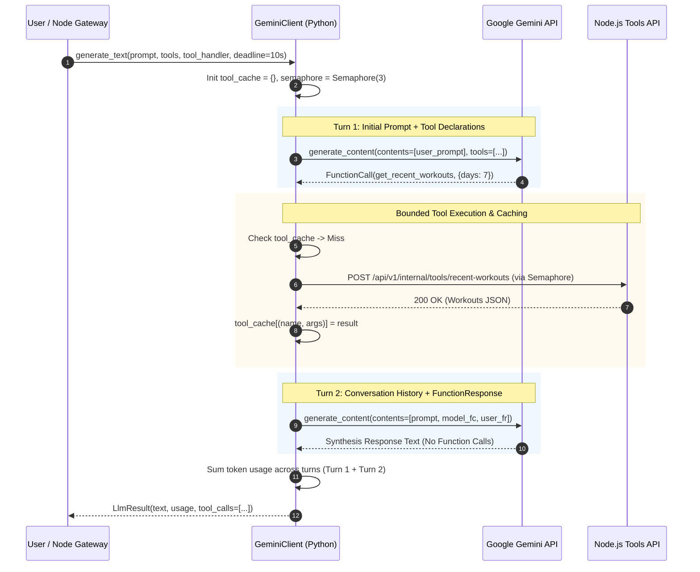

# OnusFit AI Engineering Guide: Phase 2 — Stage 2
## Multi-Turn Gemini Function Calling — Autonomous Tool Execution Loop
### மல்டி-டர்ன் ஜெமினி ஃபங்க்ஷன் காலிங் — தன்னாட்சி டூல் எக்சிகியூஷன் லூப்

> **Language**: Bilingual (Tamil + English) for practical engineering depth and Senior/Staff AI Engineer interview preparation.  
> **Components**: `ai-backend` (`onusfit_ai.shared.llm.ports`, `onusfit_ai.shared.llm.gemini`, `onusfit_ai.features.coach.application.tools`)  
> **Status Matrix**:
> - **Code Verified**: ✅ Complete (Clean Architecture aligned, strict boundaries preserved)
> - **Automated Tests**: ✅ 12/12 Stage 02 Pytest Tests Passed (0.21s) | 98/98 Suite Tests Passed (1.86s)
> - **Zero Schema Drift**: ✅ Existing Node DB schemas and API contracts 100% preserved
> - **Zero UI Modifications**: ✅ Mobile client untouched
> - **Security Perimeter**: ✅ Error sanitization, request-scoped fallback cache, bounded concurrency, deadline headroom

---

## 1. What Multi-Turn Function Calling Is
### மல்டி-டர்ன் ஃபங்க்ஷன் காலிங் என்றால் என்ன?

#### In Simple English:
In single-turn tool calling, a model emits a single function call, receives the answer, and immediately produces a conversational reply. However, real-world fitness coaching inquiries frequently require **multi-step reasoning**:
1. User: *"I feel fatigued today. Should I push for a heavy bench press or do recovery?"*
2. **Turn 1 (Tool Call)**: Model asks for recent workouts (`get_recent_workouts(days=7)`).
3. **Turn 2 (Model Evaluates & Decides It Needs More Context)**: The model inspects the workouts, sees 5 hard days in a row, but wants to know if calories/protein were sufficient before giving a verdict. It calls nutrition history (`get_nutrition_summary(days=7)`).
4. **Turn 3 (Final Synthesis)**: Having both training strain and dietary intake, the model formulates a comprehensive, grounded recovery plan.

**Multi-Turn Gemini Function Calling** is an autonomous, loop-driven protocol where the client iteratively coordinates turns between the Gemini model and backend tools until:
- The model determines it has sufficient data and returns conversational prose or structured JSON.
- Or execution bounds (maximum rounds, maximum tool calls, deadline, token budget) are reached, forcing final synthesis.

#### தமிழில் எளிய விளக்கம்:
ஒற்றை டர்ன் (Single-turn) முறையில், மாடல் ஒரே ஒரு கேள்வியை மட்டும் கேட்டு பதிலை உருவாக்கும். ஆனால் ஒரு நிஜமான ஃபிட்னஸ் பயிற்சியாளர் (AI Coach), சிக்கலான கேள்விகளுக்கு பதிலளிக்க **பல கட்ட தகவல்களை தொடர்ச்சியாக ஆராய வேண்டும் (Multi-step Reasoning)**:
- பயனர்: *"எனக்கு இன்று சோர்வாக இருக்கிறது, நான் இன்று அதிக எடை தூக்கலாமா அல்லது ஓய்வெடுக்கவா?"*
- **டர்ன் 1**: மாடல் முதலில் கடந்த 7 நாட்களின் உடற்பயிற்சிகளை (`get_recent_workouts`) கேட்கிறது.
- **டர்ன் 2**: உடற்பயிற்சி விவரங்களை பார்த்த பிறகு, பயனர் சரியான கலோரிகளையும் புரோட்டீனையும் சாப்பிட்டுள்ளாரா என்பதை அறிய உணவு சுருக்கத்தை (`get_nutrition_summary`) கேட்கிறது.
- **டர்ன் 3 (இறுதி தொகுப்பு)**: உடற்பயிற்சி பளு மற்றும் உணவு உட்கொள்ளல் இரண்டையும் இணைத்து, மாடல் முழுமையான வழிகாட்டலை பயனருக்கு வழங்குகிறது.

இந்த செயல்முறையை பாதுகாப்பு கட்டுப்பாடுகளுடன் (சுழற்சி வரம்புகள், நேர வரம்பு, டோக்கன் பட்ஜெட், கன்கரன்சி கட்டுப்பாடு) தானாக இயக்கும் பொறியியல் அமைப்பே **Multi-Turn Function Calling Loop** ஆகும்.

---

## 2. The 7 Mandatory Engineering Controls
### 7 கட்டாயப் பொறியியல் கட்டுப்பாடுகள்

| Control | Specification | Engineering Purpose & Implementation |
| :--- | :--- | :--- |
| **1. Round & Call Limits** | Max 3 rounds, Max 5 calls | Prevents unbounded agent loops and cost explosion. When limits are reached, `FunctionCallingConfigMode.NONE` forces final synthesis. |
| **2. Bounded Concurrency** | `asyncio.Semaphore(3)` | When the model emits multiple parallel tool calls in one turn, concurrent execution against Node Gateway is bounded to 3 parallel requests. |
| **3. Request-Scoped Cache** | `(tool_name, canonical_json_args)` | Deduplicates identical read-only queries within the request and **across model fallback attempts** (zero redundant DB/HTTP calls on retry). |
| **4. Error Sanitization** | `sanitize_tool_error` | Strips internal URLs, IP addresses, JWT tokens, and database traces from tool errors before sending them back to Gemini. |
| **5. Cumulative Accounting** | Separate $I, O, C, T$ token metrics | Correctly sums usage across turns without double-counting thinking ($T$) or cached ($C$) tokens. Enforces configurable token budgets. |
| **6. Deadline Headroom** | `_MIN_SYNTHESIS_SECONDS = 2.0s` | If remaining wall-clock time is < 2.0s before a turn, safely aborts with `PROVIDER_TIMEOUT` instead of initiating a hanging model call. |
| **7. Structured Output Compatibility** | Dynamic schema enforcement | Intermediate tool turns run without JSON schemas; final synthesis turns apply `response_schema` with tools disabled (`mode=NONE`). |

---

## 3. Architecture Sequence Diagram
### செயல்முறை வரிசை வரைபடம் (Execution Flow)



---

## 4. Model Fallback with Request-Scoped Tool Caching
### மாடல் ஃபால்பேக் மற்றும் டூல் கேஷிங் பொறிமுறை

When the primary model experiences rate limits (`429`) or server overload (`503`), our system automatically attempts generation on the fallback model:

```text
 ┌────────────────────────────────────────────────────────┐
 │ Primary Model Attempt (e.g. gemini-2.5-flash)          │
 │  - Turn 1: Calls get_recent_workouts(days=7)           │
 │  - Tool Handler executes -> Node API HTTP 200          │
 │  - Result stored in request-scoped `tool_cache`        │
 │  - Turn 2: Gemini returns 503 Overloaded               │
 └──────────────────────────┬─────────────────────────────┘
                            │ Circuit Breaker cools primary model
                            ▼
 ┌────────────────────────────────────────────────────────┐
 │ Fallback Model Attempt (e.g. gemini-1.5-flash)         │
 │  - Turn 1: Fallback model calls get_recent_workouts(7) │
 │  - GeminiClient checks request-scoped `tool_cache`     │
 │  - CACHE HIT! Returns cached workouts instantly        │
 │  - ZERO additional HTTP requests to Node Gateway!      │
 │  - Turn 2: Fallback model completes final synthesis    │
 └────────────────────────────────────────────────────────┘
```

This guarantees **zero duplicate database queries, zero duplicate JWT minting, and zero duplicate network overhead** when Google triggers a model fallback.

---

## 5. Automated Verification Results
### தானியங்கி சோதனை முடிவுகள்

### Stage 02 Test Suite (`test_gemini_tools_loop.py`):
```text
ai-backend/tests/test_gemini_tools_loop.py::test_single_tool_round PASSED
ai-backend/tests/test_gemini_tools_loop.py::test_multiple_sequential_tool_rounds PASSED
ai-backend/tests/test_gemini_tools_loop.py::test_parallel_tool_calls_with_bounded_concurrency PASSED
ai-backend/tests/test_gemini_tools_loop.py::test_max_tool_rounds_enforcement_forces_final_synthesis PASSED
ai-backend/tests/test_gemini_tools_loop.py::test_max_total_tool_calls_limit PASSED
ai-backend/tests/test_gemini_tools_loop.py::test_token_accounting_and_budget_limit PASSED
ai-backend/tests/test_gemini_tools_loop.py::test_deadline_headroom_exhaustion_returns_provider_timeout PASSED
ai-backend/tests/test_gemini_tools_loop.py::test_tool_error_sanitization PASSED
ai-backend/tests/test_gemini_tools_loop.py::test_sanitize_tool_error_helper_strips_credentials PASSED
ai-backend/tests/test_model_fallback_without_duplicate_tool_execution PASSED
ai-backend/tests/test_structured_output_compatibility_with_tools PASSED
ai-backend/tests/test_backward_compatibility_no_tools PASSED

============================== 12 passed in 0.21s ==============================
```

### Full Coach & LLM Test Suite:
- **`test_gemini_tools_loop.py`**: 12 passed
- **`test_coach_tools.py`**: 12 passed
- **`test_gemini_client.py`**: 20 passed
- **`test_coach_chat_api.py`**: 26 passed
- **`test_coach_insights_api.py`**: 28 passed
- **Total**: **98 passed in 1.86s (100% success rate)**
- **Ruff Linter**: Zero errors (`All checks passed!`)
- **Mypy Type Checker**: Zero issues (`Success: no issues found in 6 source files`)
- **Node Backend Typecheck**: Zero issues (`tsc --noEmit` exited with 0)

---

## 6. Senior AI Engineer Interview Q&A
### நேர்காணல் வினா-விடைகள்

#### Q1: Why can't you simply run an infinite `while` loop when an LLM requests tool calls?
**Answer**:
Unbounded tool execution loops are a critical vulnerability in autonomous LLM systems. An LLM can get stuck in an oscillation loop (e.g. repeating a failed tool call with subtle argument variations, or alternately calling two tools back and forth). This quickly exhausts context windows, triggers rate limits, burns customer token budgets, and leads to HTTP connection timeouts.  
In FitOnus, we enforce two rigid bounds:
1. `max_tool_rounds = 3` (maximum turns of tool invocations).
2. `max_total_tool_calls = 5` (maximum cumulative individual functions executed).  
When either bound is hit, we disable further tool calls (`mode=NONE`), giving Gemini one mandatory final synthesis round to answer with the information gathered so far.

#### Q2: How do you handle parallel function calls safely without overloading your backend services?
**Answer**:
Modern Gemini models support emitting multiple `FunctionCall` objects in a single turn (e.g., querying workouts and nutrition simultaneously). If an unconstrained `asyncio.gather` is used, a model could emit dozens of calls, triggering a thundering-herd problem on internal databases.  
We implement bounded concurrency using `asyncio.Semaphore(3)`. Even if Gemini requests multiple functions in a turn, at most 3 execute in parallel against our Node.js gateway. Furthermore, before acquiring the semaphore, every call checks our request-scoped cache (`tool_cache`). If an identical read-only call was already executed, it resolves instantly with zero network or database overhead.

#### Q3: Why is error sanitization necessary when returning tool execution failures to Gemini?
**Answer**:
If a backend tool fails (e.g. database connection error, internal gateway 500, or network timeout), the raw exception message might contain internal VPC IP addresses (`10.0.0.1:5432`), internal hostnames (`http://internal-node:3000`), service JWT tokens from headers, or database schema details (`relation users does not exist`).  
If raw errors are passed into Gemini's `FunctionResponse`, this internal infrastructure metadata becomes part of the model's context window. The model could inadvertently regurgitate internal IP addresses, tokens, or database structure in its conversational user output. Our `sanitize_tool_error` utility strips URLs, Bearer tokens, and IPs, transforming all errors into clean, high-level domain messages before they reach Gemini.

