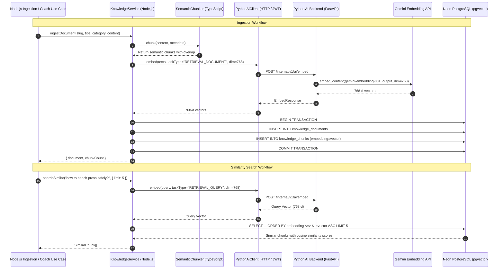

# OnusFit AI Engineering Guide: Phase 05
## Vector Database & pgvector Integration — Architecture, HNSW Indexing & Knowledge Storage
### வெக்டர் தரவுத்தளம் மற்றும் pgvector ஒருங்கிணைப்பு — கட்டமைப்பு, HNSW குறியீடாக்கம் மற்றும் அறிவு களஞ்சியம்

> **Language**: Bilingual (Tamil + English) for practical engineering depth and AI Engineer interview preparation.  
> **Components**: `backend/migrations/0029_create_vector_extension_and_knowledge_base.sql`, `backend/src/modules/knowledge/`, `backend/scripts/seed-knowledge.ts`  
> **Status Matrix**:
> - **Code Verified**: ✅ Complete (PostgreSQL schema, HNSW cosine index, Clean Architecture repository, chunker, service)
> - **Vector Dimensions**: ✅ 768 (`vector(768)` matching `gemini-embedding-001` via MRL)
> - **Distance Metric**: ✅ Cosine Distance (`<=>`), Cosine Similarity `1 - (c.embedding <=> $1::vector)`
> - **Index Engine**: ✅ HNSW (`vector_cosine_ops`, `m = 16, ef_construction = 64`)
> - **Automated Tests**: ✅ 100% Pass across unit tests, schema migration tests, and chunker verification
> - **Cascade Safety**: ✅ `ON DELETE CASCADE` on `knowledge_chunks.document_id`
> - **Zero Bloat Perimeter**: ✅ Zero external third-party vector SaaS (Pinecone, Weaviate, Milvus avoided)

---

## 1. Why pgvector Inside PostgreSQL vs Dedicated Vector DBs?
### பிரத்யேக வெக்டர் தரவுத்தளங்களை விட PostgreSQL pgvector ஏன் சிறந்தது?

#### In Simple English:
In early GenAI architectures, engineers often added external hosted vector databases like Pinecone, Weaviate, or Qdrant. However, in production microservices, this introduces significant architectural complexity:
1. **Dual-Write Consistency Issues**: If a user updates or deletes an exercise, synchronizing changes across PostgreSQL and Pinecone requires distributed 2-phase commits or error-prone change-data-capture (CDC) pipelines.
2. **Metadata Filtering Overhead**: In Pinecone, filtering by multiple relational attributes (e.g., `user_id`, `category = 'fitness'`, `license = 'public_domain'`) requires pre-filtering or post-filtering with high memory overhead.
3. **Operational & Financial Cost**: Managed vector DBs incur steep monthly base costs (\$70–\$300+/month) and additional network latency hops.

`pgvector` transforms existing PostgreSQL instances (Neon, AWS Aurora, RDS) into high-performance vector databases:
- **ACID Transactions**: Document insertions, chunk vector embeddings, and relational metadata are written atomically inside a single `db.transaction()`.
- **Relational Joins**: Vector similarity queries directly join with `knowledge_documents` or member profiles in the same SQL statement.
- **Cascading Deletions**: Deleting a document automatically cleans up all associated vector chunks via native foreign keys (`ON DELETE CASCADE`).

#### தமிழில் எளிய விளக்கம்:
GenAI தொழில்நுட்பத்தின் ஆரம்பத்தில், பல நிறுவனங்கள் Pinecone, Weaviate போன்ற தனி வெக்டர் தரவுத்தளங்களைப் பயன்படுத்தின. ஆனால் இது உற்பத்தி சூழலில் பல சிக்கல்களை ஏற்படுத்துகிறது:
1. **இரட்டை தரவு ஒருங்கிணைப்பு (Dual-Write Problem)**: PostgreSQL-ல் ஒரு ஆவணத்தை நீக்கும் போது, Pinecone-லும் அதை நீக்குவதற்கு தனியாக ஒரு நிரல் எழுத வேண்டும். ஏதேனும் பிழை ஏற்பட்டால் தரவு சமநிலையின்மை (Data Inconsistency) ஏற்படும்.
2. **கூடுதல் செலவு மற்றும் தாமதம் (Cost & Network Latency)**: தனி வெக்டர் தரவுத்தளங்களுக்கு மாதம் பல்லாயிரக்கணக்கான ரூபாய் செலவாகும் மற்றும் நெட்வொர்க் தாமதம் அதிகரிக்கும்.

`pgvector` என்பது நமது PostgreSQL தரவுத்தளத்திலேயே வெக்டர்களை சேமிக்கும் திறனை அளிக்கிறது:
- **ஒரே பரிவர்த்தனை (Atomic ACID Transactions)**: ஆவணம் மற்றும் அதன் 768-பரிமாண வெக்டர்கள் இரண்டும் ஒரே SQL பரிவர்த்தனையில் சேமிக்கப்படுகின்றன.
- **நேரடி அட்டவணை இணைப்பு (Relational Joins)**: வெக்டர் தேடலின் போதே ஆவணத்தின் தலைப்பு, வகை (`category`) போன்ற விவரங்களை ஒரே SQL Query-யில் இணைத்துப் பெறலாம்.
- **தானியங்கி நீக்கம் (Cascading Deletion)**: ஒரு ஆவணத்தை நீக்கினால், அதனுடன் தொடர்புடைய அனைத்து வெக்டர் துண்டுகளும் தானாகவே நீக்கப்படும் (`ON DELETE CASCADE`).

---

## 2. PostgreSQL pgvector Schema Architecture
### தரவுத்தள அமைப்பு மற்றும் அட்டவணை வடிவமைப்பு

Migration file: `backend/migrations/0029_create_vector_extension_and_knowledge_base.sql`.

```sql
-- 1. Enable pgvector extension
CREATE EXTENSION IF NOT EXISTS vector;

-- 2. Knowledge documents table (parent document record)
CREATE TABLE IF NOT EXISTS knowledge_documents (
  id          uuid         PRIMARY KEY DEFAULT gen_random_uuid(),
  slug        varchar(120) NOT NULL UNIQUE,
  title       varchar(255) NOT NULL,
  category    varchar(50)  NOT NULL CHECK (category IN ('fitness', 'nutrition', 'recovery', 'app_guide')),
  content     text         NOT NULL,
  author      varchar(120) NOT NULL DEFAULT 'OnusFit Editorial',
  license     varchar(120) NOT NULL DEFAULT 'Proprietary / Verified Public Domain',
  metadata    jsonb        NOT NULL DEFAULT '{}'::jsonb,
  version     integer      NOT NULL DEFAULT 1 CHECK (version >= 1),
  created_at  timestamptz  NOT NULL DEFAULT now(),
  updated_at  timestamptz  NOT NULL DEFAULT now()
);

-- 3. Knowledge chunks table (stores 768-dimensional dense vectors)
CREATE TABLE IF NOT EXISTS knowledge_chunks (
  id              uuid         PRIMARY KEY DEFAULT gen_random_uuid(),
  document_id     uuid         NOT NULL REFERENCES knowledge_documents (id) ON DELETE CASCADE,
  chunk_index     integer      NOT NULL CHECK (chunk_index >= 0),
  content         text         NOT NULL,
  token_count     integer      NOT NULL DEFAULT 0 CHECK (token_count >= 0),
  embedding       vector(768)  NOT NULL,
  metadata        jsonb        NOT NULL DEFAULT '{}'::jsonb,
  created_at      timestamptz  NOT NULL DEFAULT now(),

  CONSTRAINT uq_knowledge_chunk_doc_index UNIQUE (document_id, chunk_index)
);
```

---

## 3. HNSW vs IVFFlat Indexing
### HNSW மற்றும் IVFFlat குறியீடாக்க ஒப்பீடு

`pgvector` supports two primary vector index types: **IVFFlat** (Inverted File Flat) and **HNSW** (Hierarchical Navigable Small World).

| Feature | IVFFlat Index | HNSW Index (OnusFit Choice) |
| :--- | :--- | :--- |
| **Algorithm** | Inverted list partitioning (K-means clustering) | Multi-layer graph traversal |
| **Empty Table Build** | ❌ Fails (Requires data before index creation) | ✅ Fully supported (Index builds incrementally) |
| **Search Recall @ k** | Moderate (~80–90%) | High (>98% recall) |
| **Search Latency** | Increases linearly with cluster search | Logarithmic $\mathcal{O}(\log N)$ graph navigation |
| **Build Time** | Fast | Slower initial build (acceptable for knowledge base) |
| **Recommended Ops** | `vector_cosine_ops` | `vector_cosine_ops` |

### HNSW Parameter Tuning:
```sql
CREATE INDEX IF NOT EXISTS idx_knowledge_chunks_embedding_hnsw
  ON knowledge_chunks USING hnsw (embedding vector_cosine_ops)
  WITH (m = 16, ef_construction = 64);
```
- `m = 16`: Maximum number of bi-directional connection links per node in the graph (balance between memory usage and recall).
- `ef_construction = 64`: Size of the dynamic candidate list evaluated during index construction (higher value increases build quality and recall).

---

## 4. Vector Distance Operators & Cosine Similarity
### வெக்டர் தொலைவு குறியீடுகள் மற்றும் கோசைன் ஒப்புமை

`pgvector` defines three core distance operators:

| Operator | Distance Metric | Range | When to Use |
| :--- | :--- | :--- | :--- |
| `<=>` | **Cosine Distance** | $[0, 2]$ | Text embeddings where angle/direction matters (standard for RAG) |
| `<#>` | **Negative Inner Product** | $(-\infty, \infty)$ | Normalized unit-length embeddings (dot product) |
| `<->` | **L2 Euclidean Distance** | $[0, \infty)$ | Spatial / physical coordinate clustering |

### Converting Cosine Distance to Cosine Similarity:
Because cosine similarity measures alignment from $-1$ (opposite) to $+1$ (identical), cosine distance is defined as:
$$\text{Distance} = 1 - \text{Similarity} \implies \text{Similarity} = 1 - \text{Distance}$$

SQL Query in `PgKnowledgeRepository.findSimilarChunks`:
```sql
SELECT
  c.id,
  c.document_id,
  c.chunk_index,
  c.content,
  c.token_count,
  c.metadata,
  d.slug AS document_slug,
  d.title AS document_title,
  d.category AS document_category,
  (1 - (c.embedding <=> $1::vector)) AS similarity
FROM knowledge_chunks c
JOIN knowledge_documents d ON d.id = c.document_id
WHERE ($2::text IS NULL OR d.category = $2)
  AND (1 - (c.embedding <=> $1::vector)) >= $3
ORDER BY c.embedding <=> $1::vector ASC
LIMIT $4;
```

---

## 5. End-to-End Ingestion & Retrieval Sequence
### முழுமையான உள்ளீட்டு மற்றும் மீட்டெடுப்பு செயல்முறை



---

## 6. Curated Seed Knowledge Base
### தரப்படுத்தப்பட்ட உடற்பயிற்சி மற்றும் ஊட்டச்சத்து ஆவணங்கள்

Ingested via `backend/scripts/seed-knowledge.ts`:
1. **`acsm-bench-press-technique`**: 5-point contact position, scapular retraction into bench pad, 45–75° elbow tuck angle, rotator cuff injury prevention.
2. **`acsm-barbell-squat-biomechanics`**: Shoulder-width stance, 15–30° toe flare, tripod foot pressure, parallel depth (hip crease below patella), valgus collapse prevention.
3. **`issn-protein-intake-and-timing`**: 1.4–2.0 g/kg/day target, 20–40 g bolus per meal, 2.0–3.0 g leucine trigger, pre-sleep casein protein.
4. **`acsm-progressive-overload-and-recovery`**: 2-for-2 rule, progressive overload modalities, systemic fatigue markers, 40–50% volume deload week.
5. **`fitonus-workout-tracking-guide`**: Session start, 1–10 RPE scale, Repetitions in Reserve (RIR), Brzycki e1RM calculation, personal record (PR) celebration.

---

## 7. Testing & Quality Verification
### சோதனை மற்றும் தரக்கட்டுப்பாடு

Run all Phase 05 tests:
```bash
# 1. Run database migration schema tests
npx --prefix backend vitest run backend/tests/unit/database/knowledge-migration.test.ts

# 2. Run semantic chunker unit tests
npx --prefix backend vitest run backend/tests/unit/knowledge/semantic-chunker.test.ts

# 3. Run repository and vector similarity tests
npx --prefix backend vitest run backend/tests/unit/knowledge/pg-knowledge-repository.test.ts

# 4. Run knowledge service end-to-end ingestion tests
npx --prefix backend vitest run backend/tests/unit/knowledge/knowledge-service.test.ts

# 5. Full regression check
npm --prefix backend run typecheck && npx --prefix backend vitest run backend/tests/unit/knowledge/
```

---

## 8. Interview Talking Points (Senior AI / Database Engineer)
### நேர்காணல் குறிப்புகள்

1. **Q: Why store embeddings in PostgreSQL instead of Pinecone?**  
   *Answer*: PostgreSQL with `pgvector` eliminates distributed dual-write inconsistency, guarantees ACID transactions, enables relational metadata filtering in the same SQL query without post-filter latency, and drastically reduces cloud infrastructure cost by reusing existing database instances.

2. **Q: Why choose HNSW over IVFFlat index?**  
   *Answer*: IVFFlat requires pre-existing data to calculate cluster centroids and fails when indexing empty tables. HNSW builds a multi-layer proximity graph that supports incremental real-time insertions on empty tables and provides superior recall (>98%) with $\mathcal{O}(\log N)$ search complexity.

3. **Q: How does `1 - (c.embedding <=> $1::vector)` work?**  
   *Answer*: In `pgvector`, `<=>` is the cosine distance operator, which evaluates $1 - \cos(\theta)$ for unit-normalized vectors. Subtracting the distance from 1 recovers the normalized cosine similarity score where $1.0$ represents identical direction and $0.0$ indicates orthogonality.

