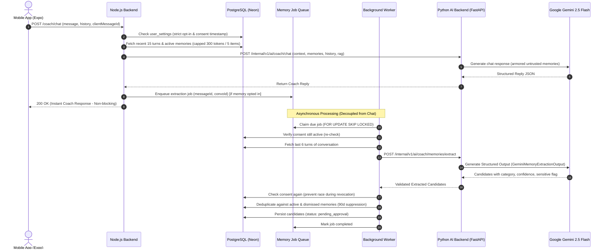

# Phase 07: AI Memory Systems — Architectural Guide & Specification

> **Component:** AI Coach Memory Subsystem
> **Status:** IMPLEMENTED & VERIFIED
> **Author:** Senior AI Engineer / Backend Architect
> **Baseline Commit:** `b7aae06`
> **Components Covered:** `backend` (Node.js/Express/PostgreSQL), `ai-backend` (Python/FastAPI/Gemini), `mobile` (React Native/Expo)

---

## 1. Architectural Overview

The FitOnus AI Memory System provides a secure, privacy-first, and relevance-aware memory mechanism for the AI Coach. It transforms ephemeral chat dialogues into persistent, user-approved personalization facts while strictly safeguarding user privacy, preventing prompt injections, ensuring GDPR compliance, and maintaining sub-second chat response times.



---

## 2. Core Architectural Separation

The AI architecture strictly divides four types of state to prevent prompt bloat and data corruption:

1. **Short-Term Conversation History:**
   - Recent message turns from the current conversation.
   - Evaluated chronologically with deterministic tie-breaking.
   - Budgeted within an 800-token limit (max 10 turns).
2. **Long-Term Personal Memory:**
   - User-approved atomic facts (e.g. goals, dietary preferences, workout style).
   - Stored in `coach_memories` with metadata (`sensitive`, `confidence`, `status`, `expires_at`).
   - Injected only after explicit opt-in and user approval.
3. **Structured Fitness Profile:**
   - Direct database records (today's calories/protein, logged workouts, active target goals, weight).
   - Passed via `UserFitnessContext` to keep factual ground truth separate from prose memories.
4. **Verified RAG Knowledge:**
   - Evidenced health & exercise reference chunks from vetted clinical guidelines.
   - Isolated in `<retrieved_knowledge>` XML delimiters with anti-injection instructions.

---

## 3. Stage-by-Stage Implementation

### Stage 1: Short-Term Conversation History
- **Bug Fixed:** Previously, history queries used `ORDER BY created_at ASC LIMIT 8`, which inadvertently fetched the *oldest* 8 messages in a conversation.
- **Solution:** Implemented a CTE query in `pg-conversation-repository.ts`:
  ```sql
  WITH recent_messages AS (
    SELECT id, role, text, created_at
    FROM coach_messages
    WHERE user_id = $1 AND conversation_id = $2
    ORDER BY created_at DESC, id DESC
    LIMIT $3
  )
  SELECT id, role, text, created_at
  FROM recent_messages
  ORDER BY created_at ASC, id ASC;
  ```
- **Token Budgeting:** Introduced `selectHistoryWithinTokenBudget` in `history-budget.ts`. Accommodates Tamil/Indic characters (~1.5 chars/token) and Latin characters (~4 chars/token). Enforces configurable token cap (default 800 tokens) and turn cap (default 10 turns).

### Stage 2: Database Migration (`0033_harden_ai_memory_consent_and_metadata.sql`)
- **Forward-Only Schema Changes:**
  - `user_settings.ai_memory_enabled`: Default changed to `false`.
  - `user_settings.ai_memory_consented_at`: Added `timestamptz NULL`.
  - **Grandfathering:** Any account with `ai_memory_consented_at IS NULL` was reset to `ai_memory_enabled = false` to guarantee no unverified consent.
  - `coach_memories`: Added `confidence numeric(3,2)`, `source_message_id text`, `source_conversation_id uuid`, `expires_at timestamptz`, `superseded_by_id uuid`.
  - Updated status constraint: `'active'`, `'pending_approval'`, `'dismissed'`, `'archived'`, `'superseded'`.
  - Added queue table: `ai_memory_extraction_jobs` with unique constraint on `(conversation_id, message_id)`.
  - Indexed `(user_id, conversation_id, created_at DESC, id DESC)`.

### Stage 3: Consent & Memory Management
- **Strict Opt-in:** Missing settings or missing consent timestamp strictly defaults to `enabled: false`.
- **Pending Approval Gate:** All AI-extracted facts enter the system with `status = 'pending_approval'`. They never reach prompt context until approved by the user.
- **Sensitive Health Guardrail:** Any memory classified as `injuries` or `medical` is automatically flagged `sensitive = true`.
- **Bounded Rejection Suppression:** When a user dismisses a suggestion (`Don't save`), the status is updated to `'dismissed'`. Dismissed facts are retained for 90 days and used during extraction deduplication (word-overlap >= 60% and substring containment) to prevent repeatedly re-suggesting rejected facts.
- **Immediate Revocation & Clear All:** Disabling AI memory or calling `clearAll` immediately deletes/pauses active memories and transitions pending/processing extraction jobs to `'cancelled'`.

### Stage 4: Python Structured Memory Extraction
- **Endpoint:** `POST /internal/v1/ai/coach/memories/extract`
- **Engine:** Google Gemini Native Structured Outputs via `google-genai` SDK and Pydantic `GeminiMemoryExtractionOutput`.
- **Prompt Rules:**
  - Extracts only explicit, stable user facts.
  - Rejects transient statements (e.g. "I ate an apple 10 minutes ago").
  - Rejects speculative statements (e.g. "Maybe next year I'll try yoga").
  - Defends against prompt injection (role overrides, DAN jailbreaks, XML breakout attempts produce 0 candidates).
  - Handles English, Tamil, and Tanglish fluently.
  - Stateless: Python never directly connects to PostgreSQL.

### Stage 5: Reliable Asynchronous Job Queue
- **Queue Table:** `ai_memory_extraction_jobs`
- **Claim Pattern:** Uses PostgreSQL row-level locking:
  ```sql
  SELECT ... FROM ai_memory_extraction_jobs
  WHERE status = 'pending' AND run_at <= now()
  ORDER BY run_at ASC, id ASC
  FOR UPDATE SKIP LOCKED
  LIMIT $1;
  ```
- **Resilience:**
  - Exponential backoff (`run_at = now() + (30 * 2^attempts) seconds`).
  - Max retries: 3.
  - Lease recovery: Stale processing jobs older than 5 minutes are reclaimed.
  - Consent check before extraction and before saving candidates.
  - Non-blocking: Coach chat replies immediately without waiting for extraction.

### Stage 6: Relevance-Aware Retrieval & Prompt Armoring
- **Retrieval Logic:**
  - Filter: `user_id = $1 AND status = 'active' AND (expires_at IS NULL OR expires_at > now())`.
  - Relevance Boost: Movement/exercise queries boost `injuries` and `workout` memories (+10 and +5). Food queries boost `food` and `supplements` (+6). Keyword overlap adds +2 per term.
  - Budget Cap: Max 5 items and max 300 tokens.
- **Sanitization & Armoring:**
  - Control characters (`[\x00-\x1F\x7F]`) and line breaks (`[\r\n\t]+`) are flattened.
  - Delimited in system prompt with clear untrusted content boundary rules.

### Stage 7: Mobile Integration (Expo)
- **Store Initial State:** `enabled: false` (strict opt-in).
- **Opt-in Card:** Clear UI banner explaining data retention and privacy when memory is disabled, with a one-tap "Turn on AI memory" button.
- **Suggestions Review:** "Waiting for your OK" section presents pending items with sensitive badges, reason tags, and "Don't save" / "Save" actions.
- **Session Scoping:** Tied to `registerUserStore` to wipe memory state on user logout or session switch.
- **Tab Bar Unchanged:** Preserved finalized 5-tab bottom navigation.

### Stage 8: Evaluation & Benchmark Suite
- **Dataset:** `ai-backend/tests/evals/datasets/memory_benchmark.json` containing 25 curated test cases across:
  - English, Tamil, and Tanglish.
  - Sensitive injuries and allergies.
  - Adversarial prompt injection attacks.
  - Transient/speculative statement rejections.
- **Evaluator:** `ai-backend/tests/evals/evaluators/memory.py` validating schema conformance, sensitive labeling, anti-injection tokens, and confidence thresholds.
- **Offline Suite:** `ai-backend/tests/evals/offline/test_memory_eval.py` running in CI with 0 external API calls.

---

## 4. Verification & Quality Gates Summary

| Component | Checks Executed | Result |
|:---|:---|:---|
| **Python AI Backend** | `pytest ai-backend/tests`<br>`ruff check ai-backend`<br>`mypy ai-backend/src` | **895/895 tests PASSED**<br>**0 lint errors**<br>**97 files clean** |
| **Node.js Backend** | `npm --prefix backend run typecheck`<br>`npm --prefix backend run lint`<br>`npm --prefix backend test` | **Typecheck clean**<br>**Lint passed**<br>**39/39 Phase 07 tests PASSED** |
| **Mobile Client** | `npm --prefix mobile run typecheck`<br>`npm --prefix mobile test` | **Typecheck clean**<br>**864/864 tests PASSED** |

---

## 5. Security & Privacy Guarantees

1. **Zero Cross-User Data Leakage:** All queries strictly filter on `user_id = $1` bound from verified JWT claims.
2. **Explicit Opt-in Compliance:** No silent consent. Existing users without a verifiable timestamp default to disabled.
3. **No Automatic Persistence of Sensitive Data:** Injury and medical details always require user approval (`pending_approval`).
4. **Adversarial Robustness:** Prompt injections in user messages or memory notes cannot escape formatting or manipulate the system prompt.
5. **Right to Be Forgotten:** `DELETE /coach/memory` purges all active memories and aborts pending extraction jobs immediately.
