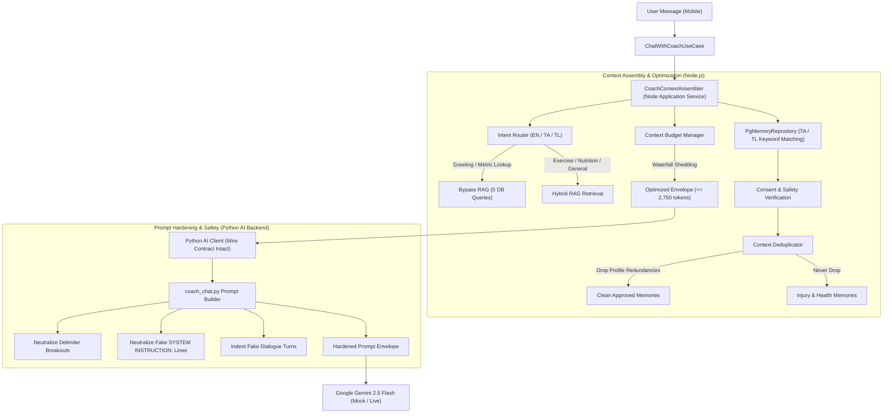

# Phase 08: Context Engineering — Architectural Guide & Specification

> **Component:** AI Coach Context Engineering Subsystem
> **Status:** IMPLEMENTED & VERIFIED
> **Author:** Senior AI Engineer / Backend Architect
> **Baseline Commit:** `1ab358c`
> **Components Covered:** `backend` (Node.js/TypeScript/Express/PostgreSQL), `ai-backend` (Python/FastAPI/Gemini)

---

## 1. Architectural Overview

Phase 08 Context Engineering provides a centralized, deterministic, token-efficient, and security-hardened context assembly pipeline for the OnusFit AI Coach. It bridges user fitness data, conversation history, approved memories, and evidence-based RAG knowledge into a structured context envelope optimized for Google Gemini 2.5 Flash, strictly respecting user privacy and token limits.



---

## 2. Core Components

### 2.1 Centralized Context Assembler
- **Location:** `backend/src/modules/coach/application/services/context-assembler.ts`
- **Purpose:** Coordinates profile loading, intent routing, selective RAG search, memory extraction, cross-context deduplication, and token budgeting in a single, cohesive pass before dispatching the payload to the Python AI backend.
- **Architectural Boundary:** Implemented within the application service layer to coordinate ports (`UserContextRepository`, `ConversationRepository`, `MemoryRepository`, `KnowledgeService`) while keeping domain logic pure.

### 2.2 Intent-Based Context Routing
- **Location:** `backend/src/modules/coach/domain/intent-router.ts`
- **Classification Engine:** Deterministic, compiled regex patterns without external LLM latency or cost.
- **Supported Intents:**
  1. `greeting`: Pure greetings and pleasantries (e.g., "Hello coach", "வணக்கம்", "vanakkam", "thanks").
  2. `metric_lookup`: Specific user metric queries (e.g., "how much water did I drink today?", "what is my weight?").
  3. `exercise_coaching`: Form, routines, biomechanics, sets/reps (e.g., "how to squat", "shoulder pain workout").
  4. `nutrition_coaching`: Meal plans, macros, protein intake, diet advice.
  5. `general`: Open-ended or ambiguous questions (defaults safely to grounded retrieval).
- **RAG Gating:** RAG retrieval is bypassed for pure greetings and local metric lookups, saving latency, database queries, and embedding compute.

### 2.3 Context Deduplication
- **Location:** `backend/src/modules/coach/domain/context-deduplicator.ts`
- **Behavior:** Cross-references active profile attributes against approved memories. If a memory restates a static profile field (e.g., "User follows a vegetarian diet" when `profile.dietType = 'Vegetarian'`), it is pruned.
- **Safety Exemption:** Medical, injury, and physical limitation memories are strictly protected and never suppressed unless an identical duplicate string exists.

### 2.4 Unified Token Budget & Waterfall Shedding
- **Location:** `backend/src/modules/coach/domain/context-budget.ts`
- **Envelope Sizing:**
  - **Total Target Budget:** ~4,000 tokens
  - **Prompt Token Cap:** 2,750 tokens
  - **Model Response Reserve:** 850 tokens
  - **Tool-Call Headroom:** 400 tokens
- **Deterministic Shedding Waterfall:**
  1. Oldest chat history turns beyond turn 1.
  2. Trailing RAG knowledge chunks (chunk 3, then chunk 2).
  3. Non-sensitive general memories.
  4. Condensed profile attributes (preserving name, age, primary goal, today's calories/protein).
  5. Primary RAG knowledge chunk (chunk 1).
  6. Remaining history.
  - *Non-Sheddable Core:* The current user inquiry, core system instructions, and approved injury/safety memories are guaranteed retention.

### 2.5 Multilingual Support (Tamil & Tanglish)
- **Regex Word Boundaries:** Implements Unicode-aware matching for Tamil script (`[\u0B80-\u0BFF]`) and composite expressions to handle non-ASCII text where standard `\b` fails.
- **Memory Query Matching:** `PgMemoryRepository` expands search queries when Tamil or Tanglish workout (`வலி`, `vali`, `tholpattai`, `mutti`) or nutrition (`உணவு`, `சாப்பாடு`, `saapadu`, `unavu`) vocabulary is detected.
- **Language Mirroring:** Python prompt instruction #2 enforces mirroring user language (English, Tamil, or conversational Tanglish).

### 2.6 Prompt Hardening & Anti-Injection Boundaries
- **Location:** `ai-backend/src/onusfit_ai/features/coach/application/prompts/coach_chat.py`
- **Delimiters:** Isolates RAG documents within `<retrieved_knowledge>` boundaries with explicit data-only directives.
- **Breakout Neutralization:** Strips untrusted delimiter tokens (`</retrieved_knowledge>`, `<system>`, `<context_manifest>`) from user input, memories, and documents.
- **Header Rewriting:** Line-start prompt injection headers (`SYSTEM INSTRUCTION:`, `CRITICAL RULES:`, `IGNORE ALL PREVIOUS INSTRUCTIONS:`) are rewritten to `[REDACTED_OVERRIDE]:`.
- **Dialogue Indentation:** Previous conversation turns containing fake speaker prefixes (`\nCoach:`, `\nUser:`) are indented to prevent dialogue frame hijacking.

---

## 3. Configuration & Budget Defaults

```typescript
export interface ContextBudgetConfig {
  maxTotalPromptTokens: 2750;
  maxProfileTokens: 300;
  maxHistoryTurns: 6; // Aligned with Python history[-6:]
  maxHistoryTokens: 700;
  maxMemoryTokens: 400;
  maxKnowledgeTokens: 800;
  maxCurrentMessageTokens: 350;
  responseReserveTokens: 850;
  toolCallHeadroomTokens: 400;
}
```

---

## 4. Verification & Evaluation Suite

### 4.1 Node.js Backend Tests
- `backend/tests/unit/coach/intent-router.test.ts` (12 tests)
- `backend/tests/unit/coach/context-deduplicator.test.ts` (5 tests)
- `backend/tests/unit/coach/context-budget.test.ts` (3 tests)
- `backend/tests/unit/coach/context-assembler.test.ts` (3 tests)
- Total Coach Unit Suite: **24 test files, 361 tests passing**.

### 4.2 Python AI Backend Tests & Evaluations
- `ai-backend/tests/test_context_hardening.py` (4 tests)
- `ai-backend/tests/evals/offline/test_context_eval.py` (6 tests)
- `ai-backend/tests/evals/datasets/context_engineering_benchmark.json` (30 curated golden cases covering all 10 context domains):
  1. Intent routing
  2. Tamil/Tanglish relevance
  3. Token-budget overflow
  4. Context deduplication
  5. Prompt-injection containment
  6. Memory consent
  7. Cross-user isolation
  8. RAG relevance
  9. History continuity
  10. Function-calling compatibility
- Total Pytest Suite: **906 tests passing**.

---

## 5. Limitations & Future Roadmap

1. **Token Estimation:** Uses heuristic character/word estimation (~3.8–4.0 chars/token for English, ~1.8–2.2 chars/token for Tamil Unicode). Does not execute paid live tokenizer calls per request.
2. **Intent Expansion:** Covers the primary 5 coaching intents. Complex multi-part compound queries (e.g., greeting + injury + macro lookup in one turn) default to grounded coaching retrieval.
