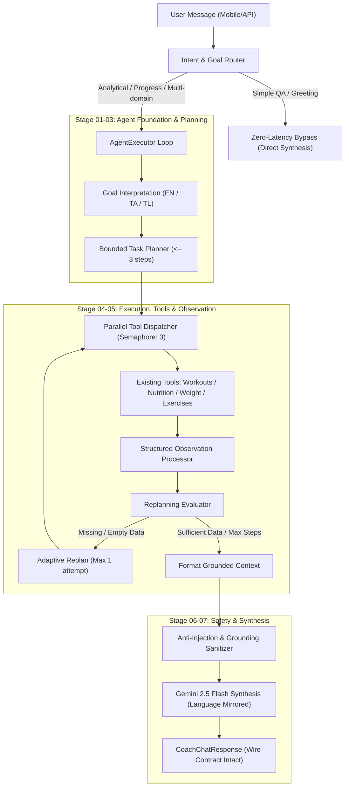

# Phase 09: AI Agent Fundamentals — Architectural Guide & Specification

> **Component:** AI Coach Agent Fundamentals Subsystem
> **Status:** IMPLEMENTED & VERIFIED
> **Author:** Senior AI Engineer / Full-Stack Architect
> **Baseline Commit:** `f348cd1`
> **Components Covered:** `ai-backend` (Python/FastAPI/Gemini/Domain/Application/Presentation), `backend` (Node.js/TypeScript/Express/PostgreSQL)

---

## 1. Architectural Overview & Philosophy

Phase 09 introduces a production-oriented, goal-driven AI Agent foundation using native Python 3.12 and Gemini function calling capabilities. Rather than relying on external heavyweight orchestration frameworks, FitOnus builds on clean hexagonal architectural principles, maintaining total state isolation and strict boundary governance.

The system transitions the AI Coach from reactive single-turn question answering into a bounded, multi-step goal execution system capable of task planning, parallel tool execution, structured observation, adaptive replanning, and anti-hallucination grounded synthesis.

---

## 2. Framework-Independent Architecture & Contracts (Stage 01)

Following Clean/Hexagonal Architecture rules, all agent contracts reside purely within the domain layer and depend only on `shared.contracts` and `shared.utils`:

- **Contract Location:** `ai-backend/src/onusfit_ai/features/coach/domain/agent.py`
- **Domain State Models:**
  - `AgentGoal`: Defines target domain (`AgentGoalType`), user query, target parameters (days/metrics), and execution requirement flag.
  - `PlanStep`: Discrete executable action containing `tool_name`, validated arguments, rationale, and lifecycle `StepStatus`.
  - `TaskPlan`: Structured plan with goal association, ordered steps list, and replan counter.
  - `ToolObservation`: Structured observation capturing raw payload, summarized takeaway, key entity metrics, and empty/error flags.
  - `ObservationEvaluation`: Evaluates whether retrieved evidence satisfies the original goal and determines if replanning is needed.
  - `AgentBudgetConfig`: Enforces hard limits:
    - `max_planning_steps = 3`
    - `max_execution_iterations = 3`
    - `max_replanning_attempts = 1`
    - `max_tool_calls = 5`
    - `deadline_seconds = 25.0`
    - `safety_deadline_margin = 1.5`
  - `AgentState`: Ephemeral execution state tracking iterations, steps, observations, deduplication action keys, and cumulative token usage.
  - `AgentExecutionResult`: Return contract containing status, final synthesized message, observations, executed tools, and token accounting.

---

## 3. Multilingual Goal Understanding & Planning (Stage 02)

- **Location:** `ai-backend/src/onusfit_ai/features/coach/application/agent/planner.py`
- **Multilingual Support:**
  - **Tamil Unicode (`\u0B80-\u0BFF`):** Handles pure Tamil queries (e.g., "வணக்கம் கோச், என் முன்னேற்றம் எப்படி").
  - **Tanglish:** Robust regex coverage for transliterated fitness queries (e.g., "En fitness progress check panni, indha week enna improve pannanum sollu").
  - **English:** Full coverage of analytical workout, nutrition, and weight queries.
- **Intent-Based Bypass:**
  - Simple greetings and single-metric local questions bypass agent planning entirely (`requires_agent_execution = False`).
  - Zero latency and zero additional tool overhead for conversational pleasantries.
- **Bounded Step Generation:**
  - `fitness_progress` / `combined_recommendations`: Generates a coordinated 3-step plan (`get_recent_workouts`, `get_nutrition_summary`, `get_weight_trend`).
  - `workout_analysis`: Generates targeted `get_recent_workouts`.
  - `nutrition_analysis`: Generates targeted `get_nutrition_summary`.
  - `weight_trend`: Generates targeted `get_weight_trend`.
  - `search_exercises`: Generates targeted `search_exercises`.

---

## 4. Bounded Execution Loop & Tool Execution (Stages 03 & 04)

- **Location:** `ai-backend/src/onusfit_ai/features/coach/application/agent/executor.py`
- **Lifecycle:**
  `Goal Interpretation → Plan Generation → Concurrency-Bounded Execution → Observation Ingestion → Dynamic Replanning → Grounded Synthesis`
- **Tool Integration & Reusability:**
  - Reuses all Phase 02 existing tool definitions (`get_recent_workouts`, `get_nutrition_summary`, `get_weight_trend`, `search_exercises`).
  - Concurrency limited via `asyncio.Semaphore(3)` for parallel independent tool dispatch.
  - **Duplicate Action Prevention:** Calculates deterministic MD5 action signatures (`tool_name + sorted_json_args`). If a step attempts an action signature that has already completed, execution is skipped and the cached observation is returned.
- **Security & User Isolation:**
  - Strictly preserves JWT user isolation by propagating verified `claims.user_id` down to all tool dispatchers and repositories.
  - Prevents Confused Deputy attacks by forbidding caller override of target user identifiers.
  - Read-only execution: no arbitrary code execution, external unverified web requests, or autonomous database writes.

---

## 5. Structured Observation & Adaptive Replanning (Stage 05)

- **Location:** `ai-backend/src/onusfit_ai/features/coach/application/agent/observer.py`
- **Observation Normalization:**
  - Inspects incoming JSON tool payloads and extracts domain metrics (workout count, volume, calorie average, protein intake, weight deltas).
  - Flags empty datasets (`is_empty = True`) when workout arrays or summaries contain no logged entries.
  - Sanitizes tool exceptions to prevent leaking raw database errors or stack traces to the user or prompt.
- **Replanning Mechanics:**
  - If a 7-day workout inquiry returns empty logs (`is_empty = True`) and the agent has remaining replan budget (`replans_count < max_replanning_attempts`), the observer triggers an expanded 14-day search.
  - Strict ceiling: Max 1 replan allowed per request to prevent execution loops and budget exhaustion.

---

## 6. Execution Limits & Safety Controls (Stage 06)

| Parameter | Default Value | Purpose |
|:---|:---|:---|
| `max_planning_steps` | 3 | Bounds the planning depth per iteration |
| `max_execution_iterations` | 3 | Bounds total loop iterations |
| `max_replanning_attempts` | 1 | Prevents infinite replanning cascades |
| `max_tool_calls` | 5 | Limits cumulative tool invocations |
| `deadline_seconds` | 25.0 | Overall request timeout budget |
| `safety_deadline_margin` | 1.5s | Early termination margin before network timeout |

### Prompt Injection & Delimiter Neutralization
- Untrusted user input, memory content, and tool observations are sanitized prior to synthesis.
- Delimiter breakout tokens (`</retrieved_knowledge>`, `<system>`, `</system>`, `<context_manifest>`) are stripped.
- Injection headers (`SYSTEM INSTRUCTION:`, `CRITICAL RULES:`, `IGNORE PREVIOUS:`) are rewritten to `[REDACTED_OVERRIDE]:`.
- Retrieved evidence is enclosed in `<grounding_observations>` boundaries with explicit anti-hallucination instructions forbidding fabrication of missing fitness metrics.

---

## 7. AI Coach Integration (Stage 07)

- **Presentation Layer:** `ai-backend/src/onusfit_ai/features/coach/presentation/coach_chat.py`
- **Application Layer:** `ai-backend/src/onusfit_ai/features/coach/application/chat.py`
- **Feature Flag Control:** Controlled by `COACH_AGENT_ENABLED` environment variable (defaults to `True` with graceful fallback).
- **Wire Compatibility:**
  - Returns standard `CoachChatResponse` compatible with existing Node.js proxy and React Native mobile clients.
  - Populates `executed_tools`, `sources`, and `metadata` so the mobile UI displays grounding sources and citations without any mobile app changes.

---

## 8. Offline Evaluation Suite & Benchmarking (Stage 08)

An extensive offline evaluation benchmark covering all 15 required facets was added:

- **Benchmark Dataset:** `ai-backend/tests/evals/datasets/agent_fundamentals_benchmark.json` (32 golden cases)
- **Evaluator:** `ai-backend/tests/evals/evaluators/agent.py` (`AgentFundamentalsEvaluator`)
- **Offline Evaluation Runner:** `ai-backend/tests/evals/offline/test_agent_eval.py` (7 offline test cases)

### Facets Covered:
1. `goal_interpretation`: Correct identification of fitness analysis goals.
2. `plan_validity`: Valid, bounded step generation within configured limits.
3. `tool_selection`: Precision in mapping goals to the correct tool set.
4. `multistep_execution`: Proper sequential and parallel execution of planned steps.
5. `observation_handling`: Accurate metric extraction and empty data detection.
6. `replanning`: Adaptive window expansion upon empty data.
7. `missing_data`: Grounded response acknowledging lack of logged metrics without hallucination.
8. `tool_failures`: Sanitized handling of network or database exceptions.
9. `execution_limits`: Hard cutoff at max iterations, tool calls, and deadlines.
10. `duplicate_prevention`: Action signature caching preventing re-execution of identical calls.
11. `user_isolation`: Strict verification of user ID claims.
12. `prompt_injection`: Neutralization of delimiter breakout tokens and override instructions.
13. `tamil_tanglish_support`: Native Tamil and Tanglish comprehension and language mirroring.
14. `simple_query_bypass`: Zero-tool pass-through for greetings and simple local lookups.
15. `grounded_recommendations`: Evidence-based synthesis grounded in retrieved observations.

### Test Results:
- **Offline Agent Benchmark:** **32 / 32 passed (100%)**
- **Evaluation Runner Suite:** **153 total evaluation cases passing** across all phases
- **Python Pytest Suite:** **942 passed, 0 failed** (in 18.91s)
- **Node.js Coach Test Suite:** **24 files, 361 passed, 0 failed** (in 3.66s)
- **Node.js Typecheck & Lint:** **Zero errors**

---

## 9. Preparation for Phase 10 (LangGraph Integration)

Phase 09 establishes the foundational domain contracts and execution primitives required for Phase 10:
1. **State Isolation:** The `AgentState`, `TaskPlan`, and `ObservationEvaluation` data structures map directly into LangGraph `StateGraph` nodes and edges.
2. **Deterministic Edge Transitions:** The current observer logic (`evaluate_observations`) provides the conditional routing predicate (`should_replan -> ReplanNode | FinalSynthesisNode`).
3. **Decoupled Engine:** The application layer cleanly separates the executor interface from the underlying engine, ensuring Phase 10 can swap the execution engine without modifying domain models or API wire contracts.
