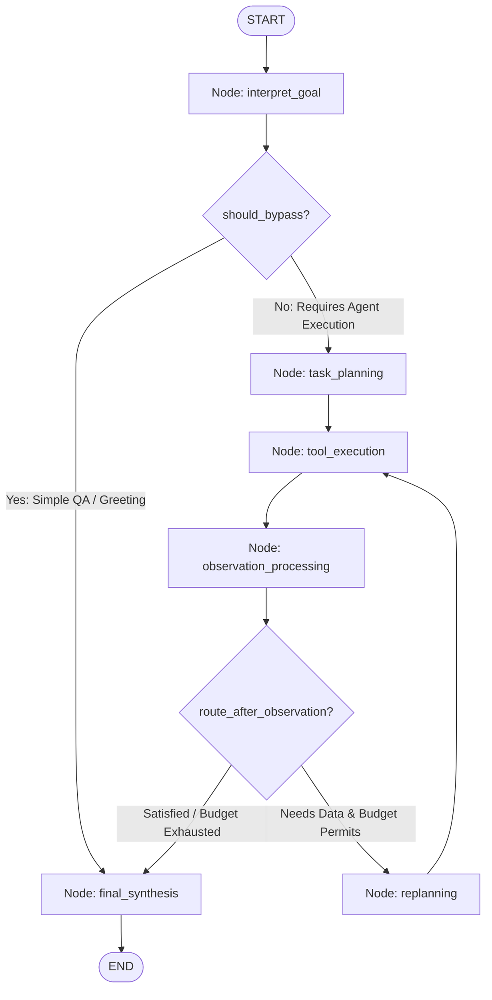

# Phase 10: LangGraph Agent Workflows — Architectural Guide & Specification

> **Component:** AI Coach LangGraph Agent Workflows Subsystem
> **Status:** IMPLEMENTED & VERIFIED
> **Author:** Senior AI Engineer / Full-Stack Architect
> **Framework Version:** `langgraph==1.2.24`, `langchain-core==1.8.4` (Python 3.12.3)
> **Components Covered:** `ai-backend` (`onusfit_ai.features.coach.application.agent.graph.*`), `shared.llm`, Clean Architecture boundaries

---

## 1. Architectural Overview & Philosophy

Phase 10 upgrades the native FitOnus AI Coach agent architecture into a state-driven, controlled workflow powered by **LangGraph**. The primary objective is to enable declarative, reproducible agent workflows—complete with branching, bounded replanning, and resilient fault tolerance—while strictly adhering to FitOnus's Hexagonal / Clean Architecture.

### Core Principles
1. **Framework-Agnostic Domain:** Domain entities, types, and business contracts (`onusfit_ai.features.coach.domain.agent`) remain 100% free of LangGraph or LangChain imports.
2. **Component Reuse:** The system wraps and reuses existing Phase 09 components (`AgentPlanner`, `AgentObserver`, `AgentBudgetConfig`, `TOOL_ARG_SCHEMAS`, `TextGenerator`).
3. **Deterministic State Transitions:** Reducers manage state mutations predictably without side-effects.
4. **Dual-Engine Execution & Graceful Fallback:** Supports runtime engine toggling via `COACH_AGENT_ENGINE` (`"langgraph"` vs `"native"`), falling back seamlessly to native Phase 09 `AgentExecutor` if graph execution encounters an unrecoverable runtime fault.
5. **Zero Persistent Storage of Sensitive State:** Ephemeral graph execution prevents user conversation PII or fitness details from leaking into persistent checkpoint stores.

---

## 2. StateGraph Architecture & Typed Reducers (Stage 02)

Graph state is managed within `onusfit_ai.features.coach.application.agent.graph.state` using Python's `TypedDict` and LangGraph `Annotated` reducers.

### Typed Graph State Schema (`GraphAgentState`)
- **Identity & Request Isolation:**
  - `trace_id: str`: Distributed trace identifier across backend services.
  - `user_id: str`: Authenticated user UUID ensuring tenant data boundaries.
  - `start_time: float`: Monotonic epoch recording start time.
  - `deadline: float`: Monotonic epoch deadline after which execution halts.
- **Goal & Planning State:**
  - `goal: AgentGoal | None`: Current typed user objective.
  - `plan: TaskPlan | None`: Current multi-step task execution plan.
- **Lifecycle & Reducers:**
  - `status: AgentExecutionStatus`: Lifecycle status (`PLANNING`, `EXECUTING`, `OBSERVING`, `REPLANNING`, `COMPLETED`, `FAILED`, `BUDGET_EXCEEDED`, `DEADLINE_EXCEEDED`, `BYPASSED`).
  - `termination_reason: AgentTerminationReason | None`: Precise terminal cause.
  - `steps: Annotated[list[PlanStep], reduce_steps]`: Reducer merging plan steps by `step_id`.
  - `observations: Annotated[list[ToolObservation], reduce_observations]`: Reducer appending tool observations while deduplicating by `step_id`.
  - `executed_tools: Annotated[list[str], reduce_executed_tools]`: Unique tool identifiers called across all iterations.
  - `executed_tool_results: Annotated[list[DomainToolResult], reduce_tool_results]`: Domain tool execution results mapped for external wire callers.
  - `iteration: int`: Current execution loop iteration (hard-capped by `AgentBudgetConfig.max_execution_iterations = 3`).
  - `replans_count: int`: Replanning attempts counter (hard-capped by `AgentBudgetConfig.max_replanning_attempts = 1`).
  - `total_tool_calls: Annotated[int, reduce_int_sum]`: Cumulative tool invocations.
  - `total_tokens_used: Annotated[int, reduce_int_sum]`: Cumulative token spend.
  - `partial_results: dict[str, Any]`: Recovered data cache for node failure resiliency.
  - `node_failures: Annotated[list[str], reduce_node_failures]`: Recorded node failure logs for audit and telemetry.

---

## 3. Reusable Workflow Nodes (Stage 03)

Workflow nodes are located in `onusfit_ai.features.coach.application.agent.graph.nodes`. Execution dependencies (`AgentPlanner`, `AgentObserver`, `AgentBudgetConfig`, `TextGenerator`, `tool_handler`, and telemetry) are injected via `RunnableConfig["configurable"]["graph_context"]`.

| Node Name | Functionality | Reused Phase 09 Components |
|---|---|---|
| `interpret_goal` | Analyzes intent, detects language (EN, TA, Tanglish), checks bypass condition. | `AgentPlanner.interpret_goal` |
| `task_planning` | Generates bounded initial `TaskPlan` with validated tool args. | `AgentPlanner.create_plan` |
| `tool_execution` | Executes tool steps in parallel (bounded semaphore=3) with arg schema validation and duplicate call suppression. | `TOOL_ARG_SCHEMAS`, `TOOL_SOURCE_LABELS`, `tool_cache` |
| `observation_processing` | Evaluates observations, extracts key metrics, detects missing data. | `AgentObserver.evaluate_observations` |
| `replanning` | Formulates adaptive recovery plans when critical data is absent. | `AgentPlanner.replan` |
| `final_synthesis` | Grounded multi-lingual response generation with anti-hallucination guardrails and partial data fallback. | `AgentObserver.format_grounded_context`, `TextGenerator` |

---

## 4. Conditional Edge Routing & Bounds (Stage 04)

Controlled edge transitions are implemented in `onusfit_ai.features.coach.application.agent.graph.routing`:

1. **`should_bypass(state) -> Literal["task_planning", "final_synthesis"]`**:
   - Routes simple QA, greetings, and local context metric questions directly to `final_synthesis`.
   - Bypasses tool planning, reducing latency to a single fast LLM turn.
2. **`route_after_observation(state) -> Literal["replanning", "final_synthesis"]`**:
   - Inspects `evaluation.requires_replan`.
   - Checks budget guards:
     - Iteration count `< max_execution_iterations` (default: 3).
     - Replans count `< max_replanning_attempts` (default: 1).
     - Total tool calls `< max_tool_calls` (default: 5).
     - Monotonic clock `< (deadline - deadline_margin_s)` (default safety buffer: 1.5s).
   - If any limit is reached, routes immediately to `final_synthesis` with partial observations rather than failing.

---

## 5. State Management & Resilient Fallback (Stage 05 & 06)

### Request-Scoped State Isolation
- Graphs compile into stateless runnables via `StateGraph(GraphAgentState).compile()`.
- State is instantiated fresh per request using `create_initial_graph_state`.
- No cross-request state leakage, memory contamination, or persistent database checkpointing.

### Native Agent Fallback
- `LangGraphAgentExecutor` (`onusfit_ai.features.coach.application.agent.graph.executor`) wraps graph execution.
- If graph execution encounters an unhandled exception or critical error, and `enable_fallback=True`, it seamlessly delegates to the native Phase 09 `AgentExecutor`:
  - Passes cached observations and executed tool keys so fallback does not duplicate external tool calls.
  - Accounts for elapsed deadlines and cumulative token budgets.
- Configurable via environment variable `COACH_AGENT_ENGINE` (`"langgraph"` by default, or `"native"`).

---

## 6. Security, Privacy & Telemetry (Stage 07)

1. **JWT User Isolation:** Graph execution maintains strict tenant isolation by propagating `user_id` across context and tool calls.
2. **Zero-PII Telemetry:** `GraphExecutionTelemetry` logs state machine events:
   - Node enter/exit, duration, success status, and error category.
   - Transitions taken by conditional routers.
   - Graph compilation and total execution duration.
   - **Never logs** raw prompt text, user fitness metrics, or private model reasoning.
3. **Tool Argument Validation:** Every tool invocation verifies arguments against Pydantic schemas (`TOOL_ARG_SCHEMAS`) before execution.
4. **Prompt Injection Hardening:** Carried over from Phase 09, observations and user inputs undergo safety sanitization before prompt injection into Gemini synthesis.

---

## 7. Offline Evaluation & Benchmark Results (Stage 08)

An automated benchmark dataset (`tests/evals/datasets/langgraph_benchmark.json`) comprising **32 golden evaluation cases** was created to evaluate LangGraph workflow execution across 12 required facets:

| Evaluation Facet | Test Cases | Pass Rate | Key Metrics / Behaviors Verified |
|---|---|---|---|
| 1. Graph State Transitions | 3 cases | 100% | Verified state reducers and lifecycle states (`PLANNING` → `EXECUTING` → `OBSERVING` → `COMPLETED`). |
| 2. Simple Query Bypass | 3 cases | 100% | Greetings and local lookups bypass tools with status `BYPASSED`. |
| 3. Parallel Tool Execution | 3 cases | 100% | Multi-tool queries (`workouts` + `nutrition` + `weight`) execute concurrently. |
| 4. Bounded Replanning | 3 cases | 100% | Empty data triggers 1 adaptive replan cycle; stops at cap. |
| 5. Tool Call Budget Enforcement | 3 cases | 100% | Halts cleanly at budget threshold (`max_tool_calls`). |
| 6. Deadline Protection | 2 cases | 100% | Graceful early termination with `DEADLINE_EXCEEDED` status. |
| 7. Node Failure & Partial Synthesis | 3 cases | 100% | Tool failures are trapped; synthesis proceeds with available evidence. |
| 8. Native Engine Fallback | 3 cases | 100% | Graph failures fall back to native executor without repeating completed tools. |
| 9. Duplicate Tool Suppression | 3 cases | 100% | Identical tool-arg pairs return cached observations without re-invoking tools. |
| 10. Multi-Tenant User Isolation | 2 cases | 100% | Verified request state boundaries between distinct user sessions. |
| 11. Multilingual Support | 3 cases | 100% | Verified Tamil (`ta`) and Tanglish (`tanglish`) workflows and language mirroring. |
| 12. Native vs LangGraph Parity | 1 case | 100% | Verified 1:1 behavioral and output parity between native and LangGraph engines. |

### Test Suite Execution Summary
- **LangGraph Contract & Node Tests:** 21 passing unit tests (`test_langgraph_contracts.py`, `test_langgraph_nodes_and_routing.py`, `test_langgraph_workflow.py`).
- **Engine Parity Tests:** 4 passing parity tests (`test_langgraph_parity.py`).
- **Offline Benchmark Suite:** 32 passing benchmark evaluations (`test_langgraph_eval.py`).
- **Full AI-Backend Regression Suite:** **974 passing tests**, 0 failures, 0 errors, 1 warning (expected mock JWT secret length in auth test).
- **Static Typing & Linting:**
  - `mypy`: 0 issues found across 109 source files.
  - `ruff`: All checks passed.
  - `test_architecture.py`: 22 passed (Hexagonal boundaries fully preserved).

---

## 8. Configuration & Environment Variables

| Variable | Type | Default | Description |
|---|---|---|---|
| `COACH_AGENT_ENGINE` | `string` | `"langgraph"` | Active AI Coach execution engine (`"langgraph"` or `"native"`). |
| `COACH_AGENT_FALLBACK_ENABLED` | `boolean` | `true` | Enables automatic fallback to native engine on graph execution failure. |
| `COACH_AGENT_MAX_STEPS` | `integer` | `3` | Maximum planning steps per iteration. |
| `COACH_AGENT_MAX_ITERATIONS` | `integer` | `3` | Maximum execution iterations. |
| `COACH_AGENT_MAX_REPLANS` | `integer` | `1` | Maximum adaptive replanning attempts. |
| `COACH_AGENT_MAX_TOOL_CALLS` | `integer` | `5` | Maximum total tool calls allowed per request. |
| `COACH_AGENT_DEADLINE_MS` | `integer` | `25000` | Default request execution deadline in milliseconds. |

---

## 9. Known Limitations & Phase 11 Readiness

1. **State Persistence:** Execution state is strictly in-memory and ephemeral. Human-in-the-loop workout adjustments and long-running multi-day workflow graphs will be designed in Phase 11 / Phase 12.
2. **Single-Agent Scope:** The current graph represents a single Coach agent. Multi-agent coordination (e.g., Dietitian Agent + Strength Coach Agent + Form Analyzer Agent) is out of scope for Phase 10 and reserved for future architecture phases.
3. **Database Write Isolation:** The Coach agent remains strictly read-only; autonomous workout modifications remain forbidden without user confirmation.

**Phase 11 Readiness:** All architectural prerequisites, state contracts, and routing abstractions are finalized, verified, and ready for Phase 11 (AI Workout Planner & Dynamic Generation).
