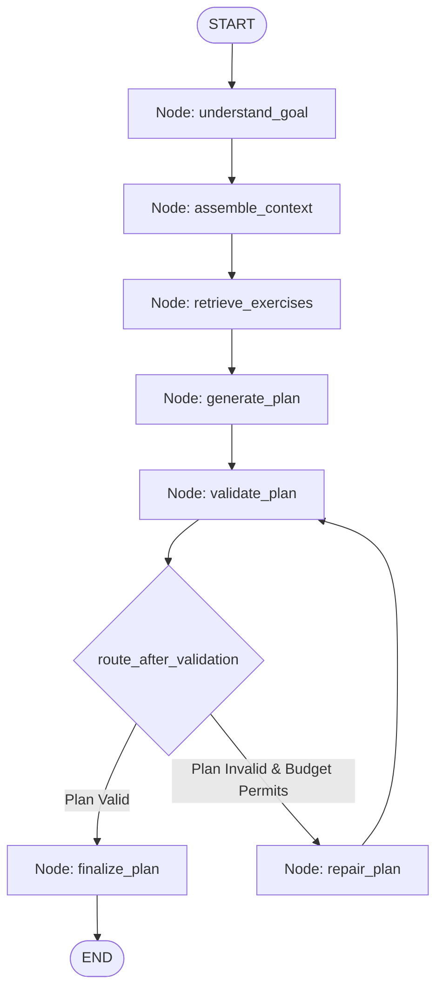

# Phase 11: AI Workout Planner — Architectural Guide & Specification

> **Component:** AI Workout Planner Subsystem
> **Status:** IMPLEMENTED & VERIFIED
> **Author:** Senior AI Engineer / Full-Stack Architect
> **Frameworks:** Python 3.12 (`FastAPI`, `LangGraph==1.2.24`, `Pydantic v2`), Node.js / Express 5 (`TypeScript`, `Zod v4`), React Native (`Expo Router`, `Zustand`)
> **Components Covered:** `ai-backend` (`onusfit_ai.features.workout_planner.*`), `backend` (`src/modules/workouts/*`), `mobile` (`src/features/workouts/*`)

---

## 1. Architectural Overview & Philosophy

FitOnus Phase 11 implements a personalized, production-grade **AI Workout Planner** that leverages Gemini structured outputs, dedicated LangGraph planning workflows, strict deterministic safety validation, and grounded exercise library references.

### Core Architecture Principles
1. **Clean / Hexagonal Boundaries:**
   - **Node.js** owns authentication (JWT), authorization, quota enforcement, transaction safety, and persistent database writes.
   - **Python** owns stateless AI orchestration, LangGraph graph execution, structured schema enforcement, and deterministic safety checks.
   - **Mobile** renders workout previews, alternatives, and explicit confirmation before persisting routines.
2. **Deterministic Safety Independent of Gemini:**
   - Medical red flags, injury contraindications, volume caps, and duration feasibility are deterministically validated with zero reliance on LLM prompt obedience.
3. **Strict Exercise Grounding:**
   - Generated plans reference ONLY genuine exercise UUIDs from `DEFAULT_EXERCISE_CATALOG`. Hallucinated IDs are deterministically detected and rejected.
4. **Bounded Self-Repair:**
   - If an LLM-generated plan violates safety rules or catalog constraints, the LangGraph workflow triggers a bounded repair node (up to 2 iterations) before falling back to a deterministic, valid plan.
5. **No Autonomous Persistence:**
   - Generation returns an ephemeral preview. The plan is persisted to PostgreSQL only upon explicit user confirmation.

---

## 2. LangGraph Workout Planning Workflow

The workflow executes through `WorkoutPlannerGraphExecutor` with zero-PII telemetry and strict deadline enforcement.

### Node Responsibilities
1. **`understand_goal_node`:** Normalizes goals (`general_fitness`, `muscle_building`, `strength`, `fat_loss`, `endurance`), experience level, duration, and target language (`en`, `ta`, `tanglish`).
2. **`assemble_context_node`:** Assembles user preferences, equipment restrictions, physical limitations, and recent training metrics.
3. **`retrieve_exercises_node`:** Indexes catalog items matching available equipment and filters out any exercises contraindicated by known limitations.
4. **`generate_plan_node`:** Uses Gemini structured outputs (`WeeklyWorkoutSchedule` schema) or deterministic fallback generation.
5. **`validate_plan_node`:** Evaluates the plan against `WorkoutSafetyValidator` across 8 deterministic safety dimensions.
6. **`repair_plan_node`:** Replaces ungrounded IDs, adjusts excessive sets, resolves duplicates, and enforces session caps.
7. **`finalize_plan_node`:** Formats rationale, tags metadata, and outputs the finalized plan.

---

## 3. Deterministic Safety & Physiological Rules

Safety validation is executed by `WorkoutSafetyValidator` in `onusfit_ai.features.workout_planner.domain.safety`:

| Safety Dimension | Rule & Threshold | Failure Action |
|:---|:---|:---|
| **Medical Red Flags** | Chest pain, acute tears, fractures, dizziness, syncope, post-surgery | Immediate generation halt; clinical disclaimer escalation |
| **Catalog Grounding** | Every exercise ID must exist in `DEFAULT_EXERCISE_CATALOG` | Fatal error; triggers repair node |
| **Duplicate Exercises** | No exercise ID may appear more than once in a single session | Fatal error; triggers repair deduplication |
| **Equipment Availability** | Exercise equipment must be a subset of user's available gear | Fatal error; triggers alternative substitution |
| **Volume Caps (Session)** | Beginner <= 18 sets, Intermediate <= 24 sets, Advanced <= 30 sets | Fatal error; sets clamped or trimmed |
| **Muscle Volume Cap** | Max 12 working sets per muscle group in a single session | Non-fatal coaching warning |
| **Duration Feasibility** | Estimated duration must satisfy `duration >= total_sets * 2.5 min` | Non-fatal coaching warning |
| **Recovery Days** | 7-day schedule requires at least 1-2 designated recovery days | Non-fatal coaching warning |

### Injury Contraindication Matrix
- **Knee pain / tendinitis:** Excludes barbell back squats, jumping lunges, box jumps. Safe substitutes: Glute bridges, dumbbell Romanian deadlifts.
- **Shoulder impingement:** Excludes overhead barbell/military press, upright rows, behind-the-neck movements. Safe substitutes: Push-ups, chest-supported rows.
- **Lower back / lumbar issues:** Excludes heavy axial deadlifts, bent-over barbell rows. Safe substitutes: Dumbbell bench press, planks, glute bridges.
- **Wrist pain / sprain:** Excludes straight barbell curls and front squats. Safe substitutes: Neutral grip dumbbell rows/curls.

---

## 4. Dynamic Workout Adaptation

When real-life disruptions occur, users request adaptation via `POST /api/v1/workouts/plans/ai/adapt`:
- **Missed Sessions:** Preserves completed days and redistributes key compound volume into remaining days without violating session set caps.
- **Duration Cuts:** Intelligently truncates accessory movements while preserving core compound movements when time is reduced (e.g. 60m → 30m).
- **Equipment Changes:** Automatically swaps gym movements to bodyweight/dumbbell equivalents using grounded alternative mappings.
- **Fatigue / Soreness Feedback:** Applies a 20–30% deload to sets, increases rest intervals (+15s), or converts days to active mobility.

---

## 5. API Contracts & Verification

### Node.js ↔ Python Internal API
- `POST /internal/v1/ai/workout-planner/generate`: Generates weekly plan with JWT scope `ai:workout:plan`.
- `POST /internal/v1/ai/workout-planner/adapt`: Adapts active plan based on feedback.
- `POST /internal/v1/ai/workout-planner/validate`: Deterministically audits any plan payload.

### Node.js External Client API
- `POST /api/v1/workouts/plans/ai/generate`: Authenticated user preview endpoint.
- `POST /api/v1/workouts/plans/ai/adapt`: Authenticated user dynamic adaptation endpoint.
- `POST /api/v1/workouts/plans`: Explicit user confirmation and persistence endpoint.

---

## 6. Offline Benchmark & Verification Results

A comprehensive 42-case golden benchmark (`workout_planner_benchmark.json`) was authored and evaluated using `WorkoutPlannerEvaluator` in `test_workout_planner_eval.py`:

| Test Category | Benchmark Case Range | Cases Count | Status |
|:---|:---|:---:|:---:|
| Goal-Specific Generation | `WORKOUT_001` – `WORKOUT_008` | 8 | **PASSED** (100%) |
| Experience & Volume Caps | `WORKOUT_009` – `WORKOUT_014` | 6 | **PASSED** (100%) |
| Equipment Restrictions | `WORKOUT_015` – `WORKOUT_020` | 6 | **PASSED** (100%) |
| Duration Constraints | `WORKOUT_021` – `WORKOUT_025` | 5 | **PASSED** (100%) |
| Grounding & Duplicate Check | `WORKOUT_026` – `WORKOUT_029` | 4 | **PASSED** (100%) |
| Physical Limitations | `WORKOUT_030` – `WORKOUT_034` | 5 | **PASSED** (100%) |
| Medical Red Flags | `WORKOUT_035` – `WORKOUT_037` | 3 | **PASSED** (100%) |
| Dynamic Plan Adaptation | `WORKOUT_038` – `WORKOUT_041` | 4 | **PASSED** (100%) |
| Multilingual (Tamil) | `WORKOUT_042` | 1 | **PASSED** (100%) |
| **Total Benchmark Cases** | — | **42** | **100% Pass Rate** |

### Test Counts Across Components
- **Python AI Backend:** 27 unit & eval tests (`pytest`) passed in 1.06s. Ruff and Mypy passed with 0 errors across 128 source files.
- **Node.js Backend:** 3 unit tests (`vitest`) passed. TypeScript typecheck and ESLint passed with 0 errors.
- **Mobile Frontend:** 865 unit tests passed. Expo TypeScript typecheck and linting passed with 0 errors.
