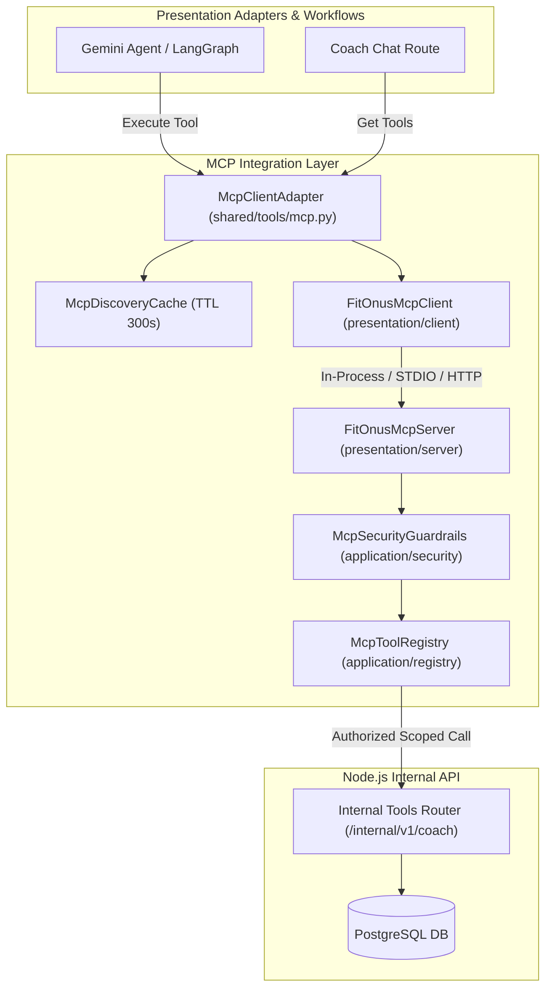

# FitOnus AI — Phase 12: Model Context Protocol (MCP)

This document specifies the Model Context Protocol (MCP) subsystem integrated into the FitOnus AI platform. It serves as the authoritative architectural specification and engineering guide for exposing domain capabilities, resources, and prompt templates to autonomous agents through standardized, secure interfaces.

---

## 1. Architectural Overview & Clean Architecture Boundaries

FitOnus preserves strict Hexagonal / Clean Architecture boundaries across both the Node.js monolithic backend and the Python AI microservice (`onusfit_ai`):

- **Node.js Monolith (`backend/`)**: Remains the authoritative source of truth for all business state, PostgreSQL persistence, user identity, JWT issuing/verification, authorization, and quota accounting.
- **Python AI Service (`ai-backend/`)**: Owns LLM orchestration, Gemini function calling, LangGraph agent workflows, prompt management, and the MCP integration layer.
- **MCP Domain Layer (`features/mcp/domain/`)**: Pure domain models (`McpToolDefinition`, `McpToolCall`, `McpToolResult`, `McpResourceDefinition`, `McpPromptDefinition`, `McpConfig`) with zero external SDK or transport dependencies.
- **MCP Application Layer (`features/mcp/application/`)**: Pure business orchestration, tool registries (`McpToolRegistry`), human-in-the-loop (HITL) approval gates, idempotency management, and security guardrails (`McpSecurityGuardrails`).
- **MCP Presentation Layer (`features/mcp/presentation/`)**: The only layer containing official MCP SDK (`mcp`) dependencies, housing the server builder (`FitOnusMcpServer`), client adapter (`FitOnusMcpClient`), transports, and FastAPI HTTP/SSE routes (`/internal/v1/mcp`).
- **Shared Client Adapters (`shared/tools/mcp.py`)**: Bridges MCP tools into Gemini function declarations and LangGraph nodes, managing discovery caching, telemetry, and fallback to `InternalToolsClient`.

---

## 2. Server & Client Lifecycle & Supported Transports

### 2.1 Capability Negotiation
Upon connection, the client and server negotiate protocol version (`2024-11-05`) and exchange capability manifests:
- `tools`: Structured tool execution with Pydantic JSON schemas.
- `resources`: Informational knowledge graphs and planning rules.
- `prompts`: Reusable structured prompt workflows.
- `logging`: Diagnostic telemetry with zero PII.

### 2.2 Supported Transports
1. **In-Process Memory (`in_process`)**: Default production transport. Zero network overhead, executing tool handlers in the same Python process through `call_tool_in_process` while propagating request-scoped context variables (`current_user_id`, `current_request_id`).
2. **Local STDIO (`stdio`)**: Standard I/O transport for local developer tooling, Claude Desktop integration, and subprocess orchestration via `stdio_runner.py`.
3. **Streamable HTTP / SSE (`streamable_http`)**: Mounted via FastAPI at `/internal/v1/mcp` for authenticated inter-service agent communication over streaming JSON-RPC.

---

## 3. Registered Tools, Resources, and Prompts

### 3.1 Registered Tools
All tools enforce strict read-only or preview-only execution patterns. Autonomous database writes are forbidden.

| Tool Name | Type | Auth Required | Description |
|:---|:---|:---|:---|
| `get_fitness_profile` | Read-only | Yes | Athlete goals, experience level, equipment, and calculated daily macro targets. |
| `get_recent_workouts` | Read-only | Yes | Completed workout sessions, volume load, and personal records. |
| `search_exercises` | Read-only | No | Verified exercise library lookup by name, muscle group, or equipment. |
| `get_exercise_details` | Read-only | No | Biomechanical cues, primary muscles, execution instructions, and safety notes. |
| `preview_workout_plan` | Preview-only | Yes | Generates grounded, non-persisted weekly workout split preview. |
| `preview_workout_adaptation` | Preview-only | Yes | Generates adaptation preview of existing plan for fatigue or injuries. |
| `validate_workout_plan` | Read-only | Yes | Validates schedules against volume caps, duplicate movements, and safety limits. |
| `get_nutrition_summary` | Read-only | Yes | Logged daily macronutrients, caloric balance, and water intake. |
| `preview_nutrition_plan` | Preview-only | Yes | Evidence-based nutritional guidelines and caloric balance calculations. |
| `get_weight_trend` | Read-only | Yes | Chronological weight logs, EMA trend, and weekly rate of change. |
| `retrieve_fitness_knowledge` | Read-only | Yes | RAG retrieval of verified sports science and nutrition chunks. |
| `persist_workout_plan` | Write (HITL) | Yes | Mutation requires explicit user confirmation ticket (`confirmed: true`). |

### 3.2 Registered Informational Resources
- `fitonus://catalog/exercises`: Verified exercise metadata, compound lift lists, and equipment categories.
- `fitonus://knowledge/guidelines`: Evidence-based guidelines for progressive overload, recovery intervals, and macronutrient distribution.
- `fitonus://planning/guidelines`: Weekly frequency boundaries, split architectures, and session volume caps.

### 3.3 Registered Reusable Prompts
- `fitness_progress_analysis`: Synthesizes workout volume, nutrition adherence, and weight trajectory over past 7–30 days.
- `workout_planning`: Guides agents through loading guidelines, retrieving equipment profiles, previewing splits, and validating safety.
- `nutrition_guidance`: Guides agents through calculating caloric requirements, protein targets, and hydration balance.

---

## 4. Gemini & LangGraph Integration

Tools discovered through MCP are translated into Gemini `types.Tool(function_declarations=[...])` via `create_gemini_tools_from_schemas`.

### Integration Flow:
1. `coach_chat.py` inspects `is_mcp_enabled()`.
2. When enabled, `get_mcp_client_adapter()` discovers tools from MCP server (or retrieves cached definitions from `McpDiscoveryCache`).
3. `mcp_adapter.create_tool_handler()` returns an async callback `Callable[[str, dict[str, Any]], Awaitable[dict[str, Any]]]`.
4. The callback executes the tool through MCP. If MCP execution fails or is unreachable, it logs a warning and transparently falls back to `InternalToolsClient.execute_tool(...)`.
5. Compatible with Gemini Function Calling, the Native Agent Executor, and LangGraph Workflow Nodes.

---

## 5. Security & Execution Controls

- **Tenant Isolation & Anti-Confused Deputy**: All tools resolve user identity exclusively from cryptographically verified JWT claims (`claims.user_id`). Client-provided `user_id`, `userId`, or `targetUserId` parameters in tool arguments are strictly ignored and forbidden.
- **Service Authentication**: Internal HTTP transport requires `Bearer` token with `ai:tools:read` scope verified by HMAC-SHA256 (`TOOL_JWT_SECRET`).
- **Tool Allowlist**: Only tools explicitly registered in `DEFAULT_ALLOWED_TOOLS` may be executed.
- **Prompt Injection Defense**: Tool outputs are scrubbed of prompt injection directives (`system instruction:`, `ignore previous instructions:`) and context delimiter breakout tokens (`</grounding_observations>`, `<retrieved_knowledge>`).
- **Credential Masking**: Bearer tokens and JWT patterns are redacted before returning data to LLM context.
- **Execution Budgets**: Per-turn cumulative limit of 10 tool calls and 5.0s per-tool timeout prevents runaway loops.
- **Human-in-the-Loop (HITL)**: Any mutating write operation generates a pending `ApprovalTicket` and halts execution until explicit user confirmation is submitted.

---

## 6. Reliability, Caching, and Telemetry

- **Discovery Cache**: `McpDiscoveryCache` caches tool definitions with a bounded 300-second TTL, avoiding repeated introspection.
- **Graceful Fallback**: If MCP is disabled (`MCP_ENABLED=false`) or encounters an unhandled exception, execution seamlessly falls back to the native Node.js internal tools client.
- **Idempotency & Deduplication**: Action signature hashing prevents duplicate mutations during connection retries or fallback transitions.
- **Privacy-Safe Telemetry**: `McpTelemetry` records invocation counts, latencies, and fallback triggers without logging user IDs, prompts, or sensitive health data.

---

## 7. Verification & Evaluation Results

- **Python Unit & Contract Tests**: 50 passed in 3.09s (`tests/test_mcp_*.py`).
- **Offline Evaluation Benchmark**: 37/37 benchmark cases passed in 0.53s (`tests/evals/offline/test_mcp_eval.py`).
- **Architecture Boundaries**: 22/22 passed in 19.43s (`tests/test_architecture.py`).
- **Type Safety**: `mypy src/onusfit_ai` passed with 0 errors across 147 source files.
- **Code Quality**: `ruff check` passed with 0 warnings.
- **Node.js Internal Tools**: 17 unit tests passed in 1.62s; TypeScript `tsc --noEmit` clean.

---

## 8. Known Limitations & Future Roadmap

1. **Preview-Only Workouts**: Workout plan generation via MCP produces schedule previews; persistence requires the Node.js API with user confirmation.
2. **Phase 13 Preparation**: Multi-agent collaborative protocols (Agent-to-Agent / A2A) evaluated in offline tests are staged for full production rollout in Phase 13.
