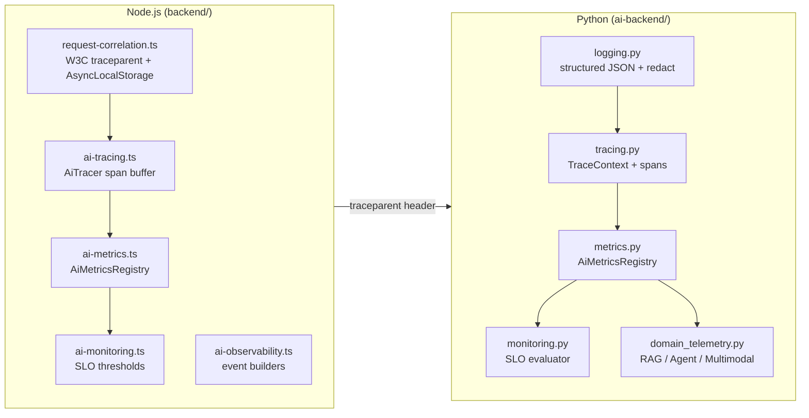

# Phase 17 — AI Observability

**Status:** COMPLETED.
**Branch:** `development` (no new branches).
**Parallel context:** Phase 13 (multi-agent), Phase 14 (streaming), Phase 15 (multimodal), Phase 19 (GenAI Ops).

> [!IMPORTANT]
> Phase 17 is a **lightweight, production-ready AI observability layer** built on existing
> FitOnus logging, correlation, and quota infrastructure.  It adds zero paid dependencies.

---

## Architecture

Both registries share identical snapshot schemas and label vocabularies so a single
query or dashboard filter works across both services.

---

## Distributed Tracing

### W3C `traceparent` Propagation

| Hop | What happens |
| --- | --- |
| **Mobile → Node** | Express `bindRequestCorrelation` middleware calls `createRootTraceContext(req.headers['traceparent'])`. |
| **Node → Python** | `PythonAiClient.postJson` and `callPythonAi` send the `traceparent` header via `buildOutboundTraceHeaders`. |
| **Python ingress** | `RequestObservabilityMiddleware` parses `traceparent`, calls `create_root_trace_context`, and binds the context to `contextvars`. |
| **Internal spans** | `withAiSpan` (Node) and `start_span` / `start_async_span` (Python) derive child spans with `createChildTraceContext` / `create_child_span_context`. |

### Span Storage

Both services use **bounded in-memory ring buffers** (`BoundedSpanRecorder` / `AiTracer`, default 500 spans).
Spans record `traceId`, `spanId`, `parentSpanId`, `operation`, `service`, `status`, `durationMs`, and sanitized attributes.
They are queryable by `traceId` for offline debugging and test assertions.

---

## Metrics

### Schema

The `AiMetricsRegistry` (both languages) is a **thread-safe, bounded-cardinality, in-memory singleton** with:

| Group | Key dimensions | Metrics |
| --- | --- | --- |
| **AI / LLM** | `feature` (closed), `model` (dynamic, capped) | requests, successes, failures, timeouts, retries, fallbacks, tokens (in/out/cached/thinking/total), estimated cost USD, latency p50/p95/p99/avg/max |
| **RAG** | `mode` (closed: vector, lexical, hybrid, reranked) | retrievals, empty results, reranked, grounded, failed, candidates, returned, citations, top/avg score, latency |
| **Agent** | `engine` (closed: native, langgraph, multi_agent, workout_planner) | executions, failures, fallbacks, limit hits, tool calls/failures, iterations, replans, routing decisions, latency |
| **Multimodal** | `modality` (closed: image, audio, multimodal) | requests, validation failures, processing errors, total bytes, latency, validation latency |

### Cardinality Bounds

- **Closed labels** (`feature`, `mode`, `engine`, `modality`, error categories) map unknown values to `_other`.
- **Dynamic labels** (`model`, `tool_name`, routing decision, limit type) are capped at `MAX_SERIES_PER_GROUP` (64) with overflow to `_other`.
- **Latency ring buffer** holds `MAX_LATENCY_SAMPLES` (256) most recent values.

### Cost Estimation

`estimate_cost_usd` applies per-model USD-per-million-token pricing (matching `GeminiRuntimeService` rates).
`recordCostUsd` (Node) attributes externally calculated cost without inflating request counts.

---

## Privacy & Security

Three layers prevent sensitive data from reaching logs or metrics:

1. **`log_event` / event builders** — call sites pass enums, numbers, and booleans; never free-text, prompts, media, or user data.
2. **`clean_fields`** — masks values whose field name matches `_SENSITIVE_FIELD_NAMES` (prompt, token, health data, medical, password, email, etc.); truncates strings to 200 chars; replaces dicts with `<dict>`.
3. **`redact` / `redactSensitiveText`** — regex-based last line of defense: masks Google API keys (`AIza...`), secret keys (`sk-...`), bearer tokens, JWTs (`eyJ...`), and email addresses.

> [!CAUTION]
> **Never log:** raw prompts, health/medical information, personal identifiers,
> media content (base64, audio, images), API keys, JWTs, or credentials.

---

## Operational Monitoring (SLO Thresholds)

`evaluate_operational_health` / `evaluateAiOperationalHealth` evaluates a metrics snapshot against `SloThresholds` / `AiSloThresholds`:

| Check | Warning | Critical | Action |
| --- | --- | --- | --- |
| Error rate | ≥ 5% | ≥ 15% | Inspect `errorCategory` in structured logs |
| Timeout rate | ≥ 5% | ≥ 15% | Check Gemini/Python deadline budgets |
| Fallback rate | ≥ 15% | ≥ 40% | Inspect model cooldown events |
| Chat p95 latency | ≥ 8s | ≥ 15s | Profile context assembly and RAG spans |
| Multimodal p95 | ≥ 12s | ≥ 20s | Inspect payload sizes |
| RAG empty rate | ≥ 35% | ≥ 60% | Verify knowledge documents and similarity thresholds |
| RAG p95 latency | ≥ 500ms | ≥ 1500ms | Check pgvector index and query embedding latency |
| Agent limit-hit rate | ≥ 15% | ≥ 35% | Review iteration/tool budgets |
| Quota exhausted | — | ≥ 1 | Verify Gemini billing cap immediately |
| Auth failures | — | ≥ 1 | Verify API key and service secret parity |
| Service unavailable | ≥ 3 | ≥ 10 | Check ai-backend health and upstream Gemini status |

The evaluator returns `{ status: 'healthy' | 'degraded' | 'critical', alerts: [...], summary: { ... } }`.

---

## Instrumented Flows

### Node.js (`backend/`)

| Module | Instrumentation |
| --- | --- |
| `request-context.ts` | Binds `TraceContext` via `createRootTraceContext` from incoming `traceparent` header |
| `python-ai-client.ts` | Sends `traceparent` in `postJson`; wraps `embed` in `withAiSpan`; records `knowledge_embed` metrics |
| `python-ai-call.ts` | Wraps `postJson` in `withAiSpan`; records `defaultAiMetrics.recordLlmCall`; redacts ledger errors |
| `gemini-runtime-service.ts` | `recordExternalUsage` calls `defaultAiMetrics.recordCostUsd` without inflating request counts |
| `knowledge-service.ts` | Single authoritative RAG telemetry source (`withAiSpan`, `recordRagRetrieval`, `ragRetrievalFields`, `ragGroundingFields`) |
| `context-assembler.ts` | Wraps RAG stage in `coach.rag.retrieve` span with redacted fallback logs (defers RAG counters/events to `KnowledgeService` to avoid double-counting) |
| `memory-extraction-worker.ts` | Removed `job.userId` from logs; sanitized error messages |
| `analyze-meal-photo.ts`, `parse-voice-meal.ts`, `python-meal-photo-service.ts`, `python-voice-meal-service.ts`, `python-speech-transcriber.ts` | Multimodal pre-quota validation failures and upstream completion/error telemetry (`defaultAiMetrics.recordMultimodalProcessing`) |

### Python (`ai-backend/`)

| Module | Instrumentation |
| --- | --- |
| `observability.py` & `router.py` | `RequestObservabilityMiddleware` binds `traceparent` / `TraceContext`, excludes `/observability` from HTTP metrics/spans while logging access; `GET /observability` & `/internal/v1/observability` (`ai:observability:read` JWT) expose sanitized metrics, health, and spans |
| `telemetry.py` (LLM) & `errors.py` | `log_ai_call(..., record_metrics=...)` & `log_ai_failure(..., usage=...)` coordinate via `llm_metrics_recorded_var` so retries, fallbacks, `SAFETY`/`MAX_TOKENS`, and `parse_failed` never double-count |
| `agent/graph/{telemetry,nodes}.py` & `executor.py` | `GraphExecutionTelemetry` + `AgentObservabilityTracker` + `tool_execution_node` record routing, tool cache hits/calls, limits, and fallbacks |
| `multi_agent/{telemetry,mcp_gateway,graph/nodes}.py` & `main.py` | `MultiAgentTelemetry` records `byEngine["multi_agent"]` (`toolCalls`, `toolFailures`, `limitHits`, `fallbacks`); `MultiAgentMcpGateway` traces & counts tool calls/cache hits once; `_MultimodalMealPortAdapter` sets `record_llm_metrics=False` so outer `coach_multi_agent` is not double-counted |
| `mcp/application/{orchestrator,a2a}.py` & `shared/tools/{client,mcp}.py` | Child spans (`mcp.orchestrator.*`, `a2a.delegate.*`, `tools.http.*`), MCP tool metrics, and outbound `traceparent` + `X-Correlation-Id` propagation (`McpTelemetry` emits logs only, avoiding tool-counter double-counting) |
| `meals/application/{photo,voice,multimodal}.py`, `speech/application/transcribe.py`, `coach/application/chat.py` | `MultimodalObservabilityTracker` records image/audio validation failures, EXIF stripping, processing latency/errors, and completion without logging media MIME strings or bytes |
| `telemetry.py` (workout) | `WorkoutPlannerTelemetry` with zero-PII: `del user_id`, structured `log_event`, `record_tool_call` |

---

## Completed Integrations & Remaining Scope

| Item | Status | Details |
| --- | --- | --- |
| Phase 13 multi-agent & MCP telemetry | **Completed** | Wired `multi_agent/*`, `mcp/application/{orchestrator,a2a}.py`, `shared/tools/{client,mcp}.py` |
| Phase 15 multimodal & speech telemetry | **Completed** | Wired `meals/*`, `speech/application/transcribe.py`, `coach/application/chat.py`, and Node multimodal use cases/clients |
| Authenticated `/observability` endpoint | **Completed** | Internal `ai:observability:read` scope (fail-closed 503/401); zero raw prompts, user IDs, or secrets |
| Phase 14 SSE streaming coordination | **Coordinated** | Phase 14 `stream_telemetry.py` emits metadata-only events via `shared.logging.log_event`; `RequestObservabilityMiddleware` and W3C `traceparent` wrap streaming ASGI responses without buffering bodies |
| Shared documentation indexes | **Completed** | Linked from `Resources/docs/INDEX.md` and `00-learning-index.md` |
| Persistent trace backend | **Deferred (Phase 20+)** | Requires external infrastructure (out of Phase 17 scope) |

---

## Process-Local & Restart Limitations

> [!NOTE]
> - **In-memory, single-instance**: metrics counters, latency windows, and bounded span ring buffers live inside process memory only. There is no cross-instance or cross-worker aggregation.
> - **Restart & worker-recycle behavior**: all counters, p50/p95/p99 summaries, and recent spans reset cleanly on process restart or Uvicorn/Node worker recycle (reported explicitly via `"processLocal": true` and `"restartBehavior"` on `/observability`).
> - **No persistent trace backend**: spans live in a bounded ring buffer (default 500 spans).
> - **No external alerting**: `evaluate_operational_health` returns SLO alerts; paging integrations (Slack/PagerDuty) remain out of scope.
> - **Cost estimation is approximate**: derived from static per-model pricing tables, not live Gemini billing APIs.

---

## Testing

Verified offline test suites (0 live Gemini calls):
- `ai-backend/tests/test_phase17_observability.py` — **80** Python test cases covering `traceparent` propagation, `/observability` internal JWT auth & sanitization, Phase 13 multi-agent/MCP/A2A telemetry, Phase 15 multimodal/speech telemetry, zero double-counting across `parse_failed`/`SAFETY`/delegated multimodal calls, PII redaction, SLO thresholds, concurrency, and fail-open resilience.
- Targeted Python suite (23 files incl. observability, auth, architecture, wire contract, agent, multi-agent, MCP, multimodal, eval runner tests) — **401 passed**; deterministic offline evals — **329/329 passed (100.0%)**.
- `backend/tests/unit/ai/ai-observability-phase17.test.ts` — **58** Node.js test cases covering W3C tracing, bounded cardinality metrics, RAG single-counting (`CoachContextAssembler` + `KnowledgeService`), multimodal pre-quota validation/transcription telemetry, PII redaction, SLO health, and fail-open resilience (`npm --prefix backend test`: **193 files / 2986 tests passed**).

---

## Troubleshooting

### "No trace IDs in logs"

1. Verify `request-context.ts` middleware is mounted before route handlers.
2. Check that `RequestObservabilityMiddleware` is in the Python ASGI stack.
3. Confirm the client sends the `traceparent` header.

### "Metrics snapshot is empty"

1. Verify `defaultAiMetrics` / `metrics_registry` are the same singleton instances used by instrumented flows.
2. Check that observability wrappers (`withAiSpan`, `record_llm_call`) are in the execution path.

### "Quota exhausted alert but billing looks fine"

1. The alert fires on the first occurrence. Check `errorsByCategory.gemini_quota_exhausted` in the snapshot.
2. The Python error classification may map a different HTTP 429 code to `gemini_quota_exhausted` — verify with `classifyPythonAiError`.

### "Latency percentiles seem wrong"

1. The ring buffer holds only the latest 256 samples. After a process restart with low traffic, percentiles stabilize after ~100 requests.
2. `maxMs` is a lifetime maximum and does not reset with the ring buffer.
