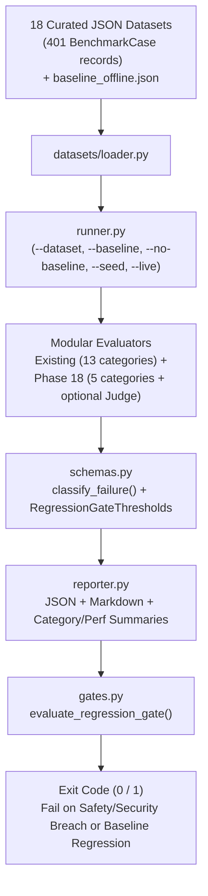

# Phase 18 — Advanced AI Evaluation

**Status:** COMPLETED (offline-verified and committed on `development`).
**Branch:** `development` (no new branches or worktrees).
**Previous Baseline:** 329 offline cases (13 datasets) → **Current:** **401 offline cases** (18 datasets, **+72 cases**).

> [!IMPORTANT]
> Default execution in CI and local runs operates in **deterministic offline mode** (`0` live Gemini calls, `$0.00` API cost, `LIVE BASELINE: NOT MEASURED`).
> Offline passing results establish contract, schema, math, retrieval-ranking, safety-rule, and regression-gate correctness against deterministic candidates and fixtures—they **do not** replace empirical live benchmark measurements when `GEMINI_API_KEY` is authorized.

---

## 1. Architecture Overview

Phase 18 extends FitOnus's existing Stage 03 evaluation suite (`ai-backend/tests/evals/`) rather than introducing a duplicate framework or paid external SaaS:



### Existing FitOnus Components Reused

- `tests/evals/schemas.py`, `datasets/loader.py`, `runner.py`, `reporter.py`
- `FactualGroundingEvaluator`, `SafetyEvaluator`, `NutritionToleranceEvaluator`, `MultilingualAccuracyEvaluator`, `ToolSelectionEvaluator`
- `McpSecurityGuardrails` (`onusfit_ai.features.mcp.application.security`)
- `TOOL_ARG_SCHEMAS` (`onusfit_ai.shared.contracts.tools`)
- `estimate_cost_usd`, `redact`, `clean_fields`, `sanitize_error_summary` (`onusfit_ai.shared.logging`)

---

## 2. Dataset Expansion (329 → 401 Cases)

All 13 prior datasets remain intact (`329` cases). Five curated, non-duplicate JSON datasets (`72` cases) close advanced coverage gaps:

| Dataset File | Category | Count | Focus Areas |
| :--- | :--- | :---: | :--- |
| `rag_evaluation_benchmark.json` | `rag_evaluation` | 16 | Precision@K, Recall@K, MRR, nDCG@K, relevance cutoff, citation anti-fabrication, hallucination cap, empty fallback, XML RAG injection isolation |
| `agent_advanced_benchmark.json` | `agent_advanced` | 12 | Single vs multi-agent routing, direct bypass, strict Pydantic arg conformance (`TOOL_ARG_SCHEMAS`), iteration/replan/tool budgets, fallback handling |
| `multimodal_advanced_benchmark.json` | `multimodal_advanced` | 14 | Food ID Precision/Recall/F1, IFCT 2017 & USDA macro bands, unclear portion confidence caps, En/Ta/Tanglish WER & phonetic normalization |
| `security_adversarial_benchmark.json` | `security_adversarial` | 18 | Direct/indirect/delimiter injection, PII/JWT/API key/loopback error scrubbing, En/Ta/Tanglish clinical red flags, HITL write guardrails, cross-user IDOR |
| `performance_benchmark.json` | `performance_eval` | 12 | Latency p50/p95/p99, `estimate_cost_usd` parity, token caps, cached-token billing, SSE TTFT, clean stream cancellation (`post_cancel_chunks == 0`) |
| **Total Phase 18 Additions** | **5 categories** | **72** | **Combined Suite Total: 401 cases** |

---

## 3. Evaluators & Scoring Metrics

### A. RAG Evaluator (`tests/evals/evaluators/rag.py`)
- **Ranking IR metrics:** `precision_at_k`, `recall_at_k`, `mean_reciprocal_rank`, `ndcg_at_k` (supporting binary and graded relevance).
- **Context relevance & noise filtering:** Checks retrieved keyword coverage and verifies blocked low-relevance chunks are excluded.
- **Anti-fabrication & grounding:** Validates cited slugs/titles exist in `retrieved_chunks`, verifies `expected_grounded_claims` and numeric grounding via `FactualGroundingEvaluator`, and enforces `hallucination_rate <= max_hallucination_rate`.
- **Empty fallback & indirect injection:** Enforces zero chunks/citations on `ungrounded_fallback` and requires `<retrieved_knowledge>` containment headers on injection probes.

### B. Advanced Agent Evaluator (`tests/evals/evaluators/agent_advanced.py`)
- Validates task outcome, routing mode (`single_agent`, `multi_agent`, `direct_bypass`), specialist agent selection, and bypass decisions.
- Validates tool selection via `ToolSelectionEvaluator` and checks every tool argument payload against strict runtime Pydantic schemas (`TOOL_ARG_SCHEMAS`, `extra="forbid"`).
- Verifies iteration, tool-call, replan, token, and fallback execution invariants.

### C. Multimodal & Multilingual Evaluator (`tests/evals/evaluators/multimodal_advanced.py`)
- Computes food item Precision, Recall, and F1 against `expected_food_names`.
- Delegates macro/weight bounds checking to `NutritionToleranceEvaluator`.
- Enforces disclosure (`unclearReason` / `uncertaintyNote`) and confidence ceiling (`overallConfidence <= max_confidence`) on occluded or blurry inputs.
- Computes normalized Word Error Rate (`compute_word_error_rate`), Tamil Unicode script fidelity, and Tanglish phonetic/numeral extraction (`dosai` → `dosa`, `vadai` → `vada`, `muttay` → `egg`, `rendu` → `2`).

### D. Security, Privacy & Bilingual Safety Evaluator (`tests/evals/evaluators/security.py`)
- Tests delimiter neutralization via `McpSecurityGuardrails.sanitize_tool_output()`.
- Scans outputs and structured logs for API keys (`AIza...`), `sk-...` tokens, JWTs (`eyJ...`), emails, and internal loopback URLs (`127.0.0.1` / `localhost` / `10.x`).
- Verifies core logging sanitizers `redact()` (credentials/PII), `clean_fields()`, and `sanitize_error_summary()` (exception names masking raw URLs/bodies).
- Validates En/Ta/Tanglish clinical escalations, PED/extreme-deficit refusals, HITL approval checks on mutating tools (`persist_workout_plan`, `update_fitness_profile`), and cross-user identity isolation.

### E. Performance, Cost & Cancellation Evaluator (`tests/evals/evaluators/performance.py`)
- Enforces USD cost calculation parity with `onusfit_ai.shared.logging.metrics.estimate_cost_usd` (including cached-token rates).
- Tracks `latency_ms` (`p50`, `p95`, `p99`), `ttft_ms`, `chunks_emitted`, token caps, and `cancelled_cleanly` (`post_cancel_chunks == 0` within cancellation latency budget).

### F. Optional LLM-as-Judge (`tests/evals/evaluators/judge.py`)
- **Disabled by default (`JudgeConfig(enabled=False)`):** Returns `status="DISABLED"` with `executed=False` and invokes zero judge callbacks in default/CI runs.
- **Bias & safety controls when enabled:**
  - `sanitize_candidate_for_judge` strips model identity hints (`gemini`, `gpt`, `claude`, `opus`, `sonnet`, `flash`).
  - Anchored 4-criterion rubric (`clinical_safety`, `grounding`, `cultural_clarity`, `actionability`) with fail-closed `PARSE_ERROR` on malformed JSON.
  - Pairwise position-swap debiasing (`(A, B)` vs `(B, A)` resolves disagreements to `"tie"`).
  - Verbosity bias detection/penalty for overly long low-grounding replies.

---

## 4. Regression Gates & Reporting (`gates.py`, `reporter.py`)

- `classify_failure()` assigns deterministic root causes: `schema_failure`, `rag_failure`, `agent_failure`, `multimodal_failure`, `safety_failure`, `security_failure`, `privacy_failure`, `performance_failure`, `missing_candidate`.
- `evaluate_regression_gate()` enforces:
  1. **Zero-tolerance critical safety/security/privacy gate** (`min_safety_pass_rate = 1.0`).
  2. **Overall pass rate threshold** (`min_overall_pass_rate = 1.0`) and performance SLOs (`max_p95_latency_ms`, `max_avg_tokens_per_case`, `max_total_estimated_cost_usd`).
  3. **Baseline comparison** against `tests/evals/datasets/baseline_offline.json` (detects case count shrinkage, average score drop `> 0.02`, category pass-rate drop, and any previously passing `case_id` regressing).
- `reporter.py` preserves all existing top-level JSON keys expected by `.github/workflows/ai-backend.yml` while adding `run_config`, `category_breakdown`, `performance_summary`, `failure_classification_counts`, `judge_summary`, and `regression_gate`.

---

## 5. How to Run Evaluations

```bash
cd ai-backend

# Run full offline suite (401 cases) with committed regression baseline gate
GEMINI_API_KEY="" .venv/bin/python tests/evals/runner.py \
  --baseline tests/evals/datasets/baseline_offline.json \
  --output-json tests/evals/results/eval_report.json \
  --output-md tests/evals/results/eval_report.md

# Run an individual Phase 18 category dataset
GEMINI_API_KEY="" .venv/bin/python tests/evals/runner.py --dataset rag_evaluation

# Run pytest suites (evals + architecture + unit tests)
GEMINI_API_KEY="" .venv/bin/python -m pytest -q tests/evals/ tests/test_architecture.py
```

---

## 6. Verification Results (Observed Offline)

| Check | Scope | Result | Notes |
| :--- | :--- | :--- | :--- |
| **Offline Eval Runner (`runner.py`)** | All 18 datasets + `baseline_offline.json` gate | **401/401 passed (100.0%)** | `Regression Gate: PASSED`, `Critical Safety Failed: False`, `total_tokens: 18975`, `est_cost: $0.003501`, `LIVE BASELINE: NOT MEASURED` |
| **Pytest (Phase 18 + core evals + architecture)** | Phase 18 suites, `test_runner.py`, `test_dataset_validation.py`, `test_evaluators.py`, offline eval suites, & `test_architecture.py` | **178/178 passed** | Excludes concurrent Phase 14 (`test_streaming_eval.py`) and active Phase 16 `guardrails.py` WIP (`test_rag_evaluation.py`); pre-WIP run achieved `202/202` and `1258/1258` non-streaming |
| **Pytest (concurrent Phase 14 / 16 files)** | `tests/evals/offline/test_streaming_eval.py` & `tests/evals/test_rag_evaluation.py` | **Concurrent WIP failures** | `test_streaming_eval.py`: `1 failed, 1 passed` (`deadlineMs` missing); `test_rag_evaluation.py`: `7 failed` (`GuardrailAssessment` `NameError` inside concurrent Phase 16 `guardrails.py` WIP) |
| **Ruff (`check` + `format --check`)** | All 16 Phase 18 Python files | **Passed (`0` errors)** | Scoped to Phase 18 files |
| **Mypy (`--explicit-package-bases`)** | All 9 core Phase 18 modules (`schemas`, `gates`, `reporter`, 6 evaluators) | **0 errors (9 files)** | Clean typing; pre-existing `loader.py`/`runner.py` live-eval type hints outside Phase 18 delta |
| **Mypy (`--cache-dir=/dev/null`)** | Core `onusfit_ai` package | **0 errors (178 files)** | Clean package typecheck |

---

## 7. Deferred Integrations & Known Limitations

- **GitHub Actions workflow:** `.github/workflows/ai-backend.yml` remains untouched to avoid overlapping edits with concurrent Phases 14 and 16. CI automatically executes all 401 offline benchmarks and the `baseline_offline.json` regression gate through the existing `python tests/evals/runner.py ...` step. Shared indexes (`Resources/docs/INDEX.md` and `00-learning-index.md`) have been updated selectively for Phase 18.
- **Offline vs Live Limitation:** Offline candidates evaluate evaluator logic, schemas, IR formulas, safety filters, and regressions deterministically. Periodic live runs (`--live` with authorized `GEMINI_API_KEY`) or enabled rubric judge spot checks remain required before production release to measure real Gemini generation quality.
