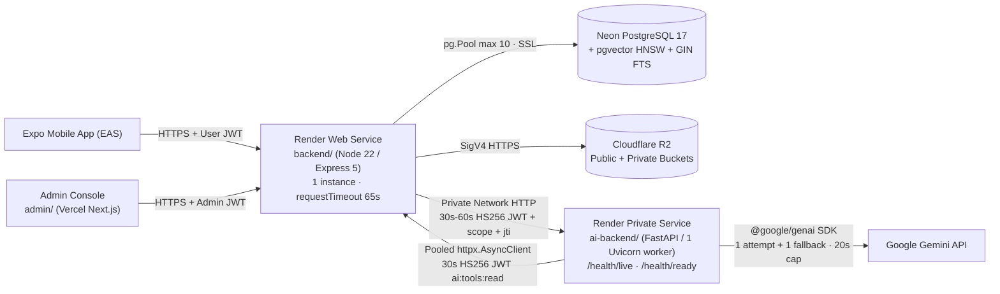
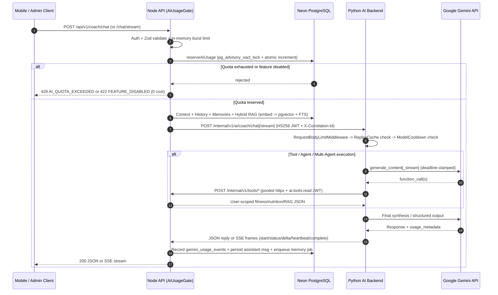

# Phase 20: Production AI Architecture & Hardening

> **Audit Scope & Safety:** Production architecture audit and surgical hardening across **Node.js 22 / Express 5 (`backend/`)**, **Python 3.12 / FastAPI (`ai-backend/`)**, **Neon PostgreSQL + `pgvector`**, and **Phase 19 Docker/Render/CI infrastructure**. Zero live paid Gemini calls were executed, no production deployment or migrations were run, and no Redis, Kubernetes, Kafka, or extra microservices were introduced.

---

## 1. Architecture Overview & Audit Status

FitOnus uses a **two-service modular architecture**:

- **`backend/` (Node.js Modular Monolith — System of Record):** Owns user authentication, PostgreSQL persistence, feature flags, per-user burst rate limiting, atomic daily quotas (`AiUsageGate`), usage/cost ledger (`gemini_usage_events`), idempotency keys, background job queues, RAG hybrid storage (`pgvector` + GIN FTS), and external client APIs (`mobile/`, `admin/`).
- **`ai-backend/` (Python FastAPI AI Execution Plane — Stateless Inference):** Owns Gemini SDK integration (`GeminiClient`), prompt engineering, structured output parsing, multimodal preprocessing/EXIF stripping, LangGraph single-agent & Phase 13 multi-agent orchestration, SSE streaming, MCP in-process server/client, and workout plan safety validation/repair.

### 1.1 Architecture Readiness Classification

| Status | Verified Capabilities & Components |
| --- | --- |
| **Implemented and Verified** | • Node ↔ Python mutual HS256 JWT auth (`30s` TTL, `jti` replay cache, endpoint `scope`, `sub` identity binding). • Single `AiUsageGate` choke point (`coach_chat`, `meal_photo`, `voice_meal`, `workout_generator`) with atomic `pg_advisory_xact_lock` quota reservation and pre-dispatch refund. • `PythonAiClient` + `streamPythonAi` single-attempt timeouts (`15s`–`28s`), `AbortSignal` cancellation propagation, `dispatched` billing guard. • `GeminiClient` primary/fallback model switching, `ModelCooldown` circuit breaker, single-turn in-flight deduplication, multi-turn tool loop caps (`3` rounds, `5` calls, semaphore `3`). • Hybrid RAG (`pgvector` HNSW cosine + `english`/`simple` FTS + RRF), prompt-injection sanitization, EXIF stripping, `413` pre-parse body limits. • Phase 14 SSE streaming (`start`/`status`/`delta`/`heartbeat`/`complete`/`error`, backpressure, disconnect watch). • Phase 17 privacy-safe JSON logging, `X-Correlation-Id` / `traceparent` propagation, and Phase 18 offline eval suite (`451/451` passing). • Phase 20 hardening: `/internal/v1/ai/embed` wire contract aligned (`outcome`, `usage`, `traceId`), `embed_content` timeout (`14s`), pooled `httpx.AsyncClient` with lifespan cleanup, Python `/health/ready`, bounded replay & insights caches, Node `server.requestTimeout = 65_000`, `workout_generator` quota gating, and UUID RAG request IDs. |
| **Implemented but Unverified (Offline / Local Limits)** | • Live Gemini latency/accuracy baselines (`LIVE BASELINE: NOT MEASURED`, `GEMINI_API_KEY=""` in CI). • Docker container builds, non-root runtime smoke tests, Trivy/Gitleaks/pip-audit scans (blocked locally due to missing `docker`/`trivy`/`gitleaks`/`pip-audit` binaries; defined in `.github/workflows/*.yml`). • Real Neon PostgreSQL + `pgvector` integration tests (`test:int` requires Docker or `TEST_DATABASE_ADMIN_URL`). • SSE end-to-end streaming over Render reverse proxy under real mobile carrier reconnects. |
| **Missing (Intentional / Deferred)** | • Distributed shared store (`Redis`) for burst limiters, `ReplayCache`/`ToolReplayCache`, `insightsCache`, `ModelCooldown`, and `StreamCoachChatUseCase` replay cache (only needed when scaling beyond 1 Node or 1 Python instance). • Dual-secret zero-downtime JWT rotation window (`AI_BACKEND_SERVICE_SECRET` / `AI_SERVICE_JWT_SECRET` accept one active key). • External OpenTelemetry OTLP exporter (spans/metrics currently record in-process / structured JSON logs). • Admin-configured model forwarding on `workout-planner/generate` (currently uses `gemini-2.5-flash` / `gemini-2.5-flash-lite` defaults in `WorkoutPlanGenerator`). |
| **Production Blockers Resolved vs Remaining** | • **Resolved in Phase 20:** `/internal/v1/ai/embed` contract mismatch (`outcome`, `usage`, `traceId`), un-timed `embed_content` SDK call, per-call unpooled `httpx.AsyncClient` in `InternalToolsClient`, `30s` Node `server.requestTimeout` cutting off long SSE/AI streams, unbounded in-memory replay/insights caches, missing Python `/health/ready`, and ungated `workout_generator` use cases. • **Remaining Operational Blockers:** Do not deploy `ai-backend` on Render Free tier (15-min idle sleep causes ~60s cold start > Node `22s`–`28s` timeout); keep 1 Node + 1 Python worker until shared Redis state is added; fix pre-existing concurrent test drift (`test_security_guardrails.py` syntax typo, `ai-backend-env.test.ts`, `rag-context-builder.test.ts`). |

---

## 2. System & Deployment Architecture

### 2.1 High-Level Production Topology (Phase 19 + Phase 20)

### 2.2 Service Boundaries

| Boundary | Owner | Responsibilities | Strict Prohibitions |
| --- | --- | --- | --- |
| **Client ↔ Node API** | `backend/` | End-user JWT auth, Zod validation, route-specific base64 body limits (`11mb`–`26mb`), burst rate limits, daily quota reservation, persistence. | Never exposes `AI_BACKEND_SERVICE_SECRET`, `GEMINI_API_KEY`, or internal Python URLs. |
| **Node ↔ Python (`/internal/v1/ai/*`)** | `PythonAiClient` / `streamPythonAi` | Signs ephemeral HS256 JWT (`iss=onusfit-node-api`, `aud=onusfit-ai-backend`, `sub=userId`, `scope`, `rid`, `jti`), enforces `15s`–`28s` HTTP deadline (`deadlineMs = timeoutMs - 1.5s`). | Python never accepts `userId` from request body; never holds DB credentials; never checks quotas. |
| **Python ↔ Node (`/internal/v1/tools/*`)** | `InternalToolsClient` / `internal-tools.routes.ts` | Pooled `httpx.AsyncClient` (`max_connections=50`, `max_keepalive=20`), `5s` timeout, mints `ai:tools:read` JWT bound to `claims.user_id`. | Read-only data access; cannot mutate workouts/nutrition or bypass user ownership (`req.actor.userId`). |

---

## 3. Data Flow & Streaming Sequence

---

## 4. Failure Handling, Timeouts & Recovery Matrix

### 4.1 Timeout Hierarchy (Client > Node Socket > Node HTTP Client > Python Deadline > Gemini Attempt)

| Feature | Client / Mobile Wait | Node `server.requestTimeout` | Node → Python HTTP Timeout | Python Total Deadline | Gemini Single Attempt Cap |
| --- | --- | --- | --- | --- | --- |
| **Coach Chat (`POST /coach/chat`)** | `~30s` | `65s` | `AI_BACKEND_TIMEOUT_MS` (`25s` default, max `28s`) | `timeoutMs - 1.5s` (`23.5s`) | `GEMINI_ATTEMPT_TIMEOUT_S` (`20s`) |
| **Coach Stream (`POST /coach/chat/stream`)** | SSE stream | `65s` | `AI_BACKEND_TIMEOUT_MS` (`25s` default, max `28s`) | `timeoutMs - 1.5s` (`23.5s`) | `20s` per turn + `5s` SSE heartbeat |
| **Coach Insights (`GET /coach/insights`)** | `25s` | `65s` | `min(timeoutMs, 22s)` | `20.5s` | `20s` (degrades to deterministic 200) |
| **Meal Photo / Multimodal** | `30s` | `65s` | `min(timeoutMs, 27s)` | `25.5s` | `20s` |
| **Voice Meal** | `25s` | `65s` | `min(timeoutMs, 22s)` | `20.5s` | `20s` |
| **RAG Embeddings (`POST /embed`)** | Admin / Chat | `65s` | `15s` | `14s` (`asyncio.timeout`) | `14s` |
| **Workout Planner (`generate`/`adapt`)** | `30s` | `65s` | `AI_BACKEND_TIMEOUT_MS` (`25s` default, max `28s`) | `25s` graph deadline | `20s` (degrades to deterministic plan) |
| **Internal Tool Callback (Py → Node)** | — | `65s` | `5s` (`httpx` per call) | — | `DATABASE_STATEMENT_TIMEOUT_MS` (`10s`) |

### 4.2 Failure-Recovery Behavior

1. **No Blind Provider Retries:** Node makes **1** HTTP call to Python; Python makes at most **1** primary attempt + **1** fallback-model attempt (and streaming falls back **only** if `emitted_any_chunk == False`). Non-retryable errors (`AUTH_ERROR`, `BAD_REQUEST`, project-wide `QUOTA_EXHAUSTED_RPD`) abort immediately without touching the backup model.
2. **Billing-Safe Quota Refund:** `AiUsageGate` refunds the reserved daily unit **only** when `context.dispatched === false` (e.g., `ECONNREFUSED`, `401`, `413`, `422`, or both models in `ModelCooldown`). Any call that may have reached Gemini (`dispatched === true`, including timeouts and mid-stream drops) keeps the quota unit consumed.
3. **Graceful Feature Degradation:**
   - **Coach Insights:** Any Python/Gemini outage or unusable output triggers `buildDeterministicInsights()` (HTTP `200`, cached 10 min, logged as `ai.deterministic_fallback`).
   - **Workout Planner:** Graph failure, validation exhaustion (after bounded repair), or medical red flags fall back deterministically to `generate_deterministic_plan()` or a safe active-recovery mobility notice.
   - **Coach RAG:** Embedding or `pgvector` retrieval failures log a privacy-safe warning and proceed with ungrounded chat rather than failing the conversation.
4. **Graceful Shutdown & Readiness:**
   - **Node (`SIGTERM`):** `lifecycle.beginShutdown()` flips `/health/ready` to `503`, stops notification/purger/memory workers, closes idle sockets, drains in-flight requests up to `SHUTDOWN_TIMEOUT_MS` (`10s`), and closes `pg.Pool`.
   - **Python (`SIGTERM`):** `lifespan` sets `_shutting_down = True` (flipping `/health/ready` to `503`), closes the pooled `httpx.AsyncClient`, and Uvicorn drains active requests (`--timeout-keep-alive 65`, Compose `stop_grace_period: 15s`).

---

## 5. Multi-Agent & LangGraph Execution Budgets

- **Single-Agent LangGraph (`LangGraphAgentExecutor`):** Bounded by `AgentBudgetConfig` (`max_iterations`, `max_tool_calls`, `max_replans`, request `deadline_ms`), duplicate action signature caching, and automatic fallback to native `AgentExecutor` when `COACH_AGENT_GRAPH_FALLBACK=true`.
- **Multi-Agent Orchestrator (`MultiAgentCoachExecutor` + `CumulativeBudgetTracker`):** Enforces request-wide (non-multiplied) cumulative ceilings:
  - `max_agent_invocations = 6`, `max_llm_calls = 2`, `max_input_tokens = 6000`, `max_output_tokens = 2000`, `max_total_tokens = 8000`, `max_tool_calls = 6`, `max_delegation_depth = 1`, `max_replanning_attempts = 1`, `max_concurrent_agents = 3`, `deadline_seconds = 20.0`.
  - Cooperative cancellation propagates via `cancel_event` / `tracker.cancel()` on client disconnect or deadline approach, returning partial verified outputs or falling back to `LangGraphAgentExecutor`.

---

## 6. Scalability Strategy & Multi-Instance State Inventory

FitOnus runs cleanly on **1 Node instance + 1 Python worker (`ai-backend`)** backed by **Neon PostgreSQL**, avoiding Redis/Kafka/Kubernetes complexity at early-to-mid scale.

| State Item | Current Store | Multi-Instance Safe? | Scaling Trigger (>1 Replica) |
| --- | --- | --- | --- |
| **Daily AI Quotas & Flags** | PostgreSQL (`user_ai_usage`, `pg_advisory_xact_lock`) | **Yes** | Exact across any number of replicas. |
| **Idempotency Keys & Async Queues** | PostgreSQL (`idempotency_keys`, `ai_memory_extraction_jobs`, `private_media_deletions`, `FOR UPDATE SKIP LOCKED`) | **Yes** | Exact across replicas; scale workers via `SKIP LOCKED`. |
| **Per-User Burst Rate Limits** | Node in-memory `InMemoryAiRateLimitStore` | **No** (`N ×` budget) | Implement `AiRateLimitStore` backed by Redis (`INCR` + `PEXPIRE`). |
| **Service JWT Replay Caches** | Python `ReplayCache` (cap `10,000`) & Node `ToolReplayCache` (cap `10,000`) | **No** (per-process) | Move `jti` set to Redis `SET NX EX 60` when scaling >1 replica. |
| **Model Cooldown & Dedup** | Python `ModelCooldown` & `GeminiClient._inflight` | **No** (per-process) | Keep `ai-backend` at 1 worker or back cooldown with Redis. |
| **Insights & Stream Replay Cache** | Node `insightsCache` (cap `1,000`) & `StreamCoachChatUseCase.completedReplays` (cap `256`) | **No** (per-process) | Acceptable for best-effort cache; back with Redis if sticky sessions absent. |
| **DB Connection Pool** | Node `pg.Pool` (`max=10`, `statement_timeout=10s`, `idle_in_transaction=20s`) | **Yes** | Keep `replicas × max_pool <= Neon pooler limit`. |

---

## 7. Security Boundaries & Cost Optimization

### 7.1 Security Boundaries
- **Zero Trust on Body Identity:** Every Python endpoint extracts `user_id` strictly from verified HS256 JWT `claims.sub` (ignoring or overwriting body `user_id`), and every internal tool callback re-binds `req.actor` from `claims.sub`.
- **Fail-Closed Startup & Auth:** Both `backend/` and `ai-backend/` validate secrets (`>= 32` chars) and abort startup in production if missing; `/docs`, `/redoc`, and `/openapi.json` are disabled on `ai-backend/`.
- **Payload & Prompt Hardening:** `RequestBodyLimitMiddleware` rejects `>25.5 MiB` payloads before JSON parsing (`413`), images strip EXIF/metadata chunks, RAG/memory/tool text passes delimiter-breakout & prompt-injection sanitization, and logs redact keys, bearer tokens, JWTs, and user content.

### 7.2 Cost Optimization
- **Tiered Model Routing:** Routine chat, voice, photo, and insights default to cost-efficient `gemini-3.5-flash-lite` with `gemini-3.1-flash-lite` fallback (admin-configurable per feature in `gemini_config` without redeploying).
- **Pre-Call Cost Avoidance:** Intent routing (`intent-router.ts`) skips RAG vector queries for greetings/simple metrics; `KnowledgeService` checks SHA-256 `content_hash` before embedding; `GeminiClient` coalesces identical concurrent single-turn calls (`_inflight`); pre-flight `estimate_multimodal_input_tokens` rejects oversized inputs before calling Gemini.
- **Zero-Cost CI:** Routine CI and offline eval suites run with `GEMINI_API_KEY=""` (`$0` API spend).

---

## 8. Remaining Production Risks & Mitigation Plan

1. **Single-Secret Rotation Window:** Rotating `AI_BACKEND_SERVICE_SECRET` / `AI_SERVICE_JWT_SECRET` has no dual-key grace window (brief `503` during staggered deploy). *Mitigation:* Rotate during low-traffic maintenance window or add secondary verification key support.
2. **Render Free Tier Cold Starts:** Free instances sleep after 15 min idle (~60s boot), exceeding Node's `22s`–`28s` AI timeout. *Mitigation:* Always deploy `backend` and `ai-backend` on paid always-on Render tiers (Private Service for `ai-backend` in same region).
3. **Large Media Memory Spikes:** Concurrent `10 MiB` image + `15 MiB` audio base64 uploads decode in memory inside single-worker `ai-backend`. *Mitigation:* Monitor Render RSS metrics during load testing and size instance RAM (>= 1–2 GB) accordingly.
4. **Live Gemini Quality/Latency Baseline Unmeasured:** Offline evals verify contracts, safety, and determinism (`451/451`), not live Gemini accuracy or p95 latency. *Mitigation:* Run staging live-eval soak (`GEMINI_API_KEY` with GCP budget alert) before public launch.

