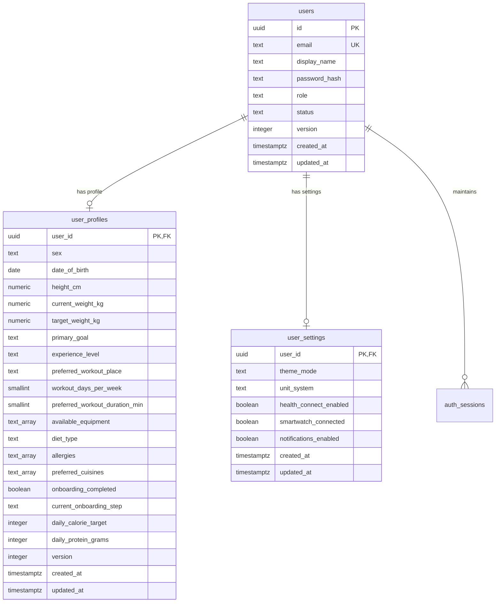
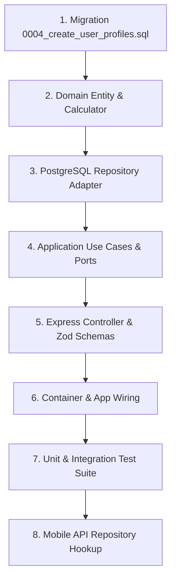

# Phase 2 — Fitness Profile & Onboarding Technical Contract

> **Document Status:** Complete Architecture & API Specification  
> **Target Subsystem:** User Profiles, Onboarding Wizard, Fitness Preferences & Settings  
> **Evaluation Date:** November 4, 2026  
> **Classification Evidence:** `[V] Verified` (Direct source code evidence) | `[I] Inferred` (Logical architectural deduction) | `[P] Proposed` (Design for upcoming implementation)

---

## 1. Executive Summary

FitOnus is transitioning from the core authentication base kit into **Phase 2: Fitness Profile & Onboarding**. This document establishes the exact architectural contract between the existing React Native mobile application (`FitOnus/mobile`), the requirements documentation (`FitOnus/docs`), and the Express 5 + PostgreSQL backend (`FitOnus/backend`).

In accordance with strict project guidelines:
- **No mobile UI, layout, styling, or navigation is altered.**
- **No backend source code or migrations are executed during this analysis phase.**
- **Existing base kit conventions (Clean Architecture, Zod validation, error envelopes, and session security) are preserved 100%.**

---

## 2. Existing Mobile Screen Analysis (`[V] Verified`)

A thorough inspection of `FitOnus/mobile` reveals a completed multi-step onboarding wizard, a dedicated Profile hub, and three specialized editing sub-screens.

### 2.1 Screen Inventory & Technical Characteristics

| Screen Identifier | Source File Path | Navigation Route | State Store Consumed | Key User Interactions & Controls |
| :--- | :--- | :--- | :--- | :--- |
| **Welcome Carousel** | `mobile/src/app/(auth)/onboarding.tsx` | `onboarding` (Auth) | `useAppStore` | 3-step value proposition carousel; "Skip" and "Get Started" navigating to `login`. |
| **Onboarding Wizard** | `mobile/src/features/onboarding/screens/OnboardingScreen.tsx` | `onboarding` | `useProfileSetupStore`, `useHealthStore` | 15-step progressive wizard with custom progress bar, back navigation, step skipping, and goal confirmation. |
| **Profile Dashboard** | `mobile/src/features/profile/screens/ProfileScreen.tsx` | `profile` (Tab) | `useProfileSetupStore`, `useGoalsStore`, `useMemoryStore`, `useHealthStore` | User avatar, initials, member since date, 3-column stats card (Weight, Height, Workouts), and navigation rows to settings. |
| **Personal Info Edit** | `mobile/src/features/profile/screens/PersonalInfoScreen.tsx` | `personalInfo` | `useProfileSetupStore`, `toastStore` | Form fields: Full name (`TextField`), DOB (`YYYY-MM-DD`), Sex (`SegmentedControl`), Height stepper (cm), Weight stepper (kg). |
| **Fitness Preferences** | `mobile/src/features/profile/screens/FitnessPreferencesScreen.tsx` | `fitnessPreferences` | `useProfileSetupStore`, `toastStore` | Chips & Steppers: Main goal, Experience level, Workout location, Days per week, Duration per session, Equipment multi-select. |
| **Nutrition Preferences** | `mobile/src/features/profile/screens/NutritionPreferencesScreen.tsx` | `nutritionPreferences` | `useProfileSetupStore`, `toastStore` | Diet style chips, Allergy multi-select chips, Favorite cuisine chips, Daily calorie/macro target preview card. |

---

### 2.2 Onboarding Step Breakdown (`OnboardingScreen.tsx`)

The onboarding wizard (`mobile/src/features/onboarding/components/OnboardingSteps.tsx`) collects granular biometrics, fitness routines, and dietary preferences across 15 distinct steps:

```mermaid
flowchart LR
    S1[1. Intro] --> S2[2. Personal]
    S2 --> S3[3. DOB]
    S3 --> S4[4. Height]
    S4 --> S5[5. Weight]
    S5 --> S6[6. Experience]
    S6 --> S7[7. Goal]
    S7 --> S8[8. Location]
    S8 --> S9[9. Equipment]
    S9 --> S10[10. Duration]
    S10 --> S11[11. Food]
    S11 --> S12[12. Health Sync]
    S12 --> S13[13. Smartwatch]
    S13 --> S14[14. Confirmation]
    S14 --> S15[15. Done]
```



1. **`intro` (`StepIntro`):** Educational summary of AI Coach personalization.
2. **`personal` (`StepPersonal`):** Full name input (`TextField`) and Biological Sex selection (`'male' | 'female' | 'unspecified'`) via `OptionCard`.
3. **`dob` (`StepDob`):** Date of birth via three synchronized steppers: Day (1–31), Month (1–12), Year (1940–2015).
4. **`height` (`StepHeight`):** Height in centimeters via large stepper: min `120 cm`, max `230 cm`.
5. **`weight` (`StepWeight`):** Weight in kilograms via large stepper: min `35 kg`, max `220 kg`, step `0.5 kg`, 1 decimal place.
6. **`experience` (`StepExperience`):** Experience level: `'beginner' | 'intermediate' | 'advanced'`.
7. **`goal` (`StepGoal`):** Primary fitness goal: `'lose' | 'gain' | 'maintain' | 'strength' | '5k' | '10k' | 'marathon'`.
8. **`workoutPreference` (`StepWorkoutPreference`):** Training location (`'gym' | 'home' | 'outdoor' | 'mixed'`) and training frequency (`1–7 days/week`).
9. **`equipment` (`StepEquipment`):** Multi-select chips for available gear: `Barbell`, `Dumbbells`, `Kettlebells`, `Cable machine`, `Pull-up bar`, `Resistance bands`, `Bench`, `Treadmill`, `Bike`, `None`.
10. **`duration` (`StepDuration`):** Target session length: `30`, `45`, `60`, or `75` minutes.
11. **`food` (`StepFood`):**
    - Diet style: `'none' | 'vegetarian' | 'eggetarian' | 'vegan' | 'pescatarian'`.
    - Allergies: `Peanuts`, `Tree nuts`, `Dairy`, `Gluten`, `Soy`, `Shellfish`, `Eggs`.
    - Cuisines: `North Indian`, `South Indian`, `Mediterranean`, `East Asian`, `Continental`.
12. **`health` (`StepHealthPermissions`):** Apple Health / Health Connect permission opt-in (`healthAllowed: boolean`).
13. **`device` (`StepDevice`):** Wearable/smartwatch connectivity opt-in (`deviceConnected: boolean`).
14. **`confirm` (`StepGoalConfirmation`):** Plan review with calculated targets (calories, protein, workout frequency, projected target completion date) and inline edit buttons to return to any prior step.
15. **`done` (`StepSummary`):** Celebration checkmark, welcome message, and redirection to `home` (Dashboard).

---

### 2.3 Mobile State Management & Networking Assessment

- **Zustand Profile Store (`profileSetupStore.ts`):** Holds the in-memory client state for all 15 onboarding steps. Default mock data initializes `Aarav Mehta`, 178 cm, 78.4 kg, intermediate, goal: lose weight.
- **TanStack Query (`@tanstack/react-query` v5.101.2):** **`[V] VERIFIED INSTALLED`** in `package.json`. Configured inside `mobile/src/providers/query-provider.tsx` with `staleTime: 5 min` and `refetchOnWindowFocus: false`.
- **HTTP Client (`apiClient` in `mobile/src/services/api-client.ts`):** Axios instance configured with `baseURL: Config.API_BASE_URL` (`http://localhost:3000/api/v1`), automatic Bearer token injection from `SecureStorageService`, and an asynchronous 401 response interceptor with token refresh queueing.

---

## 3. Requirements Traceability (`[V] Verified` & `[I] Inferred`)

A comparative cross-reference was conducted between the product specification (`FitOnus/docs/07-user-management.txt`), database design document (`docs/20-database-design.txt`), and the actual React Native implementation.

### 3.1 Traceability Matrix

| Requirement Domain | Specification Reference (`docs/07-user-management.txt`) | Mobile UI Evidence (`mobile/src/...`) | Backend Base Kit Status (`FitOnus/backend`) | Gap / Resolution Status |
| :--- | :--- | :--- | :--- | :--- |
| **Full Name** | Section 4.1: Required, 2–50 chars | `StepPersonal.tsx` / `name` | `users.display_name` (1–100 chars) | `[V] Verified` — Native column in `users` table. |
| **Date of Birth** | Section 4.1: Required, age &ge; 13 years | `StepDob.tsx` (Day, Month, Year steppers) | None | `[P] Proposed` — Store as standard SQL `DATE` in `user_profiles`. |
| **Biological Sex** | Section 4.1: Male, female, non-binary, prefer not | `StepPersonal.tsx` (`'male' \| 'female' \| 'unspecified'`) | None | `[P] Proposed` — Store in `user_profiles.sex`. Matches mobile options. |
| **Height (cm)** | Section 4.2 & 7.2: Required, stored in metric (cm) | `StepHeight.tsx` (120–230 cm) | None | `[P] Proposed` — Store as `numeric(5,1)` in `user_profiles.height_cm`. |
| **Current Weight (kg)**| Section 4.2 & 7.2: Required, stored in metric (kg) | `StepWeight.tsx` (35–220 kg, step 0.5) | None | `[P] Proposed` — Store as `numeric(5,1)` in `user_profiles.current_weight_kg`. |
| **Target Weight (kg)** | Section 4.2: Optional target body mass | `StepGoalConfirmation.tsx` (computed/target) | None | `[P] Proposed` — Store as `numeric(5,1)` in `user_profiles.target_weight_kg`. |
| **Primary Goal** | Section 4.1: Lose, build muscle, endurance, etc. | `StepGoal.tsx` (7 specific goal keys) | None | `[P] Proposed` — Store as `text` in `user_profiles.primary_goal`. |
| **Experience Level** | Section 4.1 / docs 10-workout | `StepExperience.tsx` (`beginner/intermediate/adv`) | None | `[P] Proposed` — Store as `text` in `user_profiles.experience_level`. |
| **Workout Place** | docs 10-workout | `StepWorkoutPreference.tsx` (`gym/home/outdoor/mixed`) | None | `[P] Proposed` — Store as `text` in `user_profiles.preferred_workout_place`. |
| **Weekly Frequency** | Section 4.1: 1–7 days | `StepWorkoutPreference.tsx` (1–7 days) | None | `[P] Proposed` — Store as `smallint` in `user_profiles.workout_days_per_week`. |
| **Session Duration** | docs 10-workout | `StepDuration.tsx` (30, 45, 60, 75 min) | None | `[P] Proposed` — Store as `smallint` in `user_profiles.preferred_workout_duration_min`. |
| **Equipment Access** | Section 4.1 / docs 10-workout | `StepEquipment.tsx` (10 multi-select items) | None | `[P] Proposed` — Store as `text[]` in `user_profiles.available_equipment`. |
| **Dietary Style** | Section 4.1: Omnivore, vegetarian, vegan, etc. | `StepFood.tsx` (`none/vegetarian/eggetarian/vegan/pescatarian`) | None | `[P] Proposed` — Store as `text` in `user_profiles.diet_type`. |
| **Food Allergies** | Section 4.1: Peanuts, dairy, gluten, shellfish, etc. | `StepFood.tsx` (7 allergy options) | None | `[P] Proposed` — Store as `text[]` in `user_profiles.allergies`. |
| **Cuisines** | Section 4.1 / docs 11-nutrition | `StepFood.tsx` (5 cuisine options) | None | `[P] Proposed` — Store as `text[]` in `user_profiles.preferred_cuisines`. |
| **Health Sync Status**| Section 4.1: Health Connect / HealthKit | `StepHealthPermissions.tsx` (`healthAllowed`) | None | `[P] Proposed` — Store in `user_settings.health_connect_enabled`. |
| **Wearable Status** | Section 4.1: Smartwatch integration | `StepDevice.tsx` (`deviceConnected`) | None | `[P] Proposed` — Store in `user_settings.smartwatch_connected`. |
| **Onboarding Status** | Section 5: Incremental persistence | `OnboardingScreen.tsx` (`index`, `isLast`) | None | `[P] Proposed` — Store `onboarding_completed: boolean` & `onboarding_step: text`. |
| **Caloric & Macros** | Section 7.1: Mifflin-St Jeor formula | `StepGoalConfirmation.tsx` (2350 kcal, 150g protein) | None | `[P] Proposed` — Domain calculation service storing `daily_calorie_target` and `daily_protein_grams`. |

---

## 4. Existing Backend Capabilities & Boundary Rules (`[V] Verified`)

### 4.1 Existing Tables & Migrations
The database currently has 3 active migrations:
- `0001_create_users.sql`: `users` (id, email, display_name, password_hash, role, status, version, timestamps).
- `0002_create_auth_sessions.sql`: `auth_sessions` (server-backed sessions with SHA-256 token hashing and rotation).
- `0003_create_idempotency_keys.sql`: `idempotency_keys` (distributed locking and cached mutation responses).

### 4.2 Architecture Boundaries (`eslint.config.js`)
FitOnus enforces strict Clean Architecture layers:
```text
Domain (Framework-free, pure entities & business logic)
   ▲
Application (Use cases, Ports, no Express/HTTP, no DB drivers)
   ▲
Infrastructure (PostgreSQL repositories, Raw SQL, External services)
   ▲
Interface (Express controllers, Zod route schemas, RouteGroup definitions)
```
- Module boundaries are sealed: other modules may only be accessed through `src/modules/<name>/index.ts`.
- Repositories receive only `SqlExecutor` (from `Database`) and participate in `UnitOfWork` (`PgUnitOfWork`).
- Routes are declared via `defineRoute` with declarative Zod schemas for input validation, access level enforcement, and strict output response filtering.

---

## 5. Proposed Database Schema (`[P] Proposed`)

To support Phase 2 without cluttering the primary `users` authentication table, we introduce two dedicated relational tables via migration `0004_create_user_profiles.sql`.

### 5.1 Relational Architecture Diagram



---

### 5.2 Migration DDL (`0004_create_user_profiles.sql`)

```sql
-- Migration: 0004_create_user_profiles.sql
-- Description: Creates user_profiles and user_settings tables with strict domain constraints.

-- 1. Fitness Profiles
CREATE TABLE user_profiles (
  user_id                        uuid         PRIMARY KEY REFERENCES users (id) ON DELETE CASCADE,
  sex                            text         NOT NULL DEFAULT 'unspecified',
  date_of_birth                  date,
  height_cm                      numeric(5,1),
  current_weight_kg              numeric(5,1),
  target_weight_kg               numeric(5,1),
  primary_goal                   text,
  experience_level               text,
  preferred_workout_place        text,
  workout_days_per_week          smallint,
  preferred_workout_duration_min smallint,
  available_equipment            text[]       NOT NULL DEFAULT '{}',
  diet_type                      text,
  allergies                      text[]       NOT NULL DEFAULT '{}',
  preferred_cuisines             text[]       NOT NULL DEFAULT '{}',
  onboarding_completed           boolean      NOT NULL DEFAULT false,
  current_onboarding_step        text         NOT NULL DEFAULT 'intro',
  daily_calorie_target           integer,
  daily_protein_grams            integer,
  version                        integer      NOT NULL DEFAULT 1,
  created_at                     timestamptz  NOT NULL DEFAULT now(),
  updated_at                     timestamptz  NOT NULL DEFAULT now(),

  -- Physical integrity constraints
  CONSTRAINT user_profiles_sex_valid CHECK (
    sex IN ('male', 'female', 'unspecified')
  ),
  CONSTRAINT user_profiles_dob_valid CHECK (
    date_of_birth IS NULL OR (date_of_birth >= '1920-01-01' AND date_of_birth <= CURRENT_DATE - INTERVAL '13 years')
  ),
  CONSTRAINT user_profiles_height_valid CHECK (
    height_cm IS NULL OR (height_cm >= 50.0 AND height_cm <= 260.0)
  ),
  CONSTRAINT user_profiles_current_weight_valid CHECK (
    current_weight_kg IS NULL OR (current_weight_kg >= 25.0 AND current_weight_kg <= 450.0)
  ),
  CONSTRAINT user_profiles_target_weight_valid CHECK (
    target_weight_kg IS NULL OR (target_weight_kg >= 25.0 AND target_weight_kg <= 450.0)
  ),
  CONSTRAINT user_profiles_primary_goal_valid CHECK (
    primary_goal IS NULL OR primary_goal IN ('lose', 'gain', 'maintain', 'strength', '5k', '10k', 'marathon')
  ),
  CONSTRAINT user_profiles_experience_valid CHECK (
    experience_level IS NULL OR experience_level IN ('beginner', 'intermediate', 'advanced')
  ),
  CONSTRAINT user_profiles_workout_place_valid CHECK (
    preferred_workout_place IS NULL OR preferred_workout_place IN ('gym', 'home', 'outdoor', 'mixed')
  ),
  CONSTRAINT user_profiles_days_per_week_valid CHECK (
    workout_days_per_week IS NULL OR (workout_days_per_week >= 1 AND workout_days_per_week <= 7)
  ),
  CONSTRAINT user_profiles_duration_min_valid CHECK (
    preferred_workout_duration_min IS NULL OR (preferred_workout_duration_min >= 15 AND preferred_workout_duration_min <= 180)
  ),
  CONSTRAINT user_profiles_diet_type_valid CHECK (
    diet_type IS NULL OR diet_type IN ('none', 'vegetarian', 'eggetarian', 'vegan', 'pescatarian')
  ),
  CONSTRAINT user_profiles_targets_positive CHECK (
    (daily_calorie_target IS NULL OR daily_calorie_target > 500) AND
    (daily_protein_grams IS NULL OR daily_protein_grams > 20)
  ),
  CONSTRAINT user_profiles_version_positive CHECK (version > 0)
);

CREATE INDEX user_profiles_onboarding_idx ON user_profiles (onboarding_completed) WHERE NOT onboarding_completed;

-- 2. User Application Settings
CREATE TABLE user_settings (
  user_id                uuid        PRIMARY KEY REFERENCES users (id) ON DELETE CASCADE,
  theme_mode             text        NOT NULL DEFAULT 'system',
  unit_system            text        NOT NULL DEFAULT 'metric',
  health_connect_enabled boolean     NOT NULL DEFAULT false,
  smartwatch_connected   boolean     NOT NULL DEFAULT false,
  notifications_enabled  boolean     NOT NULL DEFAULT true,
  created_at             timestamptz NOT NULL DEFAULT now(),
  updated_at             timestamptz NOT NULL DEFAULT now(),

  CONSTRAINT user_settings_theme_valid CHECK (theme_mode IN ('system', 'light', 'dark')),
  CONSTRAINT user_settings_unit_valid CHECK (unit_system IN ('metric', 'imperial'))
);
```

---

## 6. Proposed API Specifications (`[P] Proposed`)

All endpoints are mounted under the standard versioned prefix `/api/v1/profile`. Every endpoint requires a valid JWT Bearer token (`access: { kind: 'authenticated' }`) and enforces strict actor ownership.

### 6.1 Endpoint Summary Table

| HTTP Method | Route Path | Purpose | Access Control | Idempotency | Consuming Mobile Screen |
| :--- | :--- | :--- | :--- | :--- | :--- |
| `GET` | `/api/v1/profile/me` | Fetch complete fitness profile, settings, and calculated targets. | Authenticated | Safe | `ProfileScreen`, `PersonalInfoScreen`, `FitnessPreferencesScreen`, `NutritionPreferencesScreen` |
| `PATCH` | `/api/v1/profile/me` | Atomically update any combination of profile fields with optimistic concurrency. | Authenticated | Idempotent | `PersonalInfoScreen`, `FitnessPreferencesScreen`, `NutritionPreferencesScreen` |
| `POST` | `/api/v1/profile/onboarding/step` | Save intermediate progress of an individual onboarding step. | Authenticated | Idempotent | `OnboardingScreen` (any step change) |
| `POST` | `/api/v1/profile/onboarding/complete` | Validate complete profile, calculate metabolic targets, and mark onboarding as complete. | Authenticated | Supported (`Idempotency-Key`) | `OnboardingScreen` (`confirm` &rarr; `done`) |
| `GET` | `/api/v1/profile/settings` | Fetch client preferences (units, theme, permissions). | Authenticated | Safe | `ProfileScreen`, `SettingsScreen` |
| `PATCH` | `/api/v1/profile/settings` | Update client preferences. | Authenticated | Idempotent | `SettingsScreen`, `StepHealthPermissions`, `StepDevice` |

---

### 6.2 Endpoint Contracts

#### Endpoint 1: Fetch Fitness Profile
- **Method & Path:** `GET /api/v1/profile/me`
- **Access Level:** `{ kind: 'authenticated' }`
- **Request Parameters:** None.
- **Success Response (Status 200):**
```json
{
  "success": true,
  "data": {
    "userId": "ae1c758b-e47d-4053-ab70-4114c2bfab79",
    "name": "Aarav Mehta",
    "sex": "male",
    "dateOfBirth": "1997-03-14",
    "age": 29,
    "heightCm": 178.0,
    "currentWeightKg": 78.4,
    "targetWeightKg": 75.0,
    "primaryGoal": "lose",
    "experienceLevel": "intermediate",
    "preferredWorkoutPlace": "gym",
    "workoutDaysPerWeek": 5,
    "preferredWorkoutDurationMin": 60,
    "availableEquipment": ["Barbell", "Dumbbells", "Cable machine", "Bench", "Pull-up bar"],
    "dietType": "eggetarian",
    "allergies": [],
    "preferredCuisines": ["North Indian", "South Indian"],
    "onboardingCompleted": true,
    "currentOnboardingStep": "done",
    "calculatedTargets": {
      "bmr": 1752,
      "tdee": 2715,
      "dailyCalorieTarget": 2215,
      "dailyProteinGrams": 166,
      "dailyCarbGrams": 221,
      "dailyFatGrams": 74
    },
    "version": 3,
    "updatedAt": "2026-11-04T14:40:00.000Z"
  },
  "message": "Fitness profile retrieved"
}
```

---

#### Endpoint 2: Update Fitness Profile
- **Method & Path:** `PATCH /api/v1/profile/me`
- **Access Level:** `{ kind: 'authenticated' }`
- **Request Body Zod Schema:**
```typescript
export const updateProfileBodySchema = z.strictObject({
  version: z.number().int().positive(),
  name: z.string().trim().min(1).max(100).optional(),
  sex: z.enum(['male', 'female', 'unspecified']).optional(),
  dateOfBirth: z.string().regex(/^\d{4}-\d{2}-\d{2}$/, 'Must be YYYY-MM-DD').optional(),
  heightCm: z.number().min(50).max(260).optional(),
  currentWeightKg: z.number().min(25).max(450).optional(),
  targetWeightKg: z.number().min(25).max(450).optional(),
  primaryGoal: z.enum(['lose', 'gain', 'maintain', 'strength', '5k', '10k', 'marathon']).optional(),
  experienceLevel: z.enum(['beginner', 'intermediate', 'advanced']).optional(),
  preferredWorkoutPlace: z.enum(['gym', 'home', 'outdoor', 'mixed']).optional(),
  workoutDaysPerWeek: z.number().int().min(1).max(7).optional(),
  preferredWorkoutDurationMin: z.number().int().min(15).max(180).optional(),
  availableEquipment: z.array(z.string().trim().max(50)).max(30).optional(),
  dietType: z.enum(['none', 'vegetarian', 'eggetarian', 'vegan', 'pescatarian']).optional(),
  allergies: z.array(z.string().trim().max(50)).max(20).optional(),
  preferredCuisines: z.array(z.string().trim().max(50)).max(20).optional(),
});
```
- **Error Responses:**
  - `400 Bad Request` (`VALIDATION_ERROR`): Value out of range or malformed date.
  - `409 Conflict` (`VERSION_CONFLICT`): Concurrency mismatch; profile modified elsewhere.

---

#### Endpoint 3: Save Onboarding Step (Incremental Persistence)
- **Method & Path:** `POST /api/v1/profile/onboarding/step`
- **Access Level:** `{ kind: 'authenticated' }`
- **Request Body Zod Schema:**
```typescript
export const saveOnboardingStepSchema = z.strictObject({
  step: z.enum([
    'intro', 'personal', 'dob', 'height', 'weight',
    'experience', 'goal', 'workoutPreference', 'equipment',
    'duration', 'food', 'health', 'device', 'confirm', 'done'
  ]),
  data: z.record(z.string(), z.unknown()),
});
```
- **Behavior:** Upserts intermediate values into `user_profiles` and updates `current_onboarding_step = step`. This ensures that if the user closes the app or encounters network issues mid-onboarding, their inputs are saved.

---

#### Endpoint 4: Complete Onboarding
- **Method & Path:** `POST /api/v1/profile/onboarding/complete`
- **Access Level:** `{ kind: 'authenticated' }`
- **Optional Headers:** `Idempotency-Key` (UUID)
- **Business Logic:**
  1. Validates that all mandatory fields are present (name, sex, dateOfBirth, heightCm, currentWeightKg, primaryGoal).
  2. Runs Mifflin-St Jeor metabolic calculation.
  3. Updates `daily_calorie_target` and `daily_protein_grams`.
  4. Sets `onboarding_completed = true` and `current_onboarding_step = 'done'`.
  5. Commits inside a single atomic transaction.
- **Success Response (Status 200):**
```json
{
  "success": true,
  "data": {
    "onboardingCompleted": true,
    "calculatedPlan": {
      "dailyCalorieTarget": 2215,
      "dailyProteinGrams": 166,
      "workoutsPerWeek": 5,
      "projectedMilestone": "Projected to reach 75 kg within 8 to 10 weeks."
    }
  },
  "message": "Onboarding completed successfully"
}
```

---

## 7. Frontend-to-Backend Integration Plan (`[P] Proposed`)

Because `@tanstack/react-query` is already installed, mobile integration requires **zero new npm dependencies**.

### 7.1 TanStack Query Hook Mapping

```typescript
// Query Key Factory
export const profileKeys = {
  all: ['profile'] as const,
  me: () => [...profileKeys.all, 'me'] as const,
  settings: () => [...profileKeys.all, 'settings'] as const,
};

// 1. Fetch Profile Hook
export function useUserProfile() {
  return useQuery({
    queryKey: profileKeys.me(),
    queryFn: async () => {
      const response = await apiClient.get<ApiResponse<UserProfileView>>('/profile/me');
      return response.data.data;
    },
  });
}

// 2. Incremental Onboarding Step Mutation
export function useSaveOnboardingStep() {
  return useMutation({
    mutationFn: async (payload: { step: OnboardingStepId; data: Record<string, unknown> }) => {
      const response = await apiClient.post<ApiResponse<void>>('/profile/onboarding/step', payload);
      return response.data;
    },
  });
}

// 3. Complete Onboarding Mutation
export function useCompleteOnboarding() {
  const queryClient = useQueryClient();
  return useMutation({
    mutationFn: async () => {
      const response = await apiClient.post<ApiResponse<OnboardingCompleteView>>('/profile/onboarding/complete');
      return response.data.data;
    },
    onSuccess: () => {
      queryClient.invalidateQueries({ queryKey: profileKeys.all });
    },
  });
}

// 4. Update Profile Mutation (used by PersonalInfo, FitnessPreferences, NutritionPreferences)
export function useUpdateUserProfile() {
  const queryClient = useQueryClient();
  return useMutation({
    mutationFn: async (patch: UpdateProfilePayload) => {
      const response = await apiClient.patch<ApiResponse<UserProfileView>>('/profile/me', patch);
      return response.data.data;
    },
    onSuccess: (data) => {
      queryClient.setQueryData(profileKeys.me(), data);
    },
  });
}
```

### 7.2 State Synchronization Strategy
1. **Initial Screen Load:** `ProfileScreen` triggers `useUserProfile()`.
2. When data is received, the Zustand store `useProfileSetupStore` is hydrated with backend values.
3. User edits are stored in screen local state or Zustand draft.
4. Tapping "Save" executes `useUpdateUserProfile()`.
5. Upon successful response, TanStack Query cache updates immediately and a toast notification is dispatched via `showToast({ message: 'Preferences saved' })`.

---

## 8. Validation Rules & Data Integrity

| Field Name | Type / Format | Minimum Boundary | Maximum Boundary | Integrity Rule & Database Constraint |
| :--- | :--- | :--- | :--- | :--- |
| `name` | String | 1 char | 100 chars | Trimmed; stored in `users.display_name`. |
| `sex` | Enum | — | — | `'male' \| 'female' \| 'unspecified'`. |
| `dateOfBirth` | ISO Date string (`YYYY-MM-DD`) | `1920-01-01` | Today &minus; 13 years | User must be at least 13 years old (COPPA/GDPR compliance). |
| `heightCm` | Decimal (1 decimal) | `50.0 cm` | `260.0 cm` | Stored in metric centimeters. |
| `currentWeightKg`| Decimal (1 decimal) | `25.0 kg` | `450.0 kg` | Stored in metric kilograms. |
| `targetWeightKg` | Decimal (1 decimal) | `25.0 kg` | `450.0 kg` | Nullable if user chooses maintenance. |
| `primaryGoal` | Enum | — | — | `'lose' \| 'gain' \| 'maintain' \| 'strength' \| '5k' \| '10k' \| 'marathon'`. |
| `experienceLevel`| Enum | — | — | `'beginner' \| 'intermediate' \| 'advanced'`. |
| `preferredWorkoutPlace` | Enum | — | — | `'gym' \| 'home' \| 'outdoor' \| 'mixed'`. |
| `workoutDaysPerWeek` | Integer | 1 day | 7 days | Standard weekly calendar bounds. |
| `preferredWorkoutDurationMin` | Integer | 15 min | 180 min | Standard workout duration bounds. |
| `availableEquipment` | Array of strings | 0 items | 30 items | Each item trimmed, max 50 chars. |
| `dietType` | Enum | — | — | `'none' \| 'vegetarian' \| 'eggetarian' \| 'vegan' \| 'pescatarian'`. |
| `allergies` | Array of strings | 0 items | 20 items | Standard allergen tags. |
| `preferredCuisines` | Array of strings | 0 items | 20 items | Regional cuisine tags. |

---

## 9. Security & Privacy Considerations

1. **Strict Ownership Enforcement:**
   Users can only access or modify their own profile (`WHERE user_id = actor.userId`). There is no public user directory or enumeration of health metrics.
2. **Minimal Health Data Exposure:**
   Only physical metrics required for training calibration and caloric calculations (height, weight, biological sex, age) are collected. No medical history, diagnostic codes, or pharmaceutical records are accepted.
3. **Idempotency Protection:**
   The `onboarding/complete` mutation accepts the standard `Idempotency-Key` header via `PgIdempotencyStore` to prevent duplicate profile initialization on mobile retry.
4. **Optimistic Locking:**
   The `user_profiles` table maintains a `version` counter. Concurrent updates check `WHERE user_id = $1 AND version = $2` and increment `version = version + 1`, returning `409 Conflict` if stale data is submitted.

---

## 10. Step-by-Step Implementation Sequence

When approved to implement Phase 2, the following execution order is recommended:



1. **Step 1 — Database Migration:**
   Write and apply `FitOnus/backend/migrations/0004_create_user_profiles.sql` on Neon PostgreSQL.
2. **Step 2 — Domain Layer (`src/modules/profile/domain`):**
   Implement `UserProfile` aggregate entity and `MetabolicCalculator` (Mifflin-St Jeor formula).
3. **Step 3 — Repository Adapter (`src/modules/profile/infrastructure`):**
   Implement `PgProfileRepository` implementing `ProfileRepository` port with raw parameterized SQL.
4. **Step 4 — Application Layer (`src/modules/profile/application`):**
   Implement use cases: `GetProfileUseCase`, `UpdateProfileUseCase`, `SaveOnboardingStepUseCase`, `CompleteOnboardingUseCase`.
5. **Step 5 — Interface Layer (`src/modules/profile/interface`):**
   Implement `profile.controller.ts`, `profile.schemas.ts`, and `profile.routes.ts` via `defineRoute`.
6. **Step 6 — Dependency Injection Container:**
   Register the `profile` module into `src/container.ts` under `/api/v1/profile`.
7. **Step 7 — Verification:**
   Run `npm run check` (typecheck, lint, prettier, unit tests) and verify end-to-end endpoints with `curl`.
8. **Step 8 — Mobile Client Hookup:**
   Switch mobile `authService.ts` and `profileSetupStore.ts` from mock timeouts to live `apiClient` calls.

---

## 11. Open Questions & Unresolved Details

1. **Target Weight for Endurance/Strength Goals (`[U] Unverified`):**
   In `StepGoalConfirmation.tsx`, when goal is `'strength'`, `'5k'`, `'10k'`, or `'marathon'`, target weight defaults to maintaining current weight (`±1 kg`). Should users with endurance goals also be allowed to specify an optional target weight?
   *Recommendation:* Allow `targetWeightKg` to remain `null` or equal to `currentWeightKg` unless explicitly modified by the user.
2. **Imperial Unit Presentation (`[I] Inferred`):**
   The mobile UI currently displays `cm` and `kg` in steppers. While `user_settings.unit_system` supports `'imperial'`, all database values will be stored strictly in metric units (`cm`, `kg`). The client presentation layer will handle conversion to `lbs` and `ft/in`.
3. **Profile Avatar Storage (`[U] Unverified`):**
   Documentation in `docs/07-user-management.txt` mentions avatar uploads to cloud storage. In Phase 2, avatars will display computed initials (`AM` for Aarav Mehta) as implemented in `ProfileScreen.tsx`. Cloud file upload will be handled in a subsequent media-storage phase.

