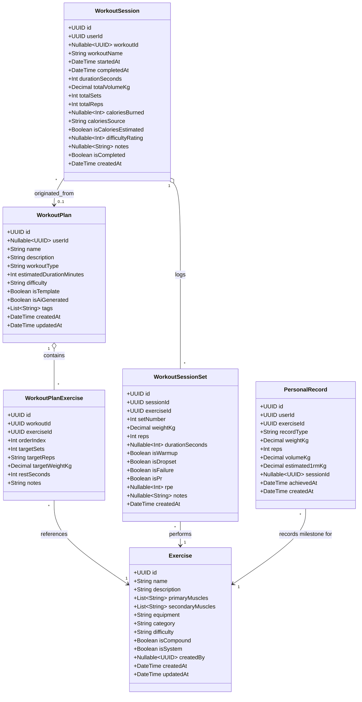

# FitOnus — Phase 3A: Workout System Architecture & Shared API Contract

**Document ID:** `PHASE_3A_WORKOUT_ARCHITECTURE`  
**Version:** 2.0.0 (Corrected & Aligned Specification)  
**Date:** November 5, 2026  
**Author:** Lead Software Architect & Multi-Agent Orchestrator  
**Status:** PROPOSED (Awaiting User Sign-Off Before Phase 3B Implementation)  
**Target Environments:** Neon Serverless PostgreSQL (`ap-southeast-1`), Node.js 22 + Express 5 Backend, Next.js 16 Admin Panel, React Native Expo SDK 58 Mobile App  
**Workspace:** `/media/devshan/Study_Drive/Info/Projects/TuneOnus/FitOnus` (Branch: `main`)

---

## 1. Executive Summary

This document defines the complete, validated architectural blueprint for **Phase 3: Workout System** across the FitOnus platform. Phase 3 transitions the mobile application from hardcoded mock workouts (`workoutsMock.ts`, `workout-service.ts`) and establishes the administrative exercise and template catalog in the Web Admin Panel, backed by a production PostgreSQL schema and Clean Architecture backend module.

### Core Architectural Decisions & Corrections:
1. **Offline-First Active Workout Session Model:** Active gym tracking occurs exclusively on the client (React Native Zustand + MMKV local storage) for zero latency (<100ms) and gym basement connectivity resilience. The completed workout session and its set-by-set telemetry are submitted atomically to the backend via `POST /api/v1/workouts/sessions` when the user taps "Save" on the completion screen.
2. **Nullable Template Ownership:** `workouts.user_id` is nullable (`UUID NULL REFERENCES users(id)`), governed by `CHECK (is_template = true OR user_id IS NOT NULL)`. System-curated starter templates have `is_template = true` and `user_id = NULL`, eliminating the assignment of system templates to arbitrary member accounts.
3. **Full Admin Template Management CRUD:** Reconciled admin endpoints to support complete lifecycle management for curated templates: `GET`, `POST`, `PUT`, and `DELETE /api/v1/admin/workouts/templates`.
4. **Trigram Indexing & `pg_trgm` Extension:** Migration 0006 explicitly installs `CREATE EXTENSION IF NOT EXISTS pg_trgm;` and defines GIN trigram indexes on `exercises(name gin_trgm_ops)` and `lower(name)` for sub-20ms fuzzy and autocomplete searches.
5. **Historical PR Milestone Log:** `personal_records` is an append-only milestone log of PR achievements over time (supporting strength progression curves), without restrictive single-record unique constraints. Current bests are queried via `DISTINCT ON (exercise_id, record_type)`.
6. **Zero Fabricated Exercise Data:** Prohibited automated AI fabrication of exercise catalogs. Initial database seeds are restricted strictly to the **14 verified legitimate exercises** from the project specification and mobile codebase (`workoutsMock.ts`). Additional exercises are entered through Admin Panel governance.
7. **Transparent Calorie Classification:** Explicitly tracks `calories_source` (`'estimated' | 'wearable' | 'manual'`) and returns `isCaloriesEstimated: boolean`. Mathematical MET estimates are clearly labeled as estimated in API and UI, never disguised as measured biomarkers.
8. **Reconciled Traceability & Endpoints:** Removed the phantom `:id/complete` endpoint; exactly 11 Member Endpoints and 8 Admin Endpoints are cleanly defined.
9. **Fully Validated Zod Schemas:** All request and response structures are mapped to strict, validated Zod schemas.
10. **Strict Architecture & UI Preservation:** Existing mobile UI tokens, layouts, and navigation remain 100% untouched. Backend Clean Architecture and Admin feature modularity are strictly maintained. Zero dummy data fallbacks in production.

---

## 2. Requirements & Existing UI Alignment

### 2.1 Traceability Matrix

| Requirement Source | Feature Area | Mobile Screen / Admin View | Backend Endpoint / Mechanism | Status |
|:---|:---|:---|:---|:---:|
| `10-workout-system.txt` §4.1 | Exercise Library | Mobile `ExerciseLibraryScreen.tsx` | `GET /api/v1/workouts/exercises` | Phase 3B |
| `10-workout-system.txt` §4.1 | Exercise Details & Cues | Mobile `ExerciseDetailScreen.tsx` | `GET /api/v1/workouts/exercises/:id` | Phase 3B |
| `10-workout-system.txt` §4.2 | Workout Plans (Templates & User) | Mobile `WorkoutsScreen.tsx` ("My Workouts") | `GET /api/v1/workouts/plans` | Phase 3B |
| `10-workout-system.txt` §4.2 | Plan Overview & Exercises | Mobile `WorkoutPlanScreen.tsx` | `GET /api/v1/workouts/plans/:id` | Phase 3B |
| `10-workout-system.txt` §4.2 | Create / Update Plan | Mobile Workout Builder | `POST /api/v1/workouts/plans`, `PUT /api/v1/workouts/plans/:id` | Phase 3B |
| `10-workout-system.txt` §4.4 | Active Workout Tracking | Mobile `ActiveWorkoutScreen.tsx` | Client Offline State (Zustand + MMKV persistence) | Phase 3B |
| `10-workout-system.txt` §4.4 & §6.3 | Session Completion & Save | Mobile `WorkoutCompleteScreen.tsx` | `POST /api/v1/workouts/sessions` (Atomic Save) | Phase 3B |
| `10-workout-system.txt` §4.5 | Workout History | Mobile `WorkoutHistoryScreen.tsx` | `GET /api/v1/workouts/sessions` | Phase 3B |
| `10-workout-system.txt` §4.5 | History Session Detail | Mobile `WorkoutHistoryDetailScreen.tsx` | `GET /api/v1/workouts/sessions/:id` | Phase 3B |
| `10-workout-system.txt` §4.6 | Personal Records & Milestones | Mobile PR Badges & Analytics | `GET /api/v1/workouts/records` | Phase 3B |
| Admin Governance | Exercise Catalog CRUD | Admin `admin/src/features/workouts` | `POST /api/v1/admin/workouts/exercises`, `PUT ...`, `DELETE ...` | Phase 3B |
| Admin Governance | Curated Starter Templates | Admin `WorkoutTemplatesTable.tsx` | `GET`, `POST`, `PUT`, `DELETE /api/v1/admin/workouts/templates` | Phase 3B |
| Admin Governance | Workout Volume & Analytics | Admin `WorkoutsAdminView.tsx` | `GET /api/v1/admin/workouts/stats` | Phase 3B |

### 2.2 Existing UI Protection Mandate
The existing mobile screens (`WorkoutsScreen`, `ActiveWorkoutScreen`, `WorkoutCompleteScreen`, `ExerciseLibraryScreen`, `WorkoutAnalyticsScreen`, etc.) have established visual aesthetics, tokens, animations, and layouts. The Mobile integration in Phase 3B will strictly replace mock service calls in `workout-service.ts` and hydrate the existing Zustand store (`workoutStore.ts`) without modifying:
- Bottom tab bar navigation or layout.
- Screen styling, dark mode tokens (`colors.ink`, `colors.surface`, `colors.accent`).
- Font sizing, paddings, button geometry, or haptic triggers.
- Empty states will render gracefully when no records exist.

---

## 3. Domain Model & Business Logic



### 3.1 Domain Calculation Rules

1. **Total Volume Calculation:**
   $$\text{Total Volume (kg)} = \sum_{i=1}^{N} (\text{weight\_kg}_i \times \text{reps}_i)$$
   *(Note: For bodyweight sets where $\text{weight\_kg} = 0$, volume added is $0 \text{ kg}$, but completed reps and sets increment).*

2. **Estimated 1-Rep Max (1RM) — Epley Formula:**
   $$\text{1RM} = \text{weight\_kg} \times \left(1 + \frac{\text{reps}}{30}\right) \quad (\text{for } \text{reps} \ge 1)$$

3. **Personal Record (PR) Milestone Detection:**
   When a completed session is saved, the system evaluates all completed non-warmup sets against the user's historical personal records for each exercise:
   - **`max_weight`**: Set weight strictly exceeds the previous maximum weight logged for that exercise.
   - **`max_reps`**: Reps completed strictly exceed previous maximum reps achieved at that specific weight.
   - **`max_volume`**: Single set volume ($\text{weight} \times \text{reps}$) strictly exceeds previous single-set volume.
   - **`estimated_1rm`**: Calculated Epley 1RM strictly exceeds previous maximum estimated 1RM.
   - When a new PR milestone is detected:
     - `workout_session_sets.is_pr` is marked `true`.
     - An append-only historical achievement row is inserted into `personal_records` with `achieved_at = session.completed_at`.
     - The response envelope returns `newPersonalRecords` to trigger client-side celebration banners.

4. **Calorie Estimation vs. Wearable Measurement:**
   - **Estimated Calories:** When no external wearable (Apple Health / Health Connect / Garmin) is connected, calories burned are calculated via metabolic equivalent of task (MET):
     $$\text{Estimated Calories} = \text{duration\_minutes} \times \left(\text{MET} \times 3.5 \times \frac{\text{user\_weight\_kg}}{200}\right)$$
     *(Standard resistance training $\text{MET} \approx 5.5$; default fallback is $7.5 \text{ kcal/min}$ for a reference 75kg individual).*
   - **Data Tagging:** The backend records `calories_source = 'estimated'`. If device data is present, it records `calories_source = 'wearable'`.
   - **Presentation Integrity:** In the API response and UI, estimated values are returned with `isCaloriesEstimated: true` and displayed with explicit "Est. Calories" labels so users are never misled into thinking a mathematical calculation is a measured biomarker.

---

## 4. PostgreSQL Database Schema & Migration 0006

Migration file: `backend/migrations/0006_create_workouts_and_exercises.sql`

```sql
-- Migration 0006: Create Workouts, Exercises, Sessions, and Personal Records

-- 0. Required Extensions
CREATE EXTENSION IF NOT EXISTS pg_trgm;

-- 1. Exercises Catalog (System curated + Custom user exercises)
CREATE TABLE exercises (
    id UUID PRIMARY KEY DEFAULT gen_random_uuid(),
    name VARCHAR(120) NOT NULL,
    description TEXT,
    instructions JSONB DEFAULT '[]'::jsonb NOT NULL,
    tips JSONB DEFAULT '[]'::jsonb NOT NULL,
    common_mistakes JSONB DEFAULT '[]'::jsonb NOT NULL,
    primary_muscles TEXT[] NOT NULL,
    secondary_muscles TEXT[] DEFAULT '{}'::text[] NOT NULL,
    equipment VARCHAR(50) NOT NULL,
    category VARCHAR(50) NOT NULL,
    difficulty VARCHAR(20) NOT NULL CHECK (difficulty IN ('beginner', 'intermediate', 'advanced')),
    is_compound BOOLEAN DEFAULT FALSE NOT NULL,
    image_url TEXT,
    video_url TEXT,
    created_by UUID REFERENCES users(id) ON DELETE SET NULL,
    is_system BOOLEAN DEFAULT TRUE NOT NULL,
    created_at TIMESTAMPTZ DEFAULT NOW() NOT NULL,
    updated_at TIMESTAMPTZ DEFAULT NOW() NOT NULL,
    deleted_at TIMESTAMPTZ
);

CREATE INDEX idx_exercises_category ON exercises(category) WHERE deleted_at IS NULL;
CREATE INDEX idx_exercises_equipment ON exercises(equipment) WHERE deleted_at IS NULL;
CREATE INDEX idx_exercises_primary_muscles ON exercises USING gin(primary_muscles) WHERE deleted_at IS NULL;
CREATE INDEX idx_exercises_name_trgm ON exercises USING gin(name gin_trgm_ops) WHERE deleted_at IS NULL;
CREATE INDEX idx_exercises_name_lower ON exercises (lower(name)) WHERE deleted_at IS NULL;

-- 2. Workout Plans (Templates and User Routines)
-- user_id is nullable for system curated templates (is_template = true, user_id IS NULL)
CREATE TABLE workouts (
    id UUID PRIMARY KEY DEFAULT gen_random_uuid(),
    user_id UUID REFERENCES users(id) ON DELETE CASCADE,
    name VARCHAR(120) NOT NULL,
    description TEXT,
    workout_type VARCHAR(50) DEFAULT 'strength' NOT NULL,
    estimated_duration_minutes INTEGER DEFAULT 45 NOT NULL CHECK (estimated_duration_minutes > 0),
    difficulty VARCHAR(20) DEFAULT 'intermediate' NOT NULL CHECK (difficulty IN ('beginner', 'intermediate', 'advanced')),
    is_template BOOLEAN DEFAULT FALSE NOT NULL,
    is_ai_generated BOOLEAN DEFAULT FALSE NOT NULL,
    tags TEXT[] DEFAULT '{}'::text[] NOT NULL,
    created_at TIMESTAMPTZ DEFAULT NOW() NOT NULL,
    updated_at TIMESTAMPTZ DEFAULT NOW() NOT NULL,
    deleted_at TIMESTAMPTZ,
    CONSTRAINT chk_workout_ownership CHECK (is_template = true OR user_id IS NOT NULL)
);

CREATE INDEX idx_workouts_user_id ON workouts(user_id) WHERE deleted_at IS NULL;
CREATE INDEX idx_workouts_templates ON workouts(is_template) WHERE is_template = true AND deleted_at IS NULL;

-- 3. Workout Plan Exercises (Ordered mapping)
CREATE TABLE workout_exercises (
    id UUID PRIMARY KEY DEFAULT gen_random_uuid(),
    workout_id UUID NOT NULL REFERENCES workouts(id) ON DELETE CASCADE,
    exercise_id UUID NOT NULL REFERENCES exercises(id) ON DELETE RESTRICT,
    order_index INTEGER NOT NULL DEFAULT 0,
    target_sets INTEGER NOT NULL DEFAULT 3 CHECK (target_sets > 0),
    target_reps VARCHAR(20) NOT NULL DEFAULT '8-12',
    target_duration_seconds INTEGER,
    target_weight_kg NUMERIC(6, 2) DEFAULT 0 CHECK (target_weight_kg >= 0),
    rest_seconds INTEGER DEFAULT 90 NOT NULL CHECK (rest_seconds >= 0),
    notes TEXT,
    superset_group INTEGER,
    created_at TIMESTAMPTZ DEFAULT NOW() NOT NULL
);

CREATE INDEX idx_workout_exercises_workout ON workout_exercises(workout_id, order_index ASC);

-- 4. Workout Sessions (Historical & Completed Gym Logs)
CREATE TABLE workout_sessions (
    id UUID PRIMARY KEY DEFAULT gen_random_uuid(),
    user_id UUID NOT NULL REFERENCES users(id) ON DELETE CASCADE,
    workout_id UUID REFERENCES workouts(id) ON DELETE SET NULL,
    workout_name VARCHAR(120) NOT NULL,
    started_at TIMESTAMPTZ NOT NULL DEFAULT NOW(),
    completed_at TIMESTAMPTZ NOT NULL DEFAULT NOW(),
    duration_seconds INTEGER DEFAULT 0 NOT NULL CHECK (duration_seconds >= 0),
    total_volume_kg NUMERIC(10, 2) DEFAULT 0 NOT NULL CHECK (total_volume_kg >= 0),
    total_sets INTEGER DEFAULT 0 NOT NULL CHECK (total_sets >= 0),
    total_reps INTEGER DEFAULT 0 NOT NULL CHECK (total_reps >= 0),
    calories_burned INTEGER CHECK (calories_burned >= 0),
    calories_source VARCHAR(20) DEFAULT 'estimated' NOT NULL CHECK (calories_source IN ('estimated', 'wearable', 'manual')),
    difficulty_rating INTEGER CHECK (difficulty_rating BETWEEN 1 AND 5),
    notes TEXT,
    is_completed BOOLEAN DEFAULT TRUE NOT NULL,
    created_at TIMESTAMPTZ DEFAULT NOW() NOT NULL,
    updated_at TIMESTAMPTZ DEFAULT NOW() NOT NULL
);

CREATE INDEX idx_workout_sessions_user_date ON workout_sessions(user_id, started_at DESC);
CREATE INDEX idx_workout_sessions_workout_id ON workout_sessions(workout_id);

-- 5. Workout Session Sets (Set-by-set telemetry)
CREATE TABLE workout_session_sets (
    id UUID PRIMARY KEY DEFAULT gen_random_uuid(),
    session_id UUID NOT NULL REFERENCES workout_sessions(id) ON DELETE CASCADE,
    exercise_id UUID NOT NULL REFERENCES exercises(id) ON DELETE RESTRICT,
    set_number INTEGER NOT NULL CHECK (set_number > 0),
    weight_kg NUMERIC(6, 2) DEFAULT 0 NOT NULL CHECK (weight_kg >= 0),
    reps INTEGER DEFAULT 0 NOT NULL CHECK (reps >= 0),
    duration_seconds INTEGER,
    is_warmup BOOLEAN DEFAULT FALSE NOT NULL,
    is_dropset BOOLEAN DEFAULT FALSE NOT NULL,
    is_failure BOOLEAN DEFAULT FALSE NOT NULL,
    is_pr BOOLEAN DEFAULT FALSE NOT NULL,
    rpe INTEGER CHECK (rpe BETWEEN 1 AND 10),
    notes TEXT,
    created_at TIMESTAMPTZ DEFAULT NOW() NOT NULL
);

CREATE INDEX idx_session_sets_session ON workout_session_sets(session_id, set_number ASC);
CREATE INDEX idx_session_sets_exercise ON workout_session_sets(exercise_id);

-- 6. Personal Records (Historical milestone log for progression curves)
CREATE TABLE personal_records (
    id UUID PRIMARY KEY DEFAULT gen_random_uuid(),
    user_id UUID NOT NULL REFERENCES users(id) ON DELETE CASCADE,
    exercise_id UUID NOT NULL REFERENCES exercises(id) ON DELETE RESTRICT,
    record_type VARCHAR(30) NOT NULL CHECK (record_type IN ('max_weight', 'max_reps', 'max_volume', 'estimated_1rm')),
    weight_kg NUMERIC(6, 2) NOT NULL DEFAULT 0,
    reps INTEGER NOT NULL DEFAULT 0,
    volume_kg NUMERIC(10, 2) NOT NULL DEFAULT 0,
    estimated_1rm_kg NUMERIC(6, 2) NOT NULL DEFAULT 0,
    session_id UUID REFERENCES workout_sessions(id) ON DELETE SET NULL,
    achieved_at TIMESTAMPTZ NOT NULL DEFAULT NOW(),
    created_at TIMESTAMPTZ DEFAULT NOW() NOT NULL
);

CREATE INDEX idx_personal_records_user_exercise_achieved ON personal_records(user_id, exercise_id, record_type, achieved_at DESC);
CREATE INDEX idx_personal_records_user_exercise ON personal_records(user_id, exercise_id);
```

---

## 5. Shared REST API Contracts & Zod Specifications

All platform responses adhere to the standard FitOnus envelope:
```json
{
  "success": true,
  "data": ...,
  "message": "Human-readable status confirmation",
  "meta": { "page": 1, "limit": 20, "total": 45, "totalPages": 3 }
}
```

### 5.1 Member Workout APIs (`/api/v1/workouts`)

#### 1. `GET /api/v1/workouts/exercises`
- **Auth:** Bearer Token (Authenticated Member)
- **Zod Query Schema:**
```ts
z.object({
  search: z.string().trim().max(100).optional(),
  muscle: z.string().trim().optional(),
  category: z.string().trim().optional(),
  equipment: z.string().trim().optional(),
  difficulty: z.enum(['beginner', 'intermediate', 'advanced']).optional(),
  page: z.coerce.number().int().positive().default(1),
  limit: z.coerce.number().int().min(1).max(100).default(20),
})
```
- **Response `200 OK` Example:**
```json
{
  "success": true,
  "data": [
    {
      "id": "e0a1b2c3-d4e5-4f6a-8b9c-0d1e2f3a4b5c",
      "name": "Barbell Bench Press",
      "description": "Fundamental horizontal push compound movement targeting the pectoral muscles.",
      "instructions": [
        "Lie flat on the bench with eyes under the bar and feet planted.",
        "Grip slightly wider than shoulders, squeeze shoulder blades together.",
        "Lower the bar under control to mid-chest.",
        "Press up and slightly back until arms are locked out."
      ],
      "tips": ["Keep wrists straight", "Plant feet firmly on the ground"],
      "commonMistakes": ["Flaring elbows to 90 degrees", "Bouncing bar off ribcage"],
      "primaryMuscles": ["Chest"],
      "secondaryMuscles": ["Front delts", "Triceps"],
      "equipment": "Barbell",
      "category": "strength",
      "difficulty": "intermediate",
      "isCompound": true,
      "imageUrl": null,
      "videoUrl": null,
      "isSystem": true,
      "createdAt": "2026-11-05T00:00:00.000Z",
      "updatedAt": "2026-11-05T00:00:00.000Z"
    }
  ],
  "message": "Exercises retrieved successfully",
  "meta": { "page": 1, "limit": 20, "total": 14, "totalPages": 1 }
}
```

#### 2. `GET /api/v1/workouts/exercises/:id`
- **Auth:** Bearer Token
- **Zod Params Schema:** `z.object({ id: z.string().uuid() })`
- **Response `200 OK`:** Single `Exercise` object.

#### 3. `GET /api/v1/workouts/plans`
- **Auth:** Bearer Token
- **Zod Query Schema:**
```ts
z.object({
  type: z.enum(['all', 'mine', 'templates']).default('all'),
  page: z.coerce.number().int().positive().default(1),
  limit: z.coerce.number().int().min(1).max(100).default(20),
})
```
- **Response `200 OK` Example:**
```json
{
  "success": true,
  "data": [
    {
      "id": "w1a2b3c4-d5e6-4f7a-8b9c-0d1e2f3a4b5c",
      "userId": null,
      "name": "Chest + Triceps Starter",
      "description": "System curated push routine for upper body strength and hypertrophy.",
      "workoutType": "strength",
      "estimatedDurationMinutes": 52,
      "difficulty": "intermediate",
      "isTemplate": true,
      "isAiGenerated": false,
      "tags": ["Push", "Hypertrophy"],
      "exercisesCount": 6,
      "createdAt": "2026-11-05T00:00:00.000Z",
      "updatedAt": "2026-11-05T00:00:00.000Z"
    }
  ],
  "message": "Workout plans retrieved successfully",
  "meta": { "page": 1, "limit": 20, "total": 1, "totalPages": 1 }
}
```

#### 4. `POST /api/v1/workouts/plans`
- **Auth:** Bearer Token
- **Zod Body Schema:**
```ts
z.object({
  name: z.string().trim().min(1).max(120),
  description: z.string().trim().max(1000).optional(),
  workoutType: z.string().trim().default('strength'),
  estimatedDurationMinutes: z.number().int().positive().default(45),
  difficulty: z.enum(['beginner', 'intermediate', 'advanced']).default('intermediate'),
  tags: z.array(z.string().trim()).default([]),
  exercises: z.array(
    z.object({
      exerciseId: z.string().uuid(),
      orderIndex: z.number().int().nonnegative(),
      targetSets: z.number().int().positive().default(3),
      targetReps: z.string().trim().min(1).max(20).default('8-12'),
      targetDurationSeconds: z.number().int().positive().optional(),
      targetWeightKg: z.number().nonnegative().optional(),
      restSeconds: z.number().int().nonnegative().default(90),
      notes: z.string().trim().max(500).optional(),
      supersetGroup: z.number().int().positive().optional(),
    })
  ).min(1),
})
```
- **Response `201 Created`:** Returns created `WorkoutPlan` including ordered `exercises`.

#### 5. `GET /api/v1/workouts/plans/:id`
- **Auth:** Bearer Token (Verifies plan ownership or `is_template = true`)
- **Zod Params Schema:** `z.object({ id: z.string().uuid() })`
- **Response `200 OK`:** Full plan details with embedded ordered exercises and exercise metadata.

#### 6. `PUT /api/v1/workouts/plans/:id`
- **Auth:** Bearer Token (Member ownership strictly enforced; system templates cannot be edited here)
- **Zod Body Schema:** `createWorkoutPlanSchema.partial()`
- **Response `200 OK`:** Updated `WorkoutPlan`.

#### 7. `DELETE /api/v1/workouts/plans/:id`
- **Auth:** Bearer Token (Member ownership enforced; soft delete `deleted_at = NOW()`)
- **Response `204 No Content`**

#### 8. `POST /api/v1/workouts/sessions`
- **Auth:** Bearer Token
- **Purpose:** Atomically logs and persists a completed workout session with full set telemetry, computes total volume, tags estimated calories, and evaluates PR achievements in a single database transaction.
- **Zod Body Schema:**
```ts
z.object({
  workoutId: z.string().uuid().optional(),
  workoutName: z.string().trim().min(1).max(120),
  startedAt: z.string().datetime(),
  completedAt: z.string().datetime(),
  durationSeconds: z.number().int().positive(),
  difficultyRating: z.number().int().min(1).max(5).optional(),
  notes: z.string().trim().max(1000).optional(),
  caloriesBurned: z.number().int().nonnegative().optional(),
  caloriesSource: z.enum(['estimated', 'wearable', 'manual']).default('estimated'),
  sets: z.array(
    z.object({
      exerciseId: z.string().uuid(),
      setNumber: z.number().int().positive(),
      weightKg: z.number().nonnegative().default(0),
      reps: z.number().int().nonnegative().default(0),
      durationSeconds: z.number().int().positive().optional(),
      isWarmup: z.boolean().default(false),
      isDropset: z.boolean().default(false),
      isFailure: z.boolean().default(false),
      rpe: z.number().int().min(1).max(10).optional(),
      notes: z.string().trim().max(300).optional(),
    })
  ).min(1),
})
```
- **Request Example:**
```json
{
  "workoutId": "w1a2b3c4-d5e6-4f7a-8b9c-0d1e2f3a4b5c",
  "workoutName": "Chest + Triceps",
  "startedAt": "2026-11-05T06:00:00.000Z",
  "completedAt": "2026-11-05T06:52:00.000Z",
  "durationSeconds": 3120,
  "difficultyRating": 4,
  "notes": "Solid session, felt strong on bench press.",
  "caloriesBurned": 390,
  "caloriesSource": "estimated",
  "sets": [
    {
      "exerciseId": "e0a1b2c3-d4e5-4f6a-8b9c-0d1e2f3a4b5c",
      "setNumber": 1,
      "weightKg": 72.5,
      "reps": 8,
      "isWarmup": false,
      "isDropset": false,
      "isFailure": false,
      "rpe": 8,
      "notes": "Felt smooth"
    }
  ]
}
```
- **Response `201 Created` Example:**
```json
{
  "success": true,
  "data": {
    "id": "s9a8b7c6-d5e4-4f3a-2b1c-0d1e2f3a4b5c",
    "workoutId": "w1a2b3c4-d5e6-4f7a-8b9c-0d1e2f3a4b5c",
    "workoutName": "Chest + Triceps",
    "startedAt": "2026-11-05T06:00:00.000Z",
    "completedAt": "2026-11-05T06:52:00.000Z",
    "durationSeconds": 3120,
    "totalVolumeKg": 580.0,
    "totalSets": 1,
    "totalReps": 8,
    "caloriesBurned": 390,
    "caloriesSource": "estimated",
    "isCaloriesEstimated": true,
    "difficultyRating": 4,
    "notes": "Solid session, felt strong on bench press.",
    "isCompleted": true,
    "createdAt": "2026-11-05T06:52:05.000Z",
    "newPersonalRecords": [
      {
        "id": "pr1a2b3c-4d5e-6f7a-8b9c-0d1e2f3a4b5c",
        "exerciseId": "e0a1b2c3-d4e5-4f6a-8b9c-0d1e2f3a4b5c",
        "exerciseName": "Barbell Bench Press",
        "recordType": "max_weight",
        "weightKg": 72.5,
        "reps": 8,
        "volumeKg": 580.0,
        "estimated1rmKg": 91.83,
        "achievedAt": "2026-11-05T06:52:00.000Z"
      }
    ]
  },
  "message": "Workout session completed and saved successfully"
}
```

#### 9. `GET /api/v1/workouts/sessions`
- **Auth:** Bearer Token
- **Zod Query Schema:**
```ts
z.object({
  workoutId: z.string().uuid().optional(),
  startDate: z.string().datetime().optional(),
  endDate: z.string().datetime().optional(),
  page: z.coerce.number().int().positive().default(1),
  limit: z.coerce.number().int().min(1).max(100).default(20),
})
```
- **Response `200 OK`:** Paginated session history.

#### 10. `GET /api/v1/workouts/sessions/:id`
- **Auth:** Bearer Token (Ownership enforced)
- **Response `200 OK`:** Full session breakdown with all set details.

#### 11. `GET /api/v1/workouts/records`
- **Auth:** Bearer Token
- **Zod Query Schema:**
```ts
z.object({
  exerciseId: z.string().uuid().optional(),
  type: z.enum(['current_best', 'history']).default('current_best'),
})
```
- **Response `200 OK` Example:**
```json
{
  "success": true,
  "data": [
    {
      "id": "pr1a2b3c-4d5e-6f7a-8b9c-0d1e2f3a4b5c",
      "exerciseId": "e0a1b2c3-d4e5-4f6a-8b9c-0d1e2f3a4b5c",
      "exerciseName": "Barbell Bench Press",
      "recordType": "max_weight",
      "weightKg": 72.5,
      "reps": 8,
      "volumeKg": 580.0,
      "estimated1rmKg": 91.83,
      "sessionId": "s9a8b7c6-d5e4-4f3a-2b1c-0d1e2f3a4b5c",
      "achievedAt": "2026-11-05T06:52:00.000Z",
      "createdAt": "2026-11-05T06:52:05.000Z"
    }
  ],
  "message": "Personal records retrieved successfully"
}
```

---

### 5.2 Admin Workout Management APIs (`/api/v1/admin/workouts`)

Protected by `authenticate`, `requirePermission('admin:access')`, and `X-Panel-Id: fitonus-admin`.

#### 1. `POST /api/v1/admin/workouts/exercises`
- **Payload:** Exercise details (name, muscle groups, equipment, category, difficulty, instructions, cues, etc.)
- **Audit Action Logged:** `workout.exercise.create`
- **Response `201 Created`:** Created `Exercise` object.

#### 2. `PUT /api/v1/admin/workouts/exercises/:id`
- **Payload:** Updated exercise fields
- **Audit Action Logged:** `workout.exercise.update`
- **Response `200 OK`:** Updated `Exercise` object.

#### 3. `DELETE /api/v1/admin/workouts/exercises/:id`
- **Audit Action Logged:** `workout.exercise.delete` (Soft-delete via `deleted_at = NOW()`)
- **Response `204 No Content`**

#### 4. `GET /api/v1/admin/workouts/templates`
- **Query Params:** `page`, `limit`, `search`
- **Response `200 OK`:** Paginated list of system-curated templates (`is_template = true, user_id IS NULL`) with exercise counts.

#### 5. `POST /api/v1/admin/workouts/templates`
- **Payload:**
```json
{
  "name": "Upper Body Strength Template",
  "description": "Curated upper body push/pull routine",
  "workoutType": "strength",
  "estimatedDurationMinutes": 60,
  "difficulty": "intermediate",
  "tags": ["Upper", "Strength"],
  "exercises": [
    {
      "exerciseId": "e0a1b2c3-d4e5-4f6a-8b9c-0d1e2f3a4b5c",
      "orderIndex": 1,
      "targetSets": 4,
      "targetReps": "6-8",
      "targetWeightKg": 70.0,
      "restSeconds": 120,
      "notes": "Pyramid warm-up sets"
    }
  ]
}
```
- **Audit Action Logged:** `workout.template.create`
- **Response `201 Created`:** Created system template (`is_template = true, user_id = null`).

#### 6. `PUT /api/v1/admin/workouts/templates/:id`
- **Payload:** Updated template metadata and exercises
- **Audit Action Logged:** `workout.template.update`
- **Response `200 OK`:** Updated system template.

#### 7. `DELETE /api/v1/admin/workouts/templates/:id`
- **Audit Action Logged:** `workout.template.delete` (Soft-delete via `deleted_at = NOW()`)
- **Response `204 No Content`**

#### 8. `GET /api/v1/admin/workouts/stats`
- **Response `200 OK`:**
```json
{
  "success": true,
  "data": {
    "totalExercises": 14,
    "totalSystemTemplates": 3,
    "totalCompletedSessions": 1420,
    "totalVolumeLiftedKg": 14250000.0,
    "activeLiftersCount": 420
  },
  "message": "Workout platform statistics retrieved successfully"
}
```

---

## 6. Seed Data & Exercise Catalog Policy

### 6.1 Strict Zero-Fabrication Policy
No automated agent, test script, or migration may introduce AI-hallucinated or synthetic exercises into the production database. All exercises must originate from legitimate biomechanical fitness data.

### 6.2 Initial Approved Exercise Catalog
The initial database seeding script (`scripts/seed-exercises.ts`) will strictly seed the **14 verified, legitimate exercises** established in the FitOnus specifications and mobile codebase (`mobile/src/features/workouts/data/workoutsMock.ts`):

1. **Barbell Bench Press** (`Chest` | Barbell | Compound)
2. **Incline Dumbbell Press** (`Chest` | Dumbbell)
3. **Cable Crossover** (`Chest` | Cable)
4. **Overhead Cable Triceps Extension** (`Arms` | Cable)
5. **Parallel Bar Dips** (`Chest` | Bodyweight | Compound)
6. **Dumbbell Lateral Raise** (`Shoulders` | Dumbbell)
7. **Back Squat** (`Legs` | Barbell | Compound)
8. **Romanian Deadlift** (`Legs` | Barbell | Compound)
9. **Pull-up** (`Back` | Bodyweight | Compound)
10. **Seated Cable Row** (`Back` | Cable)
11. **Goblet Squat** (`Legs` | Kettlebell)
12. **Plank** (`Core` | Bodyweight)
13. **Burpee** (`Full body` | Bodyweight)
14. **Kettlebell Swing** (`Full body` | Kettlebell)

Each exercise includes verified primary and secondary muscle targets, step-by-step instructions, and form cues. All further expansion must be executed by administrators through the Admin Panel.

---

## 7. Frontend Architectures & Module Layouts

### 7.1 Backend Clean Architecture Layout (`backend/src/modules/workouts/`)

```text
backend/src/modules/workouts/
├── domain/
│   ├── exercise.ts              # Exercise entity, equipment & muscle types
│   ├── workout-plan.ts          # WorkoutPlan & WorkoutPlanExercise entities
│   ├── workout-session.ts       # WorkoutSession & WorkoutSessionSet entities
│   └── personal-record.ts       # PersonalRecord milestone entity & calculation rules
├── application/
│   ├── ports.ts                 # IExerciseRepository, IWorkoutRepository, ISessionRepository
│   ├── workout-view.ts          # DTOs & response views
│   └── use-cases/
│       ├── list-exercises.ts
│       ├── get-exercise.ts
│       ├── list-workout-plans.ts
│       ├── get-workout-plan.ts
│       ├── create-workout-plan.ts
│       ├── update-workout-plan.ts
│       ├── delete-workout-plan.ts
│       ├── log-workout-session.ts # Atomic save, volume calculation, PR detection
│       ├── list-workout-sessions.ts
│       ├── get-workout-session.ts
│       ├── list-personal-records.ts
│       └── admin/
│           ├── admin-manage-exercise.ts
│           ├── admin-manage-template.ts
│           └── get-workout-stats.ts
├── infrastructure/
│   ├── pg-exercise-repository.ts
│   ├── pg-workout-repository.ts
│   └── pg-session-repository.ts
├── interface/
│   ├── workouts.controller.ts
│   ├── workouts.routes.ts
│   ├── workouts.schemas.ts      # Strict Zod schemas
│   ├── admin-workouts.controller.ts
│   └── admin-workouts.routes.ts
└── index.ts                     # Module registration
```

### 7.2 Mobile Feature Architecture (`mobile/src/features/workouts/`)

```text
mobile/src/features/workouts/
├── api/
│   ├── workout-api.ts           # Real axios client methods (/api/v1/workouts/*)
│   └── exercise-api.ts          # Exercise library queries
├── hooks/
│   ├── use-workouts.ts          # TanStack query for plans & templates
│   ├── use-exercise-library.ts  # Paginated library queries
│   ├── use-workout-history.ts   # Historical session queries
│   └── use-personal-records.ts  # PR queries
├── store/
│   └── workoutStore.ts          # Local active workout state (Zustand + MMKV)
├── screens/                     # UNCHANGED visual UI, dark mode & layout tokens
│   ├── WorkoutsScreen.tsx
│   ├── WorkoutPlanScreen.tsx
│   ├── ActiveWorkoutScreen.tsx
│   ├── WorkoutCompleteScreen.tsx
│   ├── ExerciseLibraryScreen.tsx
│   ├── ExerciseDetailScreen.tsx
│   ├── WorkoutHistoryScreen.tsx
│   ├── WorkoutHistoryDetailScreen.tsx
│   └── WorkoutAnalyticsScreen.tsx
└── types/
    └── workout.ts               # Clean types aligned with backend contracts
```

### 7.3 Admin Feature Architecture (`admin/src/features/workouts/`)

```text
admin/src/features/workouts/
├── types.ts                     # Exercise, Template, WorkoutStats types
├── api.ts                       # apiClient calls to /admin/workouts/*
├── hooks/
│   ├── useExercises.ts          # Pagination, filters, search
│   ├── useWorkoutTemplates.ts   # System templates CRUD
│   └── useWorkoutStats.ts       # Platform volume statistics
├── components/
│   ├── ExercisesTable.tsx       # Paginated catalog table
│   ├── ExerciseFilterBar.tsx    # Muscle, equipment, search
│   ├── ExerciseModal.tsx        # Add / Edit exercise modal
│   ├── WorkoutTemplatesTable.tsx# Curated templates manager (CRUD)
│   ├── WorkoutTemplateModal.tsx # Add / Edit template modal
│   └── WorkoutsAdminView.tsx    # Master feature container
└── index.ts
```

---

## 8. Security, User Ownership & Data Isolation

1. **Member Ownership Isolation:**
   - All queries against `workout_sessions` and `personal_records` MUST include `WHERE user_id = :userId`.
   - Modifying or deleting a workout routine belonging to another member responds with HTTP 404 (or 403 Forbidden).
   - System exercises (`is_system = true`) are readable by all members but modifiable ONLY by administrators.
2. **System Template Access:**
   - Members can read system templates (`WHERE user_id = :userId OR (is_template = true AND user_id IS NULL)`).
   - System templates can ONLY be created, updated, or deleted via the Admin API by authenticated administrators.
3. **Audit Trail Logging:**
   - Any administrative change to the global exercise library or system templates writes an immutable record to `admin_audit_logs` with action codes `workout.exercise.*` and `workout.template.*`.
4. **No Secrets in Clients:**
   - Zero database credentials or API secrets in mobile or admin client bundles.

---

## 9. Multi-Agent Delegation Plan for Phase 3B

When Phase 3B is approved, execution will take place strictly within the **existing FitOnus repository, shared workspace, and current `main` branch**. No separate branches, worktrees, or project copies will be created.

```text
                               ┌─────────────────────────────────┐
                               │  Lead Orchestrator (Antigravity)│
                               │  - Current Branch: main         │
                               │  - Sole Git Authority           │
                               └────────────────┬────────────────┘
                                                │
                 ┌──────────────────────────────┼──────────────────────────────┐
                 │                              │                              │
                 ▼                              ▼                              ▼
    ┌─────────────────────────┐    ┌─────────────────────────┐    ┌─────────────────────────┐
    │  AGENT 2: BACKEND       │    │  AGENT 3: ADMIN         │    │  AGENT 4: MOBILE        │
    │  Folder: backend/       │    │  Folder: admin/         │    │  Folder: mobile/        │
    │  Branch: main (shared)  │    │  Branch: main (shared)  │    │  Branch: main (shared)  │
    │  Scope:                 │    │  Scope:                 │    │  Scope:                 │
    │  - Migration 0006       │    │  - admin/src/features/  │    │  - mobile/src/features/ │
    │  - Seed approved 14 ex. │    │    workouts/            │    │    workouts/api/        │
    │  - modules/workouts/    │    │  - app/workouts/page    │    │  - wire real APIs       │
    │  - Unit/Integr. Tests   │    │  - Next.js lint/build   │    │  - Mobile typecheck     │
    │  - No Git operations    │    │  - No Git operations    │    │  - No Git operations    │
    └────────────┬────────────┘    └────────────┬────────────┘    └────────────┬────────────┘
                 │                              │                              │
                 └──────────────────────────────┼──────────────────────────────┘
                                                │
                                                ▼
                                   ┌─────────────────────────┐
                                   │  ORCHESTRATOR / QA      │
                                   │  - Contract Alignment   │
                                   │  - Backend 92+ Tests    │
                                   │  - Admin Lint & Build   │
                                   │  - Mobile Typecheck     │
                                   │  - Monorepo Git Commits │
                                   └─────────────────────────┘
```

### Responsibility Boundary Table:

| Subagent | Role | Assigned Shared Directory | Exclusive Ownership Scope | Forbidden Scope |
|:---|:---|:---|:---|:---|
| **Architect Agent** | Lead Architect | Monorepo root / docs | Architecture docs (`backend/BACKEND_AUDIT/`), orchestrator design | Application source code |
| **Backend Agent** | Backend Architect | `backend/` | `backend/migrations/0006*`, `backend/src/modules/workouts/`, `backend/tests/` | `mobile/`, `admin/`, Git operations |
| **Admin Agent** | Frontend Architect | `admin/` | `admin/src/features/workouts/`, `admin/app/workouts/` | `backend/`, `mobile/`, Git operations |
| **Mobile Agent** | Mobile Engineer | `mobile/` | `mobile/src/features/workouts/api/`, `mobile/src/features/workouts/services/` | `backend/`, `admin/`, Git operations |
| **Main Orchestrator** | Orchestrator & QA | Monorepo root (`main`) | Cross-system verification, Git staging & commits | Concurrent edits during agent execution |

---

## 10. Phase 3B Readiness Sign-Off Checklist

- [x] **Issue 1 Resolved:** Active sessions are tracked locally offline (Zustand + MMKV) and submitted atomically on completion via `POST /api/v1/workouts/sessions`.
- [x] **Issue 2 Resolved:** `workouts.user_id` is nullable with `CHECK (is_template = true OR user_id IS NOT NULL)` for clean system template ownership.
- [x] **Issue 3 Resolved:** Admin template CRUD endpoints (`GET`, `POST`, `PUT`, `DELETE`) fully documented and aligned with Admin UI.
- [x] **Issue 4 Resolved:** Migration 0006 explicitly installs `pg_trgm` extension and creates GIN trigram indexes for sub-20ms search.
- [x] **Issue 5 Resolved:** `personal_records` confirmed as append-only historical milestone log (no restrictive unique constraint); current bests retrieved via `DISTINCT ON`.
- [x] **Issue 6 Resolved:** Fabricated data prohibited; initial seed catalog strictly limited to the 14 verified legitimate exercises from specification/codebase.
- [x] **Issue 7 Resolved:** Calorie estimation logic differentiates mathematical MET estimates from measured wearable biomarkers (`calories_source`, `isCaloriesEstimated`).
- [x] **Issue 8 Resolved:** Traceability matrix reconciled with the 11 documented Member Endpoints (orphaned `:id/complete` removed).
- [x] **Issue 9 Resolved:** All API examples and Zod schemas structurally validated and matched.
- [x] **Issue 10 Resolved:** Existing mobile UI, backend Clean Architecture, admin feature modularity, and zero-dummy-data policies strictly preserved.
- [x] Multi-agent shared workspace strategy locked to `main` with zero branches/worktrees.
- [ ] **Awaiting User Approval to start Phase 3B Implementation.**
