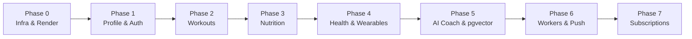

# FitOnus Backend Audit — Recommended Implementation Roadmap

**Document Reference:** `FitOnus/backend/BACKEND_AUDIT/RECOMMENDED_IMPLEMENTATION_ROADMAP.md`  
**Status:** Strategic Implementation Architecture  
**Date:** 2026-11-04  
**Auditor:** Senior Backend Architect  
**Classification:** Confidential Technical Assessment

---

## 1. Roadmap Overview & Guiding Philosophy

The audit confirms that the existing FitOnus backend base kit (`generic-backend`) provides a high-quality foundation (Clean Architecture, Express 5, PostgreSQL transactions, database-backed sessions, and OpenAPI generation).

The recommended implementation strategy is to **preserve and build upon this foundation**, incrementally adding domain modules in accordance with the established Clean Architecture patterns.

---

## 2. Phased Implementation Breakdown

### Phase 0: Infrastructure, Environment & Render Deployment Setup
- **Objective:** Establish the production deployment baseline on Render.
- **Tasks:**
  1. Generate `render.yaml` declaring the Web Service, Render PostgreSQL instance, build commands, and health check paths (`/health/live`, `/health/ready`).
  2. Configure production environment variables in Render (strong `JWT_ACCESS_SECRET`, `HMAC_SECRET`, `DATABASE_SSL=require`).
  3. Wire automated pre-deploy migration execution (`npm run db:migrate`).
  4. Perform initial local `npm ci` and run typecheck/lint verification.

### Phase 1: FitOnus User Profile & Biometric Extensions
- **Objective:** Transform generic users into fitness app profiles.
- **Tasks:**
  1. Create migration `0004_create_user_profiles.sql`:
     - Columns: `height_cm`, `weight_kg`, `target_weight_kg`, `birth_date`, `gender`, `activity_level`, `fitness_goals`, `dietary_preferences`.
  2. Implement `user-profiles` sub-module inside `src/modules/users/`.
  3. Implement onboarding endpoints: `POST /api/v1/users/onboarding` and `GET/PATCH /api/v1/users/profile`.
  4. Add OAuth 2.0 social authentication ports for Google Sign-In and Apple Sign-In.

### Phase 2: Workout & Exercise Subsystem (`src/modules/workouts/`)
- **Objective:** Enable exercise browsing, routine creation, and live workout logging.
- **Tasks:**
  1. Create migration `0005_create_workout_tables.sql`:
     - Tables: `exercises`, `exercise_categories`, `workout_routines`, `workout_logs`, `workout_set_logs`, `personal_records`.
  2. Seed standard exercise library (strength, cardio, bodyweight, flexibility).
  3. Implement Use Cases:
     - `ListExercisesUseCase`, `CreateRoutineUseCase`, `StartWorkoutUseCase`, `LogSetUseCase`, `FinishWorkoutUseCase`.
  4. Implement personal record (PR) calculation and progressive overload indicators.

### Phase 3: Nutrition & Meal Tracking Subsystem (`src/modules/nutrition/`)
- **Objective:** Support daily meal logging, macro calculations, and water tracking.
- **Tasks:**
  1. Create migration `0006_create_nutrition_tables.sql`:
     - Tables: `food_items`, `meal_logs`, `meal_items`, `daily_nutrition_targets`, `water_logs`.
  2. Implement Use Cases:
     - `SearchFoodsUseCase`, `LogMealUseCase`, `GetDailyNutritionSummaryUseCase`, `LogWaterUseCase`.
  3. Integrate third-party barcode nutrition lookup adapter (Open Food Facts API).

### Phase 4: Health Metrics & Wearable Sync (`src/modules/health-metrics/`)
- **Objective:** Ingest health data from Health Connect (Android) and Apple HealthKit (iOS).
- **Tasks:**
  1. Create migration `0007_create_health_metrics_tables.sql`:
     - Tables: `daily_health_summaries` (steps, active calories, resting HR), `sleep_sessions`, `sleep_stages`, `weight_logs`.
  2. Implement batch sync endpoints (`POST /api/v1/health-connect/sync`) with idempotency keys.
  3. Build daily summary rollup calculations and trend analytics.

### Phase 5: AI Coach Engine & Vector Memory (`src/modules/ai/`)
- **Objective:** Deliver conversational, intelligent coaching powered by LLMs and RAG.
- **Tasks:**
  1. Create migration `0008_enable_pgvector_and_create_ai_tables.sql`:
     - Enable `CREATE EXTENSION IF NOT EXISTS vector;`.
     - Tables: `ai_conversations`, `ai_messages`, `ai_memories` (vector embedding column), `wellness_knowledge_base`.
  2. Implement OpenAI / Gemini API adapter with streaming responses.
  3. Create Server-Sent Events (SSE) route in Express 5 for live token streaming.
  4. Implement function calling tools: `create_workout`, `log_meal`, `get_daily_summary`.

### Phase 6: Asynchronous Workers & Push Notifications
- **Objective:** Offload heavy processing from the HTTP server and deliver mobile alerts.
- **Tasks:**
  1. Install `pg-boss` and establish `src/worker.ts` process.
  2. Implement notification dispatcher adapter for Expo Push API / Firebase Cloud Messaging.
  3. Schedule background jobs:
     - Nightly sleep recovery calculations.
     - Scheduled workout and meal reminders.
     - 15-minute idempotent reconciliation sweeps.

### Phase 7: Analytics, Subscriptions & Monetization
- **Objective:** Implement subscription gating and analytics.
- **Tasks:**
  1. Create migration `0009_create_subscription_tables.sql`:
     - Tables: `subscriptions`, `subscription_tiers`, `billing_invoices`.
  2. Implement webhook handlers for RevenueCat / Stripe.
  3. Add subscription tier route guards (`kind: 'subscription'`, tier: `pro`) to protect advanced AI features.

