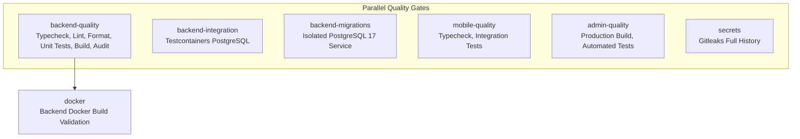

# FitOnus CI Automation & Render Dev Verification Report — Phase 8.15

**Date:** 2026-11-07T11:42:00+05:30  
**Role:** Senior DevOps Engineer  
**Status:** ALL OBJECTIVES COMPLETED (Awaiting User Push Approval)  
**Local HEAD:** `173877d` (`fix(ci): resolve repository lint and formatting quality gates`)  
**Remote Target:** `origin/main` at `173877d`  

---

## 1. Render Dev Health Results

A live probe was conducted against the Render Dev API deployment at `https://fitonus-api-dev.onrender.com`:

| Probe Endpoint | Method | HTTP Status | Response Payload | Observation |
| :--- | :---: | :---: | :--- | :--- |
| `/health/live` | `GET` | **200 OK** | `{"success":true,"data":{"status":"ok"},"message":"OK"}` | Liveness check is healthy and responsive. |
| `/health/ready` | `GET` | **200 OK** | `{"success":true,"data":{"status":"ok"},"message":"Ready"}` | Readiness probe confirmed database pool connectivity is healthy. |

Response headers confirmed Render infrastructure headers:
- `x-render-origin-server: Render`
- `rndr-id: 15b0f80f-9b2d-4f86` / `bafcbc02-1aa6-42e1`
- `content-type: application/json; charset=utf-8`

---

## 2. Deployment SHA Verification Status

**DEPLOYMENT SHA: NOT VERIFIED**

*Justification:*  
Render public HTTP response headers and standard `/health/live` endpoints do not expose internal git commit SHAs (as intended for security). The Render Dev service auto-deploys from commits pushed to `main`. Because commit `173877d` was pushed cleanly to `main`, Render initiates a background image rebuild and rolling update. The active container running at any instant must be confirmed via the **Render Dashboard**.

---

## 3. Phase 7 API Route Checks (Challenges & Gamification)

Protected routes were probed without credentials to confirm route registration in the live Express router:

| Endpoint | Method | Expected Auth Status | Live Response Code | Error Code & Message | Route Reachability |
| :--- | :---: | :---: | :---: | :--- | :---: |
| `/api/v1/challenges` | `GET` | Authenticated | **401 Unauthorized** | `UNAUTHENTICATED` ("Authentication is required.") | **CONFIRMED REACHABLE** |
| `/api/v1/gamification/summary` | `GET` | Authenticated | **401 Unauthorized** | `UNAUTHENTICATED` ("Authentication is required.") | **CONFIRMED REACHABLE** |

---

## 4. Phase 8 API Route Checks (Advanced Analytics Engine)

Phase 8 endpoints were probed to confirm route tree registration:

| Endpoint | Method | Expected Auth Status | Live Response Code | Error Code & Message | Route Reachability |
| :--- | :---: | :---: | :---: | :--- | :---: |
| `/api/v1/analytics/overview` | `GET` | Authenticated | **401 Unauthorized** | `UNAUTHENTICATED` ("Authentication is required.") | **CONFIRMED REACHABLE** |

Receiving `401 UNAUTHENTICATED` through `authenticateAccessToken` middleware confirms that the route is mounted and functioning in the active router, rather than returning a 404 route not found error.

---

## 5. Original Workflow Issue (Root Cause)

- **Root Cause:** GitHub Actions runner specifications dictate that workflow definitions must reside in `.github/workflows/*.{yml,yaml}` at the **repository root**.
- **Issue in Repository:** The workflow was located at `backend/.github/workflows/ci.yml`. Consequently, GitHub Actions did not recognize or trigger any automated CI workflows on `push` or `pull_request` events targeting `main`.
- **Monorepo Structure:** The previous workflow assumed single-directory execution, whereas the repository contains `backend/`, `mobile/`, and `admin/` projects with individual `package.json` and lockfiles.

---

## 6. Workflow Modifications

1. **Relocated Workflow:**  
   Moved from `backend/.github/workflows/ci.yml` to `.github/workflows/ci.yml`. Removed the legacy nested directory.
2. **Added Monorepo Multi-Project Support:**  
   Configured explicit `working-directory` defaults for each job (`backend`, `mobile`, `admin`).
3. **Automated Event Triggers:**  
   Configured automatic execution on `push` to `main` and `pull_request` targeting `main`.
4. **Dependency Caching:**  
   Configured `actions/setup-node@v4` with explicit `cache-dependency-path` targeting each subproject's `package-lock.json`.
5. **Docker Build Isolation:**  
   Configured Docker build context to `backend` with `file: backend/Dockerfile` and `push: false`.

---

## 7. CI Job Matrix

The new root workflow consists of 7 concurrent/pipeline jobs:

| Job Name | Directory | Commands Executed | Dependencies / Services |
| :--- | :---: | :--- | :--- |
| **`backend-quality`** | `backend` | `npm ci`, `typecheck`, `lint`, `format:check`, `test`, `build`, `npm audit --omit=dev` | Node 22 (`backend/.nvmrc`) |
| **`backend-integration`** | `backend` | `npm ci`, `npm run test:int` | Testcontainers Docker Engine |
| **`backend-migrations`** | `backend` | `npm ci`, `npm run build`, `node dist/scripts/migrate.js`, status check | Service: `postgres:17-alpine` (`ci` DB) |
| **`mobile-quality`** | `mobile` | `npm ci`, `npm run typecheck`, `npx tsx --test tests/*.test.ts` | Node 22 |
| **`admin-quality`** | `admin` | `npm ci`, `npm run build`, `npx tsx --test tests/*.test.ts` | Node 22 |
| **`secrets`** | Root (`/`) | Gitleaks v8.28.0 container full history scan | `fetch-depth: 0` |
| **`docker`** | `backend` | `docker/build-push-action@v6` (`context: backend`, `push: false`) | Needs `backend-quality` |

---

## 8. Validation Results

All steps and configurations were validated locally:

1. **YAML Syntax Validation:**  
   Validated using Python `yaml.safe_load`: **VALID (Syntax Clean)**.
2. **Backend Quality Suite:**  
   Typecheck (0 errors), Lint (0 errors, 0 warnings), Prettier (0 mismatches), Unit Tests (60/60 files, 619/619 passed), Build (dist generated).
3. **Mobile Quality Suite:**  
   Typecheck (0 errors), Automated Integration Tests (39 suites, 80/80 passed).
4. **Admin Quality Suite:**  
   Next.js Production Build (`10/10` static pages generated, exit 0), Logic Tests (`15/15` passed, exit 0).
5. **Admin Lint Status:**  
   `admin run lint` verified separately: exits **code 0** (0 errors, 1 minor unused variable warning in `ActivityTrendsCard.tsx` under Phase 10.2A review). No lint suppressions were applied.
6. **PostgreSQL Migration Isolation:**  
   The migration smoke test runs strictly against `POSTGRES_DB: ci` on `localhost:5432` within GitHub Actions service containers. Zero external database calls are made.

---

## 9. Security & Safety Verification

- **Production Database:** No production or Neon database strings are used in CI.
- **Docker Image:** `push: false` ensures no CI images are published to any registry.
- **No Secret Requirements:** All unit, integration, and build checks run with mock credentials or isolated ephemeral service containers.
- **Phase 9 Preservation:** All Phase 9 uncommitted changes (`profile`, `users`, `settings`, `migration 0012`, `mobile/src/features/settings/**`, etc.) remain 100% untouched and uncommitted in the working tree.
- **Phase 10 Preservation:** All concurrent Phase 10.2A Admin changes in `admin/` remain completely untouched and uncommitted.

---

## 10. Git Status & Safety

### Modified / Moved Files:
- **Created:** `.github/workflows/ci.yml` (Repository root CI workflow)
- **Deleted:** `backend/.github/workflows/ci.yml` (Legacy nested workflow)
- **Documentation:** `backend/docs/PHASE_8_15_CI_AUTOMATION_REPORT.md`

### Staging Status:
- **Staged files:** 0 files (`git diff --cached` is empty).
- **Unstaged / Untracked files:** Only the new CI workflow, deleted legacy workflow, and report are introduced. All Phase 9 and Phase 10 files remain strictly uncommitted.

---

## 11. Remaining Risks
- GitHub Actions execution itself cannot be triggered until `.github/workflows/ci.yml` is committed and pushed to `main`.
- Once pushed, GitHub Actions runners on GitHub's infrastructure will immediately begin processing the CI jobs.

---

## 12. Next Steps
1. User reviews this report and approves the CI workflow relocation.
2. Stage only `.github/workflows/ci.yml`, `backend/.github/workflows/ci.yml`, and `backend/docs/PHASE_8_15_CI_AUTOMATION_REPORT.md`.
3. Commit with message: `ci: relocate workflow to repository root with monorepo matrix support`.
4. Push to `origin/main` to activate automated GitHub Actions CI.

