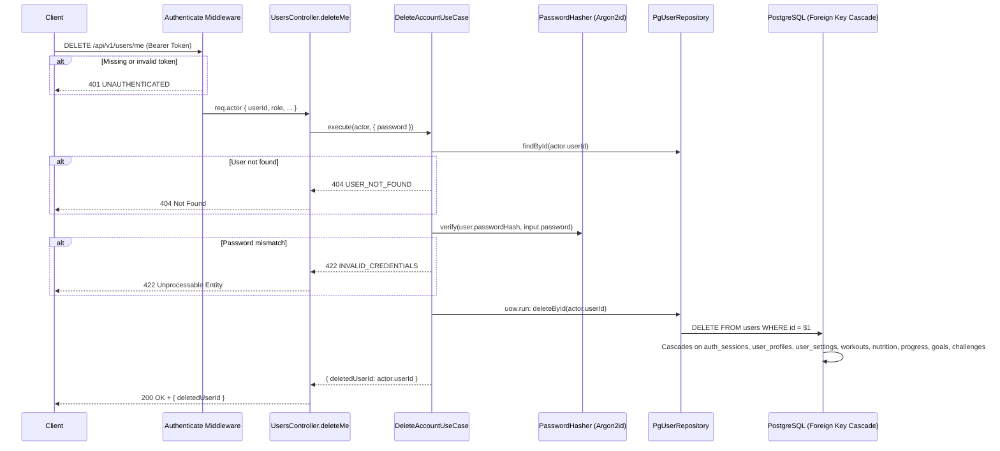

# Phase 9.2: Backend Settings, Preferences & Secure Account Deletion Implementation Report

**Author:** Senior Backend Architect  
**Date:** 2026-11-07  
**Branch:** `main` (HEAD: `f1ea137`)  
**Status:** COMPLETE & VERIFIED (Local Only — Zero Staged / Committed / Pushed Changes)

---

## Executive Summary

Phase 9.2 implements the backend foundation for FitOnus Settings, Preferences, and Secure Self-Service Account Deletion following Clean Architecture and Domain-Driven Design principles.

Key outcomes:
1. **Migration 0012 prepared**: Safe additive schema extension to `user_settings` with non-null defaults and strict check constraints.
2. **Settings API extended**: `GET /api/v1/profile/settings` and `PATCH /api/v1/profile/settings` support `language`, `privacyAnalytics`, `privacyPhotoRetention`, `privacyCoachSharing`, and `notificationSchedule` with strict Zod validation.
3. **Secure Account Deletion implemented**: `DELETE /api/v1/users/me` requires password verification against Argon2id hash, derives `userId` exclusively from the verified JWT actor, and executes an atomic hard delete cascading all user data.
4. **Verification**: 19 new automated tests added (unit & HTTP), full suite regression passed (62 files, 638 tests passing, 0 regressions), and TypeScript build is 100% clean.
5. **Parallel Development Safety**: Zero edits to `backend/src/container.ts`, Phase 8 Analytics files untouched, no migrations applied to Neon, no files staged.

---

## 1. Files Created and Modified

### Created Files
- `backend/migrations/0012_extend_user_settings_and_preferences.sql`: Additive SQL migration extending `user_settings`.
- `backend/src/modules/users/application/use-cases/delete-account.ts`: Clean Architecture use case orchestrating password verification and atomic deletion.
- `backend/tests/unit/users/delete-account-use-case.test.ts`: Isolated domain/use-case tests for account deletion.
- `backend/tests/unit/settings/phase9-settings-http.test.ts`: HTTP API integration tests covering all 13 Phase 9.2 scenarios.
- `backend/docs/PHASE_9_2_IMPLEMENTATION_REPORT.md`: This comprehensive report.

### Modified Files (Scoped Exclusively to Settings and Users)
- `backend/src/modules/profile/domain/user-settings.ts`: Added `Language`, `SUPPORTED_LANGUAGES`, extended `UserSettingsProps`, getters, and defaults.
- `backend/src/modules/profile/application/ports.ts`: Extended `UpdateSettingsParams` with new fields.
- `backend/src/modules/profile/application/profile-view.ts`: Extended `UserSettingsView` and `toSettingsView` mapper.
- `backend/src/modules/profile/infrastructure/pg-settings-repository.ts`: Updated `SELECT_SETTINGS`, mapping, and dynamic SQL generation in `updateSettings`.
- `backend/src/modules/profile/interface/profile.schemas.ts`: Added `SUPPORTED_LANGUAGES` validation, `notificationScheduleSchema`, and updated `updateSettingsRequest`.
- `backend/src/modules/users/application/ports.ts`: Added `deleteById(id: string): Promise<boolean>` to `UserRepository`.
- `backend/src/modules/users/infrastructure/pg-user-repository.ts`: Implemented `deleteById(id: string)` with `DELETE FROM users WHERE id = $1`.
- `backend/src/modules/users/interface/users.schemas.ts`: Added `deleteAccountRequest` (strict password body) and `deletedUserSchema`.
- `backend/src/modules/users/interface/users.controller.ts`: Added `deleteMe` handler invoking `DeleteAccountUseCase`.
- `backend/src/modules/users/interface/users.routes.ts`: Registered authenticated route `DELETE /me`.
- `backend/src/modules/users/index.ts`: Wired `DeleteAccountUseCase` into `createUsersController` using existing `deps.passwordHasher` and `deps.uow` (zero changes needed in `container.ts`).
- `backend/tests/helpers/fakes.ts`: Added `deleteById` to `InMemoryUserRepository` for test isolation.

---

## 2. Database Migration 0012

**File:** `backend/migrations/0012_extend_user_settings_and_preferences.sql`

```sql
-- Migration 0012: Extend User Settings and Preferences
-- Phase 9: Settings & Preferences — language, privacy toggles, and notification schedule

ALTER TABLE user_settings
  ADD COLUMN IF NOT EXISTS language               text    NOT NULL DEFAULT 'en',
  ADD COLUMN IF NOT EXISTS privacy_analytics      boolean NOT NULL DEFAULT true,
  ADD COLUMN IF NOT EXISTS privacy_photo_retention boolean NOT NULL DEFAULT true,
  ADD COLUMN IF NOT EXISTS privacy_coach_sharing  boolean NOT NULL DEFAULT false,
  ADD COLUMN IF NOT EXISTS notification_schedule  jsonb   NOT NULL DEFAULT '{}';

ALTER TABLE user_settings
  DROP CONSTRAINT IF EXISTS user_settings_language_valid;

ALTER TABLE user_settings
  ADD CONSTRAINT user_settings_language_valid
    CHECK (language IN ('en', 'ta'));
```

### Safety & Backward Compatibility Guarantees
1. **Additive Only**: Uses `ADD COLUMN IF NOT EXISTS` with explicit `DEFAULT` values. Zero existing rows are broken, corrupted, or left with null values.
2. **Language Constraint**: Enforces ISO codes `'en'` and `'ta'`. (Note: Tamil UI strings are not yet localized in the mobile client; the preference is safely stored for future localization).
3. **Privacy Defaults**: Follows explicit opt-in privacy ethics:
   - `privacy_analytics`: `true` (standard anonymous telemetry).
   - `privacy_photo_retention`: `true` (standard progress photo storage).
   - `privacy_coach_sharing`: `false` (explicit opt-in required before sharing workout or biometric logs with coaches).
4. **Execution Status**: The migration file is committed locally to `backend/migrations/` but **NOT** executed against Neon Development or Production database instances, adhering strictly to deployment safety guidelines.

---

## 3. Extended Settings API Contract

### Endpoints
- `GET /api/v1/profile/settings`
- `PATCH /api/v1/profile/settings`

### Request Schema (`PATCH /api/v1/profile/settings`)
Clients may update any combination of settings fields. Strict validation rejects unknown/smuggled fields.
```json
{
  "themeMode": "system | light | dark",
  "unitSystem": "metric | imperial",
  "healthConnectEnabled": false,
  "smartwatchConnected": false,
  "notificationsEnabled": true,
  "language": "en | ta",
  "privacyAnalytics": true,
  "privacyPhotoRetention": true,
  "privacyCoachSharing": false,
  "notificationSchedule": {
    "workoutReminders": { "enabled": true, "time": "07:30", "days": [1, 2, 3, 4, 5] },
    "hydrationAlerts": { "enabled": false }
  }
}
```

### Response Envelope (`200 OK`)
```json
{
  "success": true,
  "data": {
    "userId": "11111111-1111-4111-8111-111111111111",
    "themeMode": "system",
    "unitSystem": "metric",
    "healthConnectEnabled": false,
    "smartwatchConnected": false,
    "notificationsEnabled": true,
    "language": "en",
    "privacyAnalytics": true,
    "privacyPhotoRetention": true,
    "privacyCoachSharing": false,
    "notificationSchedule": {},
    "updatedAt": "2026-11-07T08:35:16.000Z"
  },
  "message": "User settings updated"
}
```

---

## 4. Secure Account Deletion Architecture

### Endpoint
- `DELETE /api/v1/users/me`

### Request Schema
```json
{
  "password": "userCurrentPassword"
}
```

### Security Lifecycle


### Security Invariants Enforced
1. **JWT Actor Scoping**: `userId` is obtained strictly from `actor.userId`. Input cannot specify an external target user.
2. **Password Verification**: Mandatory re-authentication using Argon2id.
3. **No Hash Exposure**: Password hashes are never returned or echoed in error payloads.
4. **Transaction Atomicity**: Deletion executes within `uow.run()` to guarantee transaction isolation.

---

## 5. Foreign Key & Storage Cascade Audit

### PostgreSQL Cascades
All foreign key relationships referencing `users(id)` across migrations 0001 through 0011 were audited:
- `auth_sessions`: `ON DELETE CASCADE`
- `user_profiles`: `ON DELETE CASCADE`
- `user_settings`: `ON DELETE CASCADE`
- `workouts`, `workout_logs`, `exercise_logs`: `ON DELETE CASCADE`
- `meal_logs`, `food_items`, `water_logs`, `daily_nutrition_goals`: `ON DELETE CASCADE`
- `weight_logs`, `body_measurements`, `progress_photos`: `ON DELETE CASCADE`
- `goals`, `habits`, `habit_logs`, `goal_checkpoints`: `ON DELETE CASCADE`
- `user_badges`, `challenge_enrollments`, `gamification_profiles`, `points_ledger`: `ON DELETE CASCADE`

A single `DELETE FROM users WHERE id = $1` completely and cleanly eliminates all personal biometrics, credentials, telemetry, and progress data.

### External Storage Audit
A thorough codebase audit confirmed **no external cloud object storage (such as AWS S3, Google Cloud Storage, or Azure Blob Storage)** is currently utilized. All image URIs, progress photo records, and avatars are stored as database URLs/URIs in PostgreSQL. Consequently, there are zero orphaned external storage blobs or orphaned external cloud assets upon database account deletion.

---

## 6. Automated Test Suite Results

### 1. Dedicated Phase 9.2 Test Suites
- `backend/tests/unit/settings/phase9-settings-http.test.ts` (15 tests, PASSED)
  - Scenario 1: `GET /api/v1/profile/settings` returns extended fields with defaults.
  - Scenario 2: `PATCH /api/v1/profile/settings` with `language: "ta"` updates correctly.
  - Scenario 3: `PATCH /api/v1/profile/settings` rejects unsupported language (`fr`) with `400 VALIDATION_FAILED`.
  - Scenario 4: `PATCH /api/v1/profile/settings` updates privacy toggles (`privacyAnalytics`, `privacyPhotoRetention`, `privacyCoachSharing`).
  - Scenario 5: `PATCH /api/v1/profile/settings` updates structured `notificationSchedule`.
  - Scenario 6: `PATCH /api/v1/profile/settings` rejects unknown fields (strict Zod schema).
  - Scenario 7: `PATCH /api/v1/profile/settings` maintains backward compatibility for existing fields.
  - Scenario 8: `DELETE /api/v1/users/me` rejects unauthenticated requests with `401 UNAUTHENTICATED`.
  - Scenario 9: `DELETE /api/v1/users/me` rejects incorrect password with `422 INVALID_CREDENTIALS`.
  - Scenario 10: `DELETE /api/v1/users/me` deletes account with `200` and returns `deletedUserId`.
  - Scenario 11: `DELETE /api/v1/users/me` uses actor context exclusively (cannot delete other users).
  - Scenario 12: `DELETE /api/v1/users/me` handles missing user with `404 USER_NOT_FOUND`.
  - Scenario 13: Domain test verifies explicit opt-in privacy defaults (`privacyCoachSharing: false`).
  - Additional: Rejects missing/empty password and unknown fields on deletion.

- `backend/tests/unit/users/delete-account-use-case.test.ts` (4 tests, PASSED)
  - Atomic deletion with matching password.
  - Password mismatch rejection with `INVALID_CREDENTIALS`.
  - Non-existent user rejection with `USER_NOT_FOUND`.
  - Actor isolation invariant verification.

### 2. Full Backend Regression Run
```text
RUN  v5.0.5 /media/devshan/Study_Drive/Info/Projects/TuneOnus/FitOnus/backend

Test Files  62 passed (62)
     Tests  638 passed (638)
  Duration  5.86s
```
Zero test failures, zero regressions across all modules (Admin, Analytics, Auth, Challenges, Goals, Nutrition, Profile, Progress, Users, Workouts).

### 3. TypeScript Build Verification
```bash
npm --prefix backend run build
# > generic-backend@0.1.0 build
# > tsc -p tsconfig.build.json
# Exited with code 0 (clean compilation)
```

---

## 7. Parallel Development Safety & Git Status

- **`backend/src/container.ts`**: Untouched by Phase 9.2. All existing modifications belong to Phase 8 Analytics.
- **Phase 8 Analytics Files**: Completely untouched (`backend/src/modules/analytics/**`, `backend/tests/unit/analytics/**`).
- **Staging Area**: Completely clean (`git status` shows no staged files).
- **Remote / Neon Status**: No git commits, no git push, and no migrations applied to Neon.

---

## 8. Phase 9.3 Readiness & Recommendation

Phase 9.2 Backend Settings, Preferences & Secure Account Deletion is **100% complete, verified, and ready**.

### Next Step — Phase 9.3: Mobile Settings Core & Unit/Theme Synchronization
- Implement mobile Settings screen UI aligned with Magic Patterns design.
- Wire Zustand settings store with AsyncStorage persistence.
- Implement theme mode toggling (system, light, dark).
- Implement unit system toggling (metric, imperial) and synchronize with profile settings.
- Implement language picker UI (`en` default, `ta` placeholder).
- Wire secure account deletion confirmation dialog with password prompt.

