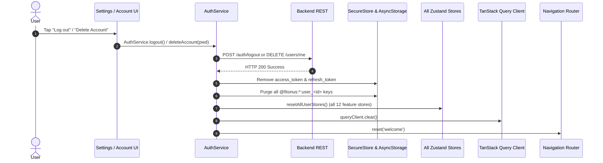

# FitOnus — Phase 9 Settings & Preferences: Architecture & Audit

**Document Version:** 1.0.0  
**Date:** 2026-11-07  
**Status:** ARCHITECTURE & AUDIT (Phase 9.1)  
**Author:** Senior Full-Stack Architect  
**Target Stack:** Expo SDK 58, React Native, Node.js 22, Express 5, TypeScript 5.8, PostgreSQL 16 (Neon), Clean Architecture

---

## 1. Executive Summary

Phase 9 establishes a unified, secure, and production-ready **Settings & Preferences** engine across FitOnus. While earlier phases established foundational screens (`SettingsScreen`, `AppearanceScreen`, `PrivacyScreen`, `AccountScreen`, `PersonalInfoScreen`, `FitnessPreferencesScreen`, `NutritionPreferencesScreen`) and database tables (`user_profiles`, `user_settings`), the existing implementation contains significant architectural fragmentation:
- In-memory Zustand stores without user-scoped persistence.
- Mock API bridges (e.g. `resetPassword` mock).
- A disconnect between backend `POST /api/v1/auth/change-password` and mobile UI navigation.
- Lack of self-service account deletion capabilities (`DELETE /api/v1/users/me`).
- Incomplete cache and store eviction upon logout.
- Static prototype placeholders and hardcoded email/identity strings.
- Hardcoded metric units without centralized conversion helpers across screens.

This document presents the full-stack architecture, API specifications, database design, mobile integration strategy, security model, and an incremental, conflict-free implementation roadmap designed to run cleanly alongside ongoing Phase 8 Analytics development.

---

## 2. Existing Codebase Audit

### 2.1 Mobile Application Audit

| Component / File | Current Implementation Status | Missing / Deficient Elements |
|---|---|---|
| **`mobile/src/features/settings/screens/SettingsScreen.tsx`** | Partially Implemented. Renders General, Health & Data, and Account groups. Has inline `SegmentedControl` for units and a logout dialog. | Hardcoded fallback email (`aarav.mehta@gmail.com`). Units change does not update app-wide formatting. No legal links or About section. |
| **`mobile/src/features/settings/screens/AccountScreen.tsx`** | Partially Implemented. Displays email, "Change password" row, sign-in methods, subscription placeholder, Logout and Delete buttons. | "Change password" navigates to `resetPassword` (unauthenticated forgot-password flow). "Delete account" shows a toast placeholder ("Contact support"). Sign-in methods hardcoded. |
| **`mobile/src/features/settings/screens/AppearanceScreen.tsx`** | Partially Implemented. Lets users choose `light`, `dark`, or `system`. Updates `useSettingsStore` and `ThemeProvider`. | State synchronization is split between `ThemeProvider` and `useSettingsStore`. If backend settings are fetched, visual theme in `ThemeProvider` is not automatically updated. |
| **`mobile/src/features/settings/screens/PrivacyScreen.tsx`** | Partially Implemented. Hero card on AI coach access, 3 toggles (meal photos, analytics, improve coach), navigation to health integration & AI memory. | Toggles are stored in temporary `useState` only (reset on navigation/restart). "Export my data" triggers a dummy `setTimeout` toast. |
| **`mobile/src/features/notifications/screens/NotificationPreferencesScreen.tsx`** | Partially Implemented. Toggle switches for morning brief, workout reminders, meal logging, hydration, and quiet hours with time picker bottom sheet. | Backed by in-memory mock store (`notificationsStore.ts`). Resets on app restart. Master toggle not synced with backend `user_settings.notifications_enabled`. |
| **`mobile/src/features/profile/screens/ProfileScreen.tsx`** | Fully Implemented. Displays avatar, name, email, quick stats (weight, height, workouts), and navigation links to sub-settings and main settings. | Header right settings gear navigates to `settings`. Hardcoded unit labels (`kg`, `cm`) regardless of unit preference. |
| **`mobile/src/features/profile/screens/PersonalInfoScreen.tsx`** | Fully Implemented. Allows editing name, sex, birthday, height, weight. Connected to `useProfile()` and `useUpdateProfile()`. | Fully wired to backend `PATCH /api/v1/profile/me`. |
| **`mobile/src/features/profile/screens/FitnessPreferencesScreen.tsx`** | Fully Implemented. Allows editing goal, experience level, place, workout days, duration, equipment. | Fully wired to backend `PATCH /api/v1/profile/me`. |
| **`mobile/src/features/profile/screens/NutritionPreferencesScreen.tsx`** | Fully Implemented. Allows editing diet type, allergies, cuisines. | Fully wired to backend `PATCH /api/v1/profile/me`. |
| **`mobile/src/shared/stores/settingsStore.ts`** | Incomplete. Pure in-memory Zustand store holding `theme` and `units`. | No user-scoped persistence. No AsyncStorage hydration. Resets on app kill. |
| **`mobile/src/hooks/use-theme.ts` / `ThemeProvider`** | Partially Implemented. Reads `app.theme_mode` from `StorageService`. | Global key (not scoped per user). Does not listen to TanStack Query backend settings changes. |
| **`mobile/src/features/auth/services/auth-service.ts`** | Fully Implemented for login/signup/logout. `resetAllUserStores()` resets 9 feature stores. | Does not reset `useSettingsStore`, `useChallengesStore`, or `useNotificationsStore`. Does not purge user-scoped AsyncStorage keys on logout. |
| **`mobile/src/features/auth/services/authService.ts`** | Incomplete / Mock Bridge. Contains `resetPassword(): Promise<{ ok: true }>` mock. | Missing `changePassword(currentPassword, newPassword)` client API calling `POST /api/v1/auth/change-password`. |

### 2.2 Backend Application Audit

| Module / Route | Current Implementation Status | Missing / Deficient Elements |
|---|---|---|
| **`GET /api/v1/profile/settings`** | Fully Implemented. Returns `user_settings` (`themeMode`, `unitSystem`, `healthConnectEnabled`, `smartwatchConnected`, `notificationsEnabled`). | Missing language preference and privacy flags. |
| **`PATCH /api/v1/profile/settings`** | Fully Implemented. Accepts partial updates for `themeMode`, `unitSystem`, `healthConnectEnabled`, `smartwatchConnected`, `notificationsEnabled`. | Validates via strict Zod schema. |
| **`GET /api/v1/profile/me` & `PATCH /api/v1/profile/me`** | Fully Implemented. Optimistic locking on profile biometrics, targets, and goals. Automatically synchronizes `display_name` on `users` table. | Fully functional and production tested. |
| **`POST /api/v1/auth/change-password`** | Fully Implemented. Requires `currentPassword` + `newPassword`. Verifies Argon2id hash, enforces password policy, updates hash, and revokes all other sessions. | Untapped by Mobile UI. |
| **`POST /api/v1/auth/logout` & `logout-all`** | Fully Implemented. Revokes session in `auth_sessions`. | Fully functional and production tested. |
| **`DELETE /api/v1/users/me`** (Self-Service Account Deletion) | **Missing**. Only admin `POST /api/v1/users/:id/disable` exists. | No endpoint or use-case for authenticated users to self-delete their account with password verification. |
| **`POST /api/v1/users/me/export`** (Data Export) | **Missing**. | No endpoint to bundle and stream user GDPR/fitness data. |

### 2.3 Database Schema Audit

| Table / Migration | Existing Schema | Alignment with Phase 9 Requirements |
|---|---|---|
| **`users`** (`0001_create_users.sql`) | `id`, `email`, `display_name`, `password_hash`, `role`, `status` (`active`/`disabled`), `version`, `created_at`, `updated_at`, `disabled_at`. | `status = 'disabled'` with `disabled_at` supports soft-delete. `id` UUID primary key is referenced by all other tables with `ON DELETE CASCADE`. |
| **`auth_sessions`** (`0002_create_auth_sessions.sql`) | `user_id REFERENCES users(id) ON DELETE CASCADE`. | Automatically wiped on user hard-delete. Supports `revokeAllForUser`. |
| **`user_profiles`** (`0004_create_user_profiles.sql`) | Biometrics, goal, experience, place, schedule, diet, allergies, cuisines. `ON DELETE CASCADE`. | Completely covers fitness and nutrition preferences. |
| **`user_settings`** (`0004_create_user_profiles.sql`) | `theme_mode` (`system`/`light`/`dark`), `unit_system` (`metric`/`imperial`), `health_connect_enabled`, `smartwatch_connected`, `notifications_enabled`. `ON DELETE CASCADE`. | Already provides core settings columns. Lacks `language` and granular privacy/notification JSON fields. |
| **All Other Domain Tables** (0006–0011) | `workouts`, `workout_sessions`, `food_logs`, `measurements`, `goals`, `habits`, `challenges`, `points_ledger`, etc. | **All have foreign keys configured with `ON DELETE CASCADE`**. A single `DELETE FROM users WHERE id = $1` automatically cascades to all domain data cleanly without orphaned rows. |

---

## 3. Feature Gap Analysis & Architectural Decisions

```
┌───────────────────────────────────────┬──────────────────────┬──────────────────────┬───────────────────────────────────────────┐
│ Requirement                           │ Backend Status       │ Mobile Status        │ Architectural Decision                    │
├───────────────────────────────────────┼──────────────────────┼──────────────────────┼───────────────────────────────────────────┤
│ 1. Account Settings View              │ Exists (`/users/me`) │ Partial              │ Replace hardcoded strings with auth store │
│ 2. Edit Profile                       │ Exists (`/profile/me`)│ Complete             │ Retain existing PersonaInfoScreen         │
│ 3. Fitness Goals & Preferences        │ Exists (`/profile/me`)│ Complete             │ Retain Fitness/Nutrition screens          │
│ 4. Measurement Units (kg/lb, cm/ft)   │ Exists (`/settings`) │ Partial (UI only)    │ Create centralized unit conversion helper │
│ 5. Theme Preferences                  │ Exists (`/settings`) │ Partial (Split state)│ Unify useSettingsStore with ThemeProvider │
│ 6. Language Preferences               │ Missing              │ Missing (English)    │ Add Language selector + user-scoped store │
│ 7. Privacy & Security Toggles         │ Missing              │ Partial (useState)   │ Persist to user-scoped AsyncStorage/DB    │
│ 8. Change Password                    │ Exists (`/auth/...`) │ Missing (Mocked)     │ Build ChangePasswordModal + connect API   │
│ 9. Secure Logout & Cache Wipe         │ Exists (`/logout`)   │ Incomplete wipe      │ Update resetAllUserStores + purge cache   │
│ 10. Self-Service Account Deletion     │ Missing              │ Mocked (Toast)       │ Build DELETE /users/me + confirm modal    │
│ 11. Notification Preferences          │ Master switch exists │ Mock store in-memory │ Persist granular schedule in user cache   │
│ 12. App Info & Legal Links            │ N/A                  │ Static text only     │ Add About & Legal section to Settings     │
└───────────────────────────────────────┴──────────────────────┴──────────────────────┴───────────────────────────────────────────┘
```

---

## 4. Full-Stack Architecture Design

### 4.1 Clean Architecture Backend Design

To guarantee parallel development safety with Phase 8 Analytics, all Phase 9 backend extensions are localized inside the existing `users`, `auth`, and `profile` modules. **`backend/src/container.ts` requires zero modifications**.

```
backend/src/modules/
├── users/
│   ├── application/
│   │   ├── ports.ts                         # Add deleteUser(id: string): Promise<boolean>
│   │   └── use-cases/
│   │       ├── delete-account.ts            # NEW: DeleteAccountUseCase (password verification + cascade)
│   │       └── export-user-data.ts          # NEW: ExportUserDataUseCase (GDPR JSON compiler)
│   ├── infrastructure/
│   │   └── pg-user-repository.ts            # Implement deleteUser query
│   └── interface/
│       ├── users.routes.ts                  # Register DELETE /me and POST /me/export
│       ├── users.controller.ts              # Handlers for deleteAccount and exportData
│       └── users.schemas.ts                 # deleteAccountRequest { password: string }
├── profile/
│   ├── domain/profile.ts                    # Add language and preferences types
│   ├── interface/
│   │   ├── profile.routes.ts                # Keep existing GET/PATCH /settings
│   │   └── profile.schemas.ts               # Extend updateSettingsRequest with language
│   └── infrastructure/
│       └── pg-profile-repository.ts         # Query mapping for extended settings
└── auth/
    └── interface/
        └── auth.routes.ts                   # Existing POST /change-password (already wired)
```

### 4.2 Database Changes (Migration 0012)

While the existing `user_settings` table covers `theme_mode` and `unit_system`, adding a language preference and flexible user configuration is cleanest via migration `0012_extend_user_settings_and_preferences.sql`:

```sql
-- Migration: 0012_extend_user_settings_and_preferences.sql
-- Safe additive migration on Neon Development branch only

ALTER TABLE user_settings
  ADD COLUMN IF NOT EXISTS language text NOT NULL DEFAULT 'en',
  ADD COLUMN IF NOT EXISTS privacy_analytics boolean NOT NULL DEFAULT true,
  ADD COLUMN IF NOT EXISTS privacy_photo_retention boolean NOT NULL DEFAULT true,
  ADD COLUMN IF NOT EXISTS privacy_coach_sharing boolean NOT NULL DEFAULT false,
  ADD COLUMN IF NOT EXISTS notification_schedule jsonb NOT NULL DEFAULT '{}';

ALTER TABLE user_settings
  DROP CONSTRAINT IF EXISTS user_settings_language_valid,
  ADD CONSTRAINT user_settings_language_valid CHECK (language IN ('en', 'es', 'fr', 'de', 'hi'));
```

> [!NOTE]
> All additions have safe defaults (`DEFAULT`). Zero disruption to existing rows in `br-fragrant-morning-b35lwkjg`.

### 4.3 Mobile Settings Architecture

```
mobile/src/
├── features/
│   ├── settings/
│   │   ├── screens/
│   │   │   ├── SettingsScreen.tsx            # Enhanced: true email, About & Legal group, language row
│   │   │   ├── AccountScreen.tsx             # Enhanced: Real change password trigger, real delete modal
│   │   │   ├── AppearanceScreen.tsx          # Enhanced: Synced with ThemeProvider and backend
│   │   │   ├── PrivacyScreen.tsx             # Enhanced: Persisted toggles, real export handler
│   │   │   ├── LanguageScreen.tsx            # NEW: Clean language selector (en, es, fr, de, hi)
│   │   │   └── AboutScreen.tsx               # NEW: Version, Build, Terms, Privacy Policy, Licenses
│   │   ├── components/
│   │   │   ├── ChangePasswordModal.tsx       # NEW: Current + new + confirm password fields with strength
│   │   │   ├── DeleteAccountModal.tsx        # NEW: Danger zone password verification + irreversible warning
│   │   │   └── DataExportModal.tsx           # NEW: Summary preview and share sheet download
│   │   ├── services/
│   │   │   └── settings-cache.ts             # NEW: User-scoped AsyncStorage (@fitonus:settings:user_<id>)
│   │   └── types/
│   │       └── settings.ts                   # Extended TypeScript contracts
│   └── profile/
│       └── utils/
│           └── unit-converters.ts            # NEW: Centralized weight (kg/lb) and height (cm/ft/in) formatting
```

---

## 5. API Contracts & Specifications

### 5.1 Account Deletion (`DELETE /api/v1/users/me`)

- **Security:** Authenticated endpoint. Requires user password confirmation to prevent accidental or malicious deletion.
- **Request:**
  ```json
  {
    "password": "UserSecurePassword123!"
  }
  ```
- **Execution Flow:**
  1. Retrieve caller identity from `Actor.userId`.
  2. Verify supplied password against Argon2id hash via `PasswordHasher.verify`. If invalid, return HTTP 422 (`INVALID_CREDENTIALS`).
  3. Execute inside transactional UnitOfWork:
     - Revoke all sessions via `sessions.revokeAllForUser(userId, 'account_deleted')`.
     - Delete record from `users` table via `DELETE FROM users WHERE id = $1`.
  4. PostgreSQL cascade cleanly wipes:
     - `auth_sessions`, `user_profiles`, `user_settings`
     - `workouts`, `workout_sessions`, `exercises` (created_by SET NULL)
     - `food_logs`, `water_logs`, `weight_logs`, `body_measurements`
     - `goals`, `habits`, `habit_logs`
     - `challenge_enrollments`, `gamification_profiles`, `gamification_points_ledger`, `user_badges`
- **Response (HTTP 200):**
  ```json
  {
    "success": true,
    "message": "Account and all associated personal data permanently deleted."
  }
  ```

### 5.2 Change Password (`POST /api/v1/auth/change-password`)

- **Status:** Already deployed and verified on backend.
- **Request:**
  ```json
  {
    "currentPassword": "OldPassword123!",
    "newPassword": "NewSecurePassword456!"
  }
  ```
- **Response (HTTP 200):**
  ```json
  {
    "success": true,
    "message": "Password changed",
    "data": {
      "revokedSessionsCount": 2
    }
  }
  ```

### 5.3 Extended Settings (`PATCH /api/v1/profile/settings`)

- **Request:**
  ```json
  {
    "themeMode": "dark",
    "unitSystem": "imperial",
    "language": "en",
    "privacyAnalytics": true,
    "privacyPhotoRetention": true,
    "privacyCoachSharing": false,
    "notificationsEnabled": true,
    "notificationSchedule": {
      "morningBrief": "07:00",
      "workoutReminder": "18:00",
      "quietHours": { "enabled": true, "start": "23:00", "end": "06:00" }
    }
  }
  ```
- **Response (HTTP 200):**
  ```json
  {
    "success": true,
    "data": {
      "userId": "uuid",
      "themeMode": "dark",
      "unitSystem": "imperial",
      "language": "en",
      "healthConnectEnabled": false,
      "smartwatchConnected": false,
      "notificationsEnabled": true,
      "privacyAnalytics": true,
      "privacyPhotoRetention": true,
      "privacyCoachSharing": false,
      "notificationSchedule": { ... },
      "updatedAt": "2026-11-07T08:00:00.000Z"
    }
  }
  ```

---

## 6. Unit Conversion Infrastructure

To solve the hardcoded "kg" and "cm" labels across mobile screens without regressing database storage (which stays canonically in metric `kg` and `cm`), a pure utility module is established:

```ts
// mobile/src/features/profile/utils/unit-converters.ts

export type UnitSystem = 'metric' | 'imperial';

export const UnitConverters = {
  // Weight: 1 kg = 2.20462 lbs
  kgToLb: (kg: number): number => Math.round(kg * 2.20462 * 10) / 10,
  lbToKg: (lb: number): number => Math.round((lb / 2.20462) * 10) / 10,

  formatWeight: (kg: number | null | undefined, unit: UnitSystem): string => {
    if (kg == null || isNaN(kg) || kg <= 0) return '—';
    if (unit === 'imperial') {
      const lb = UnitConverters.kgToLb(kg);
      return `${lb} lb`;
    }
    return `${kg} kg`;
  },

  // Height: 1 inch = 2.54 cm, 1 ft = 12 inches
  cmToFtIn: (cm: number): { ft: number; in: number } => {
    const totalInches = Math.round(cm / 2.54);
    const ft = Math.floor(totalInches / 12);
    const inches = totalInches % 12;
    return { ft, in: inches };
  },
  ftInToCm: (ft: number, inches: number): number => Math.round((ft * 12 + inches) * 2.54),

  formatHeight: (cm: number | null | undefined, unit: UnitSystem): string => {
    if (cm == null || isNaN(cm) || cm <= 0) return '—';
    if (unit === 'imperial') {
      const { ft, in: inches } = UnitConverters.cmToFtIn(cm);
      return `${ft}′ ${inches}″`;
    }
    return `${Math.round(cm)} cm`;
  },
};
```

---

## 7. Logout & Cache Cleanup Lifecycle

When the user confirms logout or their account is deleted, the app must execute a complete deterministic purge:



### Complete Store Reset List (`resetAllUserStores`):
1. `useAuthStore.getState().clearAuth()`
2. `useNutritionStore.getState().resetStore()`
3. `useWeightStore.getState().resetStore()`
4. `useWorkoutStore.getState().resetStore()`
5. `useProgressStore.getState().resetStore()`
6. `useAdvancedAnalyticsStore.getState().resetStore()`
7. `useGoalsStore.getState().resetStore()`
8. `useProfileSetupStore.getState().reset()`
9. `useHealthStore.getState().resetStore()`
10. `useChallengesStore.getState().resetStore()` **(NEW)**
11. `useNotificationsStore.getState().resetStore()` **(NEW)**
12. `useSettingsStore.getState().reset()` **(NEW)**

---

## 8. Parallel Development Safety (Zero Phase 8 Conflict)

The parallel Antigravity session is actively completing Phase 8 Advanced Analytics. To ensure zero conflicts and zero merge collisions:

1. **`backend/src/container.ts` is FROZEN:**
   - Do NOT edit or stage `backend/src/container.ts`.
   - All backend additions are registered inside `createUsersRoutes()` or `createProfileRoutes()`. Both modules are already wired in `container.ts`.
2. **`backend/src/modules/analytics/**` is PROTECTED:**
   - No modifications to any file under analytics application, domain, or infrastructure.
3. **`mobile/src/features/analytics/**` is PROTECTED:**
   - Do not edit `ProgressScreen.tsx`, `advancedAnalyticsStore.ts`, or analytics API clients.
4. **BottomNav Design is PRESERVED:**
   - No modifications to `BottomNav.tsx`. Settings is accessed strictly via the gear icon in `ProfileScreen.tsx` (`onPress={() => navigate('settings')}`).
5. **No Blind Staging (`git add .`):**
   - Stage files strictly by exact explicit file path.
6. **No Unapproved Commits or Deployments:**
   - All changes remain local until audited and authorized.

---

## 9. Task-by-Task Implementation Roadmap

```
┌────────────────────────────────────────────────────────────────────────┐
│                      PHASE 9 IMPLEMENTATION ROADMAP                    │
│                                                                        │
│  Phase 9.1 — Architecture & Audit (THIS TASK)                          │
│               Comprehensive codebase audit, gap analysis, report       │
│                                                                        │
│  Phase 9.2 — Backend Account Deletion & Settings Persistence           │
│               - Migration 0012: extend user_settings                   │
│               - DeleteAccountUseCase in users module                   │
│               - DELETE /api/v1/users/me with password confirmation     │
│               - Extended PATCH /api/v1/profile/settings schemas        │
│               - Unit and integration tests (target: 100% pass)         │
│                                                                        │
│  Phase 9.3 — Mobile Settings Core & Unit/Theme Synchronization         │
│               - User-scoped settingsStore with AsyncStorage            │
│               - Centralized UnitConverters (kg/lb, cm/ft/in)           │
│               - Synchronize ThemeProvider with backend settings        │
│               - LanguageScreen (en, es, fr, de, hi UI options)         │
│               - SettingsScreen UI updates (remove mock data)           │
│                                                                        │
│  Phase 9.4 — Account Security, Password Change & Deletion Modal        │
│               - ChangePasswordModal wired to POST /auth/change-password│
│               - DeleteAccountModal with password verification          │
│               - Comprehensive logout & account deletion cache wipe     │
│               - PrivacyScreen persistence & Data Export modal          │
│               - AboutScreen with app info, legal links, build version  │
│                                                                        │
│  Phase 9.5 — End-to-End Verification & Documentation                   │
│               - Automated test suites (backend + mobile)               │
│               - Pre-deployment readiness audit                         │
│               - Final Phase 9 verification report                      │
└────────────────────────────────────────────────────────────────────────┘
```

---

## 10. Risks & Open Decisions

| Item | Risk Level | Description | Recommendation / Decision |
|---|---|---|---|
| **Account Deletion: Hard vs Soft Delete** | Low | Hard delete cascades cleanly to all domain tables. Soft delete preserves an anonymized row (`status = 'disabled'`). | **Implement Hard Delete with Session Revocation**. Fits GDPR "Right to Erasure" requirements for fitness apps and utilizes existing PostgreSQL `ON DELETE CASCADE` constraints without orphaned records. |
| **Data Export Format** | Low | Exporting large datasets synchronously could timeout. | **Provide JSON summary export**. Compile profile, workout counts, goal progress, and weight history into a structured client-side export bundle suitable for device sharing/saving. |
| **Language Translation Depth** | Medium | App is currently 100% English. Full multi-language translations across 60+ screens is out of scope for Phase 9. | **Provide Language Selection Architecture**. Allow choosing language preference, save preference to settings, and display "English (Full Support)" alongside informational tags for future translation packs. |
| **Password Change In-Flight Lock** | Low | Double-submitting password change could create race condition. | **Enforce in-flight lockout**. Disable submit button and show loading spinner during password hashing and network round-trip. |

---

## 11. Go / No-Go Recommendation

> [!TIP]
> **Status: ARCHITECTURE & AUDIT COMPLETE — READY FOR APPROVAL**
> The audit confirms that core foundations exist (backend password change endpoint, profile biometrics, basic UI layout), while clearly isolating the necessary additions (self-service account deletion, user-scoped store persistence, centralized unit converters, full logout cache purge, and legal information). All proposed work strictly avoids shared-file conflicts with Phase 8 Analytics.

Awaiting user approval before proceeding to **Phase 9.2: Backend Preferences & Account Management**.

